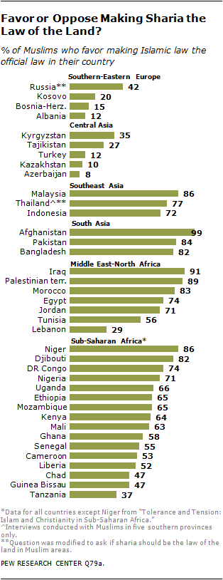

## Core Principles
Strict separation of religion and government in the United States. Religions that do not violate sentient rights are tolerated; those that do are restricted or banned in their harmful aspects. Private conscience and association protected; public institutions remain secular.

---

## Role of Religion in Government

>[!tldr] In short
> Religion stays out of government, and officials cannot turn scripture into law. Historic religious monuments stay, but no new ones go up. Public schools have no prayer; private schools do as they like.

#### Position
Religious doctrine is never involved in a governmental body, and in the United States religion is neither mandated nor involved in government. Elected officials who are religious may be influenced ideologically and philosophically by their faith, but no one is forced to follow their scriptures and religious mandates do not become law. Religious symbols already on public property may remain for historical significance, and historically significant religious structures are not taken down, but new ones are not added. Prayer is excluded from government-run public schools. Private schools may do as they wish on religious practice.

> [!question]- "Does keeping historic religious symbols on public land contradict strict separation?"
> No. Separation forbids the state from imposing religion, not from preserving its own history. A historic monument does not compel belief or practice. Adding new religious symbols would be a fresh act of government endorsement, which is why existing ones stay and new ones are not added.

#### Key Elements
- No religious doctrine or mandates in U.S. government.
- Officials may be personally shaped by faith but cannot impose scripture as law.
- Historic religious symbols and structures on public property kept; no new ones.
- No prayer in government-run public schools.
- Private schools free to practice religion as they wish.

#### Rationale
The First Amendment bars establishment of religion and protects its free exercise. The Supreme Court held in Engel v. Vitale that state-sponsored prayer in public schools violates the Establishment Clause, and in American Legion v. American Humanist Association that a long-standing cross memorial could remain on public land given its history. The position follows both: no state-directed religious practice, and no removal of historic monuments.

>[!quote]- Sources
> - Cornell LII – [First Amendment](https://www.law.cornell.edu/constitution/first_amendment)
> - Supreme Court of the United States – [Engel v. Vitale, 370 U.S. 421 (1962)](https://www.law.cornell.edu/supremecourt/text/370/421)
> - Supreme Court of the United States – [American Legion v. American Humanist Association, 588 U.S. 29 (2019)](https://www.law.cornell.edu/supremecourt/text/17-1717)
> - Supreme Court of the United States – [Kennedy v. Bremerton School District, 597 U.S. 507 (2022)](https://www.law.cornell.edu/supremecourt/text/21-418)

---

## Religious Freedom

>[!tldr] In short
> Religious bodies and private people choose their associations freely, and businesses may decline expressive work on conscience, but no business open to the public may refuse a person for a protected trait. The government acts only when rights are violated or consumers need protection. Religious practices that harm others, such as FGM and honor violence, are banned.

#### Position
Private individuals and religious bodies choose their associations freely, including on religious conscience, and religious bodies choose their own clergy and religious roles. A business may decline to create expressive work that violates its owner's conscience, for any customer. But a business open to the public may not refuse a person because of race, sex, sexual orientation, or another protected trait ([[3. Authority & Civil Liberties#Freedom of Association|Authority & Civil Liberties]]). Government steps in only when sentient rights are violated or to regulate for consumer protection. Religious practices that violate sentient rights, such as female genital mutilation, honor violence, and polygamy where it harms rights, are banned outright.

> [!question]- "Does protecting religious conscience permit discrimination?"
> Not against persons. A business may decline a message or project it objects to, such as a design, whoever asks; it may not turn a customer away for who they are. Religious bodies choose their own members and clergy; their commercial businesses follow the same rule as any business open to the public.

> [!question]- "Can a church hire clergy by its own faith rules even if that excludes by sex?"
> Yes. Religious groups choose their own clergy and religious leaders by their faith, under the ministerial exception the Supreme Court unanimously recognized in Hosanna-Tabor v. EEOC (2012). The exception covers ministers and religious leaders only; ordinary jobs at religious groups, such as janitors and accountants, stay under the equal-treatment rule.

#### Key Elements
- Individuals and religious bodies choose their associations freely; businesses may decline expressive work but may not refuse persons by protected trait.
- Ministerial exception kept: religious groups choose clergy and religious leaders by their faith; ordinary jobs at those groups stay under equal treatment.
- Government intervenes only for sentient-rights violations or consumer protection.
- Religious practices that violate sentient rights banned outright, including FGM, honor violence, and harmful polygamy.

#### Rationale
Religious liberty protects belief and practice, but not practices that harm others. The Supreme Court held in Reynolds v. United States that religious belief does not exempt conduct from general criminal law, and federal law criminalizes female genital mutilation of minors. Masterpiece Cakeshop shows the ongoing conflict between conscience and public-accommodation law; the framework protects refusal of expressive work, as the Supreme Court did in 303 Creative v. Elenis, while barring refusal of persons by protected trait.

>[!quote]- Sources
> - Cornell LII – [First Amendment](https://www.law.cornell.edu/constitution/first_amendment)
> - Supreme Court of the United States – [Reynolds v. United States, 98 U.S. 145 (1878)](https://www.law.cornell.edu/supremecourt/text/98/145)
> - Cornell LII – [18 U.S.C. § 116: Female genital mutilation](https://www.law.cornell.edu/uscode/text/18/116)
> - Supreme Court of the United States – [Masterpiece Cakeshop v. Colorado Civil Rights Commission, 584 U.S. 617 (2018)](https://www.law.cornell.edu/supremecourt/text/16-111)
> - 303 Creative LLC v. Elenis (2023) – [Compelled expression and public accommodations](https://supreme.justia.com/cases/federal/us/600/21-476/)
> - Supreme Court of the United States – [Hosanna-Tabor Evangelical Lutheran Church and School v. EEOC, 565 U.S. 171 (2012)](https://www.law.cornell.edu/supremecourt/text/10-553)
> - Supreme Court of the United States – [Employment Division v. Smith, 494 U.S. 872 (1990)](https://www.law.cornell.edu/supremecourt/text/494/872)

**See also:** [[3. Authority & Civil Liberties#Freedom of Association|Freedom of Association]]

---

## Islam and Extremism

>[!tldr] In short
> Islamism is seen as incompatible with Western society because of its record of rights violations. Migrants from countries where Islamists govern or where most people back state-enforced religious law face a presumption against admission that only strict values vetting can overcome; everyone else is vetted individually. Muslim terror groups that threaten the U.S. are actively destroyed.

#### Position
Islamism is not compatible with Western society. It is an ultra-far-right, ultra-theocratic, medieval ideology whose program of state-enforced religious law commits sentient-rights violations wherever it governs. There is a presumption against admitting migrants from countries where Islamist movements govern or where survey data show majority support for state-enforced religious law, rebuttable only through the strict values vetting in [[8. Foreign Policy & International Relations#Immigration and Borders|Foreign Policy & International Relations]]; migrants from all other countries, including other Muslim-majority countries, go through individual values vetting. Enemies of the United States that grow in number to foment these dangerous and anti-sentientist beliefs, such as Muslim terror groups, are met with proactive eradication.

> [!question]- "Is a presumption against immigration from certain Muslim-majority countries discrimination based on religion?"
> The framework treats immigration as a privilege granted in the national interest, not a right. Admission is limited to those who fit the shared Western value structure, and Islamism is judged incompatible with that structure because of its record of rights violations. The presumption is tied to where Islamism governs or holds majority support, not to religion as such; migrants from other Muslim-majority countries face individual values vetting like everyone else. The Supreme Court upheld presidential authority to restrict entry from several Muslim-majority countries in Trump v. Hawaii under the broad power granted by federal immigration law.

> [!question]- "Doesn't a country-level presumption punish individuals for what others in their country believe?"
> No, because it is not a punishment. Immigration is a privilege, not a right, so declining to admit someone takes nothing they hold and violates no negative right. The presumption governs admission only. It is never used to punish anyone, and it never applies to citizens or to residents already admitted, whose conduct alone counts ([[8. Foreign Policy & International Relations#Removal of Non-Citizen Residents and Loss of Citizenship|Removal of Non-Citizen Residents]]). It is also individually rebuttable. Country-level figures vary widely, from 8% support for sharia as official law in Azerbaijan to 84% in Pakistan and 99% in Afghanistan in Pew's surveys. Even in a high-support country many people do not share the majority view. That is why any applicant can overcome the presumption through strict individual values vetting; it sets where the burden lies, not the outcome.

> [!question]- "Does 'proactive eradication' target ordinary Muslims?"
> No. Eradication is aimed at terror groups and extremist networks that threaten the United States and sentient rights. Compatibility judgments govern admission only and impose no legal penalty for belief on anyone already within the political community ([[2. Political and Social Character#Western Values and Compatibility|Western Values and Compatibility]]).

#### Key Elements
- Islamism judged incompatible with Western society.
- Presumption against immigration from countries where Islamist movements govern or where survey data show majority support for state-enforced religious law, rebuttable through strict values vetting; individual values vetting for everyone else.
- Proactive eradication of Muslim terror groups and anti-Western extremist networks that threaten the U.S. and sentient rights.

#### Rationale
The framework judges ideologies by whether they respect sentient rights, and theocratic Islamism imposes punishments and restrictions that violate them. Survey data show the scale of support for such punishments where Islamism has popular backing. In Pew surveys conducted from 2008 to 2012 and published in 2013, among Muslims who favor sharia as official law, 86% in Egypt and 76% in Pakistan support death for leaving Islam, while support for sharia itself ranges from 8% in Azerbaijan to 99% in Afghanistan. Federal law gives the executive broad authority to suspend the entry of classes of aliens judged detrimental to U.S. interests, which the Supreme Court upheld in Trump v. Hawaii. Groups that organize violence against the United States are treated as enemies to be destroyed, consistent with the terrorism positions in Criminal Justice & Security.

*Chart © 2013 Pew Research Center. Reproduced with attribution under Pew's Terms of Use. Pew Research Center does not endorse the views on this site.*  
Source – [The World's Muslims: Religion, Politics and Society – Beliefs About Sharia (2013)](https://www.pewresearch.org/religion/2013/04/30/the-worlds-muslims-religion-politics-society-beliefs-about-sharia/)

> [!info]- What is Islamism?
> Islamism refers to political movements that seek to organize the state and law around Islamic religious law (sharia). It is distinguished from Islam as a personal faith.

>[!quote]- Sources
> - Supreme Court of the United States – [Trump v. Hawaii, 585 U.S. 667 (2018)](https://www.law.cornell.edu/supremecourt/text/17-965)
> - Cornell LII – [8 U.S.C. § 1182: Inadmissible aliens](https://www.law.cornell.edu/uscode/text/8/1182)
> - Pew Research Center – [The World's Muslims: Religion, Politics and Society – Beliefs About Sharia (2013)](https://www.pewresearch.org/religion/2013/04/30/the-worlds-muslims-religion-politics-society-beliefs-about-sharia/)

**See also:** [[8. Foreign Policy & International Relations#Immigration and Borders|Immigration and Borders]] · [[8. Foreign Policy & International Relations#Removal of Non-Citizen Residents and Loss of Citizenship|Removal of Non-Citizen Residents and Loss of Citizenship]] · [[2. Political and Social Character#Western Values and Compatibility|Western Values and Compatibility]]

---

## Sharia as State Law

>[!tldr] In short
> Islam as a personal faith is protected like any other religion. Sharia enforced as state law is not, because it punishes belief, speech, and consensual private conduct and gives people unequal legal standing by sex and religion. These rules violate negative rights whatever their source.

#### Position
The framework separates Islam as a faith from sharia as coercive state law. A Muslim who follows religious rules in private life, in worship, diet, prayer, or voluntary religious arbitration that civil courts can review, exercises the same religious freedom as anyone else ([[4. Religion & Secularism#Religious Freedom|Religious Freedom]]). The objection is to the state enforcing religious law on people who have not consented or who have harmed no one. Where governments enforce sharia as criminal and family law, the record includes death or prison for leaving Islam or insulting religion, stoning, flogging, and amputation as fixed (hudud) punishments, criminal penalties for consensual same-sex relations, and rules that give women and non-Muslims lesser legal standing. Each of these punishes belief, identity, or speech instead of harm, or uses force against a person who violated no one's rights.

> [!question]- "Isn't this an attack on Islam itself?"
> No. The critique is aimed at laws, not at believers. Within the framework, a Muslim keeps full freedom of worship, speech, and association, and a Christian, Jewish, or secular legal code that did the same things would fail the same test. What fails is any state, under any religion, that punishes apostasy, blasphemy, or consensual private conduct.

> [!question]- "Muslims in many countries support sharia. Isn't overriding them undemocratic?"
> Partly, and the framework says so openly. In Pew's 2013 survey, majorities in many countries favored making sharia official law. But a majority vote cannot authorize violating an individual's negative rights. That limit applies to every majority, including American ones ([[1. Ethical and Philosophical Framework#Political Philosophy|Political Philosophy]]). Pew also found that most supporters of making sharia official law do not believe it should apply to non-Muslims, and views on specific punishments vary widely by country. Treating all supporters as backing the harshest rules would misstate the data.

> [!question]- "Doesn't sharia also protect rights, for example property, contracts, and some inheritance rights for women?"
> Yes, in part. Classical Islamic law has detailed rules on contracts and property, and in some cases women inherit equal or larger shares. The framework does not reject every rule that happens to appear in sharia. Where a rule matches what consenting parties would agree to, or protects person and property, it is acceptable on its own merits. The objection is limited to rules enforced by the state that punish belief or consensual conduct or make legal rights depend on sex or religion.

> [!question]- "Isn't criticizing another culture's legal system Western imperialism?"
> No. The standard is the same negative rights applied to everyone, not Western custom. The UN High Commissioner for Human Rights said Brunei's 2019 Syariah Penal Code would enshrine "cruel and inhuman punishments that seriously breach international human rights law." The framework holds Western governments to the same test, as with its own limits on surveillance, speech restrictions, and religious favoritism.

#### Key Elements
- Islam as a personal faith protected on the same terms as every religion.
- Sharia enforced as state criminal or family law judged incompatible with negative rights.
- Specific rules rejected: apostasy and blasphemy penalties, hudud punishments (stoning, flogging, amputation), criminalization of consensual same-sex relations, and unequal legal standing for women and non-Muslims.
- Voluntary religious practice and arbitration allowed if consensual and subject to civil courts.
- The same test applied to any religious or secular legal code.

#### Rationale
The framework protects persons from force and fraud and does not let the state punish belief, identity, or speech. State-enforced sharia does so in documented ways. A 2022 Pew analysis found that in 2019, 22 countries had laws against apostasy, 13 of them in the Middle East and North Africa, and that 18 of the region's 20 countries criminalized blasphemy. Blasphemy laws also exist in Europe and the Americas, so blasphemy laws are not unique to sharia, but apostasy laws were found only in Africa, the Middle East, and Asia-Pacific. Brunei's 2019 revisions provided death for adultery, sodomy, and insulting the Prophet, public flogging for abortion, and amputation for theft, according to the UN human rights office. ILGA World reports that 65 UN member states criminalize consensual same-sex acts, and that 7 legally prescribe death, with legal uncertainty in 5 more. Many, though not all, of these base the penalty on sharia. In Saudi Arabia, a UNDP review found that sharia inheritance rules apply, under which a daughter in the common case receives half a son's share, while noting cases where women receive more.

Survey data show that support is real but uneven. In Pew's 2013 survey, support for making sharia official law ranged from 8% in Azerbaijan to 99% in Afghanistan. Among those who favored it, 86% in Egypt and 76% in Pakistan supported death for leaving Islam. This is why the framework ties its immigration presumption to where Islamist movements govern or hold majority support, not to Muslims as such ([[4. Religion & Secularism#Islam and Extremism|Islam and Extremism]]).

Each listed rule fails a test the framework applies everywhere. Apostasy and blasphemy laws punish belief and speech, which the framework protects up to true threats and incitement ([[7. Cultural & Social Issues#Free Speech and Censorship|Free Speech and Censorship]]). Hudud punishments impose mutilation for property crimes and death for consensual acts. Same-sex criminalization punishes consensual conduct that harms no one ([[7. Cultural & Social Issues#LGBTQ+ and Identity Issues|LGBTQ+ and Identity Issues]]). Unequal inheritance and testimony rules make legal standing depend on sex or religion rather than on conduct.

>[!quote]- Sources
> - Pew Research Center – [Four-in-ten countries and territories worldwide had blasphemy laws in 2019 (2022)](https://www.pewresearch.org/short-reads/2022/01/25/four-in-ten-countries-and-territories-worldwide-had-blasphemy-laws-in-2019-2/)
> - Pew Research Center – [The World's Muslims: Religion, Politics and Society – Beliefs About Sharia (2013)](https://www.pewresearch.org/religion/2013/04/30/the-worlds-muslims-religion-politics-society-beliefs-about-sharia/)
> - UN News – [Brunei's new penal code would enshrine 'cruel and inhuman punishments' UN rights chief warns (2019)](https://news.un.org/en/story/2019/04/1035831)
> - ILGA World – [Pride Month: new ILGA World data and maps on laws affecting LGBTI people globally (2026)](https://ilga.org/news/pride-month-2026-lgbti-maps-data/)
> - UNDP, UN Women, UNFPA & ESCWA – [Saudi Arabia: Gender Justice & The Law (2019)](https://saudiarabia.un.org/sites/default/files/2020-02/Saudi.Assessment.19.Eng_.pdf)

**See also:** [[4. Religion & Secularism#Islam and Extremism|Islam and Extremism]] · [[4. Religion & Secularism#Role of Religion in Government|Role of Religion in Government]] · [[7. Cultural & Social Issues#Free Speech and Censorship|Free Speech and Censorship]] · [[7. Cultural & Social Issues#LGBTQ+ and Identity Issues|LGBTQ+ and Identity Issues]]

---

## The Islamic Faith in Practice

>[!tldr] In short
> The framework opposes Islamism and is also strongly disaligned with, and skeptical of, the Islamic faith as classically taught and widely practiced. Its mainstream legal tradition gives non-Muslims and women lesser standing and prescribes death for leaving the faith, and surveys show many Muslims still hold these views. The critique targets doctrines, not people. Muslims keep the same rights and religious liberty as everyone else.

#### Position
The framework's opposition to Islamism, the political project of ruling by Islamic law ([[4. Religion & Secularism#Islam and Extremism|Islam and Extremism]]), extends to a broader disagreement with the faith itself. It does not mean only state enforcement ([[4. Religion & Secularism#Sharia as State Law|Sharia as State Law]]). The framework is agnostic atheist and accepts no scripture as moral authority ([[1. Ethical and Philosophical Framework#**Metaphysics**|Metaphysics]]). It judges every religion's teachings by the same test: whether they respect each sentient individual's equal negative rights. Measured that way, several central teachings of mainstream Islam fail. These include texts and classical rulings that rank believers above nonbelievers, give men authority over women, and treat leaving the faith as a capital offense. Surveys show these teachings still shape the views of large shares of Muslims today. The framework holds this disagreement openly, while protecting every Muslim's freedom to believe, worship, and speak, and judging individual Muslims by their own conduct.

> [!question]- "Muslims are diverse, and many reject these teachings. Isn't this unfair to them?"
> Yes, Muslims are diverse, and the framework says so. Pew found that support for making sharia official law ranged from 8% in Azerbaijan to 99% in Afghanistan, and that outside sub-Saharan Africa most Muslims surveyed say a woman should decide for herself whether to wear a veil. Some contemporary scholars argue that the Quran sets no worldly punishment for apostasy, pointing to "There shall be no compulsion in [acceptance of] the religion" (2:256). The framework welcomes these readings. But it judges the tradition by its classical rulings and by what large shares of believers report, not only by its most liberal interpreters. Individual Muslims are judged by their own conduct.

> [!question]- "The Bible has harsh texts too. Why single out Islam?"
> Other scriptures contain harsh texts too, and the framework rejects them on the same grounds, since it accepts no scripture as moral authority. The difference is in present practice, not in the texts alone. Pew found that the 22 countries with apostasy laws in 2019 were all in Africa, the Middle East, and Asia-Pacific. The Library of Congress found eight Muslim-majority states that make apostasy a capital crime. Pew's surveys show that majorities of Muslims in many countries support such rules. The framework applies one standard and reports where it is failed most often today.

> [!question]- "Isn't this bigotry toward Muslims?"
> No. Bigotry is hostility toward people for who they are. This critique is aimed at doctrines, the way the framework also criticizes Christianity, communism, and its own opponents' ideas. It does not call for any legal penalty for being Muslim, believing, or worshipping. Muslims keep full religious liberty, free speech, and equal treatment under the law ([[4. Religion & Secularism#Religious Freedom|Religious Freedom]]). A free society must allow criticism of every religion, including the largest ones.

> [!question]- "Doesn't taqiyya mean Muslims are permitted to lie to non-Muslims?"
> Not in the broad sense often claimed. Taqiyya is the precautionary concealment of one's faith under threat of persecution, based on Quran 3:28 and 16:106. It is stressed mainly by Shia Muslims, who were a persecuted minority. Sunni scholars accept it more narrowly, chiefly under compulsion. Shia jurists allow it more widely, including in relations with other Muslims, and some recognize forms for keeping secrets or easing tensions with non-Shia. The evidence supports a doctrine of concealment under danger, which is a real exception to candor. It does not support a general license for Muslims to deceive non-Muslims, and the framework does not treat any Muslim's word as presumptively false. Trust is judged by individual conduct.

#### Key Elements
- Opposition to Islamism, plus strong disagreement with and skepticism of the Islamic faith as classically taught and widely practiced.
- Teachings rejected: unequal standing of non-Muslims (dhimmi status and jizya), death for apostasy, and legal and domestic inequality of women.
- Survey data used to show how widely these views are held, with variation by country noted.
- Taqiyya described accurately: concealment of faith under threat, mainly Shia, not a general license to deceive.
- Critique of doctrines, not people. Muslims keep full rights and religious liberty, and individuals are judged by their own conduct.

#### Rationale
**Nonbelievers.** The Quran directs believers to "fight against those who do not believe in Allāh... from those who were given the Scripture... until they give the jizyah willingly while they are humbled" (9:29). Classical law turned this into dhimmi status. Jews, Christians, and later others received protection of life, property, and worship in exchange for the jizya tax, and Britannica notes that it was paid "as a mark of their submission." Restrictions on dress, occupation, and residence were often applied, according to *The Oxford Dictionary of Islam*. Historians at the University of Pennsylvania describe the Pact of ʿUmar, part of Islamic law by the ninth century, as laws meant to "emphasize the social superiority of Muslims." Britannica notes that jizya is no longer collected in modern Muslim nation-states. The framework counts that as progress, but the classical rule ranked people by religion.

**Apostasy.** The classical Sunni and Shia schools agreed that a sane adult male who voluntarily renounced Islam should be executed. They differed on details, such as whether he must first be invited to repent and whether female apostates could be executed or only imprisoned. The Library of Congress found in 2014 that Afghanistan, Brunei, Mauritania, Qatar, Saudi Arabia, Sudan, the United Arab Emirates, and Yemen expressly make apostasy a capital offense. Few death sentences have been carried out, and repentance often voids the conviction. Among Muslims who favor making sharia official law, Pew found 86% in Egypt and 76% in Pakistan supported death for those who leave Islam.

**Women.** The Quran states that "men are in charge of women," that "righteous women are devoutly obedient," and that husbands may, as a last step, "strike" wives they fear are defiant (4:34). It gives a son "the share of two females" in inheritance (4:11). For debt contracts it requires "two witnesses from among your men," or "a man and two women" (2:282). It also allows a man up to four wives (4:3), with no equivalent right for women. In Pew's 2013 survey, at least half of Muslims in 20 of 23 countries said a wife must always obey her husband, and about nine in ten or more did so in every South and Southeast Asian country surveyed. Views on divorce and inheritance were more divided.

**Taqiyya.** *The Oxford Dictionary of Islam* defines taqiyya as "precautionary denial of religious belief in the face of potential persecution." The *Encyclopaedia Iranica* adds that Sunni scholars accept the principle but restrict it, while Shia scholars allow it more widely. The framework notes the concern behind the common claim, which is that a doctrine permitting concealment exists. It also reports that the scholarly record does not support reading it as general permission to lie.

The framework's response is the same as for any belief system it rejects. It argues openly, protects the believer, and refuses to let any doctrine, religious or secular, override an individual's negative rights.

>[!quote]- Sources
> - Quran.com (Sahih International) – [Surah At-Tawbah 9:29](https://quran.com/9/29)
> - Quran.com (Sahih International) – [Surah An-Nisa 4:34](https://quran.com/4/34)
> - Quran.com (Sahih International) – [Surah An-Nisa 4:11](https://quran.com/4/11)
> - Quran.com (Sahih International) – [Surah Al-Baqarah 2:282](https://quran.com/2/282)
> - Quran.com (Sahih International) – [Surah An-Nisa 4:3](https://quran.com/4/3)
> - Quran.com (Sahih International) – [Surah Al-Baqarah 2:256](https://quran.com/2/256)
> - Encyclopaedia Britannica – [Jizyah](https://www.britannica.com/topic/jizya)
> - Oxford Reference, *The Oxford Dictionary of Islam* – [Dhimmī](https://www.oxfordreference.com/display/10.1093/oi/authority.20110803095715324)
> - Katz Center for Advanced Judaic Studies, University of Pennsylvania – [What Do You Know? Dhimmi, Jewish Legal Status under Muslim Rule](https://katz.sas.upenn.edu/resources/blog/what-do-you-know-dhimmi-jewish-legal-status-under-muslim-rule)
> - Law Library of Congress (2014) – [Laws Criminalizing Apostasy in Selected Jurisdictions](https://www.loc.gov/item/2014434112/)
> - Rudolph Peters & Gert J. J. De Vries, Die Welt des Islams (1976) – [Apostasy in Islam](https://doi.org/10.1163/157006076x00017)
> - *The Oxford Dictionary of Islam*, Oxford Islamic Studies Online (archived) – [Apostasy](https://web.archive.org/web/20140904042337/www.oxfordislamicstudies.com/article/opr/t125/e174)
> - Pew Research Center – [The World's Muslims: Religion, Politics and Society – Beliefs About Sharia (2013)](https://www.pewresearch.org/religion/2013/04/30/the-worlds-muslims-religion-politics-society-beliefs-about-sharia/)
> - Pew Research Center – [Four-in-ten countries and territories worldwide had blasphemy laws in 2019 (2022)](https://www.pewresearch.org/short-reads/2022/01/25/four-in-ten-countries-and-territories-worldwide-had-blasphemy-laws-in-2019-2/)
> - Pew Research Center – [The World's Muslims: Religion, Politics and Society – Women in Society (2013)](https://www.pewresearch.org/religion/2013/04/30/the-worlds-muslims-religion-politics-society-women-in-society/)
> - Oxford Reference, *The Oxford Dictionary of Islam* – [Taqiyah](https://www.oxfordreference.com/display/10.1093/oi/authority.20110803102117701)
> - Encyclopaedia Iranica – [Taqiya i. In Shiʿism](https://www.iranicaonline.org/articles/taqiya-i-shiism/)

**See also:** [[4. Religion & Secularism#Islam and Extremism|Islam and Extremism]] · [[4. Religion & Secularism#Sharia as State Law|Sharia as State Law]] · [[4. Religion & Secularism#Atheism, Secularism, and Faith|Atheism, Secularism, and Faith]] · [[1. Ethical and Philosophical Framework#**Metaphysics**|Metaphysics]]

---

## Christianity and Western Heritage

>[!tldr] In short
> Western heritage and moderate Christianity are viewed as good, and a Western society shaped by moderate Christianity is seen as culturally better than an anti-Western Islamic one. Scripture is still not taught in public settings, and extremism in any religion is rejected.

#### Position
Western heritage and Christian values are generally positive, though scripture is not mandated to be taught in any public setting. The nation's identity was built on one of God and on the values of religious freedom. Christianity is positive in its moderation and dangerous in its extremism. As a cultural judgment, a Western society shaped by moderate Christianity is absolutely superior to an anti-Western Islamic society.

> [!question]- "Does calling a Christian society superior conflict with government neutrality toward religion?"
> No. The judgment is about which societies best respect sentient rights and liberty, not a policy of state religion. Government stays neutral and does not teach scripture; the comparison expresses a cultural assessment, and extremism within Christianity is rejected on the same terms as any other.

#### Key Elements
- Western heritage and moderate Christian values viewed as positive.
- National identity historically tied to God and religious freedom.
- No mandatory scripture teaching in public settings.
- Extremism in any religion, including Christianity, rejected.
- Western society shaped by moderate Christianity judged culturally superior to anti-Western Islamic society.

#### Rationale
The framework measures cultures by how well they protect individual rights, liberty, and responsibility. The framework credits Western societies shaped by moderate Christianity with developing religious freedom, separation of church and state, and individual rights, which are the values the framework defends. Keeping scripture out of public instruction preserves the separation that made that freedom possible.

>[!quote]- Sources
> - Cornell LII – [First Amendment](https://www.law.cornell.edu/constitution/first_amendment)

---

## Atheism, Secularism, and Faith

>[!tldr] In short
> The government stays neutral toward religions that respect rights. Any part of a religion that violates rights is banned. There are no blasphemy laws.

#### Position
Government is neutral toward religions that are not in battle with sentient rights. If any religion, for any reason, battles against sentient rights, that aspect of the religion is banned. Separation of religion and government is preferred. There are no blasphemy laws.

> [!question]- "Does banning parts of a religion violate religious freedom?"
> Religious freedom covers belief and practice that leave others' rights intact. Only the aspects of a religion that violate sentient rights are banned; the rest of the faith remains free. No belief is protected when it is acted out against another sentient being.

#### Key Elements
- Government neutrality toward religions that respect sentient rights.
- Rights-violating aspects of any religion banned.
- Preference for separation of religion and state.
- No blasphemy laws.

#### Rationale
Neutrality protects every faith equally as long as it does not harm others, and the same sentient-rights test applies to every religion. Blasphemy laws protect beliefs from criticism, which conflicts with the framework's free-speech position. Under Employment Division v. Smith, neutral laws of general applicability may be enforced even when they burden religious practice, which supports banning rights-violating practices.

> [!info]- What is a blasphemy law?
> A blasphemy law punishes speech or acts considered insulting to a religion, its figures, or sacred objects.

>[!quote]- Sources
> - Cornell LII – [First Amendment](https://www.law.cornell.edu/constitution/first_amendment)
> - Supreme Court of the United States – [Employment Division v. Smith, 494 U.S. 872 (1990)](https://www.law.cornell.edu/supremecourt/text/494/872)

---

## Religious Upbringing and Children

>[!tldr] In short
> Parents can raise children in their faith and choose religious schools or homeschooling. Religion is no defense for medical neglect, abuse, forced marriage, or genital mutilation.

#### Position
Parents may raise their children in their faith, teach them its beliefs, and choose religious schooling or homeschooling. Children hold full [[Glossary#Negative rights|negative rights]] from the start, so religious belief gives no license to violate them. Withholding necessary medical care from a child in danger, physical abuse, forced marriage, and genital mutilation are banned regardless of religious motive, as with any other rights-violating practice. The state acts when a child's rights are violated, not because of the content of a family's belief.

> [!question]- "Doesn't this put the state between parents and their faith?"
> No. Belief, worship, and religious teaching are untouched. The state intervenes only at the same point it would for any family: when a child is being harmed.

#### Key Elements
- Parents choose religious teaching and schooling.
- Children hold full negative rights.
- No religious defense for medical neglect, abuse, forced marriage, or FGM.
- State acts on harm, never on belief.

#### Rationale
A review of 172 children who died between 1975 and 1995 after their parents withheld medical care in reliance on religious rituals found that 140 of the deaths were from conditions for which survival with medical care would have exceeded 90%. In *Prince v. Massachusetts* (1944) the Supreme Court held that parents may be free to become martyrs themselves but are not free to make martyrs of their children, upholding child-protection law against a religious claim. The ban on rights-violating religious practices is set out in [[#Atheism, Secularism, and Faith]], and the rights of minors in [[1. Ethical and Philosophical Framework#Minors and Incompetent Adults|Ethical and Philosophical Framework]].

>[!quote]- Sources
> - Seth M. Asser & Rita Swan, *Pediatrics* – [Child Fatalities From Religion-motivated Medical Neglect (1998)](https://childrenshealthcare.org/wp-content/uploads/2010/07/Pediatricsarticle.pdf)
> - Cornell LII – [Prince v. Massachusetts (1944)](https://www.law.cornell.edu/supremecourt/text/321/158)

**See also:** [[1. Ethical and Philosophical Framework#Minors and Incompetent Adults|Minors and Incompetent Adults]]

---

## High-Control Groups

>[!tldr] In short
> Groups are never restricted for what they believe. Force, fraud, coerced labor, and abuse are prosecuted, and members can always leave.

#### Position
Belief is never penalized, and no group is restricted for what it teaches. Restrictions attach only to conduct: confinement, threats, violence, coerced labor, fraud, and the abuse of minors. A religious, political, or other group that commits those acts is prosecuted like any other organization, and its leaders are responsible for violations they direct. Members who wish to leave may do so freely.

> [!question]- "How can a group be stopped without punishing belief?"
> By charging the acts. Holding someone against their will, extracting money by fraud, or forcing labor is a crime whether or not the group calls itself a church.

#### Key Elements
- No penalty for belief or teaching.
- Restrictions only on force, fraud, coercion, and abuse.
- Leaders liable for directed violations.
- Free exit for members.

#### Rationale
Federal law already criminalizes obtaining labor or services by force, threats, serious harm, or abuse of legal process (18 U.S.C. § 1589), without regard to the group's beliefs. The no-penalty-for-belief rule appears in [[6. Criminal Justice & Security#Terrorism and Domestic Extremism|Criminal Justice & Security]].

>[!quote]- Sources
> - Cornell LII – [18 U.S.C. § 1589: Forced labor](https://www.law.cornell.edu/uscode/text/18/1589)

**See also:** [[6. Criminal Justice & Security#Terrorism and Domestic Extremism|Terrorism and Domestic Extremism]]

---

## Ritual Slaughter and Animal Sacrifice

>[!tldr] In short
> Ritual slaughter and animal sacrifice are banned outright for every faith. Stunning rules do not matter because the ban is total.

#### Position
Ritual slaughter is banned outright, along with animal sacrifice. Religion creates no exemption from the rules protecting sentient beings, so no faith may kill animals as part of a ritual. Because the ban is total, rules on stunning or slaughter method are irrelevant to it. The long-term aim remains the end of animal agriculture through lab-grown meat.

> [!question]- "Isn't an outright ban targeting particular faiths?"
> No. The ban applies to every faith alike, and no religion is singled out or exempted. Animals hold rights under the framework, and a religious purpose does not change what is done to the animal.

#### Key Elements
- Ritual slaughter banned outright.
- Animal sacrifice banned.
- No religious exemption from animal protections.
- Stunning and method rules irrelevant to the ban.
- Lab-grown meat as the path away from animal agriculture.

#### Rationale
Federal law now treats ritual slaughter as humane by statute (7 U.S.C. § 1902(b)), a religious carve-out the ban removes. In *Church of the Lukumi Babalu Aye v. City of Hialeah* (1993) the Supreme Court struck down ordinances that singled out animal sacrifice while permitting other killing; a ban that applies to every faith equally is designed to avoid that defect. Animal protections are set out in [[10. Bioethics, Progress, & Technology#Animal Rights and Sentience Technology|Bioethics, Progress, & Technology]].

>[!quote]- Sources
> - Cornell LII – [7 U.S.C. § 1902: Humane methods](https://www.law.cornell.edu/uscode/text/7/1902)
> - Cornell LII – [Church of the Lukumi Babalu Aye v. City of Hialeah (1993)](https://www.law.cornell.edu/supremecourt/text/508/520)

**See also:** [[10. Bioethics, Progress, & Technology#Animal Rights and Sentience Technology|Animal Rights and Sentience Technology]]

---

## Religious Exemptions

>[!tldr] In short
> Religion gives no exemption from basic taxes or military service. Churches pay taxes like everyone else, and paying taxes gives them no extra say in government.

#### Position
There are generally no religious exemptions from the bare minimum of public taxes that everyone pays,. Religious status creates no exemption; general rules such as the zero income-tax bracket apply equally to everyone. Religious exemption from military service does not exist: one is an American first, and religion is secondary. Churches and religious organizations pay taxes like any other institution. Paying taxes gives them no right to influence government or hold power to push doctrine, because church-state separation in law comes before tax collection, and the rule of law and sentient-rights protections hold more strongly over any taxpaying individual, organization, or corporation.

> [!question]- "Would taxing churches give them a claim to political influence?"
> No. Every taxpayer funds the government without gaining the right to direct it. Churches would stand in the same position as any business or institution: paying their share under law while remaining barred by church-state separation from imposing doctrine.

> [!question]- "Doesn't denying a military-service exemption violate conscience?"
> The position holds that one is an American first and religion is secondary, so religious status creates no exemption from duties everyone else bears. The same rule applies to taxes: general rules apply equally to everyone, whatever their faith.

#### Key Elements
- No religious exemptions from basic public taxes.
- No religious exemption from military service.
- Churches and religious organizations taxed like other institutions.
- Tax payment grants no special influence over government.

#### Rationale
Equal treatment under law requires that religious organizations carry the same obligations as others. Churches are currently exempt under federal tax law, and the Supreme Court upheld property-tax exemptions in Walz v. Tax Commission, though exemption is a legislative choice rather than a constitutional requirement. Removing religious exemptions applies one rule to all citizens.

>[!quote]- Sources
> - Cornell LII – [26 U.S.C. § 501: Exemption from tax on corporations, certain trusts, etc.](https://www.law.cornell.edu/uscode/text/26/501)
> - Supreme Court of the United States – [Walz v. Tax Commission of the City of New York, 397 U.S. 664 (1970)](https://www.law.cornell.edu/supremecourt/text/397/664)

---
