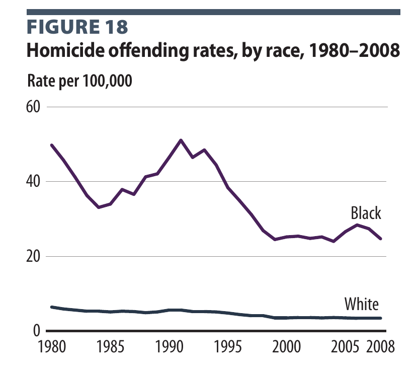

## Core Principles
Retribution, incapacitation, and the protection of victims' sentient rights take priority over rehabilitation. Those who murder or commit violent rape, child molestation, child rape, kidnapping, human trafficking, or the sale or distribution of hard drugs, or who repeatedly violate the rights of others, forfeit the protections they denied their victims. Punishment is swift, certain, and public, and capital punishment applies only where guilt is established beyond any real doubt. Enforcement is heavy, with military-style action against cartels and high-crime threats.

Helping the poor and excusing crime are separate policies. I support the first through the [[5. Domestic Policy & Governance#Welfare and Entitlements|basic-necessities floor]] and reject the second: offenders are not victims of society, poverty does not excuse a crime, and fusing the two insults the poor who never offend. Defending yourself against an attacker is not aggression ([[3. Authority & Civil Liberties#Self-Defense and Defense of Others|Self-Defense and Defense of Others]]). Studies that compare siblings, and experiments that hand out money at random, find that the link between low income and crime largely disappears (data below). Critics point to the study finding that 18-year-olds removed from Supplemental Security Income were charged with more crimes. That shows a floor of support keeps some people from turning to crime, which is what my floor is for; it does not make poverty an excuse for the crimes that are committed.

>[!example]- Data: income and crime
> Findings as reported by the studies' authors; the income–crime correlation is real, the question is whether income causes it.
>- Sweden, 526,167 children born 1989–1993: children in the lowest family-income quintile were about 6.8 times as likely as the highest to be convicted of violent crime, but comparing siblings and cousins reduced the hazard ratio to 0.95 (95% CI 0.44–2.03). Sariaslan et al., British Journal of Psychiatry – [Childhood family income, adolescent violent criminality and substance misuse (2014)](https://pubmed.ncbi.nlm.nih.gov/25147371/)
>- Finland, 650,680 people born 1986–1996: each \$15,000 of family income at age 15 was linked to 23% fewer violent-crime arrests, but the link vanished within siblings (hazard ratios 0.99–1.00). Sariaslan et al., International Journal of Epidemiology – [No causal associations between childhood family income and subsequent psychiatric disorders, substance misuse and violent crime arrests (2021)](https://pubmed.ncbi.nlm.nih.gov/34050646/)
>- Sweden, lottery players: randomly assigned lottery wealth had a small, statistically insignificant effect on winners' own conviction risk, ruling out effects one-fifth the size of the cross-sectional income gradient. Cesarini, Lindqvist, Östling & Schroeder, NBER – [Does Wealth Inhibit Criminal Behavior? Evidence from Swedish Lottery Winners and Their Children (w31962)](https://www.nber.org/papers/w31962)
>- Finland, 2017–2018: 2,000 randomly selected unemployed people received €560 a month unconditionally for two years; crime perpetration and victimization were unchanged relative to 173,222 comparable people under the existing safety net. Aaltonen, Kaila & Nix, NBER – [The Impacts of Guaranteed Basic Income on Crime Perpetration and Victimization (2025)](https://www.nber.org/papers/w34547)
>- United States, 2007–2010: unemployment doubled from 5.0% to 10.0% and the poverty rate reached 15.1%, yet **reported** robberies fell 10.0% in 2010 (FBI UCR). That count is opportunity- and reporting-confounded in a recession; it is supporting color, not the causal weight. The sibling, lottery, and cash-experiment lines above carry that weight. FBI – [Crime in the United States 2010, Robbery](https://ucr.fbi.gov/crime-in-the-u.s/2010/crime-in-the-u.s.-2010/violent-crime/robberymain); Census Bureau – [Income, Poverty and Health Insurance Coverage: 2010](https://www.census.gov/newsroom/releases/archives/income_wealth/cb11-157.html)
>- New Zealand, 1,000 children followed to age 32: low childhood self-control predicted adult criminal convictions independent of intelligence and social class, and children whose self-control improved had better outcomes. Moffitt et al., PNAS – [A gradient of childhood self-control predicts health, wealth, and public safety (2011)](https://pubmed.ncbi.nlm.nih.gov/21262822/)
>- Liberia, 999 high-risk young men: eight weeks of cognitive behavioral therapy and a \$200 cash grant each reduced crime and violence at first, but the effects faded; when cash followed therapy, crime and violence fell sharply for at least a year. Ten years later, men given therapy alone were 0.20 standard deviations less antisocial, and men given therapy plus cash 0.25. Blattman, Jamison & Sheridan, American Economic Review – [Reducing Crime and Violence: Experimental Evidence from Cognitive Behavioral Therapy in Liberia (2017)](https://www.aeaweb.org/articles?id=10.1257/aer.20150503); Blattman, Chaskel, Jamison & Sheridan, AER: Insights – [Cognitive Behavioral Therapy Reduces Crime and Violence over Ten Years (2023)](https://www.aeaweb.org/articles?id=10.1257/aeri.20220427)
>
> Not every study points one way. In the 1930s, cities that spent more on relief saw somewhat less property crime (about 1.5% less per 10% more spending). Johnson, Kantor & Fishback, NBER – [Striking at the Roots of Crime (w12825)](https://www.nber.org/papers/w12825). In the Moving to Opportunity experiment, vouchers to leave high-poverty neighborhoods cut girls' violent and property arrests, while boys' property arrests rose. Kling, Ludwig & Katz, NBER – [Neighborhood Effects on Crime for Female and Male Youth (w10777)](https://www.nber.org/papers/w10777) When a 1996 law led to more 18-year-olds being removed from Supplemental Security Income, those removed faced 20% more criminal charges over the next two decades, with income-generating charges up 60% and the yearly chance of incarceration up 60%. Deshpande & Mueller-Smith, Quarterly Journal of Economics – [Does Welfare Prevent Crime? The Criminal Justice Outcomes of Youth Removed from SSI (2022)](https://doi.org/10.1093/qje/qjac017)

<a class="back-to-top" href="#top">↑ Back to top</a>

---

## Quick Reference: Crimes and Outcomes

>[!tldr] In short
> A one-glance view of the rules set out in the topics below. The topics themselves govern; this table only collects them.

| Offense | Tier | Proof required | Outcome | Who chooses |
|---|---|---|---|---|
| Voluntary murder; attempted murder; knowingly imposing an extreme risk of death | Capital | [[Glossary#Capital evidentiary standard\|Capital evidentiary standard]] | Death (public), or the experimentation track | Victim chooses between execution and experimentation |
| Violent rape, child molestation, child rape, kidnapping, human trafficking | Capital | Capital evidentiary standard | Death (public), or the experimentation track | Victim |
| Selling or distributing hard drugs (not legal marijuana or licensed clinical therapy) | Capital | Capital evidentiary standard | Death (public), or the experimentation track | Judge (no single victim) |
| Cruelty acts (extreme violence, intentional neglect, beating without drawing blood, deliberate withholding of food, water, or shelter) causing lasting injury | Capital | Capital evidentiary standard; lasting injury proven beyond a reasonable doubt by clinician evaluation | Death, or the experimentation track | Victim |
| The same cruelty acts without lasting injury | Grave: three marks at once | Lasting-injury findings below the capital tier by clear and convincing evidence | Execution, experimentation, or life with labor | Victim |
| Terrorism, material support, treason | Attempted-murder rules | Capital evidentiary standard | Death; otherwise secure confinement under compelled labor; never deportation instead | Court |
| Lesser crimes (for example theft) | One or two marks | Ordinary conviction | Fixed-term hard labor with training, term set by the judge | Judge |
| Third mark (repeat-offender threshold) | Threshold | Capital standard for the threshold offense to allow death or experimentation; otherwise life with labor | Execution, experimentation, or life with labor | Victim; a judge when victims disagree, the victim has died, or the victim is an animal |
| Excessive self-defense close to justified | Lesser homicide | Prosecution proves intent | Lighter sentence | Judge |
| Killing without agency (insanity) | Confinement; counts as two marks (threat, not guilt) | Agency decided by a forensic panel and a judge | Confinement with treatment; execution only if no progress | Panel and judge |
| No crime; serious mental illness with danger or lost capacity | Civil commitment | Clear and convincing evidence at a hearing | Outpatient treatment first; review every six months | Court |

^crime-table

<a class="back-to-top" href="#top">↑ Back to top</a>

---

## Evidentiary Standard

>[!tldr] In short
> Nobody is executed unless the proof is overwhelming and backed by objective evidence such as video and physical evidence, not just testimony. Because there is no long appeals process, the trial itself has to get it right.

#### Position
Execution happens only when guilt is absolutely clear, without a shadow of a doubt. Ordinary proof beyond a reasonable doubt is not enough for a capital outcome. The standard requires corroborating objective evidence: body-camera or surveillance footage, multiple eyewitnesses backed by camera footage, physical evidence such as a body, and similar proof that does not depend on a single witness or on inference alone. Cases that fall short of this bar do not go to the capital track.

> [!question]- "Innocent people have been sentenced to death. Doesn't any death penalty guarantee that the state will eventually kill an innocent person?"
> Opponents cite Gross and colleagues (2014), who estimated that at least 4.1 percent of defendants sentenced to death in the United States are likely innocent. That figure indicts capital punishment as it currently operates, and this standard is built to remove its causes. Most known wrongful capital convictions rested on mistaken eyewitness identification, false confessions, unreliable informants, or flawed forensic testimony. Those are exactly the kinds of evidence a corroboration requirement excludes as a sufficient basis. Wrongful execution is treated as a rights violation by the state, with full accountability for those responsible. No human process reaches zero error, and the claim is precise: restricting execution to cases with objective corroboration reduces the error rate far below the current system's.

#### Rationale
A swift system with no long appeals is defensible only if guilt is certain at the front end. The longer the period between sentence and execution, the more the system relies on appeals to catch mistakes. The state ought to remove that period, so the burden moves to the trial itself. The evidentiary bar does the work that decades of appeals were meant to do.

Corroboration matters because the main sources of wrongful conviction are subjective. A recording, a body, and independent witnesses who agree with the recording are much harder to fabricate or misread than a single identification made under stress. The bar is deliberately strict. Its purpose is to make the capital track narrow, reliable, and limited to cases where the facts are not in serious dispute.

> [!info]- What counts as clear-cut evidence?
> Evidence that establishes both the act and the identity of the offender without depending on a single uncorroborated source. Examples include body-camera or surveillance footage of the act, multiple eyewitnesses whose accounts are confirmed by camera footage, and physical evidence such as a body. A confession alone, a single eyewitness, or circumstantial inference alone does not meet the standard.

>[!quote]- Sources
> - Gross, O'Brien, Hu & Kennedy – [Rate of False Conviction of Criminal Defendants Who Are Sentenced to Death](https://doi.org/10.1073/pnas.1306417111) (PNAS, 2014)

<a class="back-to-top" href="#top">↑ Back to top</a>

---

## Statutes of Limitations

>[!tldr] In short
> Murder, violent rape, child molestation, child rape, kidnapping, human trafficking, and selling or distributing hard drugs can be prosecuted no matter how much time has passed, as long as the strict evidence standard is met. Old convictions always count toward the repeat-offender threshold, and restitution and civil claims never expire: restitution is owed until it is paid. Other non-capital crimes have tiered limits of 3, 6, or 20 years: under \$500, \$500 up to \$10,000, and \$10,000 and up.

#### Position
There is no statute of limitations for murder, violent rape, child molestation, child rape, kidnapping, human trafficking, or selling or distributing hard drugs. All people are held liable for their actions, and the passage of time does not restore rights that were forfeited by a deliberate violation. Old convictions count toward the repeat-offender threshold indefinitely; there is no time limit on the look-back. There is no time limit on restitution or civil claims: restitution is owed forever until it is paid. Theft, fraud, and other non-capital crimes have limitation periods that scale with severity and the value involved. Minor offenses (under \$500) may be prosecuted within 3 years, mid-level offenses (\$500 up to \$10,000) within 6 years, and major offenses (\$10,000 and up) within 20 years. The thresholds may be adjusted each year to rise with the national average wage.

> [!question]- "Doesn't evidence degrade over time, risking wrongful convictions in old cases?"
> The protection against that risk is the evidentiary standard, not a deadline. A capital conviction still requires proof to the strict standard in [[#Evidentiary Standard]], however old the case.

#### Rationale
Forfeiture follows from the act, not from how quickly it is prosecuted ([[1. Ethical and Philosophical Framework#General Rules of Forfeiture|Ethical and Philosophical Framework]]). Federal law already sets no limitation period for offenses punishable by death (18 U.S.C. § 3281). For non-capital crimes, the federal default is 5 years (18 U.S.C. § 3282). Norway scales its limitation periods by the maximum sentence, from 2 years for the least serious offenses to 25 years for the most serious, and France sets 20 years for serious crimes and 6 years for mid-level offenses. The dollar thresholds are set below what the typical full-time worker earns in the same time. The full-time median is \$65,052 a year (about \$1,251 a week), so \$500 is under half a week's pay and \$10,000 is about eight weeks. Because I rank retribution and incapacitation above rehabilitation, more serious offenses carry longer periods.

>[!quote]- Sources
> - Cornell LII – [18 U.S.C. § 3281: Capital offenses](https://www.law.cornell.edu/uscode/text/18/3281)
> - Cornell LII – [18 U.S.C. § 3282: Offenses not capital](https://www.law.cornell.edu/uscode/text/18/3282)
> - Lovdata – [Straffeloven § 86](https://lovdata.no/dokument/NL/lov/2005-05-20-28/kap15)
> - Service-Public.fr – [Justice pénale : quels sont les délais de prescription ?](https://www.service-public.gouv.fr/particuliers/vosdroits/F31982)
> - U.S. Bureau of Labor Statistics – [Usual Weekly Earnings of Wage and Salary Workers, Second Quarter 2026](https://www.bls.gov/news.release/wkyeng.nr0.htm)
> - Social Security Administration – [National Average Wage Index](https://www.ssa.gov/oact/cola/AWI.html)

**See also:** [[1. Ethical and Philosophical Framework#General Rules of Forfeiture|General Rules of Forfeiture]]

<a class="back-to-top" href="#top">↑ Back to top</a>

---

## Murder, Rape, and the Mandatory Death Penalty

>[!tldr] In short
> Deliberate murder is punished by death, and so are violent rape, child molestation, child rape, kidnapping, human trafficking, and selling or distributing hard drugs proven to the same strict standard. Attempted murder and knowingly putting others at extreme risk of death are treated the same way, even if no one dies; ordinary accidents are not. Killing or trying to kill a victim or witness is always capital, and most abuse within families, which rarely meets the capital proof standard, is punished on the non-capital tracks. The sentence is fixed for adults, not left to a jury's sympathy, and the offender's mental state does not change it; minors whose crimes are serious enough are sentenced like adults. Offenders pay restitution from their own assets. Current Supreme Court rulings forbid much of this, so the position calls for those rulings to change.

#### Position
The capital offenses, attempted-murder / extreme-risk track, mandatory adult sentence, juvenile reach, restitution from the offender's own assets, and the conflict with current Supreme Court doctrine are in [[#In short|In short]] — not repeated here.

Four cruelty acts are also capital when done to a person if they cause lasting injury: extreme violence; intentional neglect (a chosen pattern of keeping it up); beating without drawing blood; and psychological abuse (withholding food, water, or shelter, not out of neglect but as deliberate punishment). Lasting injury is harm, physical or psychological, that requires ongoing treatment, does not heal within a recovery period measured in months, or leaves permanent damage — including neglect and other acts that leave lasting psychological harm. At the capital tier, lasting injury (including psychological injury) must be proven beyond a reasonable doubt through evaluation by a licensed clinician for humans, or a veterinarian or veterinary behaviorist for animals, documenting harm that requires ongoing treatment, persists for months, or is permanent. Below the capital tier, lasting injury must be proven by clear and convincing evidence, with the same clinician or veterinary evaluation. Without lasting injury, those acts fall in the [[#Abolition of Permanent Incarceration and Compelled Labor|grave tier]]: three [[Glossary#Mark|marks]] at once, reaching the threshold — execution, experimentation, or life with labor, as the victim chooses. Beating means force beyond ordinary discipline: a closed fist, an object, or repeated strikes; a swat on the rear as ordinary discipline is not beating. See [[7. Cultural & Social Issues#Animal Cruelty Law|Animal Cruelty Law]].

The offender's mental competence, intellectual capacity, or understanding of the proceedings does not reduce the sentence, because none of these change what was done to the victim. Incompetence alone does not lead to execution. An offender who was completely unaware and incompetent is removed from society, imprisoned or confined, because they are too dangerous to be around ([[1. Ethical and Philosophical Framework#Free Will and Responsibility|Ethical and Philosophical Framework]]). But some offenders cannot be changed from incompetence and remain a threat: they are violent and show no sign of change. Such a person is a threat to society and is not kept alive merely for the sake of keeping them alive; they deserve to die. The same holds for an animal in confinement that remains a threat. See [[#Insanity Defense]].

Attempted murder stays on the capital track: a deliberate attempt to kill is treated as murder whether or not the victim dies. So is conduct that knowingly imposes an extreme, unjustified risk of death on others, where the person understands the danger and goes ahead anyway with blatant disregard for life and rights — even if no one is harmed. Street racing through traffic at extreme speed is one example. The test is awareness and severity: the person knew the danger and the risk was grave, not merely careless. Ordinary accidents and ordinary negligence stay outside the capital track and are handled as [[#Lesser Homicide|lesser homicide]].

> [!question]- "Hasn't the Supreme Court already ruled that mandatory death sentences, executing the mentally incompetent, and executing for rape are unconstitutional?"
> Yes. Under current doctrine all three are barred. *Woodson v. North Carolina* (1976) struck down mandatory death sentences for murder. *Ford v. Wainwright* (1986) and *Atkins v. Virginia* (2002) bar executing the insane and the intellectually disabled. *Coker v. Georgia* (1977) and *Kennedy v. Louisiana* (2008) bar the death penalty for rape where the victim was not killed. The position here does not pretend otherwise. It is a normative claim about what the law ought to be. Achieving it would require the Court to revisit those holdings or a constitutional amendment. The Eighth Amendment itself does not prohibit capital punishment; *Gregg v. Georgia* (1976) upheld it. The dispute is over which offenses and which offenders qualify, and that line has been drawn by the Court rather than by the text.

> [!question]- "Does forfeiture let the state add suffering beyond the sentence?"
> No. [[Glossary#Rights forfeiture|Forfeiture]] removes the offender's claim against the sentence the law sets: execution, the experimentation track under the rules in [[10. Bioethics, Progress, & Technology#Animal Rights and Sentience Technology|Section 10]], or compelled labor. Within that sentence the forfeiture is complete. On the experimentation track the sentence is the research itself, and the subject's suffering in it is irrelevant: the law sets no limit on it ([[10. Bioethics, Progress, & Technology#^experiment-terms|Section 10]]). They didn't care if their victim suffered, so the law ought not care about their suffering once their rights are forfeited. What forfeiture does not reach is harm outside the lawful sentence. Beatings, deprivation, or cruelty by guards or other inmates that the sentence does not call for remain rights violations against the offender and are punished, because that harm serves no sentence the law set.

> [!question]- "Isn't the death penalty applied with racial bias?"
> The historical record supports the concern. A 1990 review by the Government Accountability Office covered 28 studies. In 82 percent of them, the race of the victim influenced whether a defendant was charged with capital murder or sentenced to death. Those who killed white victims were more likely to face death than those who killed black victims. Legally relevant factors such as prior record and heinousness did not fully explain the gap, and the effect was strongest at the earliest stages, when prosecutors decide whether to seek death and whether to accept a plea. The race of the defendant had a less clear effect. I answer this where the disparity arises. The death sentence is mandatory once the [[Glossary#Capital evidentiary standard|capital evidentiary standard]] is met. So neither the prosecutor nor the jury chooses who among the guilty faces death, and plea bargaining cannot take a capital case off that track. Discretion still remains in investigation and charging, so charging decisions in capital-eligible cases should be audited and published by the race of victim and defendant.

> [!question]- "Won't a death penalty for child rape stop families from reporting abuse, or push offenders to kill the child?"
> The concern is serious. Most sexual abuse of children is committed by someone the child knows: in Bureau of Justice Statistics data, family members were 34 percent of the offenders against juvenile victims, and 42 percent for victims aged 6 to 11. In *Kennedy v. Louisiana* the Supreme Court reasoned that a capital penalty could discourage families from reporting an abuser who is a relative and could remove an offender's incentive to keep the victim alive. That is the Court's reasoning, not a measured finding; no study has measured either effect. I answer the second risk directly: killing or trying to kill a victim or witness is an automatic capital aggravator in every case. I'm also honest about the first. Most abuse inside families leaves no camera footage or independent physical proof, so under the capital evidentiary standard most family cases will be tried on the non-capital tracks, where they are still punished.

#### Rationale
Under the rights-forfeiture principle, an agent who deliberately violates the most basic [[Glossary#Negative rights|negative rights]] of another cannot claim the full protection of those same rights. Murder destroys the victim's subjective experience entirely and permanently. Rape is among the gravest violations of bodily integrity short of death. The response is matched to the severity of the act: proportionality in my framework means the punishment reflects the seriousness of the violation. For the worst violations, that is the most serious punishment available.

The refusal to exempt incompetent offenders follows from where moral weight is placed. I'm concerned with outward rights violations, not with the inner condition of the violator. The victim is equally dead whether the killer understood the proceedings or not. Execution still requires agency: a person who was completely unaware and incompetent did not act as an agent, so they are removed from society, imprisoned or confined rather than executed. Discretionary sentencing introduces inconsistency: two offenders who commit the same act receive different outcomes depending on the jury, the county, and the quality of mitigation evidence. A mandatory rule treats like cases alike. The historical risk with mandatory statutes, noted in Woodson v. North Carolina, was that juries refused to convict to avoid the sentence; the clear-cut evidentiary standard narrows capital cases to those where guilt is not in serious dispute, which reduces that pressure.

Restitution follows the same logic of reciprocity. The offender, not uninvolved taxpayers, bears the cost of the harm. Where an offender is executed or serving a long sentence, restitution is drawn from their own pre-existing bank accounts and assets, and forfeited property and assets go to restitution, victims first. This is not payment for labor; it is the offender's own existing resources.

>[!quote]- Sources
> - Christopher Heath Wellman – [The Rights Forfeiture Theory of Punishment](https://cdn.ymaws.com/www.apaonline.org/resource/resmgr/Prizes_&_Awards/Wellman,_Christopher.pdf)
> - Stanford Encyclopedia of Philosophy – [Retributive Justice](https://plato.stanford.edu/entries/justice-retributive/)
> - Gregg v. Georgia (1976) – [Death penalty upheld under the Eighth Amendment](https://www.oyez.org/cases/1975/74-6257)
> - Woodson v. North Carolina (1976) – [Mandatory death sentences struck down](https://www.law.cornell.edu/supremecourt/text/428/280)
> - Ford v. Wainwright (1986) – [Execution of the insane barred](https://www.law.cornell.edu/supremecourt/text/477/399)
> - Atkins v. Virginia (2002) – [Execution of the intellectually disabled barred](https://www.law.cornell.edu/supremecourt/text/536/304)
> - Kennedy v. Louisiana (2008) – [Death penalty for non-homicide child rape barred](https://www.law.cornell.edu/supct/html/07-343.ZS.html)
> - U.S. Government Accountability Office – [Death Penalty Sentencing: Research Indicates Pattern of Racial Disparities (1990)](https://www.gao.gov/products/ggd-90-57)
> - Bureau of Justice Statistics (Snyder) – [Sexual Assault of Young Children as Reported to Law Enforcement (2000)](https://bjs.ojp.gov/content/pub/pdf/saycrle.pdf)
> - Legal Information Institute – [Eighth Amendment](https://www.law.cornell.edu/constitution/eighth_amendment)

**See also:** [[7. Cultural & Social Issues#Animal Cruelty Law|Animal Cruelty Law]] · [[1. Ethical and Philosophical Framework#Free Will and Responsibility|Free Will and Responsibility]] · [[10. Bioethics, Progress, & Technology#Animal Rights and Sentience Technology|Animal Rights and Sentience Technology]]

<a class="back-to-top" href="#top">↑ Back to top</a>

---

## Lesser Homicide

>[!tldr] In short
> A self-defense killing that went too far but was close to justified is a lesser homicide with a lighter sentence set by the judge. The prosecution must prove intent, and must prove any aggravating factor for a capital charge.

#### Position
A killing in self-defense that was excessive but close to justified is a lesser homicide, with a lighter sentence set by the judge. No duty to retreat and no location limit stay as they are. The prosecution bears the burden of proving intent for the lesser charge, and of proving any aggravating factor that pushes a killing to the capital track, not just the act itself. Self-defense itself is set out in [[3. Authority & Civil Liberties#Self-Defense and Defense of Others|Section 3, Authority & Civil Liberties]].

> [!question]- "Why not treat any killing beyond justified self-defense as murder?"
> A person who was really under attack and went too far did not set out to violate anyone's rights; the aggressor started the encounter. Murder on the capital track requires a deliberate violation. A near-justified killing is still a wrong and is punished, but more lightly, and the prosecution has to prove the intent behind it.

#### Rationale
Current federal law already separates killing with malice from killing without it: manslaughter is the unlawful killing of a human being without malice. The law ought to keep that line for self-defense that went too far, so a near-justified killing is not treated as murder on the capital track. The prosecution carries the burden on intent and on any aggravating factor that would move a killing to the capital track.

>[!quote]- Sources
> - Cornell LII – [18 U.S.C. § 1112: Manslaughter](https://www.law.cornell.edu/uscode/text/18/1112)

**See also:** [[3. Authority & Civil Liberties#Self-Defense and Defense of Others|Self-Defense and Defense of Others]]

<a class="back-to-top" href="#top">↑ Back to top</a>

---

## Domestic Violence

>[!tldr] In short
> Extreme violence, intentional neglect, beating without drawing blood, and withholding food, water, or shelter as punishment against a spouse or family member are capital if they cause lasting injury. Otherwise they fall in the grave tier, so each counts as three marks at once: execution, experimentation, or life with labor. Other domestic violence is aggravated and carries an extra penalty. Capital rules apply as anywhere, and guns are removed only through a red flag court finding.

#### Position
Violence by an aggressor toward their own spouse or family is worse than violence between strangers, because it betrays the people the aggressor is supposed to protect. Murder, attempted murder, violent rape, and kidnapping inside a household are capital as anywhere else, and so are the four cruelty acts, extreme violence, intentional neglect, beating without drawing blood, and withholding food, water, or shelter as deliberate punishment, when they cause [[#Murder, Rape, and the Mandatory Death Penalty|lasting injury]]. Without lasting injury, these acts, and other grave abuse that does serious harm without killing, often driven by anger, fall in the [[#Abolition of Permanent Incarceration and Compelled Labor|grave tier]]: three marks at once, reaching the threshold: execution, experimentation, or life with labor, as the victim chooses. Beating a spouse without drawing blood is capital if it causes lasting injury and otherwise falls in the grave tier. Beating means force beyond ordinary discipline: a closed fist, an object, or repeated strikes; a swat on the rear as ordinary discipline is not beating. These offenders sit below the capital tier of serial killers, murderers, and rapists; their lifelong labor rests on their own forfeiture and is not ownership. Other domestic violence is an aggravated offense, carrying an extra penalty on top of the penalty for the same act against a stranger. Protective orders are issued by a judge on evidence, and firearms are removed only through the red flag rule: a court finding that the person directly imposes a severe, non-consensual risk of serious harm on others ([[7. Cultural & Social Issues#Gun Rights|Gun Rights]]). Domestic violence convictions count toward the repeat-offender threshold.

>[!example]- Documented accounts
> These are individual reported events, not statistics; they illustrate the position and do not measure a trend.
>- France, 19 Dec 2024: a court in Avignon sentenced Dominique Pelicot to the maximum 20 years for aggravated rape after he drugged his then-wife Gisèle Pelicot and invited dozens of strangers to rape her over nearly a decade; all 50 co-defendants were found guilty, with terms of 3 to 15 years. BBC News – [Gisèle Pelicot's ex-husband jailed for 20 years in mass rape trial](https://www.bbc.com/news/articles/c89xde5qzvgo)

> [!question]- "Why punish violence against family more harshly than violence against strangers?"
> The aggressor holds a position of trust and often power over the victim, who may depend on them and cannot easily leave. Abusing that trust is a further betrayal on top of the act itself. The same act gets the same base penalty, and the household setting adds to it.

#### Rationale
In preliminary federal data for fiscal year 2024, domestic violence was recorded as a circumstance in 9% (16,101) of children's entries into foster care.

>[!quote]- Sources
> - ACF Children's Bureau – [The AFCARS Dashboard, FFY 2024](https://acf.gov/sites/default/files/documents/cb/2024-afcars-dashboard-printable.pdf)

**See also:** [[7. Cultural & Social Issues#Gun Rights|Gun Rights]]

<a class="back-to-top" href="#top">↑ Back to top</a>

---

## Human Trafficking

>[!tldr] In short
> Human trafficking of adults or children, and kidnapping, are egregious rights violations and are capital. Consensual adult sex work stays legal; force, fraud, or coercion makes it trafficking.

#### Position
Trafficking a person by force, fraud, or coercion, for labor or for sex, takes a person's body and labor without consent. Human trafficking, adult or child, is an egregious rights violation and is capital, as is kidnapping ([[#Murder, Rape, and the Mandatory Death Penalty]]). The same strict evidentiary standard applies.

>[!example]- Documented accounts
> These are individual reported events, not statistics; they illustrate the position and do not measure a trend.
>- Kansas, 7 Aug 2025: a federal judge sentenced six former members of a group to between five years' probation and 10 years in prison for a years-long conspiracy to compel the labor of children; a jury had convicted all six of forced labor conspiracy in September 2024 after a 26-day trial. U.S. Department of Justice – [Six Former Cult Members Sentenced for Years-Long Forced Labor Conspiracy to Compel the Labor of Multiple Minor Victims](https://www.justice.gov/opa/pr/six-former-cult-members-sentenced-years-long-forced-labor-conspiracy-compel-labor-multiple)

> [!question]- "Doesn't legal prostitution make trafficking easier?"
> Legal, regulated prostitution among consenting adults is separate from trafficking ([[7. Cultural & Social Issues#Drugs and Vice|Drugs and Vice]]). Consent is the line: once force, fraud, or coercion enters, it is trafficking, and the regulated trade is where that line can be enforced in the open. Cross-country data do link legalization to larger reported trafficking inflows; my answer, strict licensing, verification of every worker, and capital penalties for trafficking, is set out in [[7. Cultural & Social Issues#Drugs and Vice|Drugs and Vice]].

#### Rationale
Federal law already makes sex trafficking by force, fraud, or coercion, and sex trafficking of any child, a federal crime. In preliminary federal child-welfare data for fiscal year 2024, sex trafficking was recorded as a circumstance in 570 entries into foster care.

>[!quote]- Sources
> - Cornell LII – [18 U.S.C. § 1591: Sex trafficking of children or by force, fraud, or coercion](https://www.law.cornell.edu/uscode/text/18/1591)
> - ACF Children's Bureau – [The AFCARS Dashboard, FFY 2024](https://acf.gov/sites/default/files/documents/cb/2024-afcars-dashboard-printable.pdf)

**See also:** [[7. Cultural & Social Issues#Drugs and Vice|Drugs and Vice]]

<a class="back-to-top" href="#top">↑ Back to top</a>

---

## Age of Consent

>[!tldr] In short
> The age of consent is 18, except under the close-in-age exception below, and a minor cannot consent to sex with an adult. Young people close in age are exempt: up to two years apart if the younger is under 16, and up to four years if the younger is 16 or 17 and the older is no more than 19. No one 20 or older is ever covered. Violent rape, child molestation, and child rape proven to the strict standard are punished by death; statutory rape based on age alone, with no force or violence, is a serious non-capital crime.

#### Position
The age of consent is 18, except under the close-in-age exception below. A minor cannot consent to sex with an adult, and sex with a person who cannot consent is rape. Minors cannot marry. A close-in-age exception applies only in two cases: when both parties are minors, or when the older party is 18 or 19 and the younger party is 16 or 17. The gap may be no more than two years when the younger party is under 16, and no more than four years when the younger party is 16 or 17. The exception never covers anyone 20 or older. Violent rape, child molestation, and child rape are capital: where established under the capital evidentiary standard, they are punished by death, as set out in [[#Murder, Rape, and the Mandatory Death Penalty]]. Statutory rape, meaning sex with a minor based on age alone with no force or violence, is not capital. It is still a crime and still wrong, and it goes through the regular criminal justice system with a serious non-capital sentence.

> [!question]- "Should a teenage couple close in age be treated the same as an adult preying on a child?"
> No. When both parties are minors, or the older party is 18 or 19 and the younger is 16 or 17, and they are within the allowed gap (two years if the younger is under 16, four years if the younger is 16 or 17), the close-in-age exception applies. The exception never covers anyone 20 or older.

> [!question]- "Why 18 rather than 16?"
> Eighteen is the line for adulthood throughout my framework: minors cannot consent to irreversible decisions about their bodies and cannot marry. A single line avoids a patchwork of ages, and the close-in-age exception covers peers so teenagers are not treated as predators.

#### Rationale
Consent is what separates a lawful act from a rights violation, and I already hold that minors cannot enter certain binding agreements: they cannot marry ([[7. Cultural & Social Issues#Marriage Law|Cultural & Social Issues]]) and are excluded from assisted death. The same principle applies to animals, which cannot consent to sexual activity ([[7. Cultural & Social Issues#Animal Cruelty Law|Animal Cruelty Law]]). Federal law currently criminalizes sexual acts with minors aged 12 to 15 by a person at least four years older (18 U.S.C. § 2243). State ages of consent range from 16 to 18.

Research on teen sexual partners finds that harm clusters at age gaps of about five to six years or more and grows stronger the younger the teen. Girls under 18 with partners six or more years older had pregnancy rates 3.7 times higher than girls with partners within two years. No study identifies a single optimal gap. The sliding scale here, tighter for younger teens, is my own line drawn from that gradient, not a directly measured threshold. Most U.S. states with a close-in-age exception use a gap of two to four years, with four years the most common.

>[!quote]- Sources
> - Cornell LII – [18 U.S.C. § 2243: Sexual abuse of a minor or ward](https://www.law.cornell.edu/uscode/text/18/2243)
> - Darroch et al., Guttmacher Institute – [Age Differences Between Sexual Partners in the United States](https://www.guttmacher.org/journals/psrh/1999/07/age-differences-between-sexual-partners-united-states)
> - Manlove et al., Guttmacher Institute – [Young Teenagers and Older Sexual Partners: Correlates and Consequences for Males and Females](https://www.guttmacher.org/journals/psrh/2006/young-teenagers-and-older-sexual-partners-correlates-and-consequences-males)
> - Ryan et al., Guttmacher Institute – [Older Sexual Partners During Adolescence: Links to Reproductive Health Outcomes in Young Adulthood](https://www.guttmacher.org/journals/psrh/2008/older-sexual-partners-during-adolescence-links-reproductive-health-outcomes)
> - HHS ASPE – [Statutory Rape: A Guide to State Laws and Reporting Requirements](https://aspe.hhs.gov/reports/statutory-rape-guide-state-laws-reporting-requirements-1)
> - LawAtlas – [State Statutory Rape Laws dataset](https://lawatlas.org/datasets/state-statutory-rape-laws)

**See also:** [[7. Cultural & Social Issues#Marriage Law|Marriage Law]] · [[7. Cultural & Social Issues#Animal Cruelty Law|Animal Cruelty Law]]

<a class="back-to-top" href="#top">↑ Back to top</a>

---

## Incest

>[!tldr] In short
> All sexual contact between blood relatives, of any degree, is banned, including between consenting adults, as a precaution against reproduction. Between consenting adults it is a [[Glossary#Felony and misdemeanor|misdemeanor]] punished by an income-scaled fine plus labor for both partners; a third offense is one mark. I don't necessarily think incest is unethical in itself, but a child conceived even by accident would have to be carried to term, and I worry that legalizing it would lead to more children born to blood relatives, with serious genetic risk. Sex between a parent, step-parent, or similar guardian figure and their adult child is not valid consent. Blood relatives may not marry. Incest involving a minor is criminal under the rules already set out for child molestation, child rape, and statutory rape.

#### Position
All sexual contact between blood relatives, of any degree, is banned, including between consenting adults, as a precaution against reproduction. I don't necessarily think incest is unethical in itself. But even accidental reproduction, though criminal, would have to be carried to term, because I am anti-abortion and a consensual pregnancy cannot be ended ([[7. Cultural & Social Issues#Abortion and Bioethics|Abortion and Bioethics]]). I worry that legalizing it would lead to more children born to blood relatives, with serious genetic risk, which would be harmful to those children and to society. Step family is not under the blood-relative ban.

- **Offense:** Consensual sexual contact between adult blood relatives is an offense meant to deter, not a [[Glossary#Mark|mark]]. It is a [[Glossary#Felony and misdemeanor|misdemeanor]] punished by a fine plus labor, with the fine [[#Income-Scaled Fines|scaled to income]] so that it deters, and both partners are sentenced. A third offense becomes one [[Glossary#Mark|mark]].
- **Scope:** The ban covers all sexual contact, not just intercourse, and every pair of blood relatives, including same-sex pairs and pairs who are infertile or past childbearing age. It is a blanket rule for consistency, not tailored to each couple's chance of conceiving.
- **Children:** A child born to blood relatives has full rights, and both parents owe the normal support duties.

- **Parental figures:** Sex between a parent, step-parent, or similar guardian figure and their adult child is not valid consent. A relationship that began with one person raising the other carries an added layer of lifetime grooming, or developmental romance, that turning 18 does not erase. A step-parent who joined the family after the child was already an adult is not a parental figure. Sex without valid consent is rape, so these cases fall under the rape rules, and where a parent and adult child are also blood relatives, the rape rule governs rather than the incest fine. Sex the adult child entered willingly, without force or violence, is two marks, the same as statutory rape; forced cases follow the violent-rape track in [[#Murder, Rape, and the Mandatory Death Penalty]]. This applies equally to a step-parent who raised the child. A pregnancy from parental-figure sex the adult child entered willingly does not qualify for the rape exception to the abortion rules ([[7. Cultural & Social Issues#Abortion and Bioethics|Abortion and Bioethics]]), since the act was willing even though the law does not count it as valid consent; a pregnancy from forced parental-figure rape keeps the exception.
- **Minors:** Incest involving a minor is criminal. A minor cannot consent to sex with an adult ([[#Age of Consent]]), so a relative who has sex with a minor is punished under the existing rules: violent rape, child molestation, and child rape proven to the capital evidentiary standard are capital, and statutory rape based on age alone, with no force or violence, is a two-[[Glossary#Mark|mark]] crime. The close-in-age exception applies between relatives the same as between anyone else. A minor's pregnancy from sex with a relative keeps the abortion rape exception, since a minor cannot consent.
- **Marriage:** Blood relatives may not marry. Step relatives other than parental figures may ([[7. Cultural & Social Issues#Marriage Law|Marriage Law]]).

Sex without valid consent between relatives is rape, as it is between anyone else.

> [!question]- "What about the risk to children?"
> The risk is real and large for the closest relatives. In four studies of 213 children of first-degree unions (parent and child, or brother and sister) compiled in the National Society of Genetic Counselors' 2002 review, 46% were normal; 11.7% had known recessive disorders, 16% congenital malformations or sudden infant death, 11.7% severe and 14.6% mild intellectual impairment. Those studies have serious ascertainment biases, such as young maternal age, parental disability, and uncertain paternity. In a Canadian study of 21 children identified from a history of incest, 9 (43%) had severe abnormalities. The risk falls sharply with distance: for first cousins the review put the added risk of a significant birth defect at 1.7 to 2.8 percentage points above the general population's.

> [!question]- "What about power dynamics and grooming?"
> Sex between a parent, step-parent, or similar guardian figure and their adult child is not valid consent, as set out above. Beyond that, consent obtained by force, threat, or from someone unable to consent is not valid consent, and sex with a minor is criminal regardless. Some laws go further for family authority figures: Ohio, for example, makes sex by a parent, stepparent, guardian, or person in loco parentis a crime of sexual battery regardless of age, while not otherwise criminalizing adult incest. In Stübing v. Germany, the German courts found that the defendant's sister, who was 16 when the relationship began and seven years younger, was "considerably dependent" on him, and the German government argued the incest law protected weaker partners from structural imbalance in families.

> [!question]- "Where is adult incest legal?"
> In the United States, New Jersey does not criminalize incest between people 18 or older, and Rhode Island between people 16 or older; both still bar incestuous marriage. New Jersey repealed its incest crime in 1978, and a 2024 bill (A4524) would recreate it. Ohio prohibits incest only in parent-child type relationships. Most other states criminalize it, with penalties such as up to 5 years in Florida and up to 10 in Pennsylvania. In Europe, according to the comparative survey in Stübing v. Germany, consensual sex between adult siblings is not a crime in France, the Netherlands, Spain, Portugal, Belgium, Luxembourg, Russia, Turkey, and others, while Germany, the United Kingdom, Italy, Sweden, Switzerland, Denmark, and others criminalize it; all the systems surveyed bar siblings from marrying. In 2012 the European Court of Human Rights unanimously held that Germany's conviction of a man for consensual incest with his sister did not violate his right to private life, citing the lack of consensus among member states and a wide margin of appreciation.

#### Rationale
The ban is a precaution, not a judgment that incest is wrong in itself. Because a pregnancy from consensual sex cannot be ended, any child conceived between consenting blood relatives, even by accident, would be born, and the genetic risk to that child is high for the closest relatives (see the risk figures above). Banning the sexual relationship prevents those conceptions rather than leaving them to chance. The rule is blanket, covering all sexual contact and every pair of blood relatives, including same-sex and infertile pairs, for consistency: a single clear line is easier to know and enforce than case-by-case judgments about fertility. Because the aim is deterrence, not punishment of a rights violation, the offense is a misdemeanor punished by an income-scaled fine plus labor, becoming a mark only on a third offense. My worry that legalization would lead to more children born to blood relatives is a concern, not a measured finding; I found no reliable data on births to related parents in places where adult incest is legal. A parental figure's lifelong influence over a child voids consent in adulthood, and abuse of a child is among the most serious crimes in my framework.

The opposing case is serious. In Stübing v. Germany, the German Federal Constitutional Court's dissenting judge called eugenic aims an invalid objective for criminal law, and the applicant argued that people at higher genetic risk, such as known carriers, are not forbidden to have children. The Court's majority, and then the European Court of Human Rights, upheld Germany's ban as protecting the family, the weaker partner, and public health; the German government itself said genetic risk alone would not justify the ban but could support it.

>[!quote]- Sources
> - Bennett et al., Journal of Genetic Counseling – [Genetic Counseling and Screening of Consanguineous Couples and Their Offspring: Recommendations of the National Society of Genetic Counselors (2002)](https://doi.org/10.1023/a:1014593404915)
> - University of Washington – [First cousins face lower risk of having children with genetic conditions than is widely perceived (2002)](https://www.washington.edu/news/2002/04/03/first-cousins-face-lower-risk-of-having-children-with-genetic-conditions-than-is-widely-perceived/)
> - Seemanová, Human Heredity – [A Study of Children of Incestuous Matings (1971)](https://doi.org/10.1159/000152391)
> - Baird and McGillivray, The Journal of Pediatrics – [Children of incest (1982)](https://www.jpeds.com/article/S0022-3476(82)80347-8/abstract)
> - European Court of Human Rights – [Stübing v. Germany, no. 43547/08 (2012)](https://hudoc.echr.coe.int/app/conversion/pdf/?TID=hhtwxvrdyv&filename=001-110314.pdf&id=001-110314&library=ECHR)
> - New Jersey Legislature – [A4524: Creates crime of incest (2024)](https://pub.njleg.gov/Bills/2024/A5000/4524_I1.HTM)
> - Ohio Revised Code – [Section 2907.03: Sexual battery](https://codes.ohio.gov/ohio-revised-code/section-2907.03)
> - Rhode Island General Laws – [§ 15-1-2: Marrying kindred forbidden](https://webserver.rilegislature.gov/Statutes/TITLE15/15-1/15-1-2.htm)
> - Justia – [Incest Laws](https://www.justia.com/criminal/offenses/sex-crimes/incest-laws/)

**See also:** [[#Age of Consent|Age of Consent]] · [[7. Cultural & Social Issues#Marriage Law|Marriage Law]]

<a class="back-to-top" href="#top">↑ Back to top</a>

---

## Gun Crime and Violence

>[!tldr] In short
> Hot-spot, harsh crackdowns in gang and high-crime areas; incapacitate high-rate violent offenders under full due process outside a declared emergency. Riots and blockades shut down immediately. El Salvador-model sweeps only inside a declared, time-limited emergency (riots / grave national danger / completely rampant local crime), with on-scene charging, trial, and sentencing. Law enforcement exists only to protect victims of rights violations.

#### Position
High-crime and gang areas receive intensive policing with swift and brutal crackdowns. Incarceration targets the incapacitation of high-rate violent offenders and gang members, with hot-spot policing concentrated where violence clusters, all under full due process, with individual charges, counsel, and trial, outside a declared emergency. Riots, road blockades, and takeovers are swiftly and brutally shut down. Zero tolerance applies to criminals. The only focus of law enforcement is protecting the victims of perpetrators who violate sentient rights.

El Salvador-model sweeps are justified in a declared emergency over riots and political violence like the 2020 riots or major movements taking over the streets; grave danger to the nation; or areas with extraordinary, completely rampant crime, such as neighborhoods and parts of the country whose violent-crime rates are many times the national rate. Each such emergency is declared, time-limited, and lapses unless the legislature renews it ([[3. Authority & Civil Liberties#^emergency-capital|Emergency Powers]]). In those conditions, charging, trial, and sentencing move to the law enforcement officers or military handling the emergency. Outside those conditions, the rules above stay.

>[!example]- Data: El Salvador homicide collapse
> El Salvador's **official** homicide rate fell from a mid-2010s peak on the order of 100+ per 100,000 to roughly 2 per 100,000 (about 1.9 in 2024 on the government's series) after Bukele's gang crackdown—an extraordinary drop. That series is not a full body count: it has excluded gang members killed in confrontations in some accounting, and human-rights monitors documented more than 260 deaths in custody from 2022 to mid-2024; disappeared persons and classification fights remain. Due-process costs are separate from the rate. AP – [El Salvador homicides, gangs, Bukele (2024)](https://apnews.com/article/el-salvador-homicides-gangs-bukele-69384a8705267eaddd18dcd28a53465b) · Cristosal – [El silencio no es opción (2024)](https://cristosal.org/wp-content/uploads/2024/07/El-silencio-no-es-opcion.pdf)
> I cite the **direction and scale** as evidence that concentrated force against territorial gangs can collapse murder rates. Counting and custody caveats do not reverse that direction. I do not treat every tactic as a template for peacetime U.S. due process; my El Salvador-model sweeps stay inside a declared, time-limited emergency ([[3. Authority & Civil Liberties#^emergency-capital|Emergency Powers]]).

> [!question]- "Does mass incarceration fit with abolishing permanent incarceration?"
> Incarceration here means removing high-rate violent offenders and gang members from the streets, not idle life sentences. Broad, El Salvador-model sweeps are reserved for a declared emergency over riots and political violence like the 2020 riots or major movements taking over the streets; grave danger to the nation; or areas with extraordinary, completely rampant crime, such as neighborhoods and parts of the country whose violent-crime rates are many times the national rate. Each such emergency is declared, time-limited, and lapses unless the legislature renews it ([[3. Authority & Civil Liberties#^emergency-capital|Emergency Powers]]). Those incarcerated fall under the same rules set out in the sections above: compelled labor, restitution to victims, and the capital track for murder, violent rape, child molestation, child rape, kidnapping, human trafficking, and repeat offenders.

> [!question]- "Do Black and white Americans commit crime at different rates?"
> Yes, for violent crime. Relative to population, Black Americans are arrested about 8× as often as white Americans for murder and robbery, about 4× for aggravated assault, about 3× for property crime, and near parity for drug possession and drunk driving. Victim surveys show the same gap for serious violent crime, so arrest bias does not explain it. Most violent crime stays within one race. Official figures understate the Black–white gap because many Hispanic offenders are recorded as white. Full tables, misrecording, parental-income and test-score accounts, and the settled / contested / unresolved summary: [[#Race and Violent Crime|Race and Violent Crime]].
> [!question]- "What do the numbers say about gun deaths and gun crime in the U.S.?"
> Most U.S. gun deaths are suicides, not homicides. In 2024, 44,447 people died from gunshot injuries: 62% were suicides and 35% were homicides. Gun homicides fell 27% from their 2021 peak, while the gun suicide rate is near its all-time high. Handguns are the weapon in most gun murders where the type is known. Rifles, including what are called assault weapons, are a small share. Most criminals who carry guns do not buy them from a store, and mass shootings are a tiny share of gun deaths. Estimates of defensive gun use vary widely and remain disputed.
>
> **Gun deaths by type, 2024 (CDC)**
>
> | Type | Deaths | Share | Rate per 100,000 (age-adjusted) |
> |---|---|---|---|
> | Suicide | 27,593 | 62% | 7.6 |
> | Homicide | 15,364 | 35% | 4.7 |
> | Law enforcement | 636 | 1% | — |
> | Accidental | 450 | 1% | — |
> | Undetermined | 404 | 1% | — |
> | Total | 44,447 | 100% | 12.8 |
>
> Guns were used in 76% of all homicides and 57% of all suicides in 2024. The gun homicide rate rose from 3.5 per 100,000 in 2014 to 6.7 in 2021, then fell to 4.7 in 2024; its record was 7.2 in 1974. The gun suicide rate was 7.6 in 2024, close to the record of 7.7 in 1977.
>
> **Murder victims by weapon, 2024 (FBI)**
>
> | Weapon | Victims | Share of firearm murders with known type |
> |---|---|---|
> | Handgun | 6,457 | 87% |
> | Rifle | 415 | 6% |
> | Shotgun | 159 | 2% |
> | Other firearm | 357 | 5% |
> | Firearm, type not stated | 4,752 | — |
> | Knife or cutting instrument | 1,630 | — |
> | Hands, fists, feet | 723 | — |
> | Blunt object | 301 | — |
>
> Firearms accounted for about 12,100 of the roughly 16,600 murder victims in FBI reports. FBI data come from police agencies that report voluntarily, so they run lower than CDC death-certificate counts.
>
> **Where prisoners who had a gun during their offense got it, 2016 (BJS)**
>
> | Source | Share |
> |---|---|
> | Off the street or underground market | 43% |
> | Family or friends (gift, purchase, or borrowed) | 25% |
> | Found at the crime scene | 7% |
> | Bought in their own name from a licensed dealer | 7% |
> | Theft | 6% |
> | Gun show | 0.8% |
> | Any non-retail source | 90% |
>
> 21% of state and federal prisoners had a gun during the offense they were imprisoned for, and 13% used one.
>
> **Defensive gun use**
>
> | Estimate | Uses per year |
> |---|---|
> | National Crime Victimization Survey (BJS) | about 47,000 (235,700 over 2007–2011); about 1% of nonfatal violent crimes |
> | Range across studies (National Academies) | about 108,000 (NCVS) to more than 3 million (Kleck and others) |
>
> The National Academies called defensive gun use a subject of controversy. The NCVS asks only people who first report being victims of a crime, and private surveys ask everyone, which may overcount. The true number is unknown.
>
> **Mass shootings.** There is no single definition. The FBI counted 24 active shooter incidents in 2024, down from 61 in 2021, with 23 people killed, about 0.15% of gun homicides. The Gun Violence Archive counts any shooting with four or more people shot; by that measure 510 people died in 2024, about 3% of gun homicides.
>
> **Other countries.** In 2023, the U.S. gun death rate of 13.2 per 100,000 was among the highest in the world but below Venezuela (45.8), El Salvador (40.4), Colombia (21.7), Mexico (19.8), and Brazil (17.4). Its gun homicide rate of 6.2 was lower than in more than two dozen countries and territories, but its gun suicide rate of 6.7 was second only to Greenland's.
>
> Critics point out that suicides are the largest share of gun deaths; policing gangs and hot spots does not reach them, and red flag laws reach only people who are flagged in time. Background checks at licensed dealers apply to only a small share of guns used in crime, since 90% come from non-retail sources, which argues for enforcement against illegal markets and straw purchases as well. The homicide data point my way: gun homicide is concentrated, falling, and mostly committed with handguns rather than rifles, which fits targeting violent offenders over broad restrictions.

#### Rationale
Gun violence is concentrated in specific areas and among gang networks, so enforcement is concentrated there. The evidence favors targeting over scale. The National Research Council found that the growth of U.S. incarceration probably reduced crime, but by an uncertain and likely modest amount, with diminishing returns as prisons grew and long sentences efficient only for very high-rate or dangerous offenders. A Campbell systematic review of 65 studies found that hot-spot policing produces small but significant crime reductions, with benefits spreading to nearby areas rather than crime simply moving. El Salvador's large-scale arrests of gang members under its state of exception, in place since 2022, show that gang incapacitation can be sustained. Outside a declared emergency, it is carried out here under full due process, with individual charges, counsel, and trial; in those conditions, I accept El Salvador-model sweeps. Official homicides fell to 1.9 per 100,000 in 2024, though that count excludes gang members killed in confrontations, and human-rights monitors documented more than 260 deaths in custody from 2022 to mid-2024. Riots and blockades violate the rights of people and property owners who did nothing wrong, and tolerating them invites more. Directing law enforcement only at those who violate sentient rights keeps state power aimed at actual harm. FBI national crime statistics track **reported** violent crime and are one enforcement-volume signal for these policies. Safety is judged by victimization (NCVS and similar surveys), hard-to-hide deaths (CDC/vital homicide), and whether people must fortify or avoid ordinary life to stay unharmed — not by reported street crime alone after avoidance.

> [!question]- "If reported crime falls, isn't that proof the city got safer?"
> Not by itself. Reported crime is what reaches the police after people choose to report and after they change where they go, what they carry, and how much private security they buy. A drop can mean less predation, or it can mean more walls, more stay-home, and less reporting. I treat NCVS-style victimization and CDC homicide as the primary safety read; FBI reported series stay useful for volume and for gaps that victim surveys already corroborate ([[#Gun Crime and Violence|Gun Crime and Violence]]).

> [!info]- What is meant by zero tolerance?
> Zero tolerance means every offense in the targeted categories is met with enforcement and punishment, without informal leniency or warnings. Here it applies to criminals who violate others' rights and to riots, blockades, and takeovers.

>[!quote]- Sources
> - Federal Bureau of Investigation – [FBI Releases 2024 Reported Crimes in the Nation Statistics](https://www.fbi.gov/news/press-releases/fbi-releases-2024-reported-crimes-in-the-nation-statistics)
> - Associated Press – [El Salvador closes 2024 with a record low number of homicides](https://apnews.com/article/el-salvador-homicides-gangs-bukele-69384a8705267eaddd18dcd28a53465b)
> - Cristosal – [El silencio no es opción (2024)](https://cristosal.org/wp-content/uploads/2024/07/El-silencio-no-es-opcion.pdf)
> - National Research Council – [The Growth of Incarceration in the United States: Exploring Causes and Consequences (2014)](https://doi.org/10.17226/18613)
> - Braga et al., Campbell Systematic Reviews – [Hot spots policing of small geographic areas effects on crime (2019)](https://doi.org/10.1002/cl2.1046)
> - Federal Bureau of Investigation – [Crime Data Explorer: Arrests and Supplementary Homicide Data (2024)](https://cde.ucr.cjis.gov/LATEST/webapp/)
> - Federal Bureau of Investigation – [Expanded Homicide Data Table 6, Crime in the United States (2019)](https://ucr.fbi.gov/crime-in-the-u.s/2019/crime-in-the-u.s.-2019/tables/expanded-homicide-data-table-6.xls)
> - U.S. Census Bureau – [National Population by Characteristics, Vintage 2024](https://www2.census.gov/programs-surveys/popest/datasets/2020-2024/national/asrh/)
> - Bureau of Justice Statistics – [Homicide Trends in the United States, 1980–2008 (2011)](https://bjs.ojp.gov/content/pub/pdf/htus8008.pdf)
> - Bureau of Justice Statistics – [Race and Ethnicity of Violent Crime Offenders and Arrestees, 2018 (2021)](https://bjs.ojp.gov/library/publications/race-and-ethnicity-violent-crime-offenders-and-arrestees-2018)
> - Finlay, Luh & Mueller-Smith, NBER – [Race and Ethnicity (Mis)measurement in the U.S. Criminal Justice System (2024)](https://www.nber.org/papers/w32657)
> - Steffensmeier et al., Criminology – [Reassessing Trends in Black Violent Crime, 1980–2008 (2011)](https://doi.org/10.1111/j.1745-9125.2010.00222.x)
> - Office of Management and Budget, Federal Register – [Revisions to Statistical Policy Directive No. 15 (2024)](https://www.federalregister.gov/documents/2024/03/29/2024-06469/revisions-to-ombs-statistical-policy-directive-no-15-standards-for-maintaining-collecting-and)
> - Office of Management and Budget – [Timeline Extensions for SPD 15 Implementation (2025)](https://spd15revision.gov/content/spd15revision/en/news/2025-09-26-bulletin.html)
> - Sampson, Morenoff & Raudenbush, American Journal of Public Health – [Social Anatomy of Racial and Ethnic Disparities in Violence (2005)](https://pmc.ncbi.nlm.nih.gov/articles/PMC1449156/)
> - Chetty, Hendren, Jones & Porter, Quarterly Journal of Economics – [Race and Economic Opportunity in the United States: An Intergenerational Perspective (2020)](https://academic.oup.com/qje/article/135/2/711/5687353)
> - Pew Research Center – [What the data says about gun deaths in the U.S. (2026)](https://www.pewresearch.org/short-reads/2026/04/28/what-the-data-says-about-gun-deaths-in-the-us/)
> - National Center for Health Statistics – [Firearm Mortality in the United States, 2003–2023 (Data Brief 526)](https://www.cdc.gov/nchs/products/databriefs/db526.htm)
> - Bureau of Justice Statistics – [Source and Use of Firearms Involved in Crimes: Survey of Prison Inmates, 2016 (2019)](https://bjs.ojp.gov/content/pub/pdf/suficspi16.pdf)
> - Bureau of Justice Statistics – [Firearm Violence, 1993–2011 (2013)](https://bjs.ojp.gov/content/pub/pdf/fv9311.pdf)
> - National Academies – [Priorities for Research to Reduce the Threat of Firearm-Related Violence (2013)](https://www.nationalacademies.org/read/18319/chapter/3)
> - Federal Bureau of Investigation – [Active Shooter Incidents in the United States in 2024](https://www.fbi.gov/file-repository/reports-and-publications/2024-active-shooter-report/view)

**See also:** [[3. Authority & Civil Liberties#Emergency Powers|Emergency Powers]] · [[7. Cultural & Social Issues#Gun Rights|Gun Rights]] · [[3. Authority & Civil Liberties#Self-Defense and Defense of Others|Self-Defense and Defense of Others]] · [[7. Cultural & Social Issues#Free Speech and Censorship|Free Speech and Censorship]] (peaceful protest versus riot)

### Race and Violent Crime

The arrest, homicide-offender, victim-report, and same-race victimization figures that answer the crime-rate question live here once — not inside the Q&A.

>[!example]- Data: arrests, homicide offenders, victim reports, same-race victimization
> **Arrests per capita, 2024 (FBI)**
>
> | Offense | Black arrests | White arrests | Black rate vs. white rate |
> |---|---|---|---|
> | Murder | 5,851 | 3,982 | 8.0× |
> | Robbery | 35,566 | 24,069 | 8.1× |
> | Weapons | 77,119 | 68,982 | 6.1× |
> | Aggravated assault | 122,068 | 165,427 | 4.0× |
> | Burglary | 35,226 | 64,443 | 3.0× |
> | Larceny | 228,945 | 411,750 | 3.0× |
> | Drug possession | 55,280 | 242,217 | 1.2× |
> | Drunk driving | 118,041 | 553,885 | 1.2× |
> | All arrests | 2,086,620 | 4,477,396 | 2.5× |
>
> Rates use Census estimates for July 2024: Black alone 13.7% and white alone 74.8% of the population. The FBI's "white" category includes most Hispanics.
>
> **Homicide offenders**
>
> | Measure | Black | White |
> |---|---|---|
> | Known homicide offenders, 2024 (FBI) | 9,351 | 6,698 (race unknown for 4,378) |
> | Offending rate per 100,000, 1980–2008 average (BJS) | 34.4 | 4.5 |
> | Offending rate per 100,000, 2008 (BJS) | 24.7 | 3.4 |
>
> 
> *Figure 18 from Bureau of Justice Statistics, Homicide Trends in the United States, 1980–2008 (2011), reproduced unaltered. U.S. government work in the public domain. The Bureau of Justice Statistics does not endorse the views on this site.*  
> Bureau of Justice Statistics – [Homicide Trends in the United States, 1980–2008 (2011)](https://bjs.ojp.gov/content/pub/pdf/htus8008.pdf)
>
> **Victim reports compared with arrests, 2018 (BJS)**
>
> | Serious nonfatal violent crime (rape, robbery, aggravated assault) | Black share | White share |
> |---|---|---|
> | Offenders described by victims | 35.9% | 43.8% |
> | Offenders in incidents reported to police | 42.8% | 40.9% |
> | Persons arrested | 36.1% | 38.7% |
> | U.S. population | 12.5% | 60.4% |
>
> BJS found no statistically significant difference between the race of offenders described by victims and the race of people arrested for these crimes. The shares here count Hispanics separately.
>
> **Same-race victimization**
>
> | Victims | Killed by same race | Killed by the other race |
> |---|---|---|
> | White victims, 1980–2008 (BJS) | 84% | — |
> | Black victims, 1980–2008 (BJS) | 93% | — |
> | White victims, 2019, single victim and offender (FBI) | 2,594 | 566 by Black offenders |
> | Black victims, 2019, single victim and offender (FBI) | 2,574 | 246 by white offenders |
>
> Race is also misrecorded in the data, mostly by counting Hispanic and other nonwhite people as white. Federal standards treat Hispanic as an ethnicity rather than a race, so most Hispanics are recorded as white, and they have treated Middle Eastern and North African people as white. A 2024 revision makes Middle Eastern or North African a separate category, with agencies given until 2029 to comply. A study linking court and prison records to Census data found that 17% of court defendants and 10% of prisoners carry a race label that differs from their Census identity. Courts recorded only 15–16% of Hispanics as Hispanic, and the most common error was recording a Hispanic person as white. Black people were recorded accurately more than 96% of the time. Researchers who removed Hispanics from national arrest figures found that the Black share of homicide arrests averaged 64% rather than 51% over 1980–2008, and that the Black–white homicide arrest ratio averaged almost 12 to 1 rather than 7 to 1.
>
> Several factors explain part of the gap, but not all of it. In a Chicago study, parents' marital status, immigrant generation, and neighborhood conditions explained over 60% of the Black–white gap in violence, with neighborhood conditions mattering most. The remainder was unexplained. Parental income does not close the gap either. Among men counted in the 2010 Census at ages 27–32, 21% of Black men raised in the poorest 1% of families were incarcerated, against 6.4% of white men; among those raised in the richest 1%, 2.2% of Black men were incarcerated against 0.2% of white men, the same rate as white men raised at the 34th percentile of parental income. The authors, Chetty, Hendren, Jones & Porter, attribute the gap to environmental factors outside the family rather than ability. They call their findings inconsistent with a cognitive-ability explanation because, at the same parental income, Black women earn about as much as white women while Black men earn far less, and they see no biological reason an ability gap would differ by sex; incarceration rates are very low for women of both races, so that comparison rests mainly on earnings. The study measured parents' income and, for earnings, their marital status, education and wealth, but not the ability or behavior of the parents or their sons, so it shows that parental income does not explain the gap without settling what does.
>
> Teenage test scores statistically account for much of the incarceration gap. In the National Longitudinal Survey of Youth, Black men were about 3.5 times as likely as white men to have been incarcerated when surveyed, and about 1.8 times as likely once their Armed Forces Qualification Test scores were held equal. Roland Fryer, NBER – [Racial Inequality in the 21st Century: The Declining Significance of Discrimination (2010)](https://www.nber.org/papers/w16256). For murder and rape, the racial makeup of state prisons closely tracks the racial makeup of arrests, and victims' descriptions of offenders closely match arrestees; for drug, weapons and aggravated-assault offenses, which leave more room for discretion, it tracks less closely. Beck & Blumstein, Journal of Quantitative Criminology – [Racial Disproportionality in U.S. State Prisons (2018)](https://doi.org/10.1007/s10940-017-9357-6). In federal cases, Black defendants received sentences almost 10% longer than white defendants arrested for the same crimes with the same records, mostly through prosecutors' mandatory-minimum charges. Rehavi & Starr, Journal of Political Economy – [Racial Disparity in Federal Criminal Sentences (2014)](https://doi.org/10.1086/677255)
>
> Antisocial behavior is moderately heritable within populations, about 41% across twin and adoption studies, but no study has tested whether genes contribute to the Black–white difference in crime, and current genetic scores are on average about 4.9 times less accurate for people of African ancestry than for Europeans. Rhee & Waldman, Psychological Bulletin – [Genetic and Environmental Influences on Antisocial Behavior: A Meta-Analysis of Twin and Adoption Studies (2002)](https://doi.org/10.1037/0033-2909.128.3.490); Martin et al., Nature Genetics – [Clinical use of current polygenic risk scores may exacerbate health disparities (2019)](https://doi.org/10.1038/s41588-019-0379-x). Settling the genetic question, including what causes the group gap in IQ and test scores, needs research the current tools cannot yet do: within-family designs such as comparisons of siblings whose ancestry differs, admixture studies that properly control for environment, and genetic scores that predict equally well across ancestries. Until then, the data can neither show nor rule out a genetic share.
>
> **Summary of findings.** *Settled:* for murder and rape, the imprisonment gap largely reflects an arrest gap that victims' reports confirm (Beck & Blumstein); the incarceration gap persists at every level of parental income, and the related earnings gap persists among boys raised in the same neighborhood (Chetty et al.); disparities inside the justice system, such as longer federal sentences, are real but much smaller (Rehavi & Starr). *Contested:* why the teenage test-score gap that statistically accounts for much of the incarceration gap exists (Fryer), and how much father absence, peers and street culture cause the gap rather than reflect it. *Unresolved:* whether genes contribute to the group gap at all, and if so how much.
>
> Arrests and known offenders are not the same as all offending, homicide offender race is unknown in about a fifth of cases, victim surveys exclude homicide, and the FBI's 2021 switch to a new reporting system makes year-to-year comparisons around that time unreliable. Every offender is judged as an individual, by the same law.

See also: [[#Intelligence, Race, and Crime|Intelligence, Race, and Crime]] · [[7. Cultural & Social Issues#Race and Diversity|Race and Diversity]] · [[Where I Stand|Where I Stand]]

### Intelligence, Race, and Crime
**Size and trend.** On adult tests of general mental ability, the average Black–white gap is about 1.1 standard deviations, roughly 16 IQ points, though it is smaller in some settings, such as among applicants for more complex jobs. Roth, Bevier, Bobko, Switzer & Tyler, Personnel Psychology – [Ethnic Group Differences in Cognitive Ability in Employment and Educational Settings: A Meta-Analysis (2001)](https://doi.org/10.1111/j.1744-6570.2001.tb00094.x). Whether it has narrowed is disputed. Dickens and Flynn found Black Americans gained 4 to 7 IQ points on whites between 1972 and 2002; Rushton and Jensen replied that the gap still stands at about 1.1 standard deviations and that the gains came from a selected set of tests; in their rejoinder Dickens and Flynn put the current gap at about 0.3, 0.6 and 0.9 standard deviations at ages 4, 12 and 18. Dickens & Flynn, Psychological Science – [Black Americans Reduce the Racial IQ Gap (2006)](https://doi.org/10.1111/j.1467-9280.2006.01802.x); Rushton & Jensen, Psychological Science – [The Totality of Available Evidence Shows the Race IQ Gap Still Remains (2006)](https://doi.org/10.1111/j.1467-9280.2006.01803.x); Dickens & Flynn, Psychological Science – [Common Ground and Differences (2006)](https://doi.org/10.1111/j.1467-9280.2006.01804.x). School test gaps narrowed most before the late 1980s. On the long-term NAEP reading test, the gap at age 9 fell from 44 points in 1971 to 23 in 2012, and at age 17 from 53 points in 1971 to 20 in 1988 before widening to 26 in 2012; the math gap at age 13 fell from 46 points in 1973 to 28 in 2012. NCES – [Digest of Education Statistics, Table 221.85](https://nces.ed.gov/programs/digest/d17/tables/dt17_221.85.asp); NAGB – [NAEP Long-Term Trend 2012](https://www.nagb.gov/naep/long-term-trend/longtermtrend2012.html)

**At equal income.** In the 2003 SAT cohort, Black students from families earning more than \$100,000 averaged 490 in math and 495 in verbal, about the same as white students from families earning under \$10,000 (478 and 480). The study's authors found family income affected scores nearly twice as much for Black students, and note that Black and white families with similar incomes tend to differ in other social and economic ways. Dixon-Román, Everson & McArdle, Teachers College Record – [Race, Poverty and SAT Scores (2013)](https://www.cs.jhu.edu/~misha/DIReadingSeminar/Papers/DixonRoman13.pdf). Hereditarian researchers read the persistence of the gap at equal income as evidence that it is not simply a matter of class; environmental researchers read it as evidence that income alone misses wealth, neighborhood and schooling, the same point the Chetty study makes about incarceration.

**IQ and crime within groups.** IQ predicts official delinquency at least as well as social class or race does, and independently of both, and delinquents average about 8 IQ points below non-delinquents. Hirschi & Hindelang, American Sociological Review – [Intelligence and Delinquency: A Revisionist Review (1977)](https://doi.org/10.2307/2094556); Herbert C. Quay, NCJRS – [Intelligence, in Handbook of Juvenile Delinquency (1987)](https://www.ojp.gov/ncjrs/virtual-library/abstracts/intelligence-handbook-juvenile-delinquency-p-106-117-1987-herbert-c). It is not only that low-IQ offenders get caught: in a New Zealand cohort, delinquents who were never detected scored as low as those who were. Moffitt & Silva, Journal of Abnormal Psychology – [IQ and Delinquency: A Direct Test of the Differential Detection Hypothesis (1988)](https://doi.org/10.1037/0021-843X.97.3.330). Among 700,514 Swedish men, lower conscription IQ predicted violent convictions; the link shrank between full brothers (from −0.19 to −0.10), so part of it comes from family factors, but most of it remained, and the authors note that genes and traits such as impulsivity could not be separated out. Frisell, Pawitan & Långström, PLOS ONE – [Is the Association between General Cognitive Ability and Violent Crime Caused by Family-Level Confounders? (2012)](https://doi.org/10.1371/journal.pone.0041783)

**How much of the crime gap it accounts for.** In the National Longitudinal Survey of Youth, 2.4% of white men and 13.1% of Black men of average age were interviewed in a correctional facility, and holding IQ equal cut that difference by almost three-quarters. Herrnstein & Murray – [The Bell Curve, ch. 14 (1994)](https://archive.org/details/bellcurveintelli00herr_0). Fryer's analysis of the same survey cut the incarceration ratio from 3.5 to about 1.8 once teenage test scores were held equal (see [[6. Criminal Justice & Security#Gun Crime and Violence|Race and Crime]]). These are statistical accounts, not proof of cause: teenage scores partly reflect home, school and neighborhood, so holding them equal also holds equal some of the environment that may drive both scores and crime.

**Admixture.** One study tested whether genetic ancestry predicts IQ among African Americans. In 2,179 African Americans aged 8 to 21 in Philadelphia, more European ancestry predicted a higher general ability score; controlling for parental education modestly weakened the link, and controlling for genetically predicted skin, hair and eye color did not. A European-derived education polygenic score predicted ability about half as well in African Americans as in European Americans, and the authors estimate it may "naïvely" explain as much as 20–25% of the gap. Lasker, Pesta, Fuerst & Kirkegaard, Psych – [Global Ancestry and Cognitive Ability (2019)](https://doi.org/10.3390/psych1010034). The result is unreplicated in a nationally representative sample, and the authors themselves say their design cannot rule out many kinds of environmental confounding and that their SES control, parents' education only, is partial. Critics add that ancestry can track unmeasured environment such as wealth, neighborhood and treatment by others; that polygenic scores built from European samples lose much of their accuracy in people of African ancestry (see [[6. Criminal Justice & Security#Gun Crime and Violence|Race and Crime]]); and that the paper appeared in a new, low-profile journal. A critique of related work by the same research group called it "a cautionary example of fringe science entering the mainstream." Giangrande & Turkheimer, Perspectives on Psychological Science – [Race, Ethnicity, and the Scarr-Rowe Hypothesis (2021)](https://doi.org/10.1177/17456916211017498)

**Flynn and environmental arguments.** Test scores rose worldwide by about 2.8 full-scale IQ points per decade across 271 samples from 31 countries between 1909 and 2013, with gains slowing in recent decades. Pietschnig & Voracek, Perspectives on Psychological Science – [One Century of Global IQ Gains: A Formal Meta-Analysis of the Flynn Effect (1909–2013) (2015)](https://doi.org/10.1177/1745691615577701). Gains that large within a few generations show that environment can move scores by amounts comparable to the group gap. Nisbett and colleagues add that adoption from working-class to middle-class homes raises IQ by 12 to 18 points and that the Black–white gap has shrunk by about 0.33 standard deviations, and they conclude that group differences in IQ are best understood as environmental in origin. Nisbett et al., American Psychologist – [Intelligence: New Findings and Theoretical Developments (2012)](https://doi.org/10.1037/a0026699); Nisbett et al., American Psychologist – [Group Differences in IQ Are Best Understood as Environmental in Origin (2012)](https://doi.org/10.1037/a0029772). Hereditarian researchers answer that IQ is highly heritable within both groups, about 0.61 for African Americans and 0.72 for European Americans in the Philadelphia sample, that the tests measure the same abilities in both groups, and that the gap is concentrated in general ability (Lasker et al.). Heritability within groups does not by itself show what causes a gap between them, and a rise in scores over time does not by itself show that the group gap has the same cause.

**Bottom line.** *Settled:* a Black–white gap in average tested ability exists, about one standard deviation in adults and smaller in young children; it persists at equal family income; IQ predicts offending within groups, not only detection; and test scores statistically account for much of the incarceration gap. *Contested:* how much the adult gap has narrowed, how much of the IQ–crime link is causal, and how much of the gap environment explains. *Unresolved:* whether genes contribute to the group gap. The only DNA admixture study points toward a partial genetic share but is unreplicated and cannot exclude environmental confounding, and settling the question needs the research set out in [[6. Criminal Justice & Security#Gun Crime and Violence|Race and Crime]]. No average tells anything about an individual, and every person is judged by the same standards.

**See also:** [[7. Cultural & Social Issues#Race and Diversity|Race and Diversity]]

<a class="back-to-top" href="#top">↑ Back to top</a>

---

## Terrorism and Domestic Extremism

>[!tldr] In short
> Domestic terrorism is treated as a serious threat. Public data can be used to track it, and companies can share flagged data if users agreed to it. Islamist, communist, socialist, Nazi, anti-Western, and anti-constitutional ideologies are watched as threats, and Islamism, communism, and socialism are ranked as dangerous as Nazism: all four are Civilizational Risks at the same level.

#### Position
Domestic terror threats are taken extremely seriously. Targeted surveillance drawn from public data is used to fight them, within the limits in [[3. Authority & Civil Liberties#Privacy Rights|Authority & Civil Liberties]], and private companies may share flagged data with government agencies when users have given clear, specific, separate consent to government sharing, not consent buried in terms of service. Islamist, communist, socialist, and Nazi ideologies are monitored and treated as threats, with Islamism, communism, and socialism flagged at the same level of danger as Nazism. The four excluded ideologies are Civilizational Risks, all at the same level. By violence, Islamism is the most dangerous today; communism, carried today mainly through cultural Marxism, is equally insidious and poisonous to civilization by its wide acceptance among the young and in universities ([[2. Political and Social Character#^cultural-marxism|Cultural Marxism]]). Anti-Western and anti-constitutional ideologies are treated as threats. Monitoring uses only public data and lawful process and imposes no legal penalty for belief; the two civic disabilities for [[1. Ethical and Philosophical Framework#^excluded-ideologies|excluded ideologies]] are not penalties. Islamist sympathy toward foreign terror agents and anti-Western governments is monitored, and it is punished as a threat of terror only where it amounts to a true threat or incitement to imminent violence. Terrorism, material support to a designated terrorist organization, and treason are punished under the attempted-murder rules, whoever commits them: death where guilt meets the capital evidentiary standard ([[#Evidentiary Standard|Evidentiary Standard]]), otherwise secure confinement under compelled labor ([[#Abolition of Permanent Incarceration and Compelled Labor|Compelled Labor]]). Any knowing support, proven by a documented money trail or communications, counts. Deportation is never used instead of punishment ([[8. Foreign Policy & International Relations#Removal of Non-Citizen Residents and Loss of Citizenship|Removal of Non-Citizen Residents and Loss of Citizenship]]).

>[!example]- Documented accounts
> These are individual reported events, not statistics; they illustrate the position and do not measure a trend.
>- Texas, 23 Jun 2026: eight defendants were sentenced to a combined 450 years over the 4 July 2025 attack on the Prairieland ICE detention center in Alvarado, in which an Alvarado police officer was shot; Benjamin Song received 100 years for attempted murder. The Justice Department described them as an antifa cell and called it the first sentencing of antifa-affiliated defendants since the group's designation as a domestic terrorist organization. U.S. Department of Justice – [Leader of Antifa Cell Members in North Texas Sentenced to 100 Years in Prison for Terrorist Attack on ICE Facility](https://www.justice.gov/opa/pr/leader-antifa-cell-members-north-texas-sentenced-100-years-prison-terrorist-attack-ice)
> - **New Orleans, January 1, 2025:** a driver who had posted videos proclaiming support for ISIS killed 14 people on Bourbon Street. FBI (2025) – [Investigative Updates on the New Orleans Bourbon Street Attack](https://www.fbi.gov/news/speeches-and-testimony/investigative-updates-on-the-new-orleans-bourbon-street-attack)
> - **Sydney, December 14, 2025:** two gunmen, a father and son, killed 15 people at a Chanukah by the Sea celebration at Bondi Beach. The motive rests on police allegations not yet tested at trial, but the court documents describe an attack inspired by the Islamic State: police allege the pair planned it for months, recorded a video manifesto in front of an IS flag, and had a "tennis ball bomb" and IS flags in their car. AP (2025) – [What to know about the attack on Sydney Hanukkah festival that killed 15](https://apnews.com/article/austroalia-mass-shooting-jewish-festival-sydney-bondi-beach-d17bc9b6c9bae080b452898bd88169b2) · The Guardian (2025) – [Police allege Bondi shooters had 'tennis ball bomb' and made IS-inspired video manifesto](https://www.theguardian.com/australia-news/2025/dec/22/police-alleged-bondi-shooters-had-tennis-ball-bomb-and-video-manifesto-linked-to-is-court-documents-reveal-ntwnfb)
> - **Trappes and La Verrière, France, October 23, 2026:** a gunman shooting from a car killed one man and wounded five people; France's anti-terrorism prosecutors are investigating it as terrorist murder committed because of the victims' real or supposed race, ethnicity, nation or religion, and a copy of *Mein Kampf* was found in the suspect's home. The suspect does not contest the facts but contests their racist character; nothing has been tested at trial ([[13. News Commentary#Case: Racist attack in Trappes and La Verrière, October 2026|News Commentary]]). franceinfo (2026) – [Ce que l'on sait de l'attentat raciste à Trappes et La Verrière](https://www.franceinfo.fr/societe/trappes/un-mort-et-plusieurs-blesses-un-suspect-arrete-le-parquet-antiterroriste-saisi-ce-que-l-on-sait-de-l-attaque-a-l-arme-a-feu-a-trappes-et-la-verriere_8250688.html)

> [!question]- "Does monitoring ideologies conflict with free speech absolutism?"
> Speech is protected up to true threats and incitement to imminent violence, the same as for any other ideology. Monitoring uses public data, where no expectation of privacy exists, and private data only through clear, specific, separate user consent. Islamist sympathy is monitored and punished as a threat of terror only where it amounts to a true threat or incitement to imminent violence. The government's disgust with Nazism, communism, socialism, and Islam is expressed in its official voice through official condemnation, no platforms, no funding, and no public honors. Condemnation punishes no one's belief.

> [!question]- "Is left-wing or right-wing political violence worse in the U.S.?"
> It depends on what is measured. Right-wing extremists have killed far more people since 1990. Left-wing unrest caused far more property damage, and left-wing attacks have risen since 2016. No neutral source counts all political violence by side, so the figures below come from different datasets and cannot be added together. Islamist violence is left out here.
>
> **Deaths**
>
> | Measure | Right-wing | Left-wing |
> |---|---|---|
> | Ideologically motivated homicides, 1990–2020 (Duran, ECDB) | 227 incidents, 523 deaths (168 in Oklahoma City) | 42 incidents, 78 deaths |
> | Fatal extremist attacks, Sept 2001–2016 (GAO, ECDB) | 62 incidents, 106 deaths | No deaths |
> | Terrorist attacks and plots, 1994–May 2020 (CSIS) | 57% | 25% |
> | Terrorist attacks and plots, Jan–July 4, 2025 (CSIS) | 1 | 5 |
>
> **Property damage**
>
> | Event | Side | Damage |
> |---|---|---|
> | 2020 unrest tied to Black Lives Matter protests, May 26–June 8, 2020, 20+ states | Left-wing | Insured losses over \$2 billion, the largest civil-disorder loss on record |
> | January 6, 2021, Capitol breach | Right-wing | \$2,881,360.20 in losses (DOJ, as of Oct 2022) |
>
> **Charges**
>
> | Event | Side | Federal charges |
> |---|---|---|
> | 2020 unrest tied to Black Lives Matter protests | Left-wing | More than 300 people by Sept 2020, about 80 for arson or explosives and 35 for assaulting officers |
> | January 6, 2021 | Right-wing | About 1,583 people, about 608 for assaulting, resisting, or impeding officers; about 140 officers assaulted |
>
> Since 2016, left-wing attacks and property damage have risen markedly. CSIS counts about 0.6 left-wing attacks and plots a year from 1994 to 2000 and about 4 a year from 2016 to 2024, and in 2025 left-wing incidents outnumbered right-wing ones for the first time in more than 30 years. The 2020 unrest was the largest civil-disorder insured loss on record, and DHS reports that assaults on ICE officers rose from 19 to 238 over the same ten months of 2024 and 2025. The numbers remain small, and left-wing attacks remain far less lethal.
>
> Terrorism datasets undercount riot violence. CSIS generally excludes riots, and counts January 6 only in part, through premeditated attacks made under cover of the riot. The Duran and GAO counts cover only killings. The labels are also rough. About 94% of the 2020 demonstrations tied to Black Lives Matter involved no violence or destruction, and much of the damage came from looting with no clear ideology. Neither DOJ nor the insurers code events as left or right. Duran's far-left category includes Black separatists and anarchists, and his far-right category includes white supremacists, militias, sovereign citizens, and anti-abortion extremists. Only 8 of the more than 19,000 U.S. homicides in 2020 were ideologically motivated.

#### Rationale
Terrorism is a direct attack on sentient rights and on the trust a free society depends on. Public spaces and public data carry no expectation of privacy, so using them for security is consistent with my privacy rules, while private data remains protected unless the user consents. Communism and Nazism are both treated as totalitarian ideologies that have produced mass killing, so they share the same threat level. Socialism in the core sense shares it: imposed by force, it strips the same negative rights, and the largest famines tied to central planning came under it ([[5. Domestic Policy & Governance#Socialism|Socialism]]). Islamism shares it too, and the four are Civilizational Risks at one level. That parity reflects each ideology's historical record, not current incident counts. Federal data currently show racially or ethnically motivated and anti-government violent extremists committing the most domestic-terror incidents, and violent movements of that kind fall under the anti-constitutional threats already monitored. Federal law defines domestic terrorism as dangerous criminal acts intended to intimidate civilians or coerce government, and the designation process for foreign terrorist organizations provides the basis for treating support of foreign terror agents as a threat.

> [!info]- How does U.S. law define domestic terrorism?
> Under 18 U.S.C. § 2331(5), domestic terrorism covers acts dangerous to human life that violate criminal law, occur primarily within the United States, and appear intended to intimidate or coerce a civilian population, influence government policy by intimidation or coercion, or affect government conduct by mass destruction, assassination, or kidnapping.

>[!quote]- Sources
> - Cornell LII – [18 U.S.C. § 2331: Definitions (international and domestic terrorism)](https://www.law.cornell.edu/uscode/text/18/2331)
> - Cornell LII – [8 U.S.C. § 1189: Designation of foreign terrorist organizations](https://www.law.cornell.edu/uscode/text/8/1189)
> - Supreme Court of the United States – [Brandenburg v. Ohio, 395 U.S. 444 (1969)](https://www.law.cornell.edu/supremecourt/text/395/444)
> - U.S. Government Accountability Office – [GAO-23-104720, Domestic Terrorism: Further Actions Needed to Strengthen FBI and DHS Collaboration (2023)](https://www.gao.gov/products/gao-23-104720)
> - Daren Duran, Criminology, Criminal Justice, Law & Society (2021) – [Far-left versus Far-right Fatal Violence: An Empirical Assessment of the Prevalence of Ideologically Motivated Homicides in the United States](https://ccjls.scholasticahq.com/article/26973-far-left-versus-far-right-fatal-violence-an-empirical-assessment-of-the-prevalence-of-ideologically-motivated-homicides-in-the-united-states)
> - U.S. Government Accountability Office – [GAO-17-300, Countering Violent Extremism (2017)](https://www.gao.gov/assets/gao-17-300.pdf)
> - CSIS – [The Escalating Terrorism Problem in the United States (2020)](https://www.csis.org/analysis/escalating-terrorism-problem-united-states)
> - CSIS – [Left-Wing Terrorism and Political Violence in the United States: What the Data Tells Us (2025)](https://www.csis.org/analysis/left-wing-terrorism-and-political-violence-united-states-what-data-tells-us)
> - Lawfare – [The Difficulty of Coding Terrorism (2025)](https://www.lawfaremedia.org/article/the-difficulty-of-coding-terrorism)
> - World Economic Forum – [How the 2020 protests changed insurance forever (2021)](https://www.weforum.org/stories/2021/02/2020-protests-changed-insurance-forever/)
> - U.S. Department of Justice – [Over 300 People Facing Federal Charges for Crimes Committed During Nationwide Demonstrations (2020)](https://www.justice.gov/archives/opa/pr/over-300-people-facing-federal-charges-crimes-committed-during-nationwide-demonstrations)
> - U.S. Attorney's Office for D.C. – [Capitol Breach Cases: Final Status](https://www.justice.gov/usao-dc/media/1382981/dl?inline=)
> - U.S. Attorney's Office for D.C. – [43 Months Since the Jan. 6 Attack on the Capitol](https://www.justice.gov/usao-dc/43-months-jan-6-attack-capitol)
> - ACLED – [US Crisis Monitor Releases Full Data for 2020](https://acleddata.com/press/us-crisis-monitor-releases-full-data-2020)
> - U.S. Department of Homeland Security – [Sanctuary Politicians' Rhetoric Fuels More Than 1,150% Increase in Violence Against ICE Law Enforcement (2025)](https://www.dhs.gov/news/2025/11/24/sanctuary-politicians-rhetoric-fuels-more-1150-increase-violence-against-ice-law)

**See also:** [[3. Authority & Civil Liberties#Privacy Rights|Privacy Rights]] · [[8. Foreign Policy & International Relations#Removal of Non-Citizen Residents and Loss of Citizenship|Removal of Non-Citizen Residents and Loss of Citizenship]]

<a class="back-to-top" href="#top">↑ Back to top</a>

---

## Drug Policy

See [[7. Cultural & Social Issues#Drug Policy|Cultural & Social Issues: Drug Policy]].

<a class="back-to-top" href="#top">↑ Back to top</a>

---

## Insanity Defense

>[!tldr] In short
> Mental illness does not undo a rights violation: a mentally handicapped person who kills still commits murder. Whether agency was absent is decided by a panel of forensic psychiatrists and a judge, not a jury. An insane killer is confined, with labor or an asylum, and treated, with a first check within two years and yearly checks after. Three straight years with no progress means execution; progress means a decade of confinement, then possible supervised release if neutral clinicians find genuine progress and the release standard is met. The killing counts as two marks, the same as lesser homicide, toward the repeat-offender threshold: as an unchangeable threat to be removed, not as guilt. "Incompetent to stand trial" is usually applied too broadly; for the large majority of capital crime the approach is arrest, convict, execute, and these confinement rules apply only to the truly incompetent, which is rare.

#### Position
Moral agency does not matter for whether a rights violation occurs: a mentally handicapped person who kills still commits murder. Whether agency was absent is decided by a panel of forensic psychiatrists and a judge, not a jury. An insane person who kills is confined. Those who are able do labor; those who cannot are confined in an asylum. All receive rehabilitation or treatment. The first evaluation comes no later than two years after confinement begins, and progress checks follow every twelve months. Execution follows only when the panel finds no measurable progress at three consecutive annual checks. If the panel is split, or the evidence is incomplete, the default is continued confinement and treatment, not execution; a single dissenting expert blocks execution, as one blocks release. If they make progress, they remain in confinement and serve their sentence: a decade of confinement. When the decade is up, a person who is still deemed viable, rehabilitated, and showing great, genuine progress, as judged by a board of neutral clinicians in the asylum, may be released back into society under supervision for a period. The burden for release sits entirely on the confined person: the panel must find by clear and convincing evidence that agency is restored and that the risk of violence is minimal, and a single dissenting expert blocks release. The killing still counts as two marks, the same as lesser homicide, toward the repeat-offender threshold in [[#Repeat Offenders and Forfeiture of the Right to Life]]. They count because the person is an unchangeable threat to be removed, not as a finding of guilt.

"Incompetent to stand trial" is usually applied too broadly, so people who are competent get labeled incompetent. For the large majority of capital crime, the approach is arrest, convict, execute. For the truly incompetent, the rules above stand: confinement, progress checks, and possible release after a decade. That case is rare.

> [!question]- "Isn't it cruel to hold the mentally ill responsible?"
> A rights violation is a violation whatever the offender's mental state. An insane person who kills is confined and treated, and is given the chance to make progress. Release comes only after a decade of confinement and a finding that agency is restored and the risk of violence is minimal; a person who makes no progress is executed.

> [!question]- "Doesn't current law forbid executing the insane?"
> Yes. Under current doctrine it is barred. *Ford v. Wainwright* (1986) bars executing the currently insane and *Atkins v. Virginia* (2002) bars executing the intellectually disabled. The position here does not pretend otherwise. It is a normative claim about what the law ought to be. Achieving it would require the Court to revisit those holdings or a constitutional amendment.

> [!question]- "If a being without agency forfeits nothing, how can the state execute an insane killer?"
> The execution is not forfeiture. It is defensive force against an ongoing, permanent threat. Rights give way to force aimed at the threat itself, and the person defending does not have to absorb serious harm because the attacker lacks culpability ([[1. Ethical and Philosophical Framework#Conflicts Between Rights-Holders|Conflicts Between Rights-Holders]]). That is not harming an innocent person to benefit another. The insane killer has already killed and remains the source of the danger, so he is the threat, not a bystander. The law first gives him every chance: confinement and treatment, a first evaluation within two years, then yearly checks, with a split panel or a single dissenting expert defaulting to continued confinement. When the panel finds no measurable progress at three consecutive annual checks, the threat is treated as permanent. Lifelong confinement achieves absolutely nothing. It is a total waste of resources, time, and manpower, spent indefinitely on a threat that will never change. So once permanence is found, the United States ought to remove the threat from society for good, and the case is closed. ^unchangeable-threat

#### Rationale

**Further detail:**
- The confinement rules apply only to the truly incompetent, which is rare.
- Where agency is absent there is no forfeiture-based punishment; executing a persistently insane, violent offender who makes no progress is removal of an unchangeable threat, not forfeiture ([[1. Ethical and Philosophical Framework#Free Will and Responsibility|Free Will and Responsibility]]).
- The burden for release sits entirely on the confined person: clear and convincing evidence that agency is restored and violence risk is minimal; a single dissenting expert blocks release.
- The killing counts as two marks, the same as lesser homicide, toward the repeat-offender threshold, as an unchangeable threat, not as guilt.
- An insane offender whose act is not a killing receives no marks and is confined in secure treatment until no longer dangerous; the decade-plus confinement and panel release apply to killings.

Moral agency is irrelevant to whether a violation occurred ([[1. Ethical and Philosophical Framework#Free Will and Responsibility|Ethical and Philosophical Framework]]). In practice the insanity defense is rare. An eight-state study found it was raised in one percent of all felony cases, and only 26 percent of those who raised it were acquitted as not guilty by reason of insanity. The Supreme Court held in *Kahler v. Kansas* (2020) that due process does not require a state to adopt any particular insanity test. Under *Ford v. Wainwright* (1986), current doctrine holds that the Eighth Amendment prohibits executing the insane.

>[!quote]- Sources
> - Callahan et al., Bulletin of the American Academy of Psychiatry and the Law (1991) – [The Volume and Characteristics of Insanity Defense Pleas: An Eight-State Study](https://jaapl.org/content/19/4/331)
> - Cornell LII – [Kahler v. Kansas (2020)](https://www.law.cornell.edu/supremecourt/text/18-6135)
> - Cornell LII – [Ford v. Wainwright (1986)](https://www.law.cornell.edu/supremecourt/text/477/399)
> - Cornell LII – [Atkins v. Virginia (2002)](https://www.law.cornell.edu/supremecourt/text/536/304)

**See also:** [[3. Authority & Civil Liberties#Role of Juries|Role of Juries]] · [[1. Ethical and Philosophical Framework#Free Will and Responsibility|Free Will and Responsibility]]

<a class="back-to-top" href="#top">↑ Back to top</a>

---

## Juvenile Offenders

>[!tldr] In short
> There is no fixed age of criminal responsibility; how severely a minor is punished depends on how serious the crime was. Sentences are served as work with training, and a minor whose crime is serious enough reaches the capital tier or three marks like an adult. A capital sentence for a minor first requires a clinician's individual maturity assessment.

#### Position
There is no fixed age of criminal liability. Minors hold full negative rights and are liable for their actions, and the extent of that liability is driven by the severity of the crime. Custodial sentences for minors, like all custodial sentences, are served as compelled labor, with the vocational and educational training that applies at one or two marks. Juveniles fall under the same rules: a minor whose crime is serious enough reaches the capital tier or three marks like an adult. There is no juvenile exception to the mandatory capital rule in [[#Murder, Rape, and the Mandatory Death Penalty]]. Before a minor reaches the capital tier, a licensed clinician conducts an individual maturity assessment. A minor found not to have acted with an adult's capacity for self-control and judgment is sentenced below the capital tier, by the judge in proportion to the harm.

> [!question]- "Current law forbids executing anyone for a crime committed under 18. Why allow it?"
> *Roper v. Simmons* (2005) bars the death penalty for offenses committed under 18, and *Miller v. Alabama* (2012) bars mandatory life without parole for juveniles. I depart from *Roper* as a normative position, and achieving it would require the Court to revisit that holding or a constitutional amendment. I also depart from *Miller*: minors whose crimes are serious enough reach the capital tier or three marks under the same rules as adults.

#### Rationale
Responsibility under my framework follows agency, and a fixed age line treats a fifteen-year-old who plans a murder the same as one who shoplifts. Tying liability to the severity of the act keeps the response proportional to what was done to the victim. Applying the same rules to minors whose crimes are serious enough follows from liability scaling with the severity of the crime, as described in [[1. Ethical and Philosophical Framework|Ethical and Philosophical Framework]]. The training provisions in [[#Abolition of Permanent Incarceration and Compelled Labor]] apply most naturally to young offenders, whose working lives are longest.

Critics cite the developmental evidence, which on average points their way: self-control and judgment keep maturing into the mid-twenties, and most serious juvenile offenders stop offending. The Pathways to Desistance study followed 1,354 serious juvenile offenders for seven years and found that desistance tracked gains in psychosocial maturity, especially impulse control. Averages do not decide individual cases, and the position rests on principle. The individual maturity assessment answers the evidence case by case: liability still follows the act, but a capital sentence requires a finding that the particular minor acted with an adult's capacity.

>[!quote]- Sources
> - Roper v. Simmons (2005) – [Death penalty barred for offenses committed under 18](https://www.law.cornell.edu/supremecourt/text/543/551)
> - Miller v. Alabama (2012) – [Mandatory life without parole barred for juveniles](https://www.law.cornell.edu/supremecourt/text/10-9646)
> - National Institute of Justice – [Pathways to Desistance From Crime Among Juveniles and Adults](https://nij.ojp.gov/topics/articles/pathways-desistance-crime-among-juveniles-and-adults-applications-criminal-justice)

<a class="back-to-top" href="#top">↑ Back to top</a>

---

## Civil Commitment

>[!tldr] In short
> No one is confined for being homeless or mentally ill. A court may commit a seriously mentally ill person only on clear and convincing evidence that they endanger others' rights or have lost the capacity to survive unaided, starting with outpatient treatment, reviewed every six months, and ending when the danger or incapacity ends.

#### Position
Being homeless or mentally ill is not a crime and is not by itself grounds for confinement. A person with serious mental illness may be committed only on a judicial finding, by clear and convincing evidence at a prompt hearing with counsel. The court must find that, because of the illness, the person (1) has violated, attempted, or credibly threatened to violate the rights of others, or (2) lacks the capacity to understand their situation and is unable to secure food, shelter, or care needed to survive. The least restrictive effective option comes first: court-ordered outpatient treatment before inpatient confinement. Commitment is reviewed by a court at least every six months and ends when the person is no longer dangerous or has regained capacity, the same "until no longer dangerous" rule that governs insane offenders whose act was not a killing ([[#Insanity Defense]]). A person with capacity who refuses treatment and harms no one keeps that choice. Camping and drug use on public property stay prohibited for everyone under the ordinary rules ([[5. Domestic Policy & Governance#Housing, Zoning, and Homelessness|Housing, Zoning, and Homelessness]]).

> [!question]- "Isn't involuntary commitment a violation of liberty for people who haven't committed a crime?"
> The objection targets a rule this framework does not have: liberty cannot be taken because someone is sick, poor, or unpleasant to see. In *O'Connor v. Donaldson* (1975) the Supreme Court held that a state cannot confine a non-dangerous person who can live safely in freedom, and I agree. Commitment is allowed only on two grounds that fit its foundation. The first is danger to others, which is protection of other people's negative rights. The second is lost capacity: rights rest on sentience, not agency, so a person who cannot understand their situation is protected the way a child or incompetent adult is ([[1. Ethical and Philosophical Framework#Minors and Incompetent Adults|Minors and Incompetent Adults]]), not punished. A capable adult who refuses help and harms no one is left free.

> [!question]- "Does court-ordered treatment actually work?"
> Critics cite the OCTET randomized trial in England, where community treatment orders did not reduce readmission: 36% of patients were readmitted in both groups over 12 months. New York's assisted outpatient treatment program (Kendra's Law) was linked with fewer hospital admissions: about 25% lower odds during the first six-month order and over a third lower during renewals, in an observational study of 3,576 people. The evidence reads one way: court orders help when they bring intensive services with them, and do little alone. So outpatient orders under my framework come with assigned treatment and case management, and the program publishes its outcomes so it can be judged by results.

> [!question]- "How many homeless people does this concern?"
> On one night in January 2024, 771,480 people were homeless in the United States, and 139,964 were reported as severely mentally ill, about 18%. Among the unsheltered, 67,235 of 274,224 were, about 25%. Most homeless people are not severely mentally ill, which is why mental illness is never a stand-in for homelessness.

#### Rationale
I protect people from interference by others, so danger to others is the clearest ground for confining anyone. Lost capacity is the second ground because rights rest on sentience rather than agency: a person who cannot understand their situation is protected, as children are, rather than left to die in the street. The clear and convincing standard follows *Addington v. Texas* (1979), which set it as the constitutional minimum for civil commitment. The evidence on court-ordered treatment favors orders that carry real services, so the state ought to tie every order to them and measure the results.

>[!quote]- Sources
> - HUD Exchange – [2024 CoC Homeless Populations and Subpopulations: National](https://files.hudexchange.info/reports/published/CoC_PopSub_NatlTerrDC_2024.pdf)
> - Swartz et al., Psychiatric Services – [Assessing Outcomes for Consumers in New York's Assisted Outpatient Treatment Program (2010)](https://pubmed.ncbi.nlm.nih.gov/20889634/)
> - Burns et al., The Lancet – [Community Treatment Orders for Patients with Psychosis (OCTET): A Randomised Controlled Trial (2013)](https://pubmed.ncbi.nlm.nih.gov/23537605/)
> - Cornell LII – [O'Connor v. Donaldson (1975)](https://www.law.cornell.edu/supremecourt/text/422/563)
> - Cornell LII – [Addington v. Texas (1979)](https://www.law.cornell.edu/supremecourt/text/441/418)

**See also:** [[5. Domestic Policy & Governance#Housing, Zoning, and Homelessness|Housing, Zoning, and Homelessness]] · [[1. Ethical and Philosophical Framework#Minors and Incompetent Adults|Minors and Incompetent Adults]]

<a class="back-to-top" href="#top">↑ Back to top</a>

---

## Repeat Offenders and Forfeiture of the Right to Life

>[!tldr] In short
> Repeat offenders who keep committing crimes after being punished lose their right to life once they reach three marks, provided they are still active. At least one earlier mark must fall within the ten years before the new crime. The victim chooses among execution, experimentation, or, if they are competent and well behaved, life with labor. When multiple victims disagree, when the victim has died, or when the victim is an animal, a judge makes the decision instead of the victim.

#### Position
The [[Glossary#Repeat-offender threshold|repeat-offender threshold]] is three marks: at three marks the offender forfeits the right to life. Marks stay on the record permanently, but the automatic threshold applies only to active offenders — when the threshold is reached by accumulating marks, at least one earlier mark must fall within the ten years before the new offense. A grave-tier crime that counts as three marks at once reaches the threshold on its own. The principle: someone who robs and steals again and again, and is caught each time, has shown that the community cannot be protected by ordinary sentences.

Once the threshold is reached, three outcomes exist and the victim chooses among them: execution, experimentation on the [[10. Bioethics, Progress, & Technology#Animal Rights and Sentience Technology|experimentation track]], or life with labor (open only to offenders judged competent and well behaved). When multiple victims disagree, when the victim has died, or when the victim is an animal, a judge decides instead. A later disqualifying act ends the labor status and results in execution. Execution and the experimentation track at the threshold require that the threshold offense be proven to the capital evidentiary standard in [[#Evidentiary Standard]]; where it is proven only beyond a reasonable doubt, the outcome is life with labor. Mark-tier definitions, labor rules, organ rule, and related ops are in the Mark tiers note below — not repeated here.

>[!example]- Documented accounts
> These are individual reported events, not statistics; they illustrate the position and do not measure a trend.
> - **Charlotte, 2025:** the man federally charged with fatally stabbing Iryna Zarutska on the light rail had court records listing 14 prior cases dating to 2011, including convictions for armed robbery, felony larceny and breaking and entering. U.S. Department of Justice (2025) – [Justice Department Charges Light Rail Attacker with Federal Crime](https://www.justice.gov/opa/pr/justice-department-charges-light-rail-attacker-federal-crime); CNN (2025) – [Decarlos Brown faces a federal charge in fatal Charlotte train stabbing](https://www.cnn.com/2025/09/09/us/decarlos-brown-charged-charlotte-train-stabbing)

> [!question]- "Executing someone for theft is wildly disproportionate. How can stealing ever justify death?"
> The sentence does not answer the last theft by itself. It answers a pattern. A single theft is punished with a finite sentence. The capital consequence attaches only after the offender has been convicted repeatedly, served sentences each time, and returned to violating others' rights. At that point the question is no longer what one theft deserves. It is whether the community must keep absorbing an offender who has shown, through repeated choices, that they will not respect the rights of others. Forfeiture in my framework scales with the pattern as well as the act. Repeated predation erodes the trust a free society depends on, and the state's first duty is to protect the innocent from that erosion. Experimentation and life with labor also mean execution is not the only outcome at the threshold, and the choice among the three belongs to the victim. When multiple victims disagree, when the victim has died, or when the victim is an animal, a judge makes the decision instead of the victim.

> [!question]- "Can three ordinary convictions really cost a life?"
> Not on ordinary proof alone. Wrongful convictions are documented at scale ([[#Wrongful Convictions and Compensation]]), and lesser convictions often come by plea, with less scrutiny than a capital trial. A life should not be forfeited on a weaker standard of proof than murder requires. So marks still count toward the threshold. But execution or the experimentation track at the threshold requires that the threshold offense be proven to the capital evidentiary standard: objective evidence such as video and physical evidence, not testimony alone. Where the threshold offense is proven only beyond a reasonable doubt, the offender is removed from society for life under compelled labor instead. The community is protected either way; death is reserved for cases where the proof leaves no serious doubt.

> [!question]- "Won't juries refuse to convict if repeat theft can lead to death?"
> Critics point to history. Under England's "Bloody Code," stealing goods worth 40 shillings or more from a dwelling house carried a mandatory death sentence until 1827, and juries often valued the goods below the threshold, sometimes implausibly, to spare the defendant. The practice was called "pious perjury" and had broad judicial and public support; such verdicts declined once the death penalty for those thefts was abolished. That history condemns death for a single theft, which this is not. Death never follows a single theft: it requires three marks after earlier convictions and sentences, so a jury decides only whether this theft was committed, not whether this person dies. And at the threshold the victim chooses among execution, experimentation, and life with labor, so a non-capital outcome remains available. The state ought to track acquittal rates in threshold cases, so any jury that balks shows up in the data.

> [!question]- "Why does the victim choose, rather than the state?"
> The violation was done to the victim, so the person harmed has the strongest claim to decide among the outcomes the law allows. The state sets the limits: only the three outcomes exist, life with labor requires a competent, well-behaved offender, and a judge stands in where the victim cannot decide.

> [!question]- "Can a victim choose mercy below the three outcomes?"
> No. The threshold protects the whole community, not only one victim, from an offender whose pattern shows ordinary sentences do not work. Life with labor is the most lenient outcome available.

#### Rationale

> [!note]- Mark tiers and threshold ops
> - The original threshold was a third theft conviction; each theft conviction now counts as one mark.
> - A [[Glossary#Felony and misdemeanor|felony]] is any offense worth two or more marks, or any capital-tier crime. A misdemeanor is any offense worth one mark or a fine without a mark.
> - Every mark requires proof beyond a reasonable doubt (In re Winship, 1970): due process requires proof "beyond a reasonable doubt of every fact necessary to constitute the crime" charged.
> - Grave-tier crimes, including the four abuse acts without [[#Murder, Rape, and the Mandatory Death Penalty|lasting injury]] against a human or a higher-sentience animal, count as three marks immediately.
> - Every sentence short of execution or experimentation includes hard labor, at every stage of the tracks.
> - Life with labor is open only to offenders judged competent and well behaved. Competence is decided at sentencing by the same forensic panel and judge as in [[#Insanity Defense]], and competence is presumed unless the panel finds otherwise. Conduct is reviewed by a judge every twelve months on the prison record. An offender on life with labor is moved to experimentation or execution only on a judge's finding, by clear and convincing evidence, of a new crime or a serious disciplinary violation. Execution also requires that the threshold offense or the new crime meets the capital evidentiary standard. Incomplete evidence leaves the offender on life with labor.
> - Multiple victims may decide together; if they remain undecided, the judge is the arbiter. Where the victim declines, does not respond, or is incapacitated, or where there is no victim, the judge chooses at three marks. Selling or distributing hard drugs is capital-tier, not a mark offense; with no single victim, the judge chooses between execution and the experimentation track ([[7. Cultural & Social Issues#Drug Policy|Drug Policy]]).
> - Organs may be taken, without consent, from offenders at three marks placed on the execution or experimentation track.
> - Two-mark crimes include statutory rape without force; non-violent sex between a parental figure and their adult child ([[#Incest]]); lesser homicide, a negligent killing without extreme disregard for life; a killing without agency, counted as an unchangeable threat rather than guilt ([[#Insanity Defense]]); assault or robbery causing injury without lasting injury; domestic violence outside the four acts and without lasting injury, aggravated over the same act between strangers; and lesser cruelty, harm to a higher-sentience animal outside the four acts and without lasting injury, such as a single strike causing pain or abandonment.
> - One-mark crimes include a third consensual blood-incest offense ([[#Incest]]), property crimes, cruelty to lower-sentience animals, and killing a lower-sentience animal, including fish and shrimp species in the lower class ([[1. Ethical and Philosophical Framework#^sentience-classes|sentience classes]]), and selling, possessing, or eating food from a killed or farmed animal, including dairy, eggs, and honey, in breach of the food ban ([[9. Energy & Environment#Sanctuary Plan|Sanctuary Plan]]). Non-forced bestiality is one mark plus an [[6. Criminal Justice & Security#Income-Scaled Fines|income-and-wealth day fine]], paid first to the animal's care, then the victim restitution fund, never the seizing agency. Marks stack with distinct neglect.
> - Lesser tier: one mark for property crimes (theft, fraud, and similar) and lower-sentience animal cruelty, such as to lower-class fish; two marks for cruelty to higher-sentience animals outside the four acts and short of lasting injury, such as to dogs, cats, or livestock.
> - A disqualifying act while in compelled labor results in execution.

The rights-forfeiture principle holds that those who refuse to respect the basic negative rights of others cannot claim the full protection of those rights. Repetition matters to that judgment. A first offense may reflect a single bad choice. A pattern of offenses, each followed by punishment and release, shows a settled disposition to treat other people's property and safety as available for the taking. Each release under that pattern exposes new victims to a known risk.

The state exists first to protect negative rights. Continuing to release a known repeat predator into the community, or to house them indefinitely at public expense, is treated as a failure of that duty. Once the number is fixed in statute, the threshold makes the consequence predictable in advance: every offender knows where the line is, and every conviction before it is an explicit warning. Property offenders reoffend at the highest rate of any group (78.3% rearrested within five years in BJS data), and California's three-strikes law cut arrests among offenders facing a third strike by 17–20%. The statutory number should be set with that evidence. The ten-year window follows the desistance evidence. Offending falls steeply with age, and most offenders stop. The National Research Council found long sentences efficient only for very high-rate offenders. So the threshold is aimed at people who are still offending rather than those who have aged out.

>[!quote]- Sources
> - Bureau of Justice Statistics (Durose & Antenangeli) – [Recidivism of Prisoners Released in 34 States in 2012: A 5-Year Follow-Up Period (2012–2017)](https://bjs.ojp.gov/library/publications/recidivism-prisoners-released-34-states-2012-5-year-follow-period-2012-2017)
> - Helland & Tabarrok, Journal of Human Resources – [Does Three Strikes Deter? A Nonparametric Estimation (2007)](https://mason.gmu.edu/~atabarro/ThreeStrikes.pdf)
> - Old Bailey Proceedings Online – [Trial Verdicts](https://www.dhi.ac.uk/blogs/old-bailey/verdicts/)
> - Cornell LII – [In re Winship, 397 U.S. 358 (1970)](https://www.law.cornell.edu/supremecourt/text/397/358)
> - National Institute of Justice – [Pathways to Desistance From Crime Among Juveniles and Adults](https://nij.ojp.gov/topics/articles/pathways-desistance-crime-among-juveniles-and-adults-applications-criminal-justice)
> - National Research Council – [The Growth of Incarceration in the United States: Exploring Causes and Consequences (2014)](https://doi.org/10.17226/18613)

**See also:** [[10. Bioethics, Progress, & Technology#Animal Rights and Sentience Technology|Animal Rights and Sentience Technology]]

<a class="back-to-top" href="#top">↑ Back to top</a>

---

## Income-Scaled Fines

>[!tldr] In short
> All fines, criminal, civil, and regulatory, are scaled to the offender's income and wealth, for corporations as well as individuals, so that a fine is felt equally by rich and poor. Individuals pay day fines: the number of days set by the offense, each day worth about half a day's net income plus about 0.05% of net wealth, and every fine sentence includes labor alongside the money, scaled to the severity of the offense. Corporations pay up to 4% of global revenue, or their gain from the offense if higher, and the CEO is personally responsible.

#### Position
All criminal sanctions and fines should be scaled to income, including for corporations. A fixed fine that deters a low-income offender is a trivial cost to a wealthy one, and a fine meant to deter should be felt the same by both. The rule covers every monetary sanction, criminal, civil, and regulatory. It does not change the [[Glossary#Mark|mark]] system, the length of labor terms, or restitution, which is set by the harm done to the victim, not by the offender's means.

- **Basis:** Fines are scaled to income plus wealth, so that someone with large assets but little reported income is not let off lightly.
- **Individuals:** Fines are set in day-fine units and are a pure percentage, with no fixed floor and no cap. The number of days is set by the severity of the offense: 1 to 60 for misdemeanors, 61 to 360 for felonies. Each day fine is about half a day's net income plus about 0.05% of net wealth, with a small deduction for each dependent. At the maximum of 360 days, the wealth share alone comes to about 18% of net wealth.
- **Labor:** Labor honestly should always be a factor. Every fine sentence for an individual includes a labor component alongside the money, not only as a fallback for non-payment. Labor scales with severity, and is hard on crime:

| Offense | Day fines | Labor alongside the fine |
|---|---|---|
| Misdemeanor | 1 to 60 | 30 days to 6 months |
| Felony | 61 to 360 | 6 months to 5 years |

Where the offense also carries [[Glossary#Mark|marks]], this labor is added on top of the mark's [[Glossary#Fixed-term labor track|fixed-term]] sentence, not merged with it. The labor from a fine at the two-mark tier is capped at 5 years. The judge sets the term within the range in proportion to the harm. Minor regulatory fines involving no wrongdoing are exempt from the labor component.

As a guideline, misdemeanor labor runs about 3 days per day fine, at least 30 days and at most 6 months; felony labor runs about 5 days per day fine, at least 6 months and at most 5 years.
- **Corporations:** A corporation is fined up to 4% of its global revenue, or its gain from the offense if that is higher, so that a fine never costs less than the crime earned. The CEO is personally responsible, as they are ultimately responsible for the actions of the company: the CEO serves the labor component and is personally fined, scaled to their own income and wealth, alongside the corporate revenue fine. The law defaults to the CEO because otherwise corporations would establish fault-officers by default who would be the ones to do labor if the corporation is indicted. Naming a designated fault-officer does not shield the CEO. Officers and controlling shareholders who authorized the violation answer as well ([[1. Ethical and Philosophical Framework#Corporations as Moral Entities|Corporations as Moral Entities]]). For fines, a CEO who proves they acted to prevent or report the crime is not held responsible for it. For marks, the CEO's own involvement must be proven beyond reasonable doubt, as my framework [[#Repeat Offenders and Forfeiture of the Right to Life|requires for any mark]]. The same default applies to the heads of nonprofits and religious groups ([[4. Religion & Secularism#High-Control Groups|High-Control Groups]]) and to the CEOs of foreign companies operating in the United States.
- **Civil and regulatory fines:** A regulator or civil court assigns each violation a day count by severity within the misdemeanor range, 1 to 60 days, and the value per day follows the offender's income and wealth like any other fine. Corporate civil and regulatory fines use the revenue rule: a percentage of global revenue up to 4%, or the gain from the violation if higher. A violation serious enough for the felony range is prosecuted as a crime.
- **Income on record:** The latest income on record is used, and the offender has the right to appeal if it is outdated.
- **Non-payment:** An unpaid fine is worked off as additional labor. Refusing to pay or work it off adds a mark.

> [!question]- "How do countries with income-based fines work?"
> Finland and Germany use day fines. In Finland the court sets a number of day fines for the offense, from 1 to 120, and the amount of each is one sixtieth of the offender's average monthly net income after a basic deduction of €255, with a minimum of €6. In 2002 a Nokia executive was fined about €116,000 for riding a motorcycle at 75 km/h in a 50 km/h zone, 14 day fines based on 1999 income boosted by stock options; a court later cut it to about €5,900 using more recent income. Germany sets 5 to 360 daily rates, each based on the offender's average daily net income and set between €1 and €30,000, while leaving the offender the minimum needed to live on.

> [!question]- "How would this apply to corporations?"
> Existing law already scales some corporate penalties to size or gain. The EU's data protection regulation sets fines for the most serious violations at up to €20 million or 4% of a company's total worldwide annual turnover for the preceding year, whichever is higher. The U.S. Sentencing Commission's guidelines for organizations set a base fine as the greatest of a table amount for the offense, the organization's gain from the offense, or the loss it caused, then multiply it by a culpability score.

> [!question]- "Do income-based fines deter?"
> The evidence that exists supports it. In the first U.S. trial, in Staten Island from 1987 to 1989, average fines rose by 25%, yet collection did not suffer: 85% of day-fine cases under new collection procedures paid in full, against 76% of fixed-fine cases the year before. A 2026 study in The Review of Economic Studies, using Finnish speeding tickets that become income-based above 20 km/h over the limit, found drivers did not slow down to avoid the higher fine beforehand, but those who received a fine about €200 larger were about 15% less likely to reoffend over the next six months, an effect driven by high-income drivers that faded after a year.

#### Rationale

**Further detail:**
- Unpaid fines worked off as additional labor; refusal adds a mark.
- Marks, labor terms, and restitution are not changed by income.

A fine is meant to deter or punish, and its weight depends on what it takes from the person who pays it. A flat amount falls hardest on the poor and barely touches the rich, so the same offense is punished unequally. Scaling to income and wealth makes the sanction equal in effect, and counting wealth keeps those with large assets but low income from paying little. For corporations, tying the fine to global revenue, or to gain when that is higher, keeps a fine from becoming a cost of doing business worth paying. Separating the number of days from the value per day keeps the seriousness of the offense visible regardless of who commits it. Pairing every fine with labor means no one can simply buy their way out of a sentence. A corporation cannot serve labor, so the person at its head does: the CEO is ultimately responsible for the actions of the company, and personal liability keeps a corporate fine from being an expense paid with shareholders' money while those in charge face nothing. Defaulting to the CEO, rather than to whoever the company names, keeps corporations from installing fault-officers to take the labor. The reversed burden is limited to fines; a mark changes a person's standing toward the repeat-offender threshold, so it requires proof of the CEO's own involvement. Adding fine labor on top of mark labor, rather than merging them, keeps the fine from being free for anyone already sentenced to marks. The Finnish evidence suggests larger fines on higher earners do reduce reoffending in the short term, and the Staten Island trial found income-based fines could be collected as reliably as fixed ones.

>[!quote]- Sources
> - Finnish Police – [Fine counter](https://poliisi.fi/en/fine-counter)
> - Finnish Ministry of Justice (Oikeus.fi) – [Fines and other penalties](https://www.oikeus.fi/en/themes/penalties/fines-and-other-penalties/)
> - Statistics Finland – [Fine (concept)](https://stat.fi/meta/kas/sakko_en.html)
> - BBC News – [Nokia boss gets record speeding fine (2002)](http://news.bbc.co.uk/2/hi/europe/1759791.stm)
> - USA Today – [Finnish speeding ticket clocks in at \$103,000 (2002)](https://usatoday30.usatoday.com/news/world/2002/04/15/finland-speeding.htm)
> - German Federal Ministry of Justice – [German Criminal Code, Section 40: Daily rates](https://www.gesetze-im-internet.de/englisch_stgb/englisch_stgb.html)
> - EUR-Lex – [Regulation (EU) 2016/679 (GDPR), Article 83](https://eur-lex.europa.eu/legal-content/EN/TXT/?uri=CELEX:32016R0679)
> - U.S. Sentencing Commission – [Annotated 2025 Chapter 8: Sentencing of Organizations](https://www.ussc.gov/guidelines/2025-guidelines-manual/annotated-2025-chapter-8)
> - Winterfield and Hillsman, National Institute of Justice – [The Staten Island Day-Fine Project (1993)](https://vera-institute.files.svdcdn.com/production/downloads/publications/the-staten-island-day-fines-project-research-in-brief/legacy_downloads/Staten_Island_brief.pdf)
> - Kaila, The Review of Economic Studies – [How Do People React to Income-Based Fines? Evidence from Speeding Tickets Discontinuities (2026)](https://doi.org/10.1093/restud/rdag071)

**See also:** [[#Repeat Offenders and Forfeiture of the Right to Life|Repeat Offenders and Forfeiture of the Right to Life]] · [[#Incest|Incest]]

<a class="back-to-top" href="#top">↑ Back to top</a>

---

## Abolition of Permanent Incarceration and Compelled Labor

>[!tldr] In short
> No one is imprisoned for life with nothing to do. All prison sentences are served as required, generally supervised hard labor on public projects, and sentences for first and second offenses are made much longer. First and second offenders get job training, may work for private employers, who pay for the work into restitution while the offender is not paid, and can take cognitive-behavioral programs, all without shortening the sentence or using taxpayer money. Grave abuse that causes no lasting injury, such as beating without drawing blood, falls in the grave tier, so it counts as three marks at once: execution, experimentation, or life with labor. Lesser crimes are one or two marks, served for a fixed term. The Constitution's ban on involuntary servitude expressly allows it as punishment for a crime.

#### Position
Idle permanent incarceration is abolished in its entirety. Life sentences served in a cell and indefinite warehousing of prisoners end; every long-term sentence, including life with labor at the repeat threshold, is served as work. Every custodial sentence is served as compelled labor, generally under supervision, on government projects such as building, cleaning, and the production of goods. The labor is hard labor: difficult, demanding work, not comfortable or easy. Sentences for first and second offenses are greatly increased in length, so that early offenses are not treated as cheap strikes before the threshold. For first and second offenders, the compelled-labor term includes vocational and educational training, and offenders may be placed in work for private employers. The offender is not paid, and the employer pays for the work into restitution and rehabilitation. Cognitive-behavioral programs may run during the sentence. None of these shortens the sentence, and none is funded by taxpayers. Offenders are not paid while in prison: costs are covered only by opt-in donations or private employers. Rehabilitation remains secondary to retribution, incapacitation, and victim protection. Rights forfeited by an offender are forfeited for the duration of the sentence, and at the repeat threshold they are forfeited for life. Sentences follow three tiers by severity. The capital tier, above everything, is immediate execution, always public ([[#Public Executions]]), or the experimentation track. The grave tier covers grave abuse that does not cause [[#Murder, Rape, and the Mandatory Death Penalty|lasting injury]]. These offenders do grave harm through abuse, often driven by anger, without killing: for example, beating without drawing blood, intentional neglect, or withholding food, water, or shelter as punishment. They sit below the capital tier of serial killers, murderers, and rapists, but the abuse is grave, so it counts as three marks at once: execution, experimentation, or life with labor, as the victim chooses. Lesser crimes carry one or two marks by severity and are served on the fixed-term labor track: a term the judge sets at sentencing in proportion to the harm, with a known end date, shorter for one mark and longer for two. Rehabilitation is mandatory on every labor sentence and runs inside it; it never shortens it, and it is paid by opt-in donations or private employers, never by taxpayers.

> [!question]- "Isn't lifelong compelled labor just slavery? Doesn't the Thirteenth Amendment forbid it?"
> The Thirteenth Amendment prohibits slavery and involuntary servitude "except as a punishment for crime whereof the party shall have been duly convicted." Compelled labor imposed on a convicted offender falls within that stated exception, so the Constitution does not forbid it. The moral objection is a separate question and deserves a direct answer. Slavery as historically practiced seized people who had violated no one's rights, on the basis of race, and held them and their children as property. Compelled labor here applies only to individuals convicted of violating others' rights, as a consequence of their own choices. Under the forfeiture principle, an offender's claim against compelled labor is lost through the violation, just as a claim to liberty is lost through imprisonment. At the threshold it is one of the victim's three options, alongside execution and experimentation, not an addition to them. Lifelong labor, whether for a grave-tier crime or at the repeat threshold, is still not ownership. The offender has forfeited their liberty for life through their own violations, each proven in court. At the threshold, it is one of the three outcomes that forfeiture of the right to life allows. It is offered only to offenders judged competent and well behaved, and only where the victim chooses it in place of execution or experimentation. Ownership is claimed over people who forfeited nothing, passes to heirs, and reaches the owned person's children. Lifelong labor reaches no one but the offender, ends with the offender's life, and leaves untouched every right the offender did not forfeit. The state holds a sentence, not a person. The offender's labor offsets the cost their crimes have imposed on the public.

> [!question]- "Doesn't the Eighth Amendment forbid hard labor, public execution, and the experimentation track?"
> It may, as courts read the ban on cruel and unusual punishment. I support amending or abolishing the Eighth Amendment as needed so that hard labor, public execution, and the experimentation track are permitted. The same holds for capital punishment of animal murder: *Kennedy v. Louisiana* limits death for crimes against individuals to crimes that take the victim's life, and no court has held that an animal's life counts, so the amendment ought to say that it does. Treaty conflicts are handled in [[8. Foreign Policy & International Relations#^treaty-exit|Global Institutions]].

> [!question]- "If an offender's labor is compelled, isn't the state owning them?"
> No. For lesser crimes, the offender forfeited their rights for a term the judge sets in proportion to the harm, with a known end date; when it ends, full rights return. For grave-tier crimes and at the repeat threshold, where the victim chooses life with labor, the sentence is for life. It rests on the offender's own forfeiture: it reaches no one else and leaves every unforfeited right intact. Ownership is claimed over people who forfeited nothing and passes no judgment on what the person did.

> [!question]- "Doesn't adding rehabilitation contradict ranking it below punishment?"
> No. The ranking is unchanged: the sentence length, the labor requirement, and restitution are fixed at sentencing, and no program shortens them. Training and therapy take place within the term the offender already serves. They're included because they serve my own aims: an offender who reoffends less creates fewer new victims.

#### Rationale
Idle incarceration costs the public heavily while giving nothing back to victims or the community. State and local governments spent \$87 billion on corrections in 2021. The Federal Bureau of Prisons reports an average cost of \$47,162 per federal inmate per year (FY2024), and Vera Institute data put the 2015 state average at \$33,274. These averages include fixed costs such as facilities and administration, so removing one prisoner saves less than the average figure. Even so, a life sentence commits taxpayers to housing, feeding, and guarding an offender for decades, which is a burden on people who did nothing wrong.

Compelled labor turns the sentence into productive work that offsets part of that cost. It is not claimed to pay for incarceration in full. The federal model, Federal Prison Industries, receives no annual appropriation and runs as a self-funding revolving fund. In fiscal year 2025 it employed 19,560 inmates and reported \$14.98 million in net income, though it posted a \$37.4 million loss from operations, made up by interest and other income. Its output is real but small relative to the cost of the prison system. The stronger case for structured prison work lies in outcomes: the Washington State Institute for Public Policy estimates that correctional-industries programs return about \$4,975 in benefits per participant, largely through reduced reoffending.

Longer sentences for early offenses address a gap the threshold would otherwise create. If only the threshold carried serious consequences, the first and second offenses would look cheap by comparison. Raising their cost means every offense carries weight, and the threshold is not the only deterrent in the system. Longer sentences also serve incapacitation and desert, not only deterrence, and they operate alongside the certainty measures in this section: expanded policing, swift trials, and execution on the sentencing date.

Training within the labor term serves victims and public safety. A RAND meta-analysis found that incarcerated adults who took part in correctional education had 43% lower odds of returning to prison, a 13-percentage-point reduction in three-year reincarceration risk. Vocational training raised the odds of post-release employment by 28%. Cognitive-behavioral programs reduced 12-month reoffending from 40% to 30% on average across 58 studies, with the largest effects among higher-risk offenders. Lower reoffending means fewer new victims.

> [!info]- What is compelled labor?
> Required, generally supervised hard labor, difficult and not comfortable or easy, on government projects (construction, cleaning, production of goods, and similar tasks) performed by convicted offenders as their sentence. It replaces idle time in a cell. For lesser crimes (one or two marks) it lasts for a finite term with a known end date; grave-tier crimes count as three marks, where life with labor is one of the victim's three options. Past the threshold, for offenders judged competent and well behaved, it lasts for life.

>[!quote]- Sources
> - Legal Information Institute – [Thirteenth Amendment](https://www.law.cornell.edu/constitution/amendmentxiii)
> - Federal Bureau of Prisons – [Annual Determination of Average Cost of Incarceration Fee (COIF)](https://www.govinfo.gov/content/pkg/FR-2025-12-15/pdf/2025-22777.pdf) (Federal Register, 2025; FY2024 data)
> - Vera Institute of Justice – [The Price of Prisons: Examining State Spending Trends, 2010–2015](https://www.vera.org/publications/price-of-prisons-2015-state-spending-trends/price-of-prisons-2015-state-spending-trends/price-of-prisons-2015-state-spending-trends-prison-spending) (2017)
> - Urban Institute – [Criminal Justice Expenditures: Police, Corrections, and Courts](https://www.urban.org/policy-centers/cross-center-initiatives/state-and-local-finance-initiative/state-and-local-backgrounders/criminal-justice-police-corrections-courts-expenditures)
> - DOJ Office of the Inspector General – [Audit of the Federal Prison Industries, Inc. Annual Financial Statements, Fiscal Year 2025](https://oig.justice.gov/sites/default/files/reports/26-028.pdf) (2026)
> - U.S. Department of Justice – [Federal Prison Industries FY 2027 Congressional Budget Justification](https://www.justice.gov/jmd/media/1434671/dl?inline=) (2026)
> - Washington State Institute for Public Policy – [Correctional Industries: Benefit-Cost Results](https://wsipp.wa.gov/BenefitCost/Program/1051) (2024)
> - RAND (Davis et al.) – [Evaluating the Effectiveness of Correctional Education: A Meta-Analysis of Programs That Provide Education to Incarcerated Adults](https://www.rand.org/pubs/research_reports/RR266.html) (2013)
> - Landenberger & Lipsey, Journal of Experimental Criminology – [The Positive Effects of Cognitive-Behavioral Programs for Offenders: A Meta-Analysis of Factors Associated with Effective Treatment](https://doi.org/10.1007/s11292-004-6466-7) (2005)
> - National Institute of Justice – [Correctional Industries Preparing Inmates for Reentry: Recidivism & Post-release Employment](https://nij.ojp.gov/library/publications/correctional-industries-preparing-inmates-reentry-recidivism-post-release)

<a class="back-to-top" href="#top">↑ Back to top</a>

---

## Capital Trials and the Abolition of Death Row

>[!tldr] In short
> Capital trials take 30 days at most, and the sentence is carried out the day it is handed down. There is no death row. The strict evidence rule is what makes this speed acceptable.

#### Position
Capital trials are capped at a maximum of 30 days. Death row is abolished as a concept. The sentencing hearing is held on the same-day sentencing date, so the victim's choice deadline and same-day execution align; the replacement judge's 30 days is the stated exception. There is no waiting period between sentencing and execution. The sentence is carried out on the sentencing date, except where the offender is placed on the experimentation track under [[10. Bioethics, Progress, & Technology#Animal Rights and Sentience Technology|Section 10]]. It is carried out first for incapacitation and finality, so the threat ends the day guilt is settled; any added deterrence is a hoped-for benefit that research has not tested ([[#Deterrence and the Justification for Capital Punishment]]). Between execution and experimentation, the victim has priority in choosing. If the victim does not respond or does not care, research can proceed, with research firms requesting bodies through a registry system. A research firm's request never overrides a victim who chose execution; the victim's choice always wins. The victim is notified at conviction and must choose by the sentencing hearing; no response by then counts as not responding. When multiple victims disagree, when the victim has died, or when the victim is an animal, a judge makes the decision instead of the victim. Where the victim has died, as in murder, the judge chooses between execution and experimentation in the victim's place; a dead victim does not count as not responding, so the case does not go to the registry. A judge is not permitted to refuse this choice: choosing is the judge's duty, and a judge who refuses is no longer a judge; a refusal sends the case neither to the registry nor to execution by default. The refusing judge is removed through the judicial conduct process, and a replacement judge decides the case within 30 days, even if that pushes sentencing past the same-day date; this is an exception to same-day sentencing and execution. A pregnant offender is not executed, or placed in any experiment that risks the fetus, until the child is born, because the fetus has violated no one's rights ([[1. Ethical and Philosophical Framework#Axioms|Axiom 3]]); the sentence is carried out after the birth, a second exception to same-day execution. Nobody is held for years or decades under a death sentence, except on the experimentation track, and nobody is held idle for life as a substitute for one. ^capital-trial

>[!example]- Documented accounts
> These are individual reported events, not statistics; they illustrate the position and do not measure a trend.
>- Tennessee, 30 Sept 2026: Christa Pike, convicted of the 1995 torture-murder of 19-year-old Colleen Slemmer, survived two lethal injections of pentobarbital, was hospitalized in critical condition, and was returned to prison on 10 Oct; she is believed to be the only person to survive an execution attempt by lethal injection, and the state has not said whether it will try again. BBC News – [US murderer Christa Pike discharged from hospital 10 days after failed execution](https://www.bbc.com/news/articles/cmlyle97pqd7o); CBS News – [Christa Pike released from hospital, back in prison following botched execution in Tennessee](https://www.cbsnews.com/news/christa-pike-released-hospital-back-prison-botched-execution-tennessee/)

> [!question]- "Doesn't removing the appeals process just mean executing people before their mistakes can be found?"
> The tradeoff is explicit: a much narrower set of capital cases in exchange for finality within those cases. Appeals exist mainly because the trial is not trusted to reach the right answer. In the current system, the gap between sentence and execution often runs to decades. That gap brings cost and uncertainty without a reliable gain in accuracy, since most of the time is procedural. I address accuracy at the trial stage instead: only cases meeting the clear-cut evidentiary standard reach a capital verdict. If the evidence needs years of review to settle, the case does not belong on the capital track.

> [!question]- "What if new evidence of innocence turns up after the verdict?"
> Errors do surface late. The Death Penalty Information Center counts at least 203 people sentenced to death in the United States since 1973 who were later exonerated. Many of those cases rested on evidence that looked solid at trial, such as a confession, an eyewitness, or forensic testimony. The law keeps one narrow door open. Between verdict and sentencing date, the defense may bring new objective evidence that was not available at trial, such as DNA, video, physical evidence, or proof that trial evidence was fabricated. It is heard in a single expedited review decided before the sentencing date. If the review finds the new evidence undermines the verdict, the sentence is suspended and the case is retried. No other appeal exists. Finality otherwise remains, and that has a cost I'll state plainly: an error built on evidence that looked solid at trial, and that no new objective evidence exposes, will not be caught. Requiring objective evidence for every capital verdict narrows that risk; it does not eliminate it. For an offender on the experimentation track, the same door stays open for as long as the offender lives: new objective evidence gets the same single expedited review, and if it undermines the verdict, the experimentation stops and the case is retried. Exculpatory evidence emerging during experimentation would be a very grave error, which is why the capital track demands extreme proof before anyone reaches it.

#### Rationale

**Further detail:**
- If it undermines the verdict, the sentence is suspended and the case retried. No other appeal exists.
- If the victim does not respond or does not care, research can proceed, with research firms requesting bodies through a registry system. A research firm's request never overrides a victim who chose execution; the victim's choice always wins. The victim is notified at conviction and must choose by the sentencing hearing; no response by then counts as not responding. When multiple victims disagree, when the victim has died, or when the victim is an animal, a judge makes the decision instead of the victim. Where the victim has died, as in murder, the judge chooses between execution and experimentation in the victim's place; a dead victim does not count as not responding, so the case does not go to the registry. A judge is not permitted to refuse this choice: choosing is the judge's duty, and a judge who refuses is no longer a judge; a refusal sends the case neither to the registry nor to execution by default. The refusing judge is removed through the judicial conduct process, and a replacement judge decides the case within 30 days, even if that pushes sentencing past the same-day date; this is an exception to same-day sentencing and execution.

Delay defeats both the retributive and the protective purpose of the sentence. A punishment carried out twenty years after the crime is disconnected from the act, burdens victims' families with decades of hearings, and costs the public far more than the sentence itself. The current system keeps the severity of the death penalty while removing its certainty and speed. That combination fails on every count: it is not swift, it is not certain, and it is enormously expensive.

A fixed trial window with immediate execution keeps the formal finding of guilt by a court, which the rule of law requires, while removing indefinite delay. Organs may be taken from offenders on either track: at execution on the sentencing date, or from offenders on the experimentation track, as set out in [[10. Bioethics, Progress, & Technology#Organ Donation|Section 10]]. Combined with the evidentiary standard, it limits the death penalty to the cases where speed is justified because the facts are not in serious dispute. Capital trials under current rules have run well past 30 days (a California review cited by the state's 2008 commission put the average at 79 days). So the cap depends on the narrower capital track: only cases meeting the clear-cut standard qualify.

The cost of delay is concrete. The Federal Bureau of Prisons puts the average annual cost of holding one federal inmate at \$47,162 for fiscal year 2024. Across 45 states, Vera Institute data put the average at \$33,274 per inmate in 2015. Every year a condemned prisoner spends waiting adds that cost again, on top of the cost of the appeals themselves.

>[!quote]- Sources
> - Federal Bureau of Prisons – [Annual Determination of Average Cost of Incarceration Fee (COIF)](https://www.govinfo.gov/content/pkg/FR-2025-12-15/pdf/2025-22777.pdf) (Federal Register, 2025; FY2024 data)
> - Death Penalty Information Center – [Innocence](https://deathpenaltyinfo.org/policy-issues/innocence)
> - Vera Institute of Justice – [The Price of Prisons: Examining State Spending Trends, 2010–2015](https://www.vera.org/publications/price-of-prisons-2015-state-spending-trends/price-of-prisons-2015-state-spending-trends/price-of-prisons-2015-state-spending-trends-prison-spending) (2017)
> - California Commission on the Fair Administration of Justice – [Final Report (2008)](https://www.prisonlegalnews.org/media/publications/ca_commission_of_fair_administration_of_justice_report_on_death_penalty_2008.pdf)

**See also:** [[10. Bioethics, Progress, & Technology#Animal Rights and Sentience Technology|Animal Rights and Sentience Technology]] · [[10. Bioethics, Progress, & Technology#Organ Donation|Organ Donation]]

<a class="back-to-top" href="#top">↑ Back to top</a>

---

## Public Executions

>[!tldr] In short
> Public executions should return: executions are public or openly recorded, so citizens can see what the state does in their name, and hanging and gunshot are both acceptable methods. This changes nothing about the evidence or trial rules.

#### Position
Executions are carried out in public or recorded and made openly available, including by livestream. An on-the-spot execution in a declared emergency is no exception: it is recorded, and the recording is published once the civilian court review is complete ([[3. Authority & Civil Liberties#Emergency Powers|Emergency Powers]]). I back public execution, and hanging and gunshot are both acceptable methods. The state's use of lethal force is visible to the citizens in whose name it is carried out, not hidden behind closed doors or presented as a quiet medical procedure. Public execution changes only the manner and visibility of the sentence. It does not lower the evidentiary standard, the trial process, or any other requirement.

>[!example]- Documented accounts
> These are individual reported events, not statistics; they illustrate the position and do not measure a trend.
>- Fort Hood, Oct 2026: Defense Secretary Pete Hegseth said the firing-squad execution of Nidal Hasan, convicted of killing 13 people and wounding 32 in the 2009 Fort Hood shooting, which he described as an act of jihad, would be public and livestreamed; on 15 Oct President Trump reversed this, saying the execution would proceed by firing squad as scheduled on 3 Dec at Fort Hood but would not be streamed, and that victims' families may watch in person. An ABC News/Washington Post/Ipsos poll found eight in ten Americans opposed livestreaming it. ABC News – [Trump announces Nidal Hasan execution 'will not be streamed'](https://abcnews.com/Politics/trump-announces-nidal-hasan-execution-streamed/story?id=137288098); NBC News – [Trump says government won't livestream execution of Fort Hood shooter Nidal Hasan](https://www.nbcnews.com/politics/donald-trump/trump-no-livestream-execution-nidal-hasan-rcna603697)

**My view:** Public executions should return.

> [!question]- "Isn't public execution barbaric spectacle? Shouldn't the state at least keep it out of sight?"
> Keeping executions out of sight does not make them less real. It makes them less accountable. When the state takes a life, the public that authorized it has a claim to see what is done in its name. Secrecy allows both sides to avoid the reality: supporters avoid confronting what they support, and officials avoid scrutiny of how it is carried out. Transparency serves accountability first. It also serves the deterrent purpose that only works if potential offenders see that the sentence is real and certain.

#### Rationale
A government exercising its gravest power should do so in the open. Transparency is consistent with my broader demand for accountability of officials, who are held to higher standards than ordinary citizens. It also connects the punishment to its purpose: a sentence intended to show that grave violations bring certain consequences cannot show anything if it is hidden.

Britain ended public executions with the Capital Punishment Amendment Act 1868, which moved them inside prison walls; the United States ought to reverse that move toward secrecy.

>[!quote]- Sources
> - legislation.gov.uk – [Capital Punishment Amendment Act 1868](https://www.legislation.gov.uk/ukpga/Vict/31-32/24/contents)

<a class="back-to-top" href="#top">↑ Back to top</a>

---

## Deterrence and the Justification for Capital Punishment

>[!tldr] In short
> Studies cannot say whether the death penalty deters, partly because the current system is so slow and uncertain. The reforms aim to make punishment fast and certain, which is what deterrence research says matters most. The death penalty is justified mainly because offenders deserve it and can never harm anyone again, not because of deterrence statistics.

#### Position
The empirical research on whether capital punishment deters murder is, at best, insufficient to support a conclusion either way. That is not evidence that the death penalty fails to deter. It is evidence that the studies cannot tell. The weakness of the findings largely reflects the system being studied: slow trials, decades of appeals, and uncertain outcomes. The reforms set out above (swift trials, no death row, execution on the sentencing date, and public visibility) are designed to make the punishment certain and swift, which are the conditions under which deterrence is most expected to operate. The justification for the death penalty does not depend on a deterrence claim. It rests on retribution, incapacitation, and the forfeiture of rights by those who commit the gravest violations.

> [!question]- "If the research can't show that the death penalty deters, isn't the case for it gone?"
> No. The National Research Council's 2012 review found that the existing studies are "not informative" about whether capital punishment increases, decreases, or has no effect on homicide rates, and recommended they not be used to inform policy in either direction. A finding that the research is uninformative is not a finding of no effect. The case for capital punishment here was never built on deterrence statistics. It rests on desert and protection: a murderer has forfeited the right to life, and an executed offender cannot harm anyone again. Deterrence is a possible additional benefit, not the foundation.

> [!question]- "Doesn't the evidence say severity barely deters, so why make punishment harsher?"
> Critics cite the deterrence research, which the National Institute of Justice summarizes plainly: the certainty of being caught is "a vastly more powerful deterrent than the punishment," and "increasing the severity of punishment does little to deter crime." That finding concerns severity in today's slow, uncertain system, and it does not touch the grounds my sentences rest on. They rest mostly on incapacitation: an executed or confined offender cannot violate anyone's rights again. They also rest on desert, meaning punishment matched to what the offender earned by the crime, regardless of whether it deters, and on rights forfeiture. Its deterrence strategy is certainty: heavy funding for police and investigation, swift trials, and fixed sentences that do not depend on discretion. My punishments are also far more severe than anything the research has studied: public executions, hard labor, and the experimentation track. The existing research has not tested punishments of this kind, and I expect them to add to the deterrence benefit.

#### Rationale
The National Research Council panel identified recurring flaws in the deterrence literature. Studies failed to account for the effect of non-capital alternatives such as life imprisonment. They relied on untested assumptions about how potential offenders perceive the risk of execution. Their results shifted with small changes in statistical specification. The panel concluded that this body of work cannot settle the question.

The broader deterrence research points in a consistent direction. Daniel Nagin's reviews conclude that the certainty of apprehension and punishment has far more consistent support as a deterrent than the severity of punishment. The American death penalty as currently practiced is severe but neither certain nor swift. Execution is rare, comes decades after the crime, and is surrounded by uncertainty about whether it will happen at all. Under those conditions weak deterrence findings are what the theory would predict. Historical evidence also suggests visibility matters: Phillips (1980) found that homicides in London dropped in the weeks following heavily publicized executions, though the effect was short-lived and later weeks showed a rebound that appeared to offset it. Bailey and Peterson's monthly U.S. analysis of execution publicity from 1950 to 1980 found no deterrent effect. The position does not rest on deterrence.

Critics read the null findings as proof that the death penalty does not deter. They show only that the existing studies never tested a swift, certain, public one. The case stands on other grounds. Retribution gives the offender what the violation deserves. Incapacitation ensures the offender never violates anyone's rights again. Reciprocity holds that those who reject the basic framework of non-aggression cannot claim its full protections. These justifications hold regardless of what future deterrence research shows.

> [!info]- What is the difference between certainty and severity of punishment?
> Certainty is the likelihood that an offender will actually be caught and punished. Severity is how harsh the punishment is if it happens. Deterrence research generally finds that certainty has a stronger and more reliable effect on behavior than severity. A harsh punishment that is unlikely or delayed for decades deters less than people expect.

>[!quote]- Sources
> - National Research Council – [Deterrence and the Death Penalty](https://nap.nationalacademies.org/catalog/13363/deterrence-and-the-death-penalty) (2012)
> - National Institute of Justice – [Five Things About Deterrence](https://nij.ojp.gov/topics/articles/five-things-about-deterrence)
> - Daniel S. Nagin – [Deterrence in the Twenty-First Century](https://doi.org/10.1086/670398) (*Crime and Justice*, 2013)
> - Daniel S. Nagin – [Deterrence: A Review of the Evidence by a Criminologist for Economists](https://doi.org/10.1146/annurev-economics-072412-131310) (*Annual Review of Economics*, 2013)
> - David P. Phillips – [The Deterrent Effect of Capital Punishment: New Evidence on an Old Controversy](https://doi.org/10.1086/227206) (*American Journal of Sociology*, 1980)
> - Bailey & Peterson, American Sociological Review – [Murder and Capital Punishment: A Monthly Time-Series Analysis of Execution Publicity (1989)](https://doi.org/10.2307/2117750)
> - Stanford Encyclopedia of Philosophy – [Legal Punishment](https://plato.stanford.edu/entries/legal-punishment/)
> - Stanford Encyclopedia of Philosophy – [Retributive Justice](https://plato.stanford.edu/entries/justice-retributive/)
> - Christopher Heath Wellman – [The Rights Forfeiture Theory of Punishment](https://cdn.ymaws.com/www.apaonline.org/resource/resmgr/Prizes_&_Awards/Wellman,_Christopher.pdf)

<a class="back-to-top" href="#top">↑ Back to top</a>

---

## Wrongful Convictions and Compensation

>[!tldr] In short
> Convicting an innocent person is treated as the state violating their rights. When a court or pardon board formally clears someone on new evidence, the prosecution pays compensation; ordinary acquittals are not compensated. Officials who caused the error through misconduct are held liable.

#### Position
A wrongful conviction is a rights violation by the state. Compensation is owed when an official finding, either vacatur of the conviction by a court or a determination by a pardon board, establishes the person's innocence based on evidence that emerged after the trial. The prosecuting authority pays that compensation. An ordinary acquittal is not a finding of wrongful conviction and carries no compensation. Officials whose misconduct caused the conviction, such as fabricating or hiding evidence or coercing a confession, are held liable under the higher standard applied to those with great responsibility. A wrongful execution carries full accountability for those responsible.

>[!example]- Documented accounts
> These are individual reported events, not statistics; they illustrate the position and do not measure a trend.
> - **Central Park Five:** New York City reached a \$40 million settlement with five men wrongfully convicted in the 1989 jogger case. NPR (2014) – [Central Park Five Settlement: Was Justice Served?](https://www.npr.org/2014/06/23/324857977/central-park-five-settlement-was-justice-served)

> [!question]- "Why shouldn't everyone who is acquitted be compensated?"
> Compensation is reserved for convictions later overturned on new evidence through a formal finding, where the record shows the state punished an innocent person. An acquittal means the state did not prove guilt to the required standard; it is the trial working as designed, not a finding that the state wronged the defendant.

#### Rationale
Wrongful convictions are documented at scale. The National Registry of Exonerations recorded 3,767 exonerations in the United States from 1989 through 2025, and Gross and colleagues estimated that at least 4.1% of defendants sentenced to death are likely innocent. As of August 2026, 38 states and the District of Columbia had statutes compensating the wrongly convicted. Placing the cost on the prosecuting authority ties the consequence to the party that brought the case, and requiring a formal finding on new evidence separates proven errors from ordinary verdicts. Officials' heightened liability follows [[3. Authority & Civil Liberties#Due Process and Rule of Law|Authority & Civil Liberties]].

>[!quote]- Sources
> - National Registry of Exonerations – [Exonerations in 2025](https://exonerationregistry.org/sites/exonerationregistry.org/files/documents/2025Exonerations.pdf)
> - National Registry of Exonerations – [Compensation](https://exonerationregistry.org/compensation)
> - Gross, O'Brien, Hu & Kennedy – [Rate of False Conviction of Criminal Defendants Who Are Sentenced to Death](https://doi.org/10.1073/pnas.1306417111) (PNAS, 2014)

**See also:** [[3. Authority & Civil Liberties#Due Process and Rule of Law|Due Process and Rule of Law]]

<a class="back-to-top" href="#top">↑ Back to top</a>

---

## Victims' Rights

>[!tldr] In short
> Offenders lose their rights when they violate others'. They serve a fixed labor term set at sentencing without pay; private-employer payments for the work and opt-in donations repay the victim, and their assets are used if they are serving a long sentence or executed. Taxpayers pay nothing except through voluntary donations.

#### Position
%% AUTHOR NOTE (Oct 15, 2026): The assets rules are intentionally kept and must not be removed in any future pass that strips offender-wage references. When an offender is executed or serving a long sentence, restitution comes from the offender's own bank accounts and assets; forfeited assets also go to victims first. This money is not wages. %%
Offenders forfeit their rights when they violate the rights of others. At the three-mark threshold, the victim chooses among execution, experimentation, or, if the offender is competent and well behaved, life with labor ([[#Repeat Offenders and Forfeiture of the Right to Life]]). When multiple victims disagree, when the victim has died, or when the victim is an animal, a judge makes the decision instead of the victim. Restitution to the victim is paid by the offender. The offender serves a fixed compelled-labor term, set at sentencing in proportion to the harm. The offender is not paid for that labor. What private employers pay for the work, together with opt-in donations, is applied to restitution, and any unpaid balance does not extend custody. Where the offender is executed or serving a long sentence, restitution is drawn from the offender's own pre-existing bank accounts and assets, and forfeited property and assets likewise go to restitution, victims first. This is not payment for labor; it is the offender's own existing resources. Uninvolved taxpayers fund no restitution beyond opt-in donations.

> [!question]- "What happens when an offender cannot pay?"
> The sentence is a fixed labor term set at sentencing. The offender is not paid; what private employers pay for the work, together with opt-in donations, goes toward the debt. An unpaid balance does not extend custody. Where the offender is serving a longer sentence or is executed, the offender's own pre-existing bank accounts and assets are used, and forfeited property and assets go to restitution, victims first; this is not payment for labor. The cost never shifts to taxpayers who had no part in the crime.

#### Rationale
The harm belongs to the person who caused it, so the duty to repair it does too. Forfeiture theory holds that those who violate others' rights lose the claim to the protections they denied. Federal law already recognizes the principle in part. The Mandatory Victims Restitution Act requires restitution for many federal crimes of violence and property offenses, and the Crime Victims' Rights Act guarantees victims full and timely restitution as provided by law. The position extends that principle by applying the offender's own pre-existing accounts and assets, forfeited property, private-employer payments for prison work, and opt-in donations to repayment and keeping uninvolved taxpayers out of it. Most offenders have few assets (federal prosecutors classed 91% of \$110 billion in outstanding restitution as uncollectible in 2016), so private-employer payments for prison work and opt-in donations carry most of the load where assets fall short.

> [!info]- What is restitution?
> Restitution is payment ordered from an offender to a victim to cover losses caused by the crime, such as medical costs, lost income, and damaged or stolen property. It differs from a fine, which is ordinarily paid to the state.

>[!quote]- Sources
> - Cornell LII – [18 U.S.C. § 3771: Crime victims' rights](https://www.law.cornell.edu/uscode/text/18/3771)
> - Cornell LII – [18 U.S.C. § 3663A: Mandatory restitution to victims of certain crimes](https://www.law.cornell.edu/uscode/text/18/3663A)
> - Christopher Heath Wellman – [The Rights Forfeiture Theory of Punishment](https://cdn.ymaws.com/www.apaonline.org/resource/resmgr/Prizes_&_Awards/Wellman,_Christopher.pdf)
> - U.S. Government Accountability Office – [GAO-18-203, Federal Criminal Restitution (2018)](https://www.gao.gov/products/gao-18-203)

<a class="back-to-top" href="#top">↑ Back to top</a>

---

## Restorative Justice Secondary to Justice

>[!tldr] In short
> The justice system is first about protecting victims and the public and giving offenders what they deserve; reconciling offenders with victims or reintegrating them comes second and never changes the sentence. Victims are repaid by the offender. A victim may choose to meet the offender, but the meeting never changes the sentence.

#### Position
Restorative justice is secondary to justice. Reconciliation between offender and victim, victim-offender mediation, and community reintegration may have a place, but they are not what punishment is for, and they never come ahead of it. The criminal process exists first to protect the innocent, give offenders what their violations deserve, and remove ongoing threats. Restorative practices run only inside a sentence already matched to the violation; they never reduce or replace the sentence, the labor, or restitution. Victims are owed restitution from the offender first, not a process designed around the offender's restoration. A victim may choose to meet the offender, for example to ask questions or hear an apology; the meeting is the victim's option and does not alter the sentence. Reduced reoffending that follows from compelled labor is a welcome side effect, not a purpose of punishment.

> [!question]- "Doesn't restorative justice reduce reoffending and give victims a voice that punishment ignores?"
> The state's criminal process is organized around justice, not around mediation. Supporters of restorative justice cite a Campbell review of face-to-face conferencing, which found a modest reduction in repeat offending, larger for violent crime, along with higher victim satisfaction and fewer post-traumatic stress symptoms among victims. Those gains do not require reorganizing justice around mediation, so the state keeps those programs inside the sentence, where conferencing can run without reducing it. Victims are given a direct material remedy through restitution paid from the offender's own assets, and the protection of the community is placed at the center of the process. Restorative programs that make the offender's reintegration the central purpose of the system put it in the wrong order. I place the victim's rights and the safety of everyone else first. Restoration comes second, inside the sentence, and the mandatory rehabilitation on every [[#Abolition of Permanent Incarceration and Compelled Labor|labor sentence]] is part of that second place.

#### Rationale
Under my framework, a violation of negative rights calls for a response matched to the violation. Restorative approaches move the focus from what was done to the victim toward the future of the person who did it. The protective and retributive purposes of punishment are the basis of the system, so restoration can follow only inside a sentence already matched to the violation, never in place of it. A meeting chosen by the victim is a different matter. In randomized trials where victims chose to meet offenders, more victims were satisfied with how their cases were handled (60% versus 46%), and they reported fewer post-traumatic stress symptoms and less desire for revenge.

>[!quote]- Sources
> - Strang, Sherman, Mayo-Wilson, Woods & Ariel, Campbell Systematic Reviews – [Restorative Justice Conferencing (RJC) Using Face-to-Face Meetings of Offenders and Victims: Effects on Offender Recidivism and Victim Satisfaction](https://onlinelibrary.wiley.com/doi/10.4073/csr.2013.12) (2013)

<a class="back-to-top" href="#top">↑ Back to top</a>

---

## Police Power and Accountability

>[!tldr] In short
> Police get more money, more officers, and more respect, but officers who break the law are punished more harshly than ordinary people. Outside investigators handle misconduct, and every officer who deals with the public wears a body camera. Qualified immunity is abolished. A good-faith defense applies when the officer, in a split-second decision, relied on training, a supervisor's order, or a reasonable reading of unclear law, and fails if the officer ignored clear precedent or obvious warning signs. Force must be necessary and proportionate, and today's rules are only a starting point. Patrol officers of either sex must meet the same high physical standard.

#### Position
Police are heavily funded and expanded, and officers are well paid and well respected in proportion to the danger and responsibility of the work. That status carries a higher standard: officers who break the law face greater criminal liability and punishment than ordinary citizens. Funding, cameras, independent investigation, and the physical patrol bar are in [[#In short|In short]] — not repeated here.

Qualified immunity as currently formulated is abolished. In its place, a plaintiff must show that the officer's conduct was objectively unreasonable given what the officer knew at the time. A good-faith defense applies when the officer, in a split-second decision, relied on training, a supervisor's order, or a reasonable reading of unclear law; it fails if the officer ignored clear precedent or obvious warning signs. Current use-of-force standards are a starting point for reform, not the final word — Graham v. Connor and Tennessee v. Garner set the constitutional floor, not the ceiling. Force is used only when necessary to stop a rights violation or an imminent threat, and only in proportion to it. Deadly force is used only when necessary to protect life from an imminent threat of death or serious injury. Officers use de-escalation and less harmful means when safe and feasible; departments plan operations to minimize the need for force; every use and display of a firearm is reported. Patrol requires one high bar of physical fitness and strength for all officers; those who do not meet it are assigned to verbal confrontations in the field and administrative work, and female officers in this group also handle interactions with women.

>[!example]- Documented accounts
> These are individual reported events, not statistics; they illustrate the position and do not measure a trend.
> - **Minneapolis, 2023:** after George Floyd's murder, the Justice Department found reasonable cause to believe the city and its police engaged in a pattern or practice of violating constitutional rights, including excessive force. U.S. Department of Justice (2023) – [Investigation of the City of Minneapolis and the Minneapolis Police Department](https://www.justice.gov/d9/2023-06/minneapolis_findings_report.pdf)
> - **Uvalde, 2022:** the Justice Department's review found cascading failures in leadership, tactics and training, the most significant being treating the active shooter as a barricaded subject. U.S. Department of Justice, COPS Office (2024) – [Critical Incident Review of the Response to the School Shooting in Uvalde, Texas](https://cops.usdoj.gov/html/Dispatch/02-2024/uvalde_critical_incident_review.html)

> [!question]- "Does higher liability for officers conflict with heavy funding and support for police?"
> No. Pay, respect, and power are paired with stricter accountability, not shielded from it. Qualified immunity as currently applied under the "clearly established law" test lets officials escape personal consequences for rights violations, so it is abolished and replaced with an objective-reasonableness standard and a narrow good-faith defense. Strong policing and strict liability are treated as parts of the same commitment: enforcement exists to protect sentient rights, and an officer who violates them is held to account more severely, not less.

#### Rationale
Policing is the main instrument for protecting sentient and property rights in daily life, and an understaffed or poorly paid force cannot provide that protection. The authority to use force is also the authority most open to abuse, so accountability must grow with power. Independent investigation removes the conflict of interest in departments judging their own officers. Body cameras create a record that protects both the public and officers acting lawfully; a randomized trial in Rialto, California found that shifts with cameras saw fewer use-of-force incidents and fewer complaints than shifts without them. The Supreme Court's test in Graham v. Connor asks only whether force was objectively reasonable to an officer on the scene, and that test alone is insufficient. State force must stop a rights violation and be necessary and proportionate, in line with the European Court of Human Rights' "absolutely necessary" standard and the UN Basic Principles, which allow lethal force only when strictly unavoidable to protect life. Federal records have missed more than half of police killings, so the current standards cannot be shown to be adequate. Wording alone does not change outcomes: California's 2019 "necessary" standard showed no measurable reduction in deadly force. Practice does: in a randomized trial in Louisville, de-escalation training cut use of force by 28%, and requiring officers to report every time they point a gun was linked to fewer deaths. Patrol work can require physically overpowering resisting suspects, so physical standards are set by the demands of the job.

> [!info]- What is qualified immunity?
> Qualified immunity is a judge-made doctrine that shields government officials from personal civil liability under 42 U.S.C. § 1983 unless their conduct violated "clearly established" statutory or constitutional rights that a reasonable person would have known. It grew from Pierson v. Ray (1967) and took its modern form in Harlow v. Fitzgerald (1982). It concerns civil suits, not criminal prosecution.

>[!quote]- Sources
> - Supreme Court of the United States – [Graham v. Connor, 490 U.S. 386 (1989)](https://www.law.cornell.edu/supremecourt/text/490/386)
> - Supreme Court of the United States – [Tennessee v. Garner, 471 U.S. 1 (1985)](https://www.law.cornell.edu/supremecourt/text/471/1)
> - Supreme Court of the United States – [Harlow v. Fitzgerald, 457 U.S. 800 (1982)](https://www.law.cornell.edu/supremecourt/text/457/800)
> - Supreme Court of the United States – [Pierson v. Ray, 386 U.S. 547 (1967)](https://www.law.cornell.edu/supremecourt/text/386/547)
> - Cornell LII – [42 U.S.C. § 1983: Civil action for deprivation of rights](https://www.law.cornell.edu/uscode/text/42/1983)
> - Ariel, Farrar & Sutherland – [The Effect of Police Body-Worn Cameras on Use of Force and Citizens' Complaints Against the Police: A Randomized Controlled Trial](https://doi.org/10.1007/s10940-014-9236-3)
> - The Washington Post – [Fatal Force: Police shootings database, 2015–2024](https://www.washingtonpost.com/graphics/investigations/police-shootings-database/) (tracking ended January 1, 2025)
> - Lancet GBD Police Violence US Subnational Collaborators – [Fatal police violence by race and state in the USA, 1980–2019](https://www.thelancet.com/journals/lancet/article/PIIS0140-6736%2821%2901609-3/fulltext)
> - European Court of Human Rights – [McCann and Others v. the United Kingdom (1995)](https://policehumanrightsresources.org/mccann-and-others-v-the-united-kingdom-application-no-18984-91)
> - United Nations OHCHR – [Basic Principles on the Use of Force and Firearms by Law Enforcement Officials](https://www.ohchr.org/en/instruments-mechanisms/instruments/basic-principles-use-force-and-firearms-law-enforcement)
> - Powell – [Did California Act to Save Lives?](https://academic.oup.com/policing/article/7342192)
> - Engel et al. – [Assessing the impact of de-escalation training on police behavior](https://onlinelibrary.wiley.com/doi/10.1111/1745-9133.12574)
> - Jennings & Rubado – [Preventing the Use of Deadly Force](https://onlinelibrary.wiley.com/doi/10.1111/puar.12738)

### Case: France riots, 17 October 2026

On 17 October 2026 a nationwide day of protest in France, called by a leaderless "gilets jaunes" appeal and joined by student unions, labor unions and left parties, turned to looting, arson and attacks on police by evening. Interior Minister Laurent Nuñez attributed the violence to "several thousand far-left individuals", later joined by "delinquents who looted and ransacked numerous businesses". BBC News – [Burnt out cars and shattered glass on Paris streets after protests turn to riots and looting](https://www.bbc.co.uk/news/articles/c574pdzl0k4no). By 18 October more than 2,000 people had been arrested nationwide and more than 600 police and gendarmes injured. Ouest-France – [Violences du 17 octobre : quel est le bilan](https://www.ouest-france.fr/societe/manifestation/violences-du-17-octobre-manifestants-interpellations-quel-est-le-bilan-par-rapport-a-dautres-mobilisations-3ef58e34-cac8-11f1-ad87-e24a1a2986e9). In Paris, 517 people were in custody on 18 October, 171 of them minors, so most of those held were adults. franceinfo – [Mobilisation du 17 octobre : 517 personnes actuellement en garde à vue après les violences commises à Paris, dont 171 mineurs](https://www.franceinfo.fr/economie/greve/direct-mobilisation-du-17-octobre-1-200-personnes-ont-ete-interpellees-selon-le-premier-ministre-qui-pointe-des-degres-de-violence-inacceptables_8242435.html)

The full case, with the documented accounts, the groups that endorsed or called for the protests, commentary and my view, is in [[13. News Commentary#Case: France riots, 17 October 2026|News Commentary]].

### Police and Law Enforcement

>[!tldr] In short
> Police get more money, more officers, and more respect, and officers who break the law are punished more than ordinary citizens. Body cameras are required everywhere. The worst crime areas get militarized enforcement under zero tolerance, and theft and burglary are treated severely.

#### Position
Police are heavily funded and expanded, and the responsibilities and dangers of the job are very well paid and well respected. Officers who break laws are held to higher criminal liability and punishment than regular citizens, and the same applies to elected officials. Body cameras are mandated nationwide. Ultra-high-crime areas receive militarized police enforcement, and high-crime areas receive increased enforcement with proper protections and punishments to destroy crime, under zero tolerance. Theft and burglary are treated severely, and any erosion of a high-trust society by criminals and bad actors is addressed harshly. The full policing framework is set out in [[6. Criminal Justice & Security#Police Power and Accountability|Criminal Justice & Security]].

> [!question]- "Does militarized policing threaten civil liberties?"
> Militarized enforcement is limited to ultra-high-crime areas and comes with proper protections and punishments, including body cameras and higher criminal liability for officers who break the law. Criminals infringe on the sentient rights of others, and their victims are owed the utmost protection under the law; the civil liberties at stake are first of all the victims'.

#### Rationale
Criminals infringe on the sentient rights of others, and their victims deserve the utmost protection under the law. A force with the funding, numbers, and standing to do that job is a precondition for the rest of my framework. Each additional police officer prevents an estimated 0.06 to 0.1 homicides, roughly one life saved for every 10 to 17 officers hired, and in per capita terms the lives saved are about twice as large for Black victims as for White victims. The same study found that added officers make more low-level "quality-of-life" arrests, with per capita increases 2.5 to 3 times larger for Black civilians, while arrests for serious index crimes fall, with per capita drops 4 to 6 times larger for Black arrestees. More enforcement of low-level offenses is part of what a larger force is for: it is the harsh response to erosion of a high-trust society that this framework calls for. Pairing that power with higher liability and recorded interactions keeps it accountable. Concentrating the heaviest enforcement where crime is worst directs state power at the places where rights violations actually happen.

>[!quote]- Sources
> - Cornell LII – [Fourth Amendment](https://www.law.cornell.edu/constitution/fourth_amendment)
> - Chalfin, Hansen, Weisburst & Williams, NBER – [Police Force Size and Civilian Race](https://www.nber.org/papers/w28202)
> - Chalfin, Hansen, Weisburst & Williams, American Economic Review: Insights – [Police Force Size and Civilian Race (2022)](https://www.aeaweb.org/articles?id=10.1257%2Faeri.20200792)

**See also:** [[3. Authority & Civil Liberties#Federalism|Federalism]] (when federal forces may take over local policing)

<a class="back-to-top" href="#top">↑ Back to top</a>

---

## Border Security and Immigration Enforcement

See [[8. Foreign Policy & International Relations#Border Security and Immigration Enforcement|Foreign Policy & International Relations: Border Security and Immigration Enforcement]].

<a class="back-to-top" href="#top">↑ Back to top</a>
