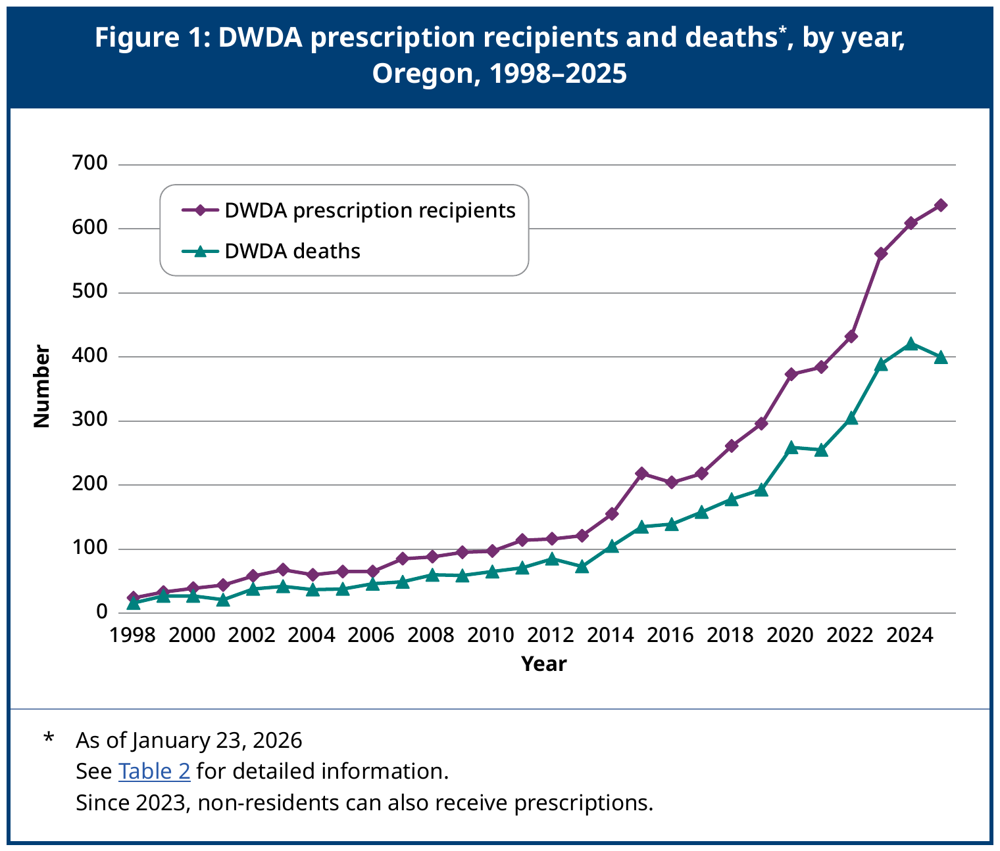
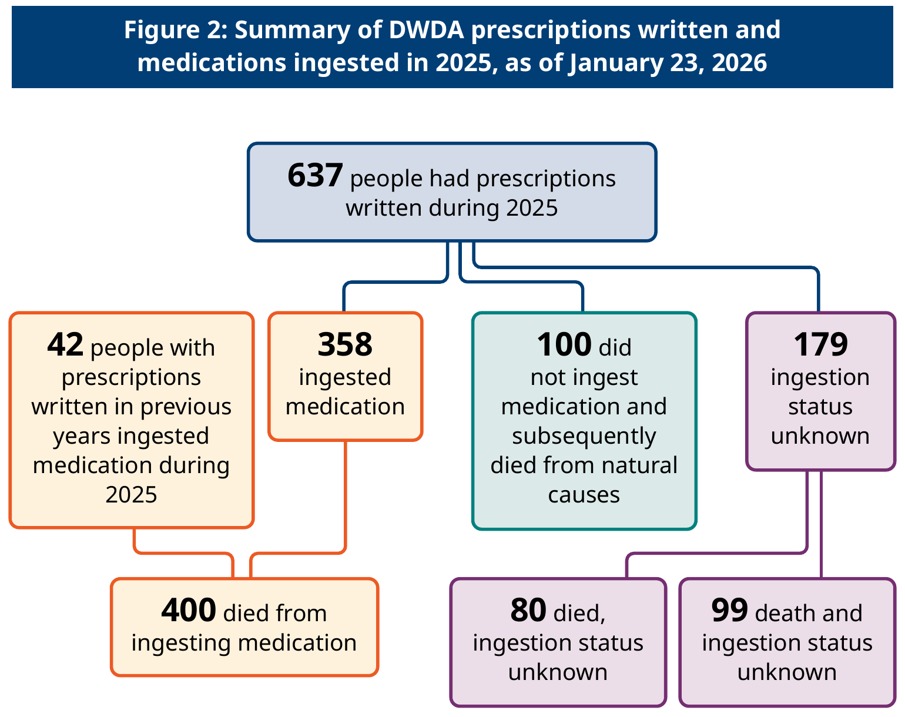

## Core Principles
Traditional nuclear family preference, free speech absolutism (with narrow exceptions), meritocracy, cultural compatibility for cohesion, and personal responsibility. Strong opposition to identity politics and progressive social engineering, and skepticism of mandates.

<a class="back-to-top" href="#top">↑ Back to top</a>

---

**Family & sex** · Family and Gender · Feminism and Sex Equality · Marriage Law · Abortion and Bioethics · Assisted Death

## Family and Gender

>[!tldr] In short
> The healthiest family is close to the traditional nuclear family, and traditional roles are seen as best, but nothing is mandated. Divorce is allowed, and custody has no default; a neutral court decides, considering the child's wishes.

#### Position
Marriage and family have multiple definitions depending on one's culture and religion. The healthiest family is something very close to the nuclear family: a mother and father, married and loyal to one another, with two to three children. Divorce is allowed. Child custody does not default to either parent; if the parents cannot reach a resolution, a neutral court arbitrates the dispute, informed by the child's privately expressed preference. Traditional roles, with a stronger male working while a female raises children, cares for the home, and supports the working man, are judged superior. But they are not mandated in any way, and people ultimately live as they decide.

> [!question]- "Does favoring traditional roles conflict with individual freedom?"
> No. The preference is a judgment about what constitutes the best-functioning society, not a rule imposed by law. Individuals remain free to structure their families and roles as they choose.

#### Rationale
The nuclear family is treated as the structure best suited to raising children, and cohesive families support a high-trust society. Married parents are far more stable: about a quarter separate before a child turns 12, against about two-thirds of cohabiting parents, though part of the difference in child outcomes reflects who marries. The preference for traditional roles is a value judgment, not an empirical finding, which is why it is never mandated. A neutral custody standard avoids presuming either parent is more fit. Keeping traditional roles voluntary respects my commitment to individual liberty.
The fertility drop since 2007 is mostly fewer marriages at each age, not a collapse of birth rates inside marriage ([[5. Domestic Policy & Governance#Births and Family Formation|Births and Family Formation]]); that is one more reason I treat the nuclear married family as the healthiest default without mandating it.

>[!quote]- Sources
> - Brookings – [Cohabiting parents differ from married ones in three big ways](https://www.brookings.edu/articles/cohabiting-parents-differ-from-married-ones-in-three-big-ways/)
> - Institute for Fiscal Studies – [Cohabitation, marriage, relationship stability and child outcomes: an update](https://ifs.org.uk/sites/default/files/output_url_files/r87.pdf)

**See also:** [[5. Domestic Policy & Governance#Births and Family Formation|Births and Family Formation]]

<a class="back-to-top" href="#top">↑ Back to top</a>

---

## Feminism and Sex Equality

>[!tldr] In short
> Both sexes hold equal rights and are judged by the same rules. Outcome-based feminism, sex quotas, and treating traditional roles as oppression are rejected, while traditional roles stay a preference, not a law.

#### Position
Men and women hold the same rights, because rights rest on sentience, not sex ([[1. Ethical and Philosophical Framework#Animal Rights and Sentientism|Animal Rights and Sentientism]]). I support equal treatment under law and reject the strands of modern feminism that seek equality of outcome between the sexes, rely on sex-based quotas or preferences, or treat traditional family roles as oppression. Traditional roles, with a working husband and a wife who raises children and keeps the home, are judged superior but never mandated ([[#Family and Gender]]). The abortion position also departs from mainstream feminism ([[#Abortion and Bioethics]]).

>[!example]- Data: young women and young men
> Survey and exit-poll figures as reported by the cited sources.
>- Gallup, ages 18–29, 2017–2024: 40% of young women identified as liberal, compared with 25% of young men. Young women's share rose from 28% in 2001–2007 and 32% in 2008–2016; young men's held at 25–27%. Gallup – [Exploring Young Women's Leftward Expansion](https://news.gallup.com/poll/649826/exploring-young-women-leftward-expansion.aspx)
>- Same Gallup data, young women vs. young men: favor stricter gun laws 74% vs. 51%; abortion should be legal in all or most cases 60% vs. 48%; global warming is human-caused 86% vs. 71%; prioritize the environment over economic growth 78% vs. 62%. Gallup – [Exploring Young Women's Leftward Expansion](https://news.gallup.com/poll/649826/exploring-young-women-leftward-expansion.aspx)
>- 2024 national exit poll, ages 18–29: women voted 61% Harris, 38% Trump; men voted 49% Trump, 48% Harris. CNN – [National Exit Polls, 2024 Presidential Results](https://www.cnn.com/election/2024/exit-polls/national-results/general/president/0)

> [!question]- "Doesn't the pay gap prove women face discrimination?"
> Mostly not. Most of the raw gap tracks differences in occupation, industry, hours, and the effect of maternity and children on mothers' careers. In 2025 women working full time earned 82.1% of men's median weekly earnings, and women working full time year-round earned 83.9% of men's median annual earnings. In Blau and Kahn's decomposition, occupation and industry were the largest measured factors in 2010, accounting for about half of the gap (51%), while work interruptions and shorter hours still mattered in high-skill jobs. Goldin finds that most of today's gap arises between men and women in the same occupation and largely begins with the birth of the first child, because many jobs pay disproportionately for long and particular hours. In Danish data, the arrival of children creates a long-run gender gap in earnings of around 20 percent, driven by time out of work, fewer hours, and lower wage rates after childbirth. A smaller residual remains: about 38% of the 2010 gap was not explained by measured factors. An unexplained residual is not proof of discrimination, but experimental evidence means discrimination "cannot be discounted." In one audit study, women applying to high-price Philadelphia restaurants were much less likely to receive job offers, while a nationwide experiment at 108 large U.S. employers found no significant average gap in callbacks between men and women, with some firms favoring men and others favoring women. The remedy I accept is equal rules, enforced against discrimination in either direction ([[#Equal Treatment in Employment and Business]]), not outcome targets.

> [!question]- "Isn't preferring traditional roles itself sexist?"
> No law follows from the preference. Women and men have identical rights and may arrange their lives as they choose; I'm only stating my judgment of which arrangement best serves families.

#### Rationale
Equal rights and equal opportunity follow directly from my framework's foundations, so the earlier, legal-equality aims of feminism are compatible with it. The conflict is with outcome-based and identity-based approaches, which I reject for every group ([[#Race and Diversity]]). The pay data show a persistent raw gap that is mostly explained by occupation, industry, hours, and the effect of maternity and children on mothers' earnings, with a smaller unexplained share, some of which experimental studies attribute to discrimination.

>[!quote]- Sources
> - U.S. Bureau of Labor Statistics – [Median Weekly Earnings Were \$1,204 in 2025](https://www.bls.gov/opub/ted/2026/median-weekly-earnings-were-1204-in-2025.htm)
> - U.S. Census Bureau – [Income in the United States: 2025](https://www.census.gov/library/publications/2026/demo/p60-289.html)
> - Blau & Kahn, Journal of Economic Literature (2017) – [The Gender Wage Gap: Extent, Trends, and Explanations](https://www.nber.org/papers/w21913)
> - Goldin, American Economic Review (2014) – [A Grand Gender Convergence: Its Last Chapter](https://doi.org/10.1257/aer.104.4.1091)
> - The Royal Swedish Academy of Sciences – [The Prize in Economic Sciences 2023: Press Release](https://www.nobelprize.org/prizes/economic-sciences/2023/press-release/)
> - Kleven, Landais & Søgaard, American Economic Journal: Applied Economics (2019) – [Children and Gender Inequality: Evidence from Denmark](https://doi.org/10.1257/app.20180010)
> - Neumark, Bank & Van Nort, Quarterly Journal of Economics (1996) – [Sex Discrimination in Restaurant Hiring: An Audit Study](https://doi.org/10.2307/2946676)
> - Kline, Rose & Walters, Quarterly Journal of Economics (2022) – [Systemic Discrimination Among Large U.S. Employers](https://www.nber.org/papers/w29053)

**See also:** [[1. Ethical and Philosophical Framework#Animal Rights and Sentientism|Animal Rights and Sentientism]]

<a class="back-to-top" href="#top">↑ Back to top</a>

---

## Marriage Law

>[!tldr] In short
> Marriage is a legal contract between consenting adults, same-sex couples included. Minors cannot marry and churches can decline.

#### Position
Civil marriage is a legal contract between consenting adults, recognized equally for opposite-sex and same-sex couples. The state records and enforces the contract but does not define its religious meaning, and religious bodies remain free to perform or decline ceremonies. Minors cannot consent, so they cannot marry. Blood relatives may not marry; step relatives other than parental figures may ([[6. Criminal Justice & Security#Incest|Incest]]). Divorce is allowed, and custody follows the existing family rules.

>[!example]- Data: the marriage gap in voting and party
> Survey and exit-poll figures as reported by the cited sources.
>- 2024 national exit poll: married men voted 60% Trump, 38% Harris; married women 52% Trump, 47% Harris; unmarried men split 48–48; unmarried women voted 61% Harris, 38% Trump. CNN – [National Exit Polls, 2024 Presidential Results](https://www.cnn.com/election/2024/exit-polls/national-results/general/president/0)
>- Party identification (Pew, registered voters, 2023 data): 59% of married men and 50% of married women identify with or lean Republican; never-married women are 72% Democratic and 24% Republican; never-married men 61% Democratic and 37% Republican. Pew Research Center – [Partisanship by Gender, Sexual Orientation, Marital and Parental Status](https://www.pewresearch.org/politics/2024/04/09/partisanship-by-gender-sexual-orientation-marital-and-parental-status/)
>- Marriage by party: 65% of Republicans and 50% of Democrats were married in 2024, compared with 71% and 61% in 2000. Among Republicans ages 25–44, 55% of men and 63% of women were married. Institute for Family Studies – [The Republican Marriage Advantage](https://ifstudies.org/report-brief/the-republican-marriage-advantage-partisanship-marriage-and-family-stability-in-the-trump-era); AEI – [Working-Class Realignment](https://www.aei.org/featured_data/working-class-realignment/)

> [!question]- "Should the state be in marriage at all?"
> The state's role is limited to recording and enforcing a contract, including property and custody consequences. It does not regulate the relationship itself.

#### Rationale
In *Obergefell v. Hodges* (2015) the Supreme Court held that the Constitution guarantees same-sex couples the right to marry. Family and custody rules are in [[#Family and Gender]].

>[!quote]- Sources
> - Cornell LII – [Obergefell v. Hodges (2015)](https://www.law.cornell.edu/supremecourt/text/14-556)

**See also:** [[5. Domestic Policy & Governance#Births and Family Formation|Births and Family Formation]]

<a class="back-to-top" href="#top">↑ Back to top</a>

---

## Abortion and Bioethics

>[!tldr] In short
> Abortion is judged by sentience: that is the moral and rights theory. In law, the **rights statute** bans elective abortion from **12 weeks**, fixed by constitutional amendment — the floor at the bottom of the published uncertainty range, locked so it cannot move later when estimates of sentience onset are revised upward. Separately labeled **prudential** limits earlier than 12 weeks are allowed only on published drift evidence, and they sunset or narrow if that evidence fails a stated review. A woman cannot end a pregnancy from 12 weeks onward that came from her own choices, and cannot end a sentient fetus on the same responsibility rule. Rape is the exception, except parental-figure sex an adult child entered willingly ([[6. Criminal Justice & Security#Incest|Incest]]).

#### Position
The position is [[Glossary#Sentience basis (sentientism)|sentientist]] and affirms fetal rights. Sentience is the moral and rights theory: full negative rights attach when the fetus is sentient, and a fetus on an undisturbed trajectory toward sentience already carries significant moral weight ([[1. Ethical and Philosophical Framework#Axioms|Axioms]]). That theory does **not** by itself fix a floating calendar ban that moves with every science update. In law, two statutes do the work, and they are labeled separately. The **rights statute** bans elective abortion from **12 weeks**, fixed by constitutional amendment ([[Glossary#Abortion rights floor (12 weeks)|Abortion rights floor (12 weeks)]]). Twelve weeks is the bottom of the published expert range for possible onset (~12 weeks to after 24–28 weeks); locking the floor there is the safeguard against "update the science → later ban" creep, and the amendment does not move later when estimates of onset are revised upward. A second, separate claim is **prudential**, not rights: additional limits **earlier than 12 weeks** are justified only by published evidence that elective regimes tend to move limits later over time. Those earlier limits are enacted as a labeled prudential statute, rest on drift evidence rather than on a claim that a pre-12-week fetus holds full negative rights, and **sunset or narrow to the 12-week floor** if a stated periodic review finds that the published drift record no longer holds. "Pro-life policy in full" is not a third rights rule and does not collapse the two statutes into conception-as-rights. A woman may not terminate sentient life in her womb if it exists because of her own decisions. If the fetus is the product of rape, she is freed of obligation, since she did not enter any agreement to raise it; voluntary sexual intercourse resulting in a fetus is what creates the responsibility. The exception does not cover sex an adult willingly entered with their parent or parental figure: the law treats that as rape because consent is not valid ([[6. Criminal Justice & Security#Incest|Incest]]), but the act was willing. Forced parental-figure rape keeps the exception, and so does a minor's pregnancy from sex with a relative, since a minor cannot consent.

>[!example]- Documented accounts
> These are individual reported events, not statistics; they illustrate the position and do not measure a trend.
>- Georgia, Aug 2022 (reported 2024): Amber Thurman, 28, died of sepsis after an incomplete medication abortion; doctors waited about 20 hours to perform a D&C, a procedure the state's new ban had criminalized with few exceptions, and Georgia's maternal mortality review committee deemed her death "preventable". ProPublica – [Abortion Bans Have Delayed Emergency Medical Care. In Georgia, Experts Say This Mother's Death Was Preventable.](https://www.propublica.org/article/georgia-abortion-ban-amber-thurman-death)

>[!example]- Data: reasons for abortion
> U.S. reporting on reasons is incomplete; figures below are from multi-state and survey sources, not a viral table.
>- Rape, incest, and life-of-mother exceptions are a small share of abortions in states that report reasons: typically under a few percent combined in Lozier Institute compilations of state data; Guttmacher's older national survey work likewise finds the large majority of abortions cited as elective reasons (timing, cost, partner, readiness), not rape or incest. Lozier Institute – [Fact sheet: reasons for abortion](https://lozierinstitute.org/fact-sheet-reasons-for-abortion/) · Guttmacher – [Reasons U.S. women have abortions (2005)](https://www.guttmacher.org/journals/psrh/2005/reasons-us-women-have-abortions-quantitative-and-qualitative-perspectives)
>- I do not treat "rare exception" as an argument for elective abortion after sentience. The rape exception in my position follows the responsibility framework, not the size of the category. Exact viral percentages that claim incest at 0.001% or "no reason" at 92% are unsupported; use the sources above.

> [!question]- "Why support earlier-than-12 limits if sentience is the moral cutoff?"
> Two statutes are at work, and they are separate. The moral and rights theory is that sentience marks when full negative rights attach. The **rights statute** in law is not a floating science update: elective abortion is banned from **12 weeks**, fixed by constitutional amendment — the floor at the bottom of the published uncertainty range (~12 weeks to after 24–28 weeks), locked so it cannot move later when onset estimates are revised upward. The **prudential statute** is different: limits **earlier than 12 weeks** are justified only by published evidence that once elective abortion is accepted, legal limits tend to move later. Recent law shows that drift: Denmark and Norway raised their limits for abortion on request from 12 to 18 weeks from 1 June 2025, and France raised its limit from 12 to 14 weeks in 2022. Massachusetts moved the same way in 2026. Chapter 188 of the Acts of 2026, signed by Governor Healey on 10 August, replaced the four permitted reasons for an abortion at or after 24 weeks (the patient's life, the patient's physical or mental health, a lethal fetal anomaly, or a grave fetal diagnosis incompatible with sustained life outside the uterus) with "the professional judgment of the physician," and ended the requirement that those abortions take place in a hospital. The House passed it 119–33 and the Senate 15–4. It takes effect 8 November 2026 unless a referendum petition gathers enough signatures to suspend it. Chapter 188 is **drift evidence for the prudential statute**, not proof that a fetus holds full negative rights before the 12-week floor, and not a reason to treat the amendment floor as optional ([[13. News Commentary#Case: Massachusetts abortion law, Chapter 188, 2026|Massachusetts Chapter 188]]). Earlier-than-12 limits sunset or narrow to the floor if a stated periodic review finds the published drift record no longer holds. The rape exception follows from the responsibility framework: obligation arises from voluntary action, and rape involves none.

> [!question]- "Is the 12-week ban a rights rule or a prudential one?"
> A rights rule — the **rights statute**. Elective abortion is banned from 12 weeks by constitutional amendment ([[Glossary#Abortion rights floor (12 weeks)|Abortion rights floor (12 weeks)]]). Sentience remains the moral theory; 12 weeks is the locked legal floor at the bottom of the published expert range for possible onset (~12 weeks to after 24–28 weeks). The amendment does not move later when that range is argued upward, and it is not revised by the animal sentience-class board. Limits earlier than 12 weeks are the separate, labeled **prudential** statute: they require published drift evidence and sunset or narrow if that evidence fails review. Collapsing both into one “full pro-life = rights” line is rejected.

> [!question]- "What happens to earlier-than-12 limits if the drift evidence fails?"
> They sunset or narrow to the 12-week rights floor. The prudential statute exists only while published evidence still shows elective regimes moving limits later. A stated periodic review tests that record; if it no longer holds, earlier limits fall or shrink, and the amendment floor at 12 weeks remains. Failure of the drift case does not move the rights floor later, and success of the drift case does not turn earlier limits into fetal full rights.

> [!question]- "What if the pregnancy threatens the mother's life?"
> She may end it. A person is not required to absorb serious harm because the threat lacks culpability ([[1. Ethical and Philosophical Framework#Conflicts Between Rights-Holders|Conflicts Between Rights-Holders]]). Where the fetus is viable, early delivery is preferred to termination.

> [!question]- "How is the rape exception established?"
> By a report to law enforcement and a medical record before the **applicable** limit — the 12-week rights floor, or an earlier prudential limit if one is in force; a criminal conviction is not required first, because a trial cannot finish in time. A knowingly false claim is fraud and is punished. The exception is responsibility-based on both statutes: obligation arises from voluntary action, and rape involves none.

#### Rationale
Sentient beings hold rights, and a sentient fetus is no exception. Expert estimates of when sentience begins range from about 12 weeks to after 24–28 weeks, depending on whether a mature cortex is required. That uncertainty is why the **legal rights floor** locks elective abortion at **12 weeks by constitutional amendment** — the bottom of the range — rather than leaving a floating board to push the ban later, and why limits earlier than 12 weeks are a separately labeled prudential statute on drift evidence with a sunset, not a claim of full negative rights from conception. Voluntary sexual intercourse carries responsibility for the life it creates, which grounds the duty not to terminate. Where the pregnancy results from rape, no voluntary act created the duty to sustain the fetus, so the obligation does not arise; this follows the distinction I draw between withdrawing support and killing. After Dobbs v. Jackson Women's Health Organization returned abortion regulation to the states, laws vary widely, which is the setting in which the domino concern applies. In the U.S., most abortions occur early (92.8% at or before 13 weeks in 2022) and 1.1% at 21 weeks or later. The full framework is set out in [[1. Ethical and Philosophical Framework|Ethical and Philosophical Framework]].

> [!info]- What is the responsibility framework?
> The responsibility framework holds that voluntarily engaging in sexual intercourse creates a duty toward a resulting fetus. Where intercourse was not voluntary, as in rape, no such duty arises.

>[!quote]- Sources
> - Supreme Court of the United States – [Dobbs v. Jackson Women's Health Organization, 597 U.S. 215 (2022)](https://www.law.cornell.edu/supremecourt/text/19-1392)
> - Royal College of Obstetricians and Gynaecologists – [Fetal Awareness: Evidence Review (2022)](https://www.rcog.org.uk/media/gdtnncdk/rcog-fetal-awareness-evidence-review-dec-2022.pdf)
> - Derbyshire & Bockmann, Journal of Medical Ethics – [Reconsidering fetal pain (2020)](https://jme.bmj.com/content/46/1/3)
> - Centers for Disease Control and Prevention – [Abortion Surveillance — United States, 2022](https://www.cdc.gov/mmwr/volumes/73/ss/ss7307a1.htm)
> - Retsinformation – [Lov nr 404 af 29/04/2025 (abortion limit raised to 18 weeks)](https://www.retsinformation.dk/eli/lta/2025/404)
> - Lovdata – [Lov om abort (abortloven)](https://lovdata.no/nav/lov/2024-12-20-96)
> - Sénat – [Renforcer le droit à l'avortement (Loi n° 2022-295 du 2 mars 2022)](https://www.senat.fr/dossier-legislatif/ppl20-023.html)
> - Massachusetts Legislature – [Chapter 188 of the Acts of 2026: An Act prioritizing patient access to care](https://malegislature.gov/Laws/SessionLaws/Acts/2026/Chapter188)
> - Massachusetts Legislature – [Bill H.5595 history and roll calls](https://malegislature.gov/Bills/194/H5595)
> - Lozier Institute – [Fact sheet: reasons for abortion](https://lozierinstitute.org/fact-sheet-reasons-for-abortion/)
> - Guttmacher – [Reasons U.S. women have abortions (2005)](https://www.guttmacher.org/journals/psrh/2005/reasons-us-women-have-abortions-quantitative-and-qualitative-perspectives)

**See also:** [[1. Ethical and Philosophical Framework#Conflicts Between Rights-Holders|Conflicts Between Rights-Holders]] · [[7. Cultural & Social Issues#Abortion and Fetal Rights: Technology|Abortion and Fetal Rights: Technology]]

### Abortion and Fetal Rights: Technology

>[!tldr] In short
> New technology changes abortion policy only if it reveals new rights violations. Sentience and responsibility remain the standard.

#### Position
Policy responds to advancing technology only where sentient rights are violated. The core sentience and responsibility framework remains the standard as artificial wombs, earlier viability, and better sentience detection develop. New detection may refine how the standard is applied; it does not move the constitutional **12-week** elective-abortion rights floor later, and it does not turn labeled prudential earlier-than-12 limits into fetal full rights ([[#Abortion and Bioethics]]).

> [!question]- "Would artificial wombs change the abortion debate?"
> Only if they create or clarify sentient-rights violations. The standard remains sentience and responsibility; new technology informs how it is applied.

#### Rationale
Technologies that extend viability or detect sentience earlier may refine where the line falls, but the principle does not change. Extra-uterine support research shows the direction of the technology: in 2017, an extra-uterine system kept extremely premature lambs developing normally for up to 4 weeks.

>[!quote]- Sources
> - Partridge et al., Nature Communications (2017) – [An extra-uterine system to physiologically support the extreme premature lamb](https://www.nature.com/articles/ncomms15112)

**See also:** [[7. Cultural & Social Issues#Abortion and Bioethics|Abortion and Bioethics]]

<a class="back-to-top" href="#top">↑ Back to top</a>

---

## Assisted Death

>[!tldr] In short
> Competent adults may choose assisted death with a willing doctor, after an independent capacity check. Non-terminal cases wait 90 days, need two assessors, and get a documented offer of care. No one is forced to help, taxpayers do not pay for it, minors are excluded, and pushing someone toward death is punished.

#### Position
A competent adult may choose medically assisted death with a willing provider, as a decision about their own body and life. No provider is compelled to take part, and no taxpayer funding is used. Minors are excluded, as they are from all irreversible bodily decisions. Every request requires an independent capacity check by a second clinician. Where death is reasonably foreseeable (Track 1), a 48-hour waiting period applies, waivable when death is imminent. Where it is not (Track 2), the waiting period is 90 days, two assessors must agree, one a specialist in the person's condition, and the person must receive a documented offer of care and support. Whenever mental illness is involved, a psychiatric assessment is mandatory; mental illness as the sole condition qualifies only if it is long-standing, assessed by a psychiatrist, and documented treatment attempts have failed. Cases are reported publicly each year. Anyone who pressures or deceives a person into choosing death violates that person's rights and is punished accordingly. Where sentience has been permanently and irreversibly lost, decisions belong to next-of-kin under Axiom 4, as set out in [[7. Cultural & Social Issues#End-of-Life Care and Lost Sentience|End-of-Life Care and Lost Sentience]].

>[!example]- Documented accounts
> These are individual reported events, not statistics; they illustrate the position and do not measure a trend.
> - **Canada, 2023:** Health Canada reported 15,343 people received medical assistance in dying, 4.7% of deaths in Canada, an increase of 15.8% over 2022; 622 were cases where natural death was not reasonably foreseeable. Health Canada (2024) – [Fifth Annual Report on Medical Assistance in Dying in Canada, 2023](https://www.canada.ca/en/health-canada/services/publications/health-system-services/annual-report-medical-assistance-dying-2023.html)

> [!question]- "Won't legal assisted death pressure the sick, disabled, and elderly into dying?"
> Voluntary choice by a competent adult is the condition. Pressure, deception, or coercion toward death is a rights violation in its own right and is punished. No provider is compelled, and no public money pays for it, so there is no institutional incentive to steer people toward it. The law ought not to restrict assisted death to terminal illness. Instead it guards against drift with process: an independent capacity check, a 90-day wait, two assessors, and a documented offer of care for non-terminal cases, and psychiatric assessment whenever mental illness is involved. Oregon's data show why the concern is real. In 2024, 42% of those who died under its law listed being a burden on family, friends, or caregivers among their end-of-life concerns, though loss of autonomy, at 89%, was the most common.

> [!question]- "What does the data show where non-terminal assisted death is legal?"
> Critics point to growth and to non-terminal cases, and the review data show the safeguards holding. In Canada, which allows both tracks, 16,499 people received assisted death in 2024, 5.1% of deaths, and yearly growth slowed from 36.8% in 2019–20 to 6.9%. Non-terminal (Track 2) cases were 732, or 4.4%. Those cases raise the concern my extra safeguards address: 44.7% cited isolation or loneliness, compared with 21.9% in Track 1, and only 23.2% received palliative care. Isolation was never the sole reason given, and 45 requests were refused for external pressure. Canada has twice delayed eligibility for mental illness alone, now set for March 17, 2027. In the Netherlands, 9,958 cases made up 5.8% of deaths in 2024, including 219 psychiatric and 427 dementia cases, and the review committees found six cases (0.06%) that failed the due-care standard. While critics argue that vulnerability is not captured by demographics alone, a 2007 review of Oregon and Dutch data found no heightened risk for the elderly, the poor, the disabled, or people with psychiatric illness, and my extra safeguards address the individual case.

> [!question]- "Why allow assisted death but not abortion?"
> Assisted death is a competent adult's decision about their own body and life. Abortion of a sentient fetus ends another sentient being's life, one that exists because of the mother's own decisions. The line in both cases is the same: rights rest on sentience, and no one may end another sentient being's life without [[Glossary#Rights forfeiture|forfeiture]].

#### Rationale
Adults are free to make choices about their own bodies with willing providers, even choices others judge mistaken. That principle already governs adult transition in [[#LGBTQ+ and Identity Issues]]. [[Glossary#Negative rights|Negative rights]] protect a person against interference by others, and a competent person's own considered choice is not an interference. Oregon's experience shows the practice operating at small scale. In 2025, 637 people received prescriptions under the Death with Dignity Act and 400 died from ingesting the medication, about 1.0% of deaths in the state. Since 1997, 5,520 people have received prescriptions and 3,691 have died from taking them. Most had cancer (61%) or a neurological disease (14%), and the most common concerns were loss of autonomy (89%) and less ability to enjoy life (89%); 39.8% cited being a burden on family or caregivers. Jurisdictions that allow non-terminal cases, such as Canada and the Netherlands, show steady growth and some cases driven by isolation. So the law ought to allow any qualifying condition while adding time, a second specialist view, and a documented offer of care where death is not near.

*Chart: Oregon Health Authority, 2025 Oregon Death with Dignity Act Data Summary (Year 28), reproduced with attribution. The Oregon Health Authority does not endorse the views on this site.*  
Oregon Health Authority – [2025 Death with Dignity Act Data Summary](https://www.oregon.gov/oha/PH/PROVIDERPARTNERRESOURCES/EVALUATIONRESEARCH/DEATHWITHDIGNITYACT/Documents/year28.pdf)

*Chart: Oregon Health Authority, 2025 Oregon Death with Dignity Act Data Summary (Year 28), reproduced with attribution. The Oregon Health Authority does not endorse the views on this site.*  
Oregon Health Authority – [2025 Death with Dignity Act Data Summary](https://www.oregon.gov/oha/PH/PROVIDERPARTNERRESOURCES/EVALUATIONRESEARCH/DEATHWITHDIGNITYACT/Documents/year28.pdf)

>[!quote]- Sources
> - Oregon Health Authority – [2025 Oregon Death with Dignity Act Data Summary](https://www.oregon.gov/oha/PH/PROVIDERPARTNERRESOURCES/EVALUATIONRESEARCH/DEATHWITHDIGNITYACT/Documents/year28.pdf)
> - Health Canada – [Sixth Annual Report on Medical Assistance in Dying in Canada](https://www.canada.ca/en/health-canada/services/publications/health-system-services/annual-report-medical-assistance-dying-2024.html)
> - Justice Canada – [Medical Assistance in Dying](https://www.justice.gc.ca/eng/cj-jp/ad-am/bk-di.html)
> - Regional Euthanasia Review Committees – [Annual Report 2024](https://english.euthanasiecommissie.nl/site/binaries/site-content/collections/documents/annual-reports/archive/annual-report/annual-reports/rte-annual-report-2024.pdf)
> - Journal of Medical Ethics – [Legal physician-assisted dying in Oregon and the Netherlands: evidence concerning the impact on patients in "vulnerable" groups](https://pmc.ncbi.nlm.nih.gov/articles/PMC2652799/)
> - Journal of Medical Ethics – [Another perspective on Oregon's data](https://doi.org/10.1136/jme.2010.037044)
> - Stanford Encyclopedia of Philosophy – [Voluntary Euthanasia](https://plato.stanford.edu/entries/euthanasia-voluntary/)

**See also:** [[7. Cultural & Social Issues#End-of-Life Care and Lost Sentience|End-of-Life Care and Lost Sentience]]

### End-of-Life Care and Lost Sentience

>[!tldr] In short
> Patients decide their own care while they are conscious, and their written wishes are followed. Once consciousness is permanently gone, the family decides, guided by what the person wanted. Medical science decides when that point has been reached.

#### Position
While a person remains sentient, their own decisions govern their care, including refusing treatment. Advance directives and other known wishes are honored. When sentience is permanently and irreversibly lost, the being keeps residual moral consideration, and decision-making authority, including whether to continue life support, passes to next-of-kin, guided by the person's known wishes and dignity (Axiom 4). Whether sentience is irreversibly lost is decided by the best available scientific consensus and accepted medical standards (Axiom 5).

> [!question]- "Who decides when a patient can no longer speak and has left no instructions?"
> Next-of-kin decide, guided by what is known of the person's wishes and by respect for their dignity. Where the person left an advance directive, it governs. The decision ought to rest with the family rather than with the state, which intervenes only to protect a still-sentient person's rights.

#### Rationale
Axiom 4 already sets the rule; this topic applies it to medical care. Current law offers the working standard. The Uniform Determination of Death Act defines death as the irreversible cessation of circulatory and respiratory functions, or of all functions of the entire brain including the brain stem, determined by accepted medical standards. In *Cruzan v. Director, Missouri Department of Health* (1990), the Supreme Court allowed a state to require clear and convincing evidence of an incompetent patient's wishes before life support is withdrawn. That shows why recorded wishes matter in practice. Assisted death for competent adults is covered in [[7. Cultural & Social Issues#Assisted Death|Cultural & Social Issues]].

>[!quote]- Sources
> - Uniform Law Commission – [Uniform Determination of Death Act (1981)](https://www.uniformlaws.org/HigherLogic/System/DownloadDocumentFile.ashx?DocumentFileKey=38420c48-ebbd-531d-da32-e6cc175ebdb1)
> - Cruzan v. Director, Missouri Department of Health (1990) – [Supreme Court opinion](https://www.law.cornell.edu/supremecourt/text/497/261)

**See also:** [[7. Cultural & Social Issues#Assisted Death|Assisted Death]]

<a class="back-to-top" href="#top">↑ Back to top</a>

---

**Identity & schools** · LGBTQ+ and Identity Issues · Gender Identity in Schools and Institutions · Curriculum Content

## LGBTQ+ and Identity Issues

>[!tldr] In short
> Same-sex marriage is legal, though male-female pairing is seen as best. Transgenderism is viewed as a mental illness; adults may transition privately, but not compete in opposite-sex sports or use opposite-sex multi-person bathrooms and changing rooms open to the public. Minors get no transition treatment, pronouns are never mandated. Coercive or aversive "conversion" methods are banned; voluntary exploratory therapy for adults and non-affirming therapy for minors under parental authority are allowed.

#### Position
Same-sex marriage is legal, though the best outcome for society is male and female, naturally and biologically. Male-male adoption raises concern because same-sex parents do not fully fulfill the best-case male/female dynamic of traditional parenting, though this belief is not mandated. Transgenderism is treated as a mental illness, the DSM's definitions of gender are viewed as ideologically driven, and the illness is treated rather than validated. Adults may transition, and private practices may train for and perform the surgery, as a freedom of both parties. Transgender individuals do not compete in their transitioned-sex sports in any case, minors undergo no transgender treatment in any case, and every multi-person bathroom or changing room open to the public, in government or private facilities, is separated by birth sex, while single-occupancy lockable rooms are open to anyone. Pronouns may be respected or not as each individual chooses and are never mandated. Because dysphoria is treated as a mental illness rather than validated, talk therapy aimed at reducing incongruence is ordinary treatment when it is voluntary. Coercive or aversive methods — force, electroshock, or any therapy a minor is compelled into against parental authority or an adult against their will — are banned. Voluntary exploratory therapy for adults, and non-affirming / exploratory therapy for minors under parental authority, are allowed; affirming medical transition for minors remains banned.

> [!question]- "If transgenderism is a mental illness, why allow adults to transition?"
> Adults are free to make choices about their own bodies with willing providers, even choices judged mistaken. The state does not validate or promote transition, and it protects others where the choice affects them: in sports, bathrooms, and speech. Minors, who cannot consent to such decisions, are excluded entirely.

> [!question]- "Isn't the DSM the scientific consensus? Why call its classification ideologically driven?"
> The DSM is a consensus document, and the American Psychiatric Association states its reasons openly. In 2013 DSM-5 replaced "gender identity disorder" with "gender dysphoria" to "avoid stigma and ensure clinical care," stating that gender nonconformity "is not in itself a mental disorder" while keeping a diagnosis that preserves treatment and insurance access. The APA itself calls the diagnosis "a double-edged sword." The 2022 text revision changed "natal male" to "individual assigned male at birth" to use "less stigmatizing language." Reducing stigma and preserving coverage are social and practical aims, not new findings about causes or outcomes, so I treat the classification as a value judgment I may reject.

> [!question]- "Don't the major medical associations support gender-affirming care?"
> Yes. The American Medical Association calls such treatment medically necessary and opposes laws that restrict it, and the American Psychiatric Association supports puberty suppression for youth when indicated. The question is what their guidance rests on. The Cass Review's systematic review of 23 guidelines found that few systematically reviewed the evidence and that most drew on two, WPATH's and the Endocrine Society's. Court documents reported by The BMJ show WPATH required Johns Hopkins reviewers it commissioned to use the data "for the benefit of advancing transgender health in a positive manner" and to seek board approval before publishing. The lead reviewer reported finding "little to no evidence about children and adolescents," and only two reviews were published. WPATH says it disputed only the timing of publication. The 2025 HHS umbrella review rated the evidence on psychological outcomes, quality of life, regret, and long-term health as very low quality. Endorsement by an association does not raise the quality of the studies underneath it.

> [!question]- "Doesn't childhood dysphoria usually persist?"
> Follow-up studies suggest most cases do not. In a Toronto sample of 139 clinic-referred boys, 17 (12.2%) persisted and 122 (87.8%) desisted (Singh, Bradley, and Zucker, 2021). In a Dutch sample of 127, persistence was the minority outcome and was more likely with more intense dysphoria and among girls (Steensma et al., 2013). These studies have limits: they used older DSM criteria, 36.7% of the Toronto boys were below the diagnostic threshold, and they predate today's adolescent-onset caseload. Comorbidity is high: in Finland's adolescent service, severe psychiatric problems often preceded the dysphoria and autism-spectrum problems were very common (Kaltiala-Heino et al., 2015). That pattern supports treating the underlying distress first. Advocates cite a 2022 U.S. cohort of 317 children who had socially transitioned, 94% of whom identified as transgender about five years later (Olson et al.). The study followed only children who had already transitioned, so it cannot separate persistence from the effect of the transition itself. Transgenderism is a cultural mental illness propagated and supported by society, when it should instead be supported out of, not into.

> [!question]- "Hasn't the change in referrals just reflected greater acceptance?"
> Advocates credit greater acceptance, but the researchers who documented the rise say the reasons "are not known," naming awareness, destigmatization, and social and media influences as possibilities (de Graaf et al., 2020). Referrals rose on a similar pattern across four Nordic countries and the UK, with natal girls predominating among adolescents. Whatever the cause, a fast change in who is referred argues for more diagnostic caution, not less. Several of the countries with the longest experience have pulled back. Sweden judged in 2022 that the risks of blockers and hormones for adolescents "are likely to outweigh the expected benefits," Finland made psychosocial support first-line, Norway's investigation board classed the treatments as investigational, and NHS England limited puberty blockers to research settings.

> [!question]- "Isn't sex a spectrum?"
> No. Biological sex is defined by the type of gamete an organism is organized to produce, and there are two, small and large; no third gamete exists (Goymann, Brumm, and Kappeler, 2023). Some biologists argue sex is better described as a spectrum because of differences of sex development, and those conditions are real. They are variations in how the two-sex system develops, not additional sexes, so they do not change the binary. Law and public facilities that rely on sex therefore track biological sex.

> [!question]- "Don't adults who transition report low regret and better well-being?"
> Advocates cite low reported regret: a meta-analysis of 27 studies with 7,928 patients found about 1%, though its own authors note subjective measurement and a lack of standardized questionnaires (Bustos et al., 2021). Long-term outcomes are less clear. A Swedish cohort found post-surgery mortality 2.8 times and suicide 19.1 times that of controls, though it could not show what would have happened without surgery (Dhejne et al., 2011). A national Swedish study first reported reduced mental-health treatment after surgery, then issued a correction after reanalysis finding no advantage of surgery for mood or anxiety treatment or suicide-attempt hospitalization (Bränström and Pachankis, 2020). So the state ought to leave adult transition to adult choice without treating it as the established cure, and without public funding.

> [!question]- "You call dysphoria a mental illness and also oppose conversion therapy — which is it?"
> Both, under a defined rule. Oppose means ban coercive and aversive methods: force, electroshock, or compelling a minor into any therapy against parental authority, or an adult against their will. Allow means voluntary exploratory talk therapy for adults who want to reduce incongruence, and non-affirming or exploratory therapy for minors under parental authority, consistent with treating the illness rather than affirming it. Affirming hormones or surgery for minors stay banned. Adult medical transition stays a private choice with willing providers, not a state-validated cure.

#### Rationale
The state ought to protect adult liberty while refusing to compel others to affirm beliefs they do not hold. Sex-based categories in sports and bathrooms exist for fairness and safety, so they follow biological sex. Minors cannot consent to irreversible medical treatment, and the Supreme Court upheld a state ban on such treatment for minors in United States v. Skrmetti. England's Cass Review (2024) found the evidence base for youth gender medicine remarkably weak and recommended puberty blockers only within research protocols. My classification departs from the DSM-5-TR, which diagnoses gender dysphoria only where incongruence brings clinically significant distress. The departure rests on three points. First, the 2013 reclassification was justified by the APA in terms of stigma and access to care rather than new evidence about causes or outcomes. Second, the guidelines built on it have been judged weak by systematic review, and the evidence for treating minors has been rated low or very low quality by England's Cass Review, Sweden, and the 2025 HHS review. Third, sex is binary, defined by gametes, so an identity that contradicts it is treated as a condition to be understood and treated, not as a fact the law must adopt. Counter-evidence is acknowledged: the AMA and the American Psychiatric Association support affirming care, and reported regret after adult surgery is low. Same-sex marriage remains legal under Obergefell v. Hodges, consistent with my limited role for the state in private relationships.

##### Outcomes
Columbia Law School's What We Know project reviewed 79 peer-reviewed studies. Of these, 75 found children of gay or lesbian parents fare no worse than other children. The American Academy of Pediatrics and the American Psychological Association agree. Supporting work includes Rosenfeld's 2010 census analysis, the National Longitudinal Lesbian Family Study (Gartrell and Bos), and studies of adoptive gay fathers by Golombok and by Farr and Patterson.

Three lines of research dissent. Regnerus (2012) reported worse outcomes for adults raised by a parent with a same-sex relationship. Allen, Pakaluk, and Price (2013) reanalyzed Rosenfeld's data and found children of same-sex couples 35% less likely to make normal progress through school; Allen also studied high school graduation in Canadian census data. Sullins (2015–2016) found emotional problems more than twice as common and attributed this to not living with both biological parents. Cheng and Powell (2015) reanalyzed Regnerus's data and found that at least a third of the respondents he counted as raised by a same-sex parent were misclassified, many having never lived with that parent or having lived with them for a year or less. Once corrected, the differences were small or absent.

Planned same-sex household studies do not settle the male-male adoption concern: the no-difference literature mostly uses small, self-selected samples of planned lesbian families. Breakup-contaminated designs cut the other way — dissenting studies often count a household as same-sex if a parent ever had a same-sex relationship, which mixes in children who went through family breakup — and the journal that published Regnerus released an audit concluding its peer review failed. Residual uncertainty stays; the preference for mother-and-father parenting stands on developmental priors and the family section, not on Regnerus alone, and male-male adoption remains the sharper concern.

##### Abuse Data
No published study measures abuse rates in gay-father adoptive or foster homes. In the National Longitudinal Lesbian Family Study, 0 of 78 adolescents reported physical or sexual abuse by a parent or caregiver. In Regnerus's survey, 23% of respondents whose mother had a same-sex relationship reported ever being touched sexually by a parent or adult, against 2% from intact biological families. The question did not ask who did it, and Cheng and Powell's reanalysis found many of those respondents misclassified. The federal NIS-4 has no data specific to gay-father homes, so no national figure measures abuse in them.

##### Boys
Goldberg (2009) studied couples waiting to adopt. Among those with a sex preference, 46% of same-sex couples preferred boys, against 29% of heterosexual couples. Several studies find gay fathers do end up adopting boys more often. Whether this comes from parent preference or agency matching is unclear, and no data ties it to abuse. The pattern is noted as a point to watch, not as evidence of harm.

>[!quote]- Sources
> - Supreme Court of the United States – [Obergefell v. Hodges, 576 U.S. 644 (2015)](https://www.law.cornell.edu/supremecourt/text/14-556)
> - Supreme Court of the United States – [United States v. Skrmetti (2025)](https://www.law.cornell.edu/supremecourt/text/23-477)
> - Reuters – [Evidence around youth gender care 'remarkably weak', major English review finds (2024)](https://www.reuters.com/world/uk/evidence-gender-care-remarkably-weak-says-major-english-review-2024-04-09/)
> - American Psychiatric Association – [DSM-5 Fact Sheet: Gender Dysphoria (2013)](https://www.psychiatry.org/file%20library/psychiatrists/practice/dsm/apa_dsm-5-gender-dysphoria.pdf)
> - American Psychiatric Association – [DSM-5-TR Fact Sheet: Gender Dysphoria (2022)](https://www.psychiatry.org/getmedia/a5bef7b8-d401-4fc2-bac5-21a4d788fdb6/APA-DSM5TR-GenderDysphoria.pdf)
> - American Psychiatric Association – [Gender Dysphoria Diagnosis](https://www.psychiatry.org/psychiatrists/diversity/education/transgender-and-gender-nonconforming-patients/gender-dysphoria-diagnosis)
> - American Medical Association – [H-185.927 Clarification of Evidence-Based Gender-Affirming Care](https://policysearch.ama-assn.org/policyfinder/detail/H-185.927?uri=%2FAMADoc%2FHOD-185.927.xml)
> - Hewitt et al., Archives of Disease in Childhood (2024) – [Clinical guidelines for children and adolescents experiencing gender dysphoria or incongruence: a systematic review of guideline quality (part 1)](https://pubmed.ncbi.nlm.nih.gov/38594049/)
> - The BMJ (2024) – [Dispute arises over WPATH's involvement in WHO's trans health guideline](https://www.bmj.com/content/387/bmj.q2227)
> - U.S. Department of Health and Human Services – [Treatment for Pediatric Gender Dysphoria: Executive Summary (2025)](https://opa.hhs.gov/sites/default/files/2025-11/gender-dysphoria-report-exec-summary.pdf)
> - Singh, Bradley & Zucker, Frontiers in Psychiatry (2021) – [A Follow-Up Study of Boys With Gender Identity Disorder](https://pubmed.ncbi.nlm.nih.gov/33854450/)
> - Steensma et al., J. Am. Acad. Child Adolesc. Psychiatry (2013) – [Factors associated with desistence and persistence of childhood gender dysphoria](https://pubmed.ncbi.nlm.nih.gov/23702447/)
> - Olson et al., Pediatrics (2022) – [Gender Identity 5 Years After Social Transition](https://doi.org/10.1542/peds.2021-056082)
> - Kaltiala-Heino et al., Child and Adolescent Psychiatry and Mental Health (2015) – [Two years of gender identity service for minors](https://pubmed.ncbi.nlm.nih.gov/25873995/)
> - de Graaf et al., Nordic Journal of Psychiatry (2020) – [Time trends in referrals to child and adolescent gender identity services](https://pubmed.ncbi.nlm.nih.gov/31556776/)
> - Swedish National Board of Health and Welfare – [Care of children and adolescents with gender dysphoria: Summary of national guidelines (2022)](https://www.socialstyrelsen.se/contentassets/444af6c0a5fb429c9b56fd51b931a816/2023-1-8330.pdf)
> - The BMJ (2023) – [Gender dysphoria in young people is rising, and so is professional disagreement](https://www.bmj.com/content/380/bmj.p382.full)
> - The BMJ (2023) – [Norway's guidance on paediatric gender treatment is unsafe, says review](https://www.bmj.com/content/bmj/380/bmj.p697.full.pdf)
> - The BMJ (2023) – [Puberty blockers for young people will only be available as part of clinical research, says NHS England](https://www.bmj.com/content/381/bmj.p1344.full)
> - Goymann, Brumm & Kappeler, BioEssays (2023) – [Biological sex is binary, even though there is a rainbow of sex roles](https://pubmed.ncbi.nlm.nih.gov/36543364/)
> - Bustos et al., Plastic and Reconstructive Surgery Global Open (2021) – [Regret after Gender-affirmation Surgery: A Systematic Review and Meta-analysis of Prevalence](https://pubmed.ncbi.nlm.nih.gov/33968550/)
> - Dhejne et al., PLoS One (2011) – [Long-term follow-up of transsexual persons undergoing sex reassignment surgery](https://pubmed.ncbi.nlm.nih.gov/21364939/)
> - American Journal of Psychiatry (2020) – [Correction to Bränström and Pachankis](https://psychiatryonline.org/doi/10.1176/appi.ajp.2020.1778correction)
> - Columbia Law School / Cornell – [What does the scholarly research say about the well-being of children with gay or lesbian parents?](https://whatweknow.inequality.cornell.edu/topics/lgbt-equality/what-does-the-scholarly-research-say-about-the-wellbeing-of-children-with-gay-or-lesbian-parents/)
> - American Academy of Pediatrics – [Promoting the Well-Being of Children Whose Parents Are Gay or Lesbian (2013)](https://publications.aap.org/pediatrics/article/131/4/827/31789/)
> - American Psychological Association – [Resolution on Sexual Orientation, Gender Identity, Parents and Their Children](https://www.apa.org/about/policy/resolution-sexual-orientation-parents-children.pdf)
> - Rosenfeld – [Nontraditional Families and Childhood Progress Through School (2010)](https://pmc.ncbi.nlm.nih.gov/articles/PMC3000058/)
> - Gartrell, Bos, and Goldberg – [Adolescents of the U.S. National Longitudinal Lesbian Family Study (2010)](https://pmc.ncbi.nlm.nih.gov/articles/PMC3210350/)
> - Golombok et al. – [Adoptive Gay Father Families: Parent–Child Relationships and Children's Psychological Adjustment](https://pmc.ncbi.nlm.nih.gov/articles/PMC4510787/)
> - Farr and Patterson – [Parenting and Child Development in Adoptive Families: Does Parental Sexual Orientation Matter? (2010)](http://www.anterospadova.it/wp-content/uploads/2015/03/Farr_Patterson_2010.pdf)
> - Regnerus / NFSS – [New Family Structures Research and the "No Differences" Claim (2012)](https://www.familystructurestudies.com/files/NFSS-summary-20120809.pdf)
> - Wikipedia – [New Family Structures Study](https://en.wikipedia.org/wiki/New_Family_Structures_Study)
> - Allen, Pakaluk, and Price – [Nontraditional Families and Childhood Progress Through School: A Comment on Rosenfeld (2013)](https://www.sfu.ca/~allen/RosenfeldCommentDemography.pdf)
> - Sullins – [Emotional Problems among Children with Same-Sex Parents: Difference by Definition (2015)](https://journaljesbs.com/index.php/JESBS/article/view/482)
> - Sullins – [Invisible Victims: Delayed Onset Depression among Adults with Same-Sex Parents (2016)](https://pmc.ncbi.nlm.nih.gov/articles/PMC4903140/)
> - Cheng & Powell, Social Science Research – [Measurement, methods, and divergent patterns: Reassessing the effects of same-sex parents (2015)](https://doi.org/10.1016/j.ssresearch.2015.04.005)
> - U.S. Administration for Children and Families – [Fourth National Incidence Study of Child Abuse and Neglect (NIS-4) Executive Summary](https://acf.gov/sites/default/files/documents/opre/nis4_report_exec_summ_pdf_jan2010.pdf)
> - Goldberg – [Heterosexual, Lesbian, and Gay Preadoptive Preferences About Child Gender (2009)](https://wordpress.clarku.edu/wp-content/uploads/sites/156/2012/03/04-09GenderPrefAdoptiveParents.pdf)

#### Gender Identity in Rights Clauses
Every person is entitled to equal treatment under the law, and I support a plain equal-protection guarantee. I do not support writing gender identity or gender expression into a constitution as protected categories. Those categories would override the sex-based rules the law ought to keep for sports, multi-person bathrooms and changing rooms, and records. A rights clause should also not preserve preferences for some groups over others ([[7. Cultural & Social Issues#Equal Treatment in Employment and Business|Equal Treatment in Employment and Business]]). Vermont Proposal 4 does both, so if I were voting, I would vote **no**.

>[!quote]- Sources
> - State of Vermont, Office of the Governor – [Proclamation: Proposal 4](https://governor.vermont.gov/sites/scott/files/documents/Proclamation%204%20Civil%20Rights.pdf)
> - Vermont Secretary of State – [List of Proposals](https://sos.vermont.gov/vsara/learn/constitution/amending-the-constitution/proposals)

<a class="back-to-top" href="#top">↑ Back to top</a>

---

## Gender Identity in Schools and Institutions

>[!tldr] In short
> Public schools stay out of gender-identity advocacy, never socially transition students, and never keep it from parents. No one is compelled to use pronouns. ID, prisons, and shelters follow birth sex, adult transition gets no public money, military service follows ordinary medical standards, and government buildings fly official flags only.

#### Position
This section applies [[#LGBTQ+ and Identity Issues]] to public institutions. Public schools teach core skills and objective facts without ideological instruction in either direction ([[5. Domestic Policy & Governance#Education|Education]]), so gender-identity advocacy is not part of the public curriculum. Schools do not socially transition students and never withhold a student's gender-identity concerns from parents. No student, teacher, or public employee is required to use another person's chosen pronouns. Government identity documents record birth sex, with no change of marker. Prisons and shelters house people by birth sex. No public money funds adult transition. Transgender people may serve in the military under the same medical-fitness standards as any other condition, set by the military. Government buildings fly official flags only.

>[!example]- Documented accounts
> These are individual reported events, not statistics; they illustrate the position and do not measure a trend.
>- United States, 27 Jun 2025: in Mahmoud v. Taylor the Supreme Court ruled 6–3 that Montgomery County, Maryland, parents are entitled to notice and to excuse their elementary-school children from instruction using "LGBTQ+-inclusive" storybooks while the case proceeds, after the board had rescinded its opt-out policy. NPR – [SCOTUS: Parents can opt kids out of classes with LGBTQ book characters](https://www.npr.org/2025/06/27/nx-s1-5430355/scotus-opt-out-schools); Supreme Court of the United States – [Mahmoud v. Taylor, No. 24-297 (opinion)](https://www.supremecourt.gov/opinions/24pdf/24-297_4f14.pdf)
>- United States, 21 Oct 2026: the Supreme Court denied the administration's request to pause an order blocking the Bureau of Prisons from ending hormone therapy and social accommodations for transgender inmates; Justices Thomas and Alito would have granted it. Supreme Court of the United States – [Order, Trump v. Kingdom, No. 26A416](https://www.supremecourt.gov/orders/courtorders/102126zr_5i36.pdf) · [[12. Current Administration#Transgender inmate care|S12 grade]]

> [!question]- "Isn't refusing chosen pronouns harassment?"
> Pronouns may be respected or not as each person chooses, and that freedom is never mandated away. Compelling speech is coercion, and the Supreme Court has limited compelled expression in 303 Creative v. Elenis. Threats and incitement remain unprotected as with any other speech ([[#Free Speech and Censorship]]).

> [!question]- "Doesn't telling parents put some students at risk?"
> Parents hold primary responsibility for their minor children, and a school that hides a significant psychological matter from them takes a decision that is not its own. Where a school has evidence of abuse, the ordinary child-protection process applies, as it does for any other concern. The HHS review found that the evidence does not show clear benefit from social transition in minors.

> [!question]- "Why birth sex on ID instead of gender identity?"
> Documents record facts the state relies on, and sex is a biological fact defined by gametes ([[#LGBTQ+ and Identity Issues]]). The same record then governs sex-separated facilities consistently.

> [!question]- "Why must private businesses separate multi-person bathrooms by birth sex? Isn't that a mandate?"
> It is, and it rests on protection and privacy: multi-person bathrooms and changing rooms are places of undress where people are most exposed. Direct data on assault are thin. A Massachusetts study of public-record incident reports found that gender-identity nondiscrimination ordinances were not related to the number of safety or privacy incidents, which were exceedingly rare either way (Hasenbush, Flores, and Herman, 2019). The rule therefore rests on privacy and protection rather than a measured crime effect. Single-occupancy lockable rooms are open to anyone, so no one is left without access.

> [!question]- "Isn't housing trans women in men's prisons dangerous for them?"
> Prisons owe safety to every inmate. Housing stays by birth sex. Separate protective units are allowed inside the male and female prisons, assigned by individual risk such as small build, a history of being abused, or sexual orientation. They add protection within each sex's prison and are not a third category. Federal prison-rape standards already require screening on similar factors, including physical build, prior sexual victimization, and being perceived as gay, lesbian, or bisexual.

> [!question]- "Why can transgender people serve in the military?"
> Service follows the same medical-fitness standards as any condition, set by the military, so the decision rests on readiness rather than a political rule in either direction.

> [!question]- "Do official-flags-only rules restrict speech?"
> No. The rule governs only what the government itself displays. Private citizens and businesses fly any flag they choose.

#### Rationale
The state ought to keep public institutions out of ideological promotion, refuse to compel anyone to affirm beliefs they don't hold, and leave adult transition a private choice without public support, consistent with no compelled redistribution beyond the floor ([[5. Domestic Policy & Governance#Welfare and Entitlements|Welfare and Entitlements]]). Sex-separated spaces follow biological sex for privacy and protection. The evidence for medical treatment of minors is low quality on the key outcomes, which supports the exclusion of minors, who cannot consent to irreversible treatment.

>[!quote]- Sources
> - Cass Review – [Final Report (2024)](https://cass.independent-review.uk/home/publications/final-report/)
> - Taylor et al., Archives of Disease in Childhood (2024) – [Interventions to suppress puberty in adolescents experiencing gender dysphoria or incongruence: a systematic review](https://pubmed.ncbi.nlm.nih.gov/38594047/)
> - Tordoff et al., JAMA Network Open (2022) – [Mental Health Outcomes in Transgender and Nonbinary Youths Receiving Gender-Affirming Care](https://pubmed.ncbi.nlm.nih.gov/35212746/)
> - U.S. Department of Health and Human Services – [Treatment for Pediatric Gender Dysphoria: Review of Evidence and Best Practices (2025)](https://opa.hhs.gov/gender-dysphoria-report)
> - Hasenbush, Flores & Herman, Sexuality Research and Social Policy (2019) – [Gender Identity Nondiscrimination Laws in Public Accommodations: a Review of Evidence Regarding Safety and Privacy in Public Restrooms, Locker Rooms, and Changing Rooms](https://link.springer.com/article/10.1007/s13178-018-0335-z)
> - 303 Creative LLC v. Elenis (2023) – [Compelled expression and public accommodations](https://supreme.justia.com/cases/federal/us/600/21-476/)
> - Cornell LII – [28 CFR § 115.41: Screening for risk of victimization and abusiveness](https://www.law.cornell.edu/cfr/text/28/115.41)

**See also:** [[5. Domestic Policy & Governance#Education|Education]] · [[5. Domestic Policy & Governance#Welfare and Entitlements|Welfare and Entitlements]]

<a class="back-to-top" href="#top">↑ Back to top</a>

---

## Curriculum Content

>[!tldr] In short
> History and civics are taught unmodified, with more curriculum on taxes, government, how society works, and jobs.

#### Position
History and civics are taught unmodified. The curriculum adds more instruction on taxes, government, how society works, and jobs. Charter schools set their own curricula and remain publicly accountable; private schools set their own curricula.

> [!question]- "Who decides what counts as unmodified?"
> Public standards are set locally and published so parents can see them. Families who disagree may choose a private school or homeschooling.

> [!question]- "Is critical race theory taught in public schools?"
> Not as doctrine. Critical race theory is an academic framework from legal scholarship whose core claim is that racism is "embedded in legal systems and policies," not only in individual bias. Public schools teach history unmodified, including slavery, Jim Crow, and the civil rights movement, as facts. They do not teach critical race theory, intersectionality, or any other ideological framework as settled truth, consistent with a curriculum limited to core skills and objective facts ([[5. Domestic Policy & Governance#Education|Education]]). Some platforms call for closely related content: the Green Party would "Teach all students about white supremacy and intersectionality." Several states have passed laws on the subject, though Brookings found most of them never name critical race theory.

> [!question]- "Doesn't 'unmodified' history still leave out African and Arab roles in the slave trade?"
> Unmodified means the full record, not a single villain. Public schools ought to teach the Atlantic trade as a system: European demand and shipping, and African kingdoms and middlemen—including Dahomey, Asante, and Fante networks—as essential suppliers on the coastal side, plus the separate Arab/East African trades, U.S. emancipation through the Civil War, Jim Crow, the civil rights movement, and Black achievement. "Primary brokers" is fair for the African supply side and incomplete without European demand. That is history as fact, not critical race theory as doctrine. A curriculum that casts only one group as eternal oppressor fails the unmodified test the same way a curriculum that erases slavery would.

#### Rationale
In 2022, 13% of eighth graders performed at or above proficient in U.S. history and 22% in civics on the National Assessment of Educational Progress. Education structure is set out in [[5. Domestic Policy & Governance#Education|Domestic Policy & Governance]].

The institutions that tell the story pick the villain. Schools, universities and publicly funded culture that teach a single oppressor-and-oppressed lens train students to cast the capitalist, the employer, the landlord and "the rich" as villains, and a generation taught one lens applies it everywhere, to housing, to climate and to conflicts abroad. That is why no ideological framework is taught as doctrine and civics is taught unmodified. As the commentator Brivael Le Pogam put it, "whoever tells the story picks the villain." X – [Brivael Le Pogam, 17 Oct 2026](https://x.com/brivael/status/2111420678914085225)

Teaching only a domestic oppressor lens while skipping African supply-side kingdoms or the Arab trade is the same selective storytelling I reject.

>[!quote]- Sources
> - National Center for Education Statistics – [NAEP U.S. History 2022: Achievement Levels](https://www.nationsreportcard.gov/ushistory/results/achievement/)
> - National Center for Education Statistics – [NAEP Civics 2022: Achievement Levels](https://www.nationsreportcard.gov/civics/results/achievement/)
> - Education Week – [What Is Critical Race Theory, and Why Is It Under Attack?](https://www.edweek.org/leadership/what-is-critical-race-theory-and-why-is-it-under-attack/2021/05)
> - Brookings – [Why are states banning critical race theory?](https://www.brookings.edu/articles/why-are-states-banning-critical-race-theory/)
> - Green Party of the United States – [Social Justice](https://www.gp.org/social_justice)

**See also:** [[5. Domestic Policy & Governance#Education|Education]]

<a class="back-to-top" href="#top">↑ Back to top</a>

---

**Speech & minors** · Free Speech and Censorship · Pornography and Minors' Access · Minors and Social Media

## Free Speech and Censorship

>[!tldr] In short
> Speech is fully protected except for true threats and incitement to imminent violence. Private platforms set their own rules. Misinformation is answered by platforms and individuals, not the government.

#### Position
Free speech is held absolutely: no one is fined, jailed, or removed for any opinion, and the only speech the law punishes is true threats and incitement to imminent violence that infringe on others' sentient rights. The two civic disabilities for excluded ideologies govern who holds authority roles and which institutions may be built, not what any person may say or believe ([[1. Ethical and Philosophical Framework#^excluded-ideologies|Excluded ideologies]]). Separate from speech restrictions, minors' access is limited by law in two areas: pornography, as set out in [[#Pornography and Minors' Access]], and social media accounts, as set out in [[#Minors and Social Media]]. Adults' speech and access are unaffected. Private platforms are private and may restrict speech under their own codes of conduct and terms of service, just as a homeowner may remove someone from a private home for speech the owner does not approve. Misinformation is the responsibility of the private platform or, in public, of individuals to debunk as factually false. Peaceful protest is protected speech and assembly. Once a protest turns to looting, arson or attacks, it is a riot, met with immediate enforcement and serious prison time for those who took part. Organizers and endorsers are criminally liable only if they planned or incited the violence. Otherwise their endorsement is speech, which others are free to condemn.

>[!example]- Documented accounts
> These are individual reported events, not statistics; they illustrate the position and do not measure a trend.
>- United Kingdom, 17 Oct 2024: Lucy Connolly was jailed for 31 months after pleading guilty to inciting racial hatred over an X post on the day of the Southport killings calling for "mass deportation now" and for hotels housing asylum seekers to be set on fire; the post was viewed about 310,000 times. Crown Prosecution Service – [UPDATED WITH SENTENCE: Childminder admits inciting racial hatred over social media post](https://www.cps.gov.uk/cps/news/updated-sentence-childminder-admits-inciting-racial-hatred-over-social-media-post); BBC News – [Politician's wife Lucy Connolly jailed for race hate post](https://www.bbc.co.uk/news/articles/cp3wkzgpjxvo)

> [!question]- "Does letting private platforms moderate undermine free speech absolutism?"
> No. Free speech is a protection against government censorship. A private platform setting its own rules is exercising property rights, the same way a homeowner controls who speaks in their home. The state's only role in speech is to restrict true threats and incitement to imminent violence; limits on minors' access are set out separately.

> [!question]- "Is hate speech protected?"
> Yes, legally. The only speech restricted is true threats and incitement to imminent violence. Private platforms may still remove it under their own terms, and misinformation is answered by platforms and individuals, not the government.

> [!question]- "Don't limits on minors' access contradict free-speech absolutism?"
> They are separate from speech restrictions. They limit minors' access to pornography and to social media accounts; adults' speech and access are unaffected.

#### Rationale
Speech does not violate sentient rights unless it threatens or incites violence. The Supreme Court's standard in Brandenburg v. Ohio protects advocacy unless it is directed to and likely to produce imminent lawless action, which closely matches the line drawn here. Federal law already protects platforms' ability to moderate content on their own terms.

>[!quote]- Sources
> - Cornell LII – [First Amendment](https://www.law.cornell.edu/constitution/first_amendment)
> - Supreme Court of the United States – [Brandenburg v. Ohio, 395 U.S. 444 (1969)](https://www.law.cornell.edu/supremecourt/text/395/444)
> - Cornell LII – [47 U.S.C. § 230: Protection for private blocking and screening of offensive material](https://www.law.cornell.edu/uscode/text/47/230)

**See also:** [[6. Criminal Justice & Security#Gun Crime and Violence|Gun Crime and Violence]] (zero tolerance for riots) · Case: [[13. News Commentary#Case: France riots, 17 October 2026|France riots, 17 October 2026]]

### Violence Against Speakers

>[!tldr] In short
> No one may use force or the threat of force to stop a lawful talk or event. The state protects the event and prosecutes the force; it does not cancel the speech to keep the peace.

#### Position
Free speech is held absolutely, and that includes the speech a crowd hates. A mob that burns, blocks or attacks to stop a speaker has used force against the speaker's and the audience's rights, and the threat of that force is not a reason to shut the event. Public universities and police ought to protect a lawful event rather than cancel it, and those who use force are prosecuted for the force, never for their opinions. Peaceful counter-protest is protected the same way.

**See also:** Case: [[13. News Commentary#Case: France riots, 17 October 2026|France riots, 17 October 2026]] (Bilbao talk cancelled after riots)

<a class="back-to-top" href="#top">↑ Back to top</a>

---

## Pornography and Minors' Access

>[!tldr] In short
> Adult pornography made with consent is legal. Anything involving minors or non-consent is prosecuted. A law prohibits minors' access, with parental and device tools layered on top.

#### Position
Adult pornography produced with the consent of adults is protected expression. Material involving minors or non-consenting people is a rights violation and is prosecuted. A law prohibits minors' access to pornography, and parental and device-level tools are a layer on top of it. The law and the tools are not mutually exclusive.

>[!example]- Documented accounts
> These are individual reported events, not statistics; they illustrate the position and do not measure a trend.
> - **United Kingdom, 2025:** under the Online Safety Act, around 6,000 sites allowing pornography began checking that UK users are over 18; experts questioned how easily the checks could be circumvented. BBC News (2025) – [UK to see 6,000 porn sites verifying user age, Ofcom says](https://www.bbc.com/news/articles/c24v4dl5r16o)

> [!question]- "Doesn't keeping it from minors burden adult speech?"
> Adults keep full access. The same principle already keeps gambling and other vices from minors without banning them for adults.

#### Rationale
In *Free Speech Coalition v. Paxton* (2025) the Supreme Court upheld, 6–3, a Texas law requiring age verification for commercial sites with substantial sexual material, applying intermediate scrutiny. Free speech limits are set out in [[#Free Speech and Censorship]], and vice rules in [[#Drugs and Vice]].

>[!quote]- Sources
> - Cornell LII – [Free Speech Coalition, Inc. v. Paxton (2025)](https://www.law.cornell.edu/supremecourt/text/23-1122)

<a class="back-to-top" href="#top">↑ Back to top</a>

---

## Minors and Social Media

>[!tldr] In short
> Following Australia's model, minors under 16 cannot hold social media accounts. Going one step further than Australia, 16- to 18-year-olds have access only with parental opt-in. The rule rests on parental authority, not on proven harm.

#### Position
Social media follows Australia's model for under-16s: minors under 16 may not hold social media accounts. Australia sets no rule for 16- and 17-year-olds; here, from 16 to 18, access is allowed only by parental-consent opt-in. Opt-in consent for data collection applies everywhere, given by parents for their children.

>[!example]- Documented accounts
> These are individual reported events, not statistics; they illustrate the position and do not measure a trend.
> - **Australia, 2024:** parliament approved a ban on social media accounts for children under 16, with fines of up to A\$50m for non-compliant companies. BBC News (2024) – [Australian social media ban on under-16s approved by parliament](https://www.bbc.com/news/articles/c89vjj0lxx9o)

> [!question]- "Doesn't this take the decision away from parents?"
> Under 16, the rule is the same for every family. From 16 to 18, parents decide through opt-in consent.

> [!question]- "Is there proof that social media harms teenagers?"
> Critics cite the National Academies, which found in 2023 that the research does not support the conclusion that social media causes changes in adolescent health across the population, while noting possible harms and benefits for individual teens. The ban never rested on population-level harm. It rests on parental authority: children cannot consent to contracts or data collection on their own, and the rule backs parents against platforms built to hold a child's attention.

#### Rationale
Since December 10, 2025, Australian law has required age-restricted social media platforms to take reasonable steps to prevent Australians under 16 from creating or keeping accounts, according to Australia's eSafety Commissioner. In 2024, 16% of U.S. teens said they use TikTok almost constantly and 15% said the same of YouTube, according to the Pew Research Center. The National Academies of Sciences, Engineering, and Medicine concluded in 2023 that the evidence does not show social media causing population-level changes in adolescent health. The age limit is grounded in parental authority over minors, not in a proven harm.

>[!quote]- Sources
> - eSafety Commissioner (Australia) – [Social media age restrictions](https://www.esafety.gov.au/about-us/industry-regulation/social-media-age-restrictions)
> - Pew Research Center (Faverio & Sidoti) – [Teens, Social Media and Technology 2024](https://www.pewresearch.org/internet/2024/12/12/teens-social-media-and-technology-2024/)
> - National Academies of Sciences, Engineering, and Medicine – [Social Media and Adolescent Health (2023)](https://doi.org/10.17226/27396)

<a class="back-to-top" href="#top">↑ Back to top</a>

---

**Race & merit** · Race and Diversity · Equal Treatment in Employment and Business

## Race and Diversity

>[!tldr] In short
> No quotas, no DEI preferences, and only merit in hiring and admissions. Reparations are paid only by the responsible government, charged to those who voted for it, and they expire after some generations. More unbiased research on group differences is needed. The current evidence on IQ and crime is set out in [[6. Criminal Justice & Security#Intelligence, Race, and Crime|Criminal Justice & Security]]. Race carries real patterns that shouldn't be ignored or politically corrected away, without that meaning race-based policy. Profiling by police, aimed at those who fit the statistics and data, should not be stopped, and random checks are also allowed.

#### Position
There are absolutely zero hiring quotas based on innate characteristics, which are fundamentally racist and sexist. Government DEI programs are abolished. Equality of outcome is discriminatory by definition, and equality of opportunity is the goal. Meritocracy is the only relevant factor in hiring and admissions, public and private, with narrow carve-outs ([[7. Cultural & Social Issues#^merit-carveouts|Merit-rule carve-outs]]) ([[7. Cultural & Social Issues#Equal Treatment in Employment and Business|Equal Treatment in Employment and Business]]). Reparations are paid only by the offending government, and only where a causal link runs from the electorate's voting decisions to the candidate or administration responsible. Those whose vote is on record as electing the offending government are liable for the reparations tax, and those who did not vote for it are not. Reparations apply only for a limited number of generations, expiring once enough time has passed. More unbiased scientific research on racial IQ is needed. Race doesn't matter in itself; culture and assimilation do. But race carries real patterns that shouldn't be willfully ignored or politically corrected away, without that meaning race-based policy. Profiling by police and law enforcement is acceptable and should not be stopped. It is justified because it targets the people who fit the statistics and data: a hooded young Black man fits them in a way an elderly white woman does not. Random checks are also allowed.

>[!example]- Documented accounts
> These are individual reported events, not statistics; they illustrate the position and do not measure a trend.
> - **Supreme Court, 2023:** the Court held that Harvard's and UNC's race-conscious admissions programs violate the Equal Protection Clause. Supreme Court of the United States (2023) – [Students for Fair Admissions, Inc. v. President and Fellows of Harvard College, No. 20-1199](https://www.supremecourt.gov/opinions/22pdf/20-1199_hgdj.pdf)

> [!question]- "How could voter records determine reparations liability when ballots are secret?"
> The position ties liability to a voter's recorded support for the responsible government; where no such record exists, liability cannot be assigned. The principle is that only those causally responsible pay. Implementing it would require a record of votes that current secret-ballot systems do not keep, so the mechanism is a statement of principle and does not change the secret ballot.

> [!question]- "Without DEI, what stops discrimination in public institutions?"
> Merit. Meritocracy is the only relevant factor in public hiring and admissions, so neither preference nor exclusion by innate characteristics is permitted. Equality of opportunity is the goal; equality of outcome is rejected as discriminatory by definition.

> [!question]- "What makes research on group differences unbiased, and how is misuse prevented?"
> Unbiased means open data, preregistered methods, and peer review, with any public funding opt-in. No finding about a group changes anyone's rights, which rest on sentience, and in hiring and admissions individuals are judged by merit, not by group averages.

#### Rationale
Judging people by innate characteristics in hiring, admissions, and business violates the principle of individual responsibility at the core of my framework. The Supreme Court held in Students for Fair Admissions v. Harvard that race-conscious admissions violate the Equal Protection Clause. Defenders of racial preferences cite California, which ended race-based admissions at its public universities under Proposition 209 in 1998: Bleemer (2022) found that underrepresented minority applicants then enrolled at less selective colleges, earned fewer degrees, and earned about 5% less a year at ages 24 to 34, driven by Hispanic applicants. That finding measures what a preference gave one group; it does not make the preference just. Every seat awarded by race is a seat denied to another applicant for the same innate trait, which is the discrimination the Court struck down. The law ought to ban race preferences in all hiring and admissions, public and private. Merit admission does not depend on group outcomes; equality of opportunity is the goal. Liability for reparations follows the same principle: those who caused the harm pay, and those who did not are not charged. Unbiased research aims at an honest account of group differences, without race-based policy built on them.

> [!info]- What is equality of opportunity versus equality of outcome?
> Equality of opportunity means everyone is judged by the same rules and standards. Equality of outcome means adjusting rules or results so that groups end up with similar results.

>[!quote]- Sources
> - Supreme Court of the United States – [Students for Fair Admissions v. Harvard, 600 U.S. 181 (2023)](https://www.law.cornell.edu/supremecourt/text/20-1199)
> - Cornell LII – [Fourteenth Amendment](https://www.law.cornell.edu/constitution/amendmentxiv)
> - The Quarterly Journal of Economics – [Affirmative Action, Mismatch, and Economic Mobility after California's Proposition 209 (2022)](https://doi.org/10.1093/qje/qjab027)

**See also:** [[6. Criminal Justice & Security#Intelligence, Race, and Crime|Intelligence, Race, and Crime]] · [[6. Criminal Justice & Security#Gun Crime and Violence|Race and Crime]]

<a class="back-to-top" href="#top">↑ Back to top</a>

---

## Equal Treatment in Employment and Business

>[!tldr] In short
> Employers and businesses, public or private, may not treat anyone better or worse for race, sex, or sexual orientation: no firing for being gay, no firing a transgender worker for traits or conduct that would be accepted in the other sex, and no quotas or DEI preferences, with narrow carve-outs ([[7. Cultural & Social Issues#^merit-carveouts|Merit-rule carve-outs]]). Wide advertising is fine, government DEI is abolished, and freedom of association covers private life, not jobs and public business.

#### Position
One symmetric rule governs employment and public business. Hiring, firing, pay, promotion, and treatment of workers or customers by race, sex, sexual orientation, or another immutable or protected trait is a rights violation, for private employers and businesses as well as government, with narrow carve-outs ([[7. Cultural & Social Issues#^merit-carveouts|Merit-rule carve-outs]]). For government as an employer, the oath-standard exception also applies: anti-American and anti-constitutional beliefs, namely Nazism, communism, socialism, and Islam, all on the same terms, bar authority roles ([[3. Authority & Civil Liberties#Freedom of Association|Freedom of Association]], [[4. Religion & Secularism#Oath of Office and Perjury|Oath of Office and Perjury]]); private employers are unchanged. Religion stays a protected trait; adherence to an excluded ideology ([[1. Ethical and Philosophical Framework#^excluded-ideologies|Excluded ideologies]]) is a chosen commitment judged by one published test, not an immutable trait. The rule cuts both ways. No one may be fired for being gay. A transgender worker may not be fired for traits or conduct that would be accepted in a worker of the other biological sex, because that is discrimination by sex. No one may be hired or promoted through a quota or DEI preference. Government DEI offices, diversity statements, and mandatory diversity training are abolished. Voluntary outreach that does not affect selection, such as advertising widely, stays legal. Sex means biological sex: male, female, and rare intersex conditions; gender identity is not a legal category and is not a protected trait. Freedom of association covers personal, religious, and club life, not employment and public business ([[3. Authority & Civil Liberties#Freedom of Association|Freedom of Association]]).

**The merit rule.** I hold that merit is the one legitimate basis for hiring and admissions, public and private. Race, sex, ethnicity, and other immutable traits must never be a requirement or an effective quota in any law or policy, and any rule that makes them one is unjust. Judging a person by status rather than by merit or conduct is a status harm, a violation of that person's equal negative rights, and it is the same assignment of standing by group that the [[1. Ethical and Philosophical Framework#^excluded-ideologies|excluded-ideologies test]] condemns. The law ought to bar the use of these traits in selection, and nothing more: the rule imposes no outcome requirement and no quota, and a workforce or a class that does not mirror the population breaks no law. A rule that is neutral on its face but designed to reach a racial or sex balance is covered too, as Thomas Jefferson High School's test-free admissions were ([[2. Political and Social Character#^anti-merit|Anti-meritocratic beliefs in practice]]). Disparate-impact liability ought to be repealed in every law, not only in employment. Under 42 U.S.C. § 2000e-2(k), and since Griggs v. Duke Power Co. (1971), a neutral employment practice that causes a disparate impact on the basis of race, color, religion, sex, or national origin is unlawful unless the employer shows it is "job related for the position in question and consistent with business necessity," and Griggs held that "good intent or absence of discriminatory intent does not redeem" such a practice. The Supreme Court allowed the same liability under the Age Discrimination in Employment Act in Smith v. City of Jackson (2005) and held it "cognizable under the Fair Housing Act" in Texas Department of Housing and Community Affairs v. Inclusive Communities Project (2015). Executive Order 14281 (2025) made it "the policy of the United States to eliminate the use of disparate-impact liability in all contexts to the maximum degree possible," the Justice Department removed disparate-impact liability from its Title VI regulations in December 2025, and the Consumer Financial Protection Bureau amended Regulation B in 2026 to state that the Equal Credit Opportunity Act "does not provide that the 'effects test' applies." An executive order and agency rules can be reversed by the next administration, and none of them changes the statutes as the Court has read them, so the repeal ought to be written into law. A rule that makes unequal group results the offense requires equality of outcome ([[2. Political and Social Character#^equality-of-outcome|From disparity to equal outcomes]]). Intentional discrimination stays unlawful, including any neutral-looking rule designed to reach a racial or sex balance. Current law already reaches much of this. Title VII bars employment discrimination by race, color, religion, sex, and national origin at employers with fifteen or more employees, and Students for Fair Admissions v. Harvard (2023) held race-conscious admissions unlawful at a public university and at a private college receiving federal funds. ^merit-rule

**Carve-outs.** Three narrow carve-outs apply. Employers with fewer than fifteen employees, the threshold Title VII already uses, are outside the merit rule for hiring only, because choosing who joins a household or a shop of a few people is close to personal association. Firing, pay, promotion, and service to the public stay covered for every employer, so no employer of any size may fire anyone for being gay or for their race. Sex or race may be a requirement where it is a genuine, essential part of the role: casting an actor to portray a real or historical person, or a character of that race or sex; hiring a model for a specific look; staffing a locker room with an attendant of the same sex. It never applies to ordinary jobs, and it is never a quota or a balance target. This goes beyond Title VII, which allows a job-requirement exception for sex, religion, and national origin but none for race. Religious groups hire by their faith for religious roles, meaning clergy and religious leaders, under the ministerial exception ([[4. Religion & Secularism#Religious Freedom|Religious Freedom]]), and ordinary jobs at those groups stay under the merit rule. This is stricter than current law: 42 U.S.C. § 2000e-1(a) and § 2000e-2(e)(2) let religious organizations and religious schools prefer members of their own faith for all jobs, and the law ought to limit that preference to religious roles. ^merit-carveouts

**Tests in selective admissions.** Every selective public school, and every selective college or university that receives federal funds, meaning one that ranks applicants for a limited number of seats, ought to require a standardized test score for admission: the SAT or ACT, or an equivalent national exam for applicants schooled abroad, alongside auditions or portfolios where the school's work calls for them. Grades vary from school to school, and a common test lets an applicant from any school show what they can do. Dartmouth's and MIT's own data, and the Opportunity Insights study across Ivy-Plus colleges, show that scores predict college performance and help identify disadvantaged students who would otherwise be missed ([[2. Political and Social Character#^anti-merit|Anti-meritocratic beliefs in practice]]). A fully private school that takes no public money stays free to set its own admissions, but the bar on immutable traits as a requirement or a quota covers every school. Test-free admissions designed to change the racial mix fall under the merit rule ([[7. Cultural & Social Issues#^merit-rule|The merit rule]]). ^test-required

> [!question]- "Doesn't a merit rule for private employers take away an owner's freedom to choose?"
> It takes away one choice only: selecting by race, sex, or another immutable trait outside the narrow carve-outs. The owner stays free to hire for skill, for fit with the work and the team, and at whatever pay the two sides agree, and to set every standard of the job. The state does not pick the hire, require any outcome, or audit the mix of the workforce. Freedom of association protects whom people befriend, worship with, or admit to their clubs ([[3. Authority & Civil Liberties#Freedom of Association|Freedom of Association]]); a job is an exchange of labor for pay, and judging the other party to it by status is a status harm the law ought to stop. The small-employer carve-out keeps hiring at the household and the very small shop, where work and personal life overlap, outside the rule; once someone is hired, firing, pay, and promotion stay covered ([[7. Cultural & Social Issues#^merit-carveouts|Merit-rule carve-outs]]).

> [!question]- "Doesn't banning private DEI preferences violate freedom of association?"
> Freedom of association protects whom people befriend, worship with, or admit to their clubs. An employer or a business open to the public is not choosing companions; it is judging workers and customers, and judging them by group rather than merit or conduct is the rights violation the rule stops. The same reasoning that bars firing a worker for being gay bars hiring a worker through a racial or sex quota. A rule that banned one and allowed the other would not be neutral.

> [!question]- "Isn't this just existing civil-rights law?"
> Partly. Title VII already bars employment discrimination by race, color, religion, sex, and national origin; the Supreme Court held in Bostock v. Clayton County that firing someone for being gay or transgender is sex discrimination, reasoning that the employer penalizes in one sex what it accepts in the other. The law ought to apply that reasoning through biological sex alone and not recognize gender identity as a legal category. In Ames v. Ohio Department of Youth Services (2025) the Court held unanimously that majority-group plaintiffs face the same standard as anyone else. The law ought to add an explicit statement that preferences are barred as firmly as exclusion. My rule departs from current law in three places ([[7. Cultural & Social Issues#^merit-rule|The merit rule]]; [[7. Cultural & Social Issues#^merit-carveouts|Merit-rule carve-outs]]): disparate-impact liability is repealed in every law; religious groups may hire by faith only for religious roles, not for every job as 42 U.S.C. § 2000e-1(a) now allows; and race may be a requirement where it is a genuine, essential part of the role, such as casting an actor, which Title VII does not allow.

> [!question]- "Don't diversity trainings reduce bias?"
> Supporters cite lasting effects on knowledge: a meta-analysis of 260 samples found them, while effects on attitudes faded; effects were larger when training was sustained and combined with other measures (Bezrukova et al., 2016). A network meta-analysis of 492 studies found changes in implicit bias were weak and generally produced trivial changes in behavior (Forscher et al., 2019). Dobbin and Kalev reported that mandatory training often fails to increase managerial diversity and can provoke backlash. The objection is to judging people by group, not to training as such: private voluntary training that does not affect selection stays legal.

> [!question]- "Can employers, landlords, or insurers use group statistics?"
> No. Race carries real patterns that shouldn't be ignored, without that meaning race-based policy: employers, landlords, and insurers judge each person on their own record, not on race or sex averages. The exceptions are real sex-based facts, such as life expectancy in actuarial tables, and fitness tests applied the same way to everyone. Current federal law is stricter on one point: in Los Angeles Department of Water and Power v. Manhart (1978), the Supreme Court barred employers from charging women larger pension contributions based on longer average life expectancy.

> [!question]- "Does merit-only admission apply to private colleges?"
> Yes. Students for Fair Admissions v. Harvard (2023) held race-conscious admissions unlawful at Harvard, a private college receiving federal funds, and at the University of North Carolina. The law ought to extend the merit rule to all private colleges, with no race or sex preference. Single-sex colleges may remain, since they exclude by a defined mission rather than ranking applicants by group.

> [!question]- "Isn't wide advertising a form of preference?"
> No. Outreach widens who applies without changing who is selected. Selection itself must turn on merit.

#### Rationale
Judging individuals by group membership conflicts with the individual responsibility at the core of my framework ([[1. Ethical and Philosophical Framework#Political Philosophy|Political Philosophy]]). Applying one rule in both directions keeps it neutral and avoids treating any group's claim as special. The evidence on DEI training is mixed rather than uniformly negative, but I don't rest my case on that evidence: even an effective group-based preference treats individuals unequally.

>[!quote]- Sources
> - Cornell LII – [42 U.S.C. § 2000e: Definitions](https://www.law.cornell.edu/uscode/text/42/2000e)
> - Cornell LII – [42 U.S.C. § 2000e-1: Exemption](https://www.law.cornell.edu/uscode/text/42/2000e-1)
> - Cornell LII – [42 U.S.C. § 2000e-2: Unlawful employment practices](https://www.law.cornell.edu/uscode/text/42/2000e-2)
> - Supreme Court of the United States – [Griggs v. Duke Power Co., 401 U.S. 424 (1971)](https://www.law.cornell.edu/supremecourt/text/401/424)
> - Supreme Court of the United States – [Smith v. City of Jackson, 544 U.S. 228 (2005)](https://www.law.cornell.edu/supremecourt/text/03-1160)
> - Supreme Court of the United States – [Texas Department of Housing and Community Affairs v. Inclusive Communities Project, 576 U.S. 519 (2015)](https://www.law.cornell.edu/supremecourt/text/13-1371)
> - Federal Register – [Executive Order 14281: Restoring Equality of Opportunity and Meritocracy (2025)](https://www.federalregister.gov/documents/2025/04/28/2025-07378/restoring-equality-of-opportunity-and-meritocracy)
> - Federal Register (Department of Justice) – [Rescinding Portions of Department of Justice Title VI Regulations To Conform More Closely With the Statutory Text and To Implement Executive Order 14281 (2025)](https://www.federalregister.gov/documents/2025/12/10/2025-22448/rescinding-portions-of-department-of-justice-title-vi-regulations-to-conform-more-closely-with-the)
> - Federal Register (Consumer Financial Protection Bureau) – [Equal Credit Opportunity Act (Regulation B) (2026)](https://www.federalregister.gov/documents/2026/04/22/2026-07804/equal-credit-opportunity-act-regulation-b)
> - Cornell LII – [12 CFR § 1002.6: Rules concerning evaluation of applications](https://www.law.cornell.edu/cfr/text/12/1002.6)
> - Supreme Court of the United States – [Bostock v. Clayton County (2020)](https://www.law.cornell.edu/supremecourt/text/17-1618)
> - Supreme Court of the United States – [Ames v. Ohio Department of Youth Services (2025)](https://www.law.cornell.edu/supremecourt/text/23-1039)
> - Supreme Court of the United States – [Students for Fair Admissions v. Harvard, 600 U.S. 181 (2023)](https://www.law.cornell.edu/supremecourt/text/20-1199)
> - Supreme Court of the United States – [Los Angeles Department of Water and Power v. Manhart, 435 U.S. 702 (1978)](https://www.law.cornell.edu/supremecourt/text/435/702)
> - Bezrukova, Spell, Perry & Jehn, Psychological Bulletin (2016) – [A meta-analytical integration of over 40 years of research on diversity training evaluation](https://pubmed.ncbi.nlm.nih.gov/27618543/)
> - Forscher et al., Journal of Personality and Social Psychology (2019) – [A meta-analysis of procedures to change implicit measures](https://pubmed.ncbi.nlm.nih.gov/31192631/)
> - Dobbin & Kalev, Harvard Business Review (2016) – [Why Diversity Programs Fail](https://hbr.org/2016/07/why-diversity-programs-fail)

**See also:** [[3. Authority & Civil Liberties#Freedom of Association|Freedom of Association]] · [[1. Ethical and Philosophical Framework#Political Philosophy|Political Philosophy]]

<a class="back-to-top" href="#top">↑ Back to top</a>

---

**Arms & vice** · Gun Rights · Drugs and Vice

## Gun Rights

>[!tldr] In short
> Qualified citizens can buy guns, with background checks and red flag laws aimed at stopping bad actors. Concealed carry has a higher bar. Explosives are banned or limited to construction, and full automatics are heavily restricted.

#### Position
Guns are available for purchase by those who are qualified. Background checks and red flag laws aim to keep bad actors from acquiring firearms. Concealed carry requires a higher level of qualification than open carry. Assault weapons are vaguely defined, and handguns are more dangerous because they are easy to conceal. High-ordnance explosives are banned or heavily restricted to construction work. Full automatics are heavily restricted but potentially available to extremely trained or vetted individuals.

>[!example]- Documented accounts
> These are individual reported events, not statistics; they illustrate the position and do not measure a trend.
> - **Highland Park, 2022:** police had responded in 2019 to a report that the future July 4 parade shooter threatened to kill everyone in his home and seized 16 knives, a dagger and a sword; he was not arrested, no one sought a red-flag order, and he later obtained a firearm ID card with his father's sponsorship. NPR (2022) – [Illinois' gun laws failed to stop the Highland Park shooter from getting weapons](https://www.npr.org/2022/07/08/1110435835/illinois-gun-laws-failed-to-stop-the-highland-park-shooter-from-getting-weapons)

> [!question]- "Do red flag laws violate due process?"
> No, when a judge issues the order. A red flag order removes firearms only on a court finding that the person directly imposes a severe, non-consensual risk of serious harm on others, the forfeiture threshold in [[1. Ethical and Philosophical Framework#General Rules of Forfeiture|Section 1]]. It is never an executive declaration. A judge may issue a short emergency order before the hearing, and the person then has a prompt hearing where the order must be justified. The position supports red flag laws as part of qualification, alongside strong support for the right of qualified citizens to own guns.

> [!question]- "Why are handguns treated as more concerning than assault weapons?"
> Assault weapons are vaguely defined, while handguns are more dangerous in practice because they are easy to conceal. In FBI data for 2019, handguns were used in about 91% of firearm murders where the type of gun was known, and rifles of every kind in about 5%. That is why concealed carry requires a higher level of qualification than open carry.

#### Rationale
Self-defense protects sentient rights, and the Second Amendment protects an individual right to keep and bear arms, as held in District of Columbia v. Heller and New York State Rifle & Pistol Association v. Bruen. Safeguards target the people and weapons most likely to cause harm. RAND's review of the research finds moderate evidence that background checks reduce firearm and total homicides, limited evidence that extreme risk protection (red flag) orders reduce suicides, and inconclusive evidence on their effect on violent crime. It also finds supportive evidence that shall-issue concealed-carry laws increase homicides, which fits the higher bar for concealed carry. In FBI data for 2019, handguns accounted for 6,368 of the 6,977 firearm murders where the type was recorded. Federal law already restricts machine guns heavily, which the position retains with a path for highly vetted individuals.

>[!quote]- Sources
> - Supreme Court of the United States – [District of Columbia v. Heller, 554 U.S. 570 (2008)](https://www.law.cornell.edu/supremecourt/text/07-290)
> - Supreme Court of the United States – [New York State Rifle & Pistol Association v. Bruen, 597 U.S. 1 (2022)](https://www.law.cornell.edu/supremecourt/text/20-843)
> - Cornell LII – [18 U.S.C. § 922: Unlawful acts (firearms)](https://www.law.cornell.edu/uscode/text/18/922)
> - RAND Corporation – [Gun Policy Research Review](https://www.rand.org/research/gun-policy/analysis.html)
> - FBI – [Expanded Homicide Data Table 8: Murder Victims by Weapon, 2015–2019](https://ucr.fbi.gov/crime-in-the-u.s/2019/crime-in-the-u.s.-2019/tables/expanded-homicide-data-table-8.xls)

**See also:** [[1. Ethical and Philosophical Framework#General Rules of Forfeiture|General Rules of Forfeiture]] · [[3. Authority & Civil Liberties#Self-Defense and Defense of Others|Self-Defense and Defense of Others]] · [[6. Criminal Justice & Security#Gun Crime and Violence|Gun Crime and Violence]]

<a class="back-to-top" href="#top">↑ Back to top</a>

---

## Drugs and Vice

>[!tldr] In short
> Marijuana is legal and hard drugs are legal for private, personal use, but no drug, marijuana included, may be used in public or while a minor is present, and no one may be impaired around a minor. Selling or distributing hard drugs is capital, prostitution is legal and regulated, and adults can gamble. Impaired drivers lose their license for ten years to life. The drug war targets cartels with military force, including war with governments that refuse to help.

#### Position
Marijuana is legal, though widespread use is not condoned. Hard drugs are legal for private, personal use. No drug, marijuana included, may be used in public areas or while a minor is also present in the same private home or area, and no one may be impaired or altered by any drug while in the presence of a minor. Selling or distributing hard drugs is a capital crime ([[7. Cultural & Social Issues#^drug-rule|Drug Policy]]). Prostitution is legal, less clandestine, and regulated to prevent exploitation of prostitutes. Consensual, regulated sex work is distinct from trafficking, which is capital ([[6. Criminal Justice & Security#Human Trafficking|Human Trafficking]]). Gambling is regulated only to keep it from minors; adults may gamble. Driving while intoxicated or under the influence of hard drugs results in license revocation for a minimum of ten years, up to permanently. The drug war focuses less on domestic addicts and more on the offensive obliteration of drug cartels by force, treating them as terroristic entities endangering the country's safety. Joint operations with compliant Central and South American governments are best, and if they do not comply, war with those governments is justified to eradicate the cartel problem. Refusal to act against cartels operating against the United States is treated as hostility, consistent with [[8. Foreign Policy & International Relations#Interventionism vs Non-Intervention|Foreign Policy & International Relations]].

> [!question]- "Is legalizing prostitution compatible with preventing exploitation?"
> Legal prostitution brings the trade into the open, where regulation can address exploitation directly. A clandestine trade leaves workers without protection. Regulation targets the rights violation, exploitation, rather than the voluntary exchange.

> [!question]- "Don't countries that legalize prostitution see more human trafficking?"
> The best cross-country evidence says they do. Cho, Dreher, and Neumayer found that countries with legalized prostitution report larger human trafficking inflows, apparently because a larger market outweighs the shift toward legal workers. Prostitution stays legal because consenting adults may trade, and I answer the trafficking risk directly: every business is strictly licensed, every worker's age, identity, and consent are verified, and trafficking is a capital crime ([[6. Criminal Justice & Security#Human Trafficking|Human Trafficking]]).

#### Rationale
Adult choices that harm only the chooser fall outside the state's coercive role, while driving impaired endangers others and is punished severely. Harsher DUI sanctions measurably reduce repeat offending (Washington State data show drops of up to 17% at the 0.08 threshold); the ten-years-to-life term is a protective judgment beyond what studies have tested. Cartels murder and corrupt on a scale that threatens national security, and the United States designated several cartels as Foreign Terrorist Organizations in 2025. The Supreme Court's decision in Murphy v. NCAA allowed states to legalize sports betting. Related positions are set out in [[7. Cultural & Social Issues#Drug Policy|Drug Policy]].

>[!quote]- Sources
> - Supreme Court of the United States – [Gonzales v. Raich, 545 U.S. 1 (2005)](https://www.law.cornell.edu/supremecourt/text/03-1454)
> - Supreme Court of the United States – [Murphy v. NCAA, 584 U.S. 453 (2018)](https://www.law.cornell.edu/supremecourt/text/16-476)
> - Federal Register – [Foreign Terrorist Organization Designations of Tren de Aragua, MS-13, Cartel de Sinaloa, CJNG, and Others (2025)](https://www.federalregister.gov/documents/2025/02/20/2025-02873/foreign-terrorist-organization-designations-of-tren-de-aragua-mara-salvatrucha-ms-13-cartel-de-sinaloa-cartel-de-jalisco-nueva-generacion-carteles-unidos-cartel-del-noreste-cartel-del-golfo-and-la-nueva-familia-michoacana)
> - Hansen, American Economic Review – [Punishment and Deterrence: Evidence from Drunk Driving (2015)](https://www.aeaweb.org/articles?id=10.1257/aer.20130189)
> - Cho, Dreher & Neumayer, World Development – [Does Legalized Prostitution Increase Human Trafficking? (2013)](https://doi.org/10.1016/j.worlddev.2012.05.023)

**See also:** [[6. Criminal Justice & Security#Human Trafficking|Human Trafficking]] · [[8. Foreign Policy & International Relations#Interventionism vs Non-Intervention|Interventionism vs Non-Intervention]] · [[7. Cultural & Social Issues#Drug Policy|Drug Policy]]

### Drug Policy

>[!tldr] In short
> Using drugs privately is legal, but not while a minor is present or while impaired around a minor; using them in public is banned, and selling or otherwise distributing hard drugs to anyone is a capital crime. Adults obtain hard drugs only through licensed clinical channels or by producing their own, never from a shop. Cartels are treated as terrorists and destroyed with military force.

#### Position
Marijuana is legal, and other drugs are legal for private, personal use. No drug may be used while a minor is also present in the same private home or area, and no one may be impaired or altered by a drug while in the presence of a minor. Drug use in public areas is prohibited. The state ought not to pursue prohibition. Cartels are designated as terroristic national-security threats and destroyed with military force. Enforcement resources move away from private users and toward the organizations that traffic drugs through violence. Selling or distributing hard drugs is a capital crime. Distribution means any transfer of a hard drug to another person: sale, gift, sharing, or carrying it for someone else. Anyone who distributes, from cartel trafficker to street dealer to a friend who passes a dose along, is on the capital track: proven to the capital evidentiary standard, the sentence is death, the same as for the other capital crimes ([[6. Criminal Justice & Security#Murder, Rape, and the Mandatory Death Penalty|Mandatory Death Penalty]]). The ground is the same as for every capital act that knowingly imposes an extreme risk of death: a hard drug handed to another person can kill them, and fentanyl or any drug disguised as something else endangers every recipient's life. Cartel violence along the supply chain makes the harm larger, but it is not the reason; a lone distributor imposes the same risk. There is no commercial market for hard drugs and no licensed shops or retail sellers. Hard-drug use is a personal endeavor, and an adult may obtain hard drugs lawfully in only two ways. The first is licensed clinical supply, through medical or therapeutic channels under clinical supervision, never a storefront; the most lethal synthetics, such as fentanyl and its analogues, are available only this way. The second is personal production for one's own use. Producing more than a personal quantity counts as distribution. Legal, regulated marijuana and prescribed clinical psychedelic therapy in a licensed setting are not covered, and private, personal use and possession stay legal. ^drug-rule

>[!example]- Documented accounts
> These are individual reported events, not statistics; they illustrate the position and do not measure a trend.
> - **Oregon, 2024:** after Measure 110 decriminalized possession, lawmakers rolled it back and made small-amount possession a misdemeanor again. OPB (2024) – [Drug possession is a crime again in Oregon. Here’s what you need to know](https://www.opb.org/article/2024/09/01/oregon-starts-drug-possession-recriminalization/)
> - **Cartels as terrorists, 2025:** the State Department designated Tren de Aragua, MS-13, the Sinaloa Cartel, CJNG and four other groups as Foreign Terrorist Organizations. U.S. Department of State (2025) – [Designation of International Cartels](https://www.state.gov/designation-of-international-cartels)

> [!question]- "Does legalizing private use contradict a hardline stance on crime?"
> No. Private drug use by an adult does not by itself violate the sentient rights of others, and prohibition has failed to stop it while feeding the black market that funds cartels. The hardline stance is aimed at rights violators: cartels that murder, traffic, and corrupt governments are treated as terrorist enemies, and public use that imposes on others remains banned, as do use and impairment around minors. Legal private use narrows enforcement to where harm to others actually occurs.

> [!question]- "Why use the military against cartels?"
> Cartels are designated as terroristic national-security threats: they murder, traffic, and corrupt governments. They are rights violators at scale, and organized groups that systematically violate rights may be met with decisive force ([[1. Ethical and Philosophical Framework#Political Philosophy|Political Philosophy]]). In Mexico, drug-related violence rose substantially after close elections of mayors from the party leading the crackdown, as rival traffickers fought over territory the crackdowns had weakened (Dell, 2015). That is a finding about Mexican state capacity: cartels are embedded in Mexico, and the Mexican state cannot govern those territories effectively. It has no bearing on U.S. firepower if the United States gets involved.

> [!question]- "Didn't Oregon's decriminalization raise overdose deaths?"
> Critics cite one study of Oregon's Measure 110 that estimated a 23% rise in unintentional overdose deaths, about 182 more deaths in 2021. Two JAMA studies found no significant effect once fentanyl's spread is accounted for. Either way, the rights line stands: private adult use harms no one else. The law ought to keep sale capital and keep the bans on public use and on use or impairment around minors.

> [!question]- "Why legalize private drug use rather than only decriminalize it?"
> Decriminalization would still treat private use as an offense, handled by fines or administrative penalties, and private use by an adult does not by itself violate anyone else's rights. Legal private use puts the line where harm to others begins: in public, around a minor, behind the wheel, and at the point of sale. Marijuana goes one step further, with a legal, regulated market that takes that trade away from cartels. For other drugs there is no commercial market; supply is clinical or personal, and any other transfer is capital ([[7. Cultural & Social Issues#^drug-transfer|Drug Policy]]).

> [!question]- "If using hard drugs is legal, how can selling or giving them to someone be capital?"
> Use and distribution are different acts. Use risks only the user's own life, and that is his to risk. Distribution knowingly imposes an extreme risk of death on another person, the same ground that makes any act knowingly imposing an extreme risk of death capital, and consent to take a drug is not consent to an unknown dose or a hidden fentanyl cut. The right to use is real, not a legal fiction, because the United States ought to leave two lawful sources open: licensed clinical supply under medical supervision, and personal production for one's own use. It ought not to license commercial sellers or shops; a retail market would turn a personal choice into a promoted trade and normalize drug culture. Supervised medical heroin in Zurich coincided with new regular heroin users falling from about 850 a year to about 150, while British Columbia's take-home prescribing was followed by more opioid-poisoning hospitalizations, so supply stays supervised. Prohibiting use is not the goal. It fails, and it reaches an act that harms no one else. ^drug-transfer

#### Rationale
I limit state coercion to protecting the rights of others, and private consumption falls outside that line while public use spills onto others. Portugal decriminalized the personal possession of all drugs in 2001, replacing criminal penalties with administrative responses, and the European drug agency's country reports track that model. I go one step further for private use, making it legal rather than an administrative offense, and keep the bans on public use, use around minors, and sale. On cartels, the United States designated several cartels and transnational gangs, including the Sinaloa Cartel and Cartel de Jalisco Nueva Generación, as Foreign Terrorist Organizations in February 2025, following a January 2025 executive order. That designation treats cartels as security threats rather than ordinary criminal enterprises, which matches my position.

> [!info]- What is the difference between decriminalization and legalization?
> Decriminalization removes criminal penalties for using or possessing drugs, though use can still be restricted or handled through civil or administrative measures. Legalization makes production and sale lawful and regulated. My position is that marijuana is legal and other drugs are legal for private, personal use, obtained only through licensed clinical supply or personal production, without a commercial market or shops. Use is barred in public and while a minor is present in the same private home or area, and no one may be impaired or altered by a drug in the presence of a minor.

>[!quote]- Sources
> - European Union Drugs Agency – [Portugal, Country Drug Report 2019](https://www.emcdda.europa.eu/publications/country-drug-reports/2019/portugal_en)
> - Federal Register – [Foreign Terrorist Organization Designations of Tren de Aragua, MS-13, Cartel de Sinaloa, CJNG, and Others (2025)](https://www.federalregister.gov/documents/2025/02/20/2025-02873/foreign-terrorist-organization-designations-of-tren-de-aragua-mara-salvatrucha-ms-13-cartel-de-sinaloa-cartel-de-jalisco-nueva-generacion-carteles-unidos-cartel-del-noreste-cartel-del-golfo-and-la-nueva-familia-michoacana)
> - The White House – [Designating Cartels and Other Organizations as Foreign Terrorist Organizations and Specially Designated Global Terrorists](https://www.whitehouse.gov/presidential-actions/2025/01/designating-cartels-and-other-organizations-as-foreign-terrorist-organizations-and-specially-designated-global-terrorists/)
> - Journal of Health Economics – [Does drug decriminalization increase unintentional drug overdose deaths?: Early evidence from Oregon Measure 110 (2023)](https://www.sciencedirect.com/science/article/abs/pii/S0167629623000759)
> - JAMA Psychiatry – [One-Year Association of Drug Possession Law Change With Fatal Drug Overdose in Oregon and Washington (2023)](https://jamanetwork.com/journals/jamapsychiatry/fullarticle/2809867)
> - JAMA Network Open – [Drug Decriminalization, Fentanyl, and Fatal Overdoses in Oregon (2024)](https://jamanetwork.com/journals/jamanetworkopen/fullarticle/2823254)
> - American Economic Review – [Trafficking Networks and the Mexican Drug War (2015)](https://www.aeaweb.org/articles?id=10.1257/aer.20121637)
> - The Lancet – [Incidence of heroin use in Zurich, Switzerland: a treatment case register analysis (2006)](https://doi.org/10.1016/S0140-6736(06)68804-1)
> - JAMA Internal Medicine – [British Columbia's Safer Opioid Supply Policy and Opioid Outcomes (2024)](https://jamanetwork.com/journals/jamainternalmedicine/fullarticle/2814103)
> - Cornell LII – [8 U.S.C. § 1189: Designation of foreign terrorist organizations](https://www.law.cornell.edu/uscode/text/8/1189)

**See also:** [[1. Ethical and Philosophical Framework#Political Philosophy|Political Philosophy]] · [[7. Cultural & Social Issues#Drugs and Vice|Drugs and Vice]] · Graded: [[12. Current Administration#Fentanyl as a weapon of mass destruction|Fentanyl as a weapon of mass destruction]]

<a class="back-to-top" href="#top">↑ Back to top</a>

---

**Nation & animals** · Patriotism and National Identity · Language and Assimilation · Hunting, Fishing, Pets, and Zoos · Animal Cruelty Law

## Patriotism and National Identity

>[!tldr] In short
> A cohesive, patriotic culture is best, and multiculturalism works only with shared values. Some immigrant cultures are seen as compatible and others not, and being Muslim creates a rebuttable presumption of failing the values test. History is taught straight, and America is exceptional because of liberty, rights, and opportunity.

#### Position
A patriotic nation that is culturally cohesive in its values is the best result for cohesion. Multiculturalism can work only if the cultures share important common values; many legally immigrated Mexican and South American families are compatible because of shared family and religious values. Islamic and third-world African cultures are judged incompatible with Western society, clashing with values such as human rights and civic responsibility; individual immigrants are judged through values vetting. History is taught unmodified and objective. American exceptionalism rests not on America as such but on what America stands for: liberty, freedom, rights, and great financial opportunity.

> [!question]- "Does cultural compatibility contradict civic nationalism?"
> Civic nationalism unites people around shared values, and cultural compatibility is the condition for sharing them. Cultures that hold the same core values integrate; those that clash with them do not. The test is values, which is why compatible immigrant communities are welcomed and Muslim applicants start with the burden of proving compatibility.

#### Rationale
A high-trust society depends on shared norms, and cohesion is easier where citizens hold common values. Teaching history without modification gives citizens an accurate basis for national identity. Grounding exceptionalism in principles rather than in nationality alone makes it a standard the country must live up to. Robert Putnam's 2007 study found that in the short run, residents of more ethnically diverse U.S. neighborhoods showed lower trust, even of their own group, and less community cooperation. He also found that successful immigrant societies overcome this by building shared identities, which is the role shared values play here.

>[!quote]- Sources
> - Robert D. Putnam, Scandinavian Political Studies (2007) – [E Pluribus Unum: Diversity and Community in the Twenty-first Century](https://onlinelibrary.wiley.com/doi/10.1111/j.1467-9477.2007.00176.x)

<a class="back-to-top" href="#top">↑ Back to top</a>

---

## Language and Assimilation

>[!tldr] In short
> Assimilation is paramount and English is the shared civic language. Private language use is free.

#### Position
Cultural assimilation is paramount, and a shared language is central to it. English is the common language of civic life, and immigrants are expected to learn it as part of joining the shared Western value structure. Private use of any language is free.

> [!question]- "Isn't expecting English unwelcoming?"
> A common language lets every citizen take part in public life, work, and civic debate. It is an invitation to full membership, while private life remains free.

#### Rationale
Executive Order 14224 (March 1, 2025) designated English as the official language of the United States. Assimilation is set out in [[8. Foreign Policy & International Relations#Immigration and Borders|Foreign Policy & International Relations]].

>[!quote]- Sources
> - The White House – [Designating English as the Official Language of the United States](https://www.whitehouse.gov/presidential-actions/2025/03/designating-english-as-the-official-language-of-the-united-states/)

**See also:** [[8. Foreign Policy & International Relations#Immigration and Borders|Immigration and Borders]]

<a class="back-to-top" href="#top">↑ Back to top</a>

---

## Hunting, Fishing, Pets, and Zoos

>[!tldr] In short
> Deliberately killing a sentient animal outside of self-defense is murder, graded by the animal's sentience: high-sentience animals are on the capital track, and killing lower-sentience animals is still punishable and counts as marks against the offender. Hunting is murder, an egregious rights violation on the capital track, and animal agriculture is abolished. Pets can be kept if their rights are respected, commercial breeding mills are banned with animal agriculture, and killing a high-sentience pet for convenience is murder. Lethal pest control is allowed only against an actual or imminent attack or a clear disease or rights threat — including a statutory infestation in a dwelling, food store, or medical facility — with the least-harmful method required; preventive area-wide extermination of non-infesting high-sentience wildlife is not allowed. Zoos become sanctuaries where non-threatening predators eat lab-grown meat. Herbivorization methods are under study. Animal cruelty is graded by severity: the most extreme, violent cruelty that causes lasting injury is on the capital track, and lesser cruelty is tracked and counts toward the repeat-offender threshold.

#### Position
Sentient animals within U.S. borders hold negative rights, and the government has a duty to protect them. Deliberately killing a high-sentience animal is murder, treated the same as in the human context: it goes on the capital track, and the same forfeitures that apply to human murder apply here. Killing an animal in self-defense or defense of rights — against an actual or imminent attack, or against a clear disease or rights threat, including a statutory infestation when a high-class pest population occupies a dwelling, food store, or medical facility in a way that foreseeably spreads pathogens or destroys necessary stores — is not illegal; hunger or need is not self-defense; only killing outside those bounds is murder. Rats, mice, and pigeons stay in the high class; pest status does not demote them ([[1. Ethical and Philosophical Framework#^sentience-classes|sentience classes]]). Lethal infestation control must use the least-harmful method that works; preventive area-wide extermination of high-class animals that are not occupying a qualifying site remains murder. Animals are graded into classes based on sentience, ranging in severity of the offense ([[1. Ethical and Philosophical Framework#^sentience-classes|sentience classes]]). The capital class consists of the high-sentience animals. Lower-sentience animals do not classify as capital, but killing them is still punishable and counts as marks against the offender as a lesser offense. Hunting is murder and is classified as murder: it is an egregious rights violation and belongs on the capital track. Fishing that kills sentient animals is classified the same way. Animal agriculture is abolished immediately, and lab-grown meat is the goal and the replacement, scaling up over time ([[10. Bioethics, Progress, & Technology#^lab-meat|Animal Rights and Sentience Technology]]). Companion animals may be kept where their rights are respected. Zoos operate as sanctuaries: animals are kept for their own protection, not for display at their expense, and non-threatening predators held in sanctuary are fed lab-grown meat for the rest of their lives. Confined predators that remain violent and cannot be helped fall under the execution rule in [[6. Criminal Justice & Security#Murder, Rape, and the Mandatory Death Penalty|Criminal Justice & Security]].

**My view:** Nature needs to be civilized more than it needs to be "protected". In its current state, quadrillions of animals die every year, often painfully, and conservation often gives no consideration to the welfare of the animals living inside it. Individual welfare should come before "nature".

> [!question]- "Isn't hunting necessary to control herbivore populations once predators are removed?"
> Removing predators does raise the question of herbivore populations, and the answer cannot be to kill the innocent animals I protect. Once predators are removed, herbivore populations are controlled. Predator removal starts with odd-order predators to avoid a trophic cascade that could harm the herbivores below them. Nature is herbivorized through bioengineering, with outcomes scientifically tested: infertility to stop predator species from breeding, bringing the environment fully under human dominion so wilderness no longer exists, and keeping animals in sanctuaries. Many of these methods are still in their infancy and need to be studied. Herbivorizing nature and reducing predation is central to my framework, because predation and sentient rights are so intertwined.

> [!question]- "What herbivorization methods are being proposed?"
> Many of these methods are still in their infancy and need to be studied. Methods proposed for study include:
> - Selective breeding of animals over generations for the ability to live on plants.
> - CRISPR gene drives to herbivorize predators.
> - Tunable gene drives that regulate fertility across species.
> - Single-sex gene drives, so predator species die out painlessly.
> - Supplementary feeding of herbivores to reduce competition.
> - Plants engineered so herbivores cannot overgraze them.
> - Sterilization.
> - Plant-based diets for predators.
> - A model sanctuary for wild animals.
> - AI monitoring of wild animals.
>
> No outside proposal has laid out an order for phasing predators out, so the odd-order predator approach above stands as the plan.

> [!question]- "What about ecosystem collapse, omnivores, and cats?"
> - **Ecosystem collapse.** Nature is not a standard; it is reordered by bioengineering to stop rights violations. Removing predators is paired with herbivore population control (fertility-regulating gene drives, sterilization, AI monitoring), so herbivores do not overshoot and starve.
> - **Omnivory.** Predation is defined by the act, not the species label. Herbivores that kill animals, such as deer eating nestling birds, fall under the same duty and the same herbivorization methods, weighted by the sentience of the animals they kill.
> - **Cats.** Obligate carnivores need specific nutrients, such as taurine, that synthetic or plant-based diets can supply. Each companion animal's diet is set by veterinary judgment of its health, and sentience science decides which prey species count.

> [!question]- "What is the long-term future of predator species?"
> The duty to stop predation applies instantly. Within U.S. borders, predation is a rights violation that the government must stop now, not someday ([[1. Ethical and Philosophical Framework#Wild-Animal Predation|Wild-Animal Predation]], [[1. Ethical and Philosophical Framework#Animal Rights and Sentientism|Animal Rights and Sentientism]]).
>
> **Methods under the day-one duty:** Within U.S. borders the duty to stop predation is immediate. Preferred tools, not a soft delay of the duty: stop breeding predators held under human control; let captive predator lines end rather than restock them; and pursue herbivorization where the science works, in line with gene-drive methods under study and Pearce's proposal of "rewriting the vertebrate genome" (see [[7. Cultural & Social Issues#Evidence: Herbivorization|Evidence: Herbivorization]]). Those are how the duty is carried out — not a gradual aside that treats the ban as optional.

> [!question]- "What about people who hunt or fish to feed their families?"
> Killing a sentient animal for food is murder, graded by sentience. Self-defense against an immediate attack remains, as for humans ([[1. Ethical and Philosophical Framework#Animal Rights and Sentientism|Section 1]]). But a predator that can be separated or contained may not be killed for being dangerous by nature; separation and containment come first. There is no subsistence exception, and no Indigenous exception whatsoever.

> [!question]- "Don't tribes have treaty rights to hunt and fish?"
> Many do, and the Supreme Court enforces them: in *Herrera v. Wyoming* (2019) it held that an 1868 treaty hunting right survived Wyoming's statehood. But Congress can abrogate an Indian treaty right by a clear statement (*Lone Wolf v. Hitchcock*, *Menominee Tribe v. United States*). The law ought to do exactly that, expressly, for every right to hunt or fish sentient animals. There is no Indigenous exception, because the animal killed is the same animal whoever kills it.
> - Supreme Court of the United States – [Herrera v. Wyoming (2019)](https://www.supremecourt.gov/opinions/18pdf/17-532_q86b.pdf)
> - Cornell LII – [Lone Wolf v. Hitchcock, 187 U.S. 553 (1903)](https://www.law.cornell.edu/supremecourt/text/187/553)
> - Cornell LII – [Menominee Tribe v. United States, 391 U.S. 404 (1968)](https://www.law.cornell.edu/supremecourt/text/391/404)

> [!question]- "Tens of millions of Americans hunt or fish. Are you putting them all on the capital track?"
> In 2022, 14.4 million Americans hunted and 39.9 million fished. Every one of them who keeps killing high-sentience animals after the ban takes effect commits murder and is treated as a murderer. No one is prosecuted for a hunt or a catch before the ban ([[1. Ethical and Philosophical Framework#Animal Rights and Sentientism|Animal Rights and Sentientism]]). The law is published, licenses end on day one, and the line is clear, so continuing is a choice made in full knowledge. The capital evidentiary standard still applies: no one is executed on a game warden's word, only on objective evidence such as video and physical evidence. Critics warn that a law this far from current practice invites juries to refuse to convict, as English juries did under the Bloody Code. The state ought to track acquittal rates in these cases as it does at three marks ([[6. Criminal Justice & Security#Repeat Offenders and Forfeiture of the Right to Life|Repeat Offenders]]). Widespread killing does not make the killing anything less than murder; it makes enforcement more urgent.
> - U.S. Fish & Wildlife Service – [2022 National Survey of Fishing, Hunting, and Wildlife-Associated Recreation](https://www.fws.gov/sites/default/files/documents/Final_2022-National-Survey_101223-accessible-single-page.pdf)

> [!question]- "How is animal cruelty punished?"
> Under [[#Animal Cruelty Law]]: cruelty to animals in the applicable sentience classes is capital if it causes [[6. Criminal Justice & Security#Murder, Rape, and the Mandatory Death Penalty|lasting injury]] and otherwise is grave abuse (three marks: execution, experimentation, or life with labor); below that, cruelty is non-capital but tracked and counts toward the repeat-offender threshold. Companion animals are on the same tiers.

> [!question]- "What about the trade in wild and exotic animals?"
> Capturing wild animals to sell them, and the commercial trade in wild-caught animals, fall under the same ban as commercial breeding mills: they treat sentient beings as stock. Exotic-pet owners are in the same category as any other pet owner: as long as the animals are safe, they may foster and keep them. Anyone who takes an ownerless or wild animal under their responsibility may adopt it and becomes its guardian ([[1. Ethical and Philosophical Framework#Animal Rights and Sentientism|Animal Rights and Sentientism]]). Most infectious diseases in people can spread from animals, so the trade also carries a public-health cost.

> [!question]- "Can people keep pets, and what about commercial breeding?"
> Companion animals may be kept where their rights are respected. Commercial breeding mills fall under the animal-agriculture ban: they are banned as the position. Killing a high-sentience companion animal for convenience is murder, and the cruelty tiers apply to companion animals the same as to any other sentient animal. Euthanasia is not murder only when it is for the animal's own sake, never for convenience, on a veterinarian's best-interest finding, and carried out by a veterinary professional, even at home ([[1. Ethical and Philosophical Framework#Animal Rights and Sentientism|Animal Rights and Sentientism]]).
>
> > [!note]- No wind-down
> > There is no lag here: commercial breeding mills shut down immediately along with animal agriculture, and the animals in them are adopted out where possible, after the same vetting as farm animals, and the rest go to sanctuary ([[9. Energy & Environment#Sanctuary Plan|Sanctuary Plan]]).

> [!question]- "Is pest control allowed?"
> Lethal control of sentient pests is allowed only to stop an actual or imminent attack on persons or animals, or a clear disease or rights threat. A clear disease or rights threat includes a statutory **infestation**: when a high-class pest population occupies a dwelling, food store, or medical facility in a way that foreseeably spreads pathogens or destroys necessary stores, lethal control of that occupying population is lawful self-defense / defense of rights ([[Glossary#Infestation (pest)|Infestation (pest)]]; [[1. Ethical and Philosophical Framework#Animal Rights and Sentientism|Animal Rights and Sentientism]]). A food store is a structure used to store food for persons or animals under care — not an open field, and not a general agricultural barn that is not a food store. The three sites are the whole list. Separation, exclusion, and other non-lethal methods come first where they will work; when lethal force is used, the least-harmful method that works is required, and control is graded by sentience class like every other killing of a sentient animal. Rats, mice, pigeons, and every other high-class pest stay in the high class — pest status does not demote them. Qualifying infestation control is not the banned "preventive extermination." What stays banned is preventive area-wide extermination of high-sentience animals that are not occupying a qualifying site: outdoor kill campaigns, park or field sweeps, and island-wide rodent eradication dressed up as pest control are murder when the animals are high-class. Hunger, nuisance alone, or fear that pests might arrive later is not self-defense and is not an infestation.

> [!question]- "What counts as an infestation?"
> Occupation of a **dwelling**, a **food store**, or a **medical facility** by a high-class pest population in a way that foreseeably spreads pathogens or destroys necessary stores. Those three sites only. A food store means a structure used to store food for persons or animals under care (a pantry, warehouse, or similar). Open fields, pastures, parks, and general agricultural barns that are not food stores do not qualify. A passing animal, or animals outdoors that are not occupying a qualifying site, do not qualify. Once the test is met, lethal control of the occupying population is lawful self-defense / defense of rights, with separation/exclusion first where they will work and the least-harmful method required. The kill ends with the occupying threat at that site; it is not a warrant to clear the neighborhood. Preventive area-wide extermination of non-infesting wildlife stays banned.

#### Rationale

**Further detail:**
- Fishing that kills sentient animals is classified the same way.
- Commercial breeding mills fall under the animal-agriculture ban; killing a high-sentience companion animal for convenience is murder, and cruelty tiers apply.
- Euthanasia is not murder only when it is for the animal's own sake, on a veterinarian's best-interest finding, and carried out by a veterinary professional.
- Euthanasia outside those conditions: genuine non-vet cases with real suffering get a lesser, separate, non-capital penalty; cover cases are cruelty under the tiers; clear intent to harm is murder ([[#Animal Cruelty Law]]).
- Lethal pest control of sentient animals is allowed only to stop an actual or imminent attack on persons or animals or a clear disease or rights threat, including a statutory infestation when a high-class pest population occupies a dwelling, food store, or medical facility in a way that foreseeably spreads pathogens or destroys necessary stores. Separation/exclusion first where they will work; least-harmful method required; control graded by sentience class; rats/mice/pigeons stay high-class; preventive area-wide extermination of non-infesting high-sentience animals is not allowed.
- Zoos operate as sanctuaries; non-threatening predators are fed lab-grown meat.
- Herbivorization methods proposed for study include selective breeding, gene drives, sterilization, supplementary feeding, engineered plants, plant-based diets for predators, a model sanctuary, and AI monitoring.
- Animal cruelty is graded by severity: cruelty to applicable animals that causes lasting injury is capital. Without lasting injury it is grave abuse (three marks: execution, experimentation, or life with labor). Lesser cruelty is non-capital but tracked and counts toward the repeat-offender threshold.

Rights rest on sentience, not species ([[1. Ethical and Philosophical Framework#Sentience Determination|Ethical and Philosophical Framework]]). Killing a sentient animal for sport or food violates its rights in the same way I treat any other killing of an innocent. So the same murder rules, self-defense exception, and forfeitures apply as in the human context. Grading by sentience sets the severity of the offense. Predation is treated as a rights violation even when the predator lacks agency, and within U.S. borders the government intervenes by placing non-threatening predators in sanctuary or confinement and feeding them lab-grown meat ([[1. Ethical and Philosophical Framework#Wild-Animal Predation|Wild-Animal Predation]]). Sanctuary works for predators because their violence can be subdued: a predator can be contained, separated from other animals, and fed. A violent human, short of permanent sedation, requires far more maintenance and is much harder to manage, which is why violent humans face the forfeiture tracks rather than sanctuary. Herbivore populations and sanctuary lands receive priority protection ([[9. Energy & Environment#Regulation and Conservation|Energy & Environment]]). About 15.9 million people held paid hunting licenses in 2024, according to the U.S. Fish and Wildlife Service, so ending hunting is a large change. The evidence for herbivorization is set out below.

>[!quote]- Sources
> - U.S. Fish and Wildlife Service – [National Hunting License Data](https://tracs.fws.gov/oci-dashboards/hunting-licenses)
> - Stanford Encyclopedia of Philosophy – [The Moral Status of Animals](https://plato.stanford.edu/entries/moral-animal/)
> - CDC – [About Zoonotic Diseases](https://www.cdc.gov/one-health/about/about-zoonotic-diseases.html)

#### Evidence: Herbivorization

Jeff McMahan argues that "we have reason to desire the extinction of all carnivorous species," provided herbivorous species replace them "without ecological upheaval involving more harm than would be prevented." David Pearce proposes "reprogramming or phasing out" predators. He writes that the abolitionist project "entails ecosystem redesign, cross-species immunocontraception, marine nanorobots, rewriting the vertebrate genome," and names "the extinction - or genetically-driven behavioural modification - of members of the cat family" as its most controversial case. Removing predators has already helped native species on islands. Across 251 eradications of invasive mammals on 181 islands, 236 native species benefited and 7 were harmed, and four threatened species improved their IUCN category while none got worse (Jones et al. 2016). New Zealand's Predator Free 2050 program, which targets possums, rats, and mustelids, had over 2.5 million hectares under sustained suppression and 122,110 hectares free of all three target groups and defended against reinvasion as of June 2025. Two of its seven 2025 goals were achieved. Contraception works on single herds but lowers numbers slowly. PZP immunocontraception of the Assateague horses was 92–100% effective each year and reached zero population growth within 2 years, but the herd fell only 22.8% (175 to 135) by year 11 because treated mares lived longer. No gene drive has been released into the wild in any vertebrate. The two most advanced vertebrate systems, both in house mice, have not yet reached full proof of concept in the laboratory, according to the 2026 Gene Drive Monitor survey. Without population control, removing predators shifts herbivores to food limitation: they increase, overgraze, and vegetation declines (Hairston, Smith & Slobodkin 1960). That is why herbivore control goes together with predator removal.

##### Case Study: Yellowstone Wolves
Wolves were eradicated from Yellowstone by the 1920s. Park managers held elk to about 3,000 by culling until 1969; after culling stopped, elk peaked at about 22,000 in 1994, and between 1995 and 1997, 41 wolves were reintroduced. A 21-year study of 113 aspen stands found that elk density was 8.6 to 9.5 times stronger than wolf predation risk as a driver of browsing, and about 20 to 28 times stronger for young aspen growing out of elk reach. Herbivore numbers, not elk's fear of wolves, drove both the damage and the recovery (Brice et al. 2025). Recovery took more than a decade: browsing did not begin to decline until 2008. Lower elk numbers alone did not restore willows. In a 20-year experiment, willows reached the heights of a restored community only where simulated beaver dams were present and browsing was reduced. A reorganized community of large herbivores, with bison as a relatively invulnerable prey species, suppressed willow growth (Hobbs et al. 2024). Yellowstone supports controlling the whole herbivore system: every herbivore species, not one, along with the conditions plants need to recover.

>[!quote]- Sources
> - Jeff McMahan / The New York Times – [The Meat Eaters](https://archive.nytimes.com/opinionator.blogs.nytimes.com/2010/09/19/the-meat-eaters/)
> - Jeff McMahan / The New York Times – [Predators: A Response](https://archive.nytimes.com/opinionator.blogs.nytimes.com/2010/09/28/predators-a-response/)
> - David Pearce – [Reprogramming Predators: the case for high-tech Jainism and a pan-species welfare state](https://www.hedweb.com/abolitionist-project/reprogramming-predators.html)
> - Jones et al. / PNAS – [Invasive mammal eradication on islands results in substantial conservation gains](https://www.pnas.org/doi/10.1073/pnas.1521179113)
> - New Zealand Department of Conservation – [Review of progress against the Predator Free 2025 goals](https://www.doc.govt.nz/globalassets/documents/conservation/threats-and-impacts/pf2050/review-of-progress-against-the-pf-2025-goals.pdf)
> - Predator Free 2050 Ltd – [Annual Report 2025](https://www.doc.govt.nz/globalassets/documents/conservation/threats-and-impacts/pf2050/papers-and-reports/predator-free-2050-limited-annual-report-2025v2.pdf)
> - Turner & Kirkpatrick – [Achieving population goals in a long-lived wildlife species with contraception](https://www.wildlifefertilitycontrol.org/wp-content/uploads/2008/10/Achieving-Population-Goals.pdf)
> - Gene Drive Monitor – [Gene Drive Development in Non-Insect Targets – including Vertebrates, Snails, Fungi and Plants: A Horizon Scanning Survey (2026)](https://genedrivemonitor.org/sites/default/files/2026-05/table-non-insect-targets-2026.pdf)
> - Hairston, Smith & Slobodkin / American Naturalist – [Community Structure, Population Control, and Competition](https://doi.org/10.1086/282146)
> - Brice, Larsen, Stahler & MacNulty / Ecological Monographs – [The primacy of density-mediated indirect effects in a community of wolves, elk, and aspen (2025)](https://esajournals.onlinelibrary.wiley.com/doi/10.1002/ecm.1627)
> - Hobbs, Johnston, Marshall, Wolf & Cooper / Ecological Monographs – [Does restoring apex predators to food webs restore ecosystems? (2024)](https://esajournals.onlinelibrary.wiley.com/doi/10.1002/ecm.1598)

**See also:** [[6. Criminal Justice & Security#Murder, Rape, and the Mandatory Death Penalty|Murder, Rape, and the Mandatory Death Penalty]] · [[1. Ethical and Philosophical Framework#Wild-Animal Predation|Wild-Animal Predation]] · [[1. Ethical and Philosophical Framework#Animal Rights and Sentientism|Animal Rights and Sentientism]] · [[9. Energy & Environment#Agriculture, Grazing, and Habitat|Agriculture, Grazing, and Habitat]] · [[1. Ethical and Philosophical Framework#Sentience Determination|Sentience Determination]] · Graded: [[12. Current Administration#Hunting heritage|Hunting heritage]] · [[12. Current Administration#Saltwater angling|Saltwater angling]] · [[12. Current Administration#Bear baiting allowed in Alaska preserves|Bear baiting allowed in Alaska preserves]]

<a class="back-to-top" href="#top">↑ Back to top</a>

---

## Animal Cruelty Law

>[!tldr] In short
> Animal cruelty is extreme violence, intentional neglect, beating without drawing blood, or withholding food, water, or shelter as deliberate punishment. Any of these against a human or a higher-sentience animal is capital if it causes lasting injury, even against a single animal, and otherwise is grave abuse (three marks: execution, experimentation, or life with labor). Against lower-sentience animals it counts as marks. It counts toward the repeat-offender threshold, and ritual slaughter is banned with no religious exemption. All sexual acts with sentient animals are banned, forced or not, because animals cannot consent and allowing any form would leave a gray area for abuse. Non-forced acts carry one mark, fixed-term labor with mandatory rehabilitation, an [[6. Criminal Justice & Security#Income-Scaled Fines|income-and-wealth day fine]] that goes first to the animal's care, and a ban on keeping animals.

#### Position
Cruelty to a sentient animal is a rights violation and a crime. Animal cruelty is any of the following: 1. extreme violence; 2. intentional neglect, a chosen pattern of keeping it up; 3. beating without drawing blood; 4. psychological abuse, withholding food, water, or shelter, not out of neglect but as deliberate punishment. Beating means force beyond ordinary discipline: a closed fist, an object, or repeated strikes. A swat on the rear as ordinary discipline is not beating. If any of these acts is done to a human or to an animal in the higher sentience tier, it is capital if it causes [[6. Criminal Justice & Security#Murder, Rape, and the Mandatory Death Penalty|lasting injury]], physical or psychological; otherwise it falls in the [[6. Criminal Justice & Security#Abolition of Permanent Incarceration and Compelled Labor|grave tier]]: three marks at once, reaching the threshold: execution, experimentation, or life with labor, as the victim chooses. Marks are uniform across victims: the same act carries the same marks whether the victim is a person or a higher-sentience animal. Lesser cruelty, harm to a higher-sentience animal outside the four acts and without lasting injury, such as a single strike causing pain or abandonment, is two marks; cruelty to a lower-sentience animal is one mark. Cruelty to lower-sentience animals is not capital; it counts as marks against the offender. The same intent test that governs crimes against humans applies: what matters is whether the offender acted voluntarily and knew what they were doing. Moral agency is irrelevant to whether a violation occurred, but where agency is absent, no forfeiture-based punishment follows. The same sentience-based classes used for killing animals apply. Cruelty to high-sentience animals in the capital class is capital if it causes lasting injury and otherwise is grave abuse (three marks: execution, experimentation, or life with labor). Cruelty to lower-sentience animals is a lesser offense that counts as marks against the offender. Animal cruelty counts toward the repeat-offender threshold, with its weight depending on severity. Extremely severe, violent cruelty that causes lasting injury is capital even when only one animal is harmed, just as violent torture of a single human is capital; it does not require large numbers. Torturing large numbers of animals is likewise capital outright, with no lesser classification. Mass neglect, meaning neglect of multiple animals at once or a sustained pattern, is capital when it causes lasting injury, physical or psychological, and otherwise grave abuse (three marks). Intentional neglect of a single higher-sentience animal without lasting injury is grave abuse (three marks), the same as for a person, and neglect of a lower-sentience animal counts as marks. Ritual slaughter is banned, with no religious exemption. Euthanasia that meets the living-animal rule in [[1. Ethical and Philosophical Framework#Animal Rights and Sentientism|Animal Rights and Sentientism]] is not cruelty. Euthanasia that breaks those conditions is graded on a sliding scale. A genuine case of real suffering where the guardian skips the vet, the convenience being the vet trip and not the killing, carries a lesser, separate, non-capital penalty. A cover case with no real suffering is cruelty under these tiers, capital if it causes lasting injury and otherwise grave abuse (three marks: execution, experimentation, or life with labor); clear intent to harm is murder.

>[!example]- Documented accounts
> These are individual reported events, not statistics; they illustrate the position and do not measure a trend.
> - **Michael Vick, 2007:** the NFL quarterback was sentenced to 23 months for a dogfighting conspiracy that involved gambling and killing pit bulls; sentences like this are far below the position's standard. NPR (2007) – [Vick Sentenced to 23 Months for Conspiracy](https://www.npr.org/2007/12/10/17096947/vick-sentenced-to-23-months-for-conspiracy)
> - **Ritual slaughter in Europe:** the EU Court of Justice upheld Flanders' requirement of reversible stunning before ritual slaughter. Court of Justice of the European Union (2020) – [Press Release No 163/20: Judgment in Case C-336/19, Centraal Israëlitisch Consistorie van België and Others](https://curia.europa.eu/jcms/upload/docs/application/pdf/2020-12/cp200163en.pdf)

Animals cannot consent to sexual activity. All sexual acts with sentient animals are banned; the ban itself makes no distinction between forced and non-forced acts. Forced acts are graded under the cruelty tiers; non-forced acts carry a separate, lesser penalty. The ban follows from the consent principle in [[6. Criminal Justice & Security#Age of Consent|Age of Consent]].

> [!question]- "Shouldn't cruelty to animals be punished less severely than violence against people?"
> Sentient animals hold the same negative rights as people, so the same cruelty acts get the same penalties against a higher-sentience animal as against a human: capital if they cause lasting injury, grave abuse (three marks: execution, experimentation, or life with labor) otherwise. Severity is graded by the animal's sentience, not by species membership.

> [!question]- "How is animal cruelty punished?"
> Any of the four cruelty acts (extreme violence, intentional neglect, beating without drawing blood, or withholding food, water, or shelter as deliberate punishment) against a higher-sentience animal is capital if it causes lasting injury, even when only one animal is harmed, the same as against a human. Without lasting injury it falls in the [[6. Criminal Justice & Security#Abolition of Permanent Incarceration and Compelled Labor|grave tier]]: three marks at once, reaching the threshold: execution, experimentation, or life with labor, as the victim chooses. Cruelty to lower-sentience animals is non-capital but tracked in the system, and cruelty convictions count toward the repeat-offender threshold. This matches the murder rules in [[6. Criminal Justice & Security#Murder, Rape, and the Mandatory Death Penalty|Criminal Justice & Security]] and the threshold in [[6. Criminal Justice & Security#Repeat Offenders and Forfeiture of the Right to Life|Repeat Offenders]], and replaces treatment of animal cruelty as an ordinary crime. Companion animals are included on the same tiers ([[#Hunting, Fishing, Pets, and Zoos]]).

> [!question]- "Why ban it if the animal isn't forced?"
> Animals cannot consent. With non-consenting people, the main problem is psychological damage, which can be severe, especially for the young. That harm dynamic is not exactly the same with animals. Even though animals can't consent, if they are not being sexualized in an abusive manner, the sexual activity itself does not create psychological danger to the animal, and sexual activity is a strong biological drive for them. So there is a difference between forced bestiality, where someone forces an animal, penetrative or otherwise, and cases where someone lets an animal do something to them. It is not as clear-cut as human sexual consent. I don't see a problem with the second category in itself. But societally, if any form were allowed, it would be too much of a gray area for people to abuse animals. So the ban is flat and covers all sexual acts with sentient animals.

> [!note]- Penalties
> Forced sexual acts with sentient animals are cruelty and are graded under the cruelty tiers above, by severity and sentience class. Non-forced acts are still banned and carry a separate penalty, lighter than for forced acts, which go through the cruelty tiers: one mark; a fixed-term labor sentence with mandatory rehabilitation and a known end date; an [[6. Criminal Justice & Security#Income-Scaled Fines|income-and-wealth day fine]], which goes first to the animal's care, then to the victim restitution fund, and never to the seizing agency; and a ban on keeping animals. Fines can be substantial.
> Bestiality and neglect are separate harms: the sex act is one violation of the animal's dignity, and neglect is a failure of care on top of it. Marks stack only when both are charged, so the same suffering is not punished twice. Neglect is charged separately only when it is a distinct failure of care, not the harm of the act itself. Forced bestiality follows the same rule: the force is graded under the cruelty tiers (capital with lasting injury, otherwise grave abuse, three marks), and distinct neglect stacks on top.

#### Rationale

**Further detail:**
- Any of these against a human or a higher-sentience animal is capital if it causes lasting injury and otherwise is grave abuse (three marks: execution, experimentation, or life with labor); against a lower-sentience animal it counts as marks.
- Lesser cruelty to higher-sentience animals outside the four acts is two marks; cruelty to lower-sentience animals is one mark.
- Intentional neglect of a single higher-sentience animal without lasting injury is grave abuse (three marks), the same as for a person, and neglect of a lower-sentience animal counts as marks.
- Forced acts under the cruelty tiers; non-forced acts a separate, lesser penalty: one mark, fixed-term labor with mandatory rehabilitation, an [[6. Criminal Justice & Security#Income-Scaled Fines|income-and-wealth day fine]] that goes first to the animal's care, then to the victim restitution fund, never the seizing agency, and a ban on keeping animals.
- Bestiality and neglect are separate harms: the sex act is one violation of the animal's dignity, and neglect is a failure of care on top of it. Marks stack only when both are charged, so the same suffering is not punished twice. Neglect is charged separately only when it is a distinct failure of care, not the harm of the act itself. Forced bestiality follows the same rule: the force is graded under the cruelty tiers (capital with lasting injury, otherwise grave abuse, three marks), and distinct neglect stacks on top.

Sentient animals hold negative rights within U.S. borders, so deliberately inflicting suffering on one is an outward rights violation, which is what my criminal law punishes ([[6. Criminal Justice & Security#Murder, Rape, and the Mandatory Death Penalty|Criminal Justice & Security]]). Because those rights are the same rights humans hold, the same cruelty acts that are capital against a human are capital against a higher-sentience animal, with severity graded by sentience under [[1. Ethical and Philosophical Framework#Animal Rights and Sentientism|Animal Rights and Sentientism]]. Religious practice does not exempt anyone from rights protections ([[4. Religion & Secularism#Ritual Slaughter and Animal Sacrifice|Religion & Secularism]]). Federal law already criminalizes certain acts of animal crushing and torture under the Preventing Animal Cruelty and Torture Act (18 U.S.C. § 48).

>[!quote]- Sources
> - Cornell LII – [18 U.S.C. § 48: Animal crushing](https://www.law.cornell.edu/uscode/text/18/48)
> - Stanford Encyclopedia of Philosophy – [The Moral Status of Animals](https://plato.stanford.edu/entries/moral-animal/)

**See also:** [[6. Criminal Justice & Security#Murder, Rape, and the Mandatory Death Penalty|Murder, Rape, and the Mandatory Death Penalty]] · [[6. Criminal Justice & Security#Abolition of Permanent Incarceration and Compelled Labor|Abolition of Permanent Incarceration and Compelled Labor]] · [[1. Ethical and Philosophical Framework#Animal Rights and Sentientism|Animal Rights and Sentientism]] · [[6. Criminal Justice & Security#Age of Consent|Age of Consent]] · [[6. Criminal Justice & Security#Repeat Offenders and Forfeiture of the Right to Life|Repeat Offenders and Forfeiture of the Right to Life]] · [[10. Bioethics, Progress, & Technology#Animal Rights and Sentience Technology|Animal Rights and Sentience Technology]] · Graded: [[12. Current Administration#Companion animal welfare enforcement|Companion animal welfare enforcement]]

<a class="back-to-top" href="#top">↑ Back to top</a>
