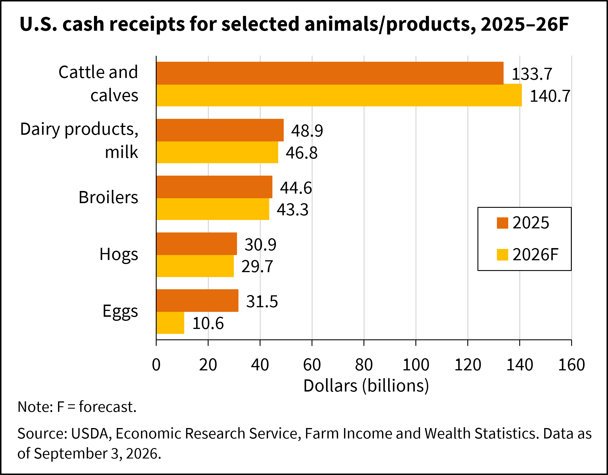
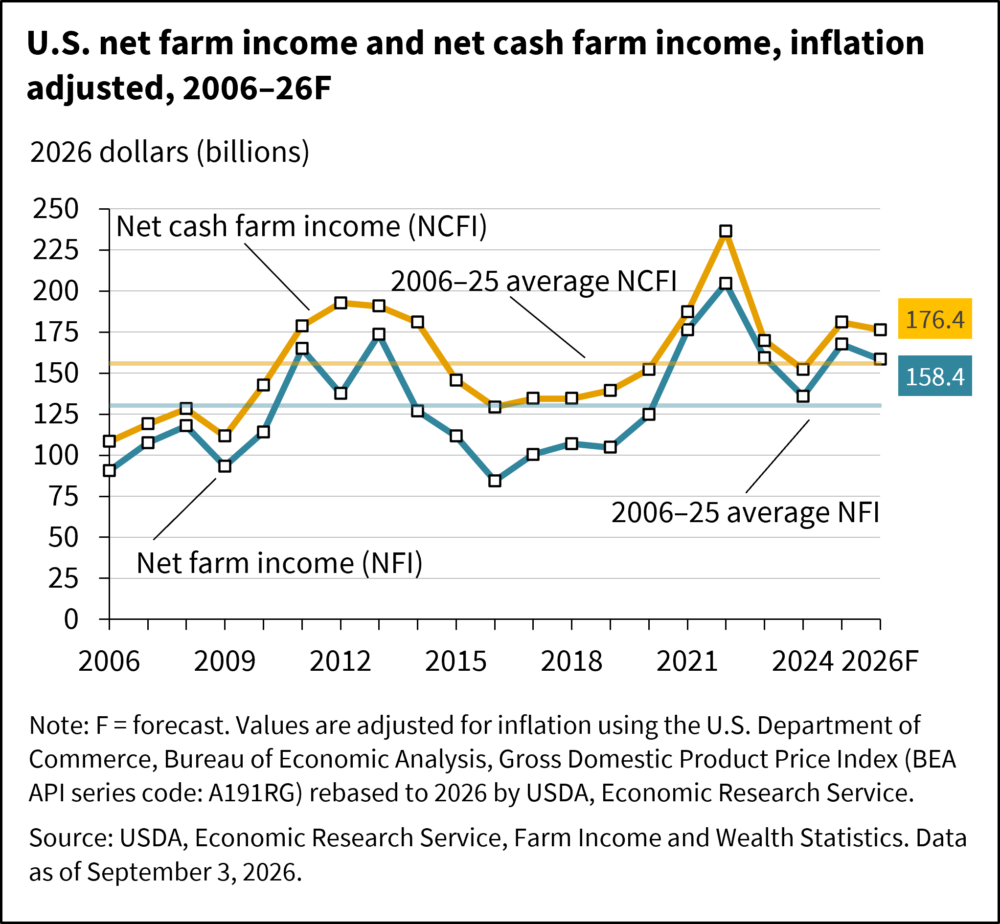
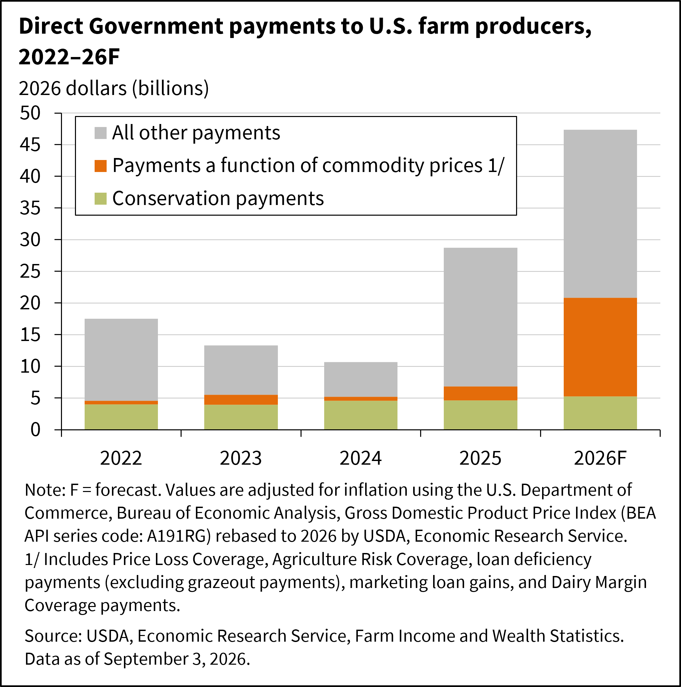

## Core Principles
Practical, gradual transition guided by free-market innovation and sentient-rights considerations. Avoid disruptive mandates or taxpayer-funded subsidies. Prioritize human (and herbivore) welfare over apocalyptic framing while conserving nature where it does not conflict with rights or development.

<a class="back-to-top" href="#top">↑ Back to top</a>

---

## Climate Change

>[!tldr] In short
> Climate change is real and nearly all recent warming is human-caused (IPCC), but it is not apocalyptic under the IPCC AR6 scenario ranges treated here as the central case (serious harm, not civilization collapse). Any shift to greener infrastructure ought to be slow and market-driven, with no mandates and no source forced off early, so energy supply is not disrupted. Animal agriculture ought to be banned and shut down immediately as a rights violation, which also cuts a material share of human-caused warming (~12% FAO livestock agrifood systems, 2015 baseline).

#### Position
The climate varies naturally, but the IPCC finds that essentially all warming since the late 1800s is human-caused. The threat is real but not apocalyptic: under AR6, long-term (2081–2100) global warming versus 1850–1900 is very likely about 1.3–2.4°C in a low-emissions case (SSP1-2.6, best estimate 1.8°C), about 2.1–3.5°C in an intermediate case (SSP2-4.5, best estimate 2.7°C), and about 3.3–5.7°C in a very high-emissions case (SSP5-8.5, best estimate 4.4°C). Likely global mean sea-level rise by 2100 versus 1995–2014 is about 0.32–0.62 m (SSP1-2.6), 0.44–0.76 m (SSP2-4.5), and 0.63–1.01 m (SSP5-8.5) under medium-confidence ice processes. That is serious, uneven harm — coasts, heat, extremes — not human extinction or civilization collapse as the central projection. Low-likelihood ice-sheet outcomes under very high emissions can go higher; if credible evidence shows extreme unjustified death-risk to future sentient beings, greenhouse-gas limits tighten under [[#Pollution and Liability|Pollution and Liability]], still without energy mandates or early forced shutdowns of reliable supply. Policy supports long-term wellbeing of sentient individuals without upending energy supply chains. Any transition to greener infrastructure comes slowly, through markets and private innovation, with no mandates and no early forced shutdowns ([[#Grid Reliability and Permitting|Grid Reliability and Permitting]]). Ending animal agriculture, which is banned as a rights violation and shut down immediately ([[#Agriculture, Grazing, and Habitat|Agriculture, Grazing, and Habitat]]), also cuts livestock agrifood-system emissions; the ban rests on rights, and the climate gain is a side effect.

> [!question]- "If climate change is real, why not act faster?"
> In my judgment, rapid transition would disrupt energy supply chains that sentient beings depend on, causing harm of its own. That is a judgment about risk, not a measured cost estimate. A slow, market-driven shift addresses the problem without that disruption.

> [!question]- "Doesn't carbon pricing cut emissions?"
> Carbon-pricing advocates cite a 2024 meta-analysis of 80 evaluations covering 21 schemes, which found emissions cuts of 5% to 21% in the 17 schemes with significant effects, or 4% to 15% after correcting for publication bias. A cut bought with a government-imposed price on energy is still imposed. The shift to greener energy stays slow and market-driven, with no mandates and no source forced off early, so energy supply is not disrupted.

> [!question]- "What about catastrophic tail risk?"
> Present agents may not impose extreme, unjustified risk of death on future sentient beings ([[1. Ethical and Philosophical Framework#Duties to Future Generations|Duties to Future Generations]]). If credible evidence shows that risk, the harm-based greenhouse-gas limits in [[#Pollution and Liability|Pollution and Liability]] can be tightened in proportion to it, with the burden of proof on the rule. That still means no energy mandates and no early forced shutdowns of reliable supply.

#### Rationale
The IPCC attributes recent warming to human activity: it puts the human-caused rise from 1850–1900 to 2010–2019 at about 1.07°C (likely 0.8–1.3°C), out of about 1.1°C observed, with natural drivers contributing between −0.1°C and +0.1°C. It projects the scenario ranges above. FAO's 2023 *Pathways towards lower emissions* assessment (GLEAM) puts livestock agrifood systems — farm gate, land-use change tied to feed, and key supply-chain steps — at about 6.2 GtCO₂eq in the **2015** reference year, about **12%** of anthropogenic greenhouse-gas emissions. That is a material share, not the largest human driver (fossil energy is larger). The 2006 *Livestock's Long Shadow* figure of about 18% and its livestock-versus-transport comparison are not used here; that comparison mixed a full livestock life-cycle with direct transport emissions only and was later corrected in the literature. The ~12% figure links the [[Glossary#Sentience basis (sentientism)|sentientist]] case against animal agriculture to the climate question as a side effect. Measured transition balances long-term wellbeing against present needs.

>[!quote]- Sources
> - IPCC – [AR6 Synthesis Report: Climate Change 2023](https://www.ipcc.ch/report/ar6/syr/)
> - IPCC – [AR6 Working Group I, Summary for Policymakers (2021)](https://www.ipcc.ch/report/ar6/wg1/chapter/summary-for-policymakers/) (Table SPM.1 temperature; B.5.3 sea level)
> - Food and Agriculture Organization – [Pathways towards lower emissions: A global assessment of the greenhouse gas emissions and mitigation options from livestock agrifood systems (2023)](https://doi.org/10.4060/cc9029en) (~12% of anthropogenic GHG; 6.2 GtCO₂eq; reference year 2015)
> - Food and Agriculture Organization – [New FAO report maps pathways towards lower livestock emissions (2023 newsroom)](https://www.fao.org/newsroom/detail/new-fao-report-maps-pathways-towards-lower-livestock-emissions/en)
> - Nature Communications – [Systematic review and meta-analysis of ex-post evaluations on the effectiveness of carbon pricing (2024)](https://www.nature.com/articles/s41467-024-48512-w)

**See also:** [[1. Ethical and Philosophical Framework#Duties to Future Generations|Duties to Future Generations]]

<a class="back-to-top" href="#top">↑ Back to top</a>

---

## Adaptation and Disaster Policy

>[!tldr] In short
> Climate adaptation ought to be practical. Owners should carry the risk of where they build, subsidies should need opt-in funding, the 18 percent flood insurance cap should be removed, and emergency rescue should stay public.

#### Position
Climate change is real but gradual, so adaptation is handled as a practical matter. Taxpayer subsidies for risk, including subsidized insurance for building in high-risk areas, require opt-in funding like any other subsidy. Owners bear the risks of where and how they build, and private insurance prices those risks. The 18 percent statutory cap on annual flood-insurance premium increases is removed.

> [!question]- "What happens to people hit by a disaster?"
> Emergency response, rescue, and public safety remain government functions. What changes is the long-term subsidy of rebuilding in high-risk places, which shifts costs to taxpayers who did not choose the risk.

#### Rationale
The National Flood Insurance Program owed the Treasury \$22.525 billion after borrowing \$2 billion on February 10, 2025, according to the Congressional Research Service. Under FEMA's Risk Rating 2.0, about one-third of National Flood Insurance Program policyholders already pay full-risk premiums, and 9 percent will eventually need increases of more than 300 percent, according to the Government Accountability Office. Annual increases for most policyholders are limited to 18 percent by statute; GAO estimated it would take until 2037 for 95 percent of current policies to reach full-risk premiums, leaving a \$27 billion premium shortfall. Because the cap keeps premiums below the real risk for more than a decade, it should be removed. Any assistance for policyholders comes only through opt-in funding, not taxpayer subsidies. The no-subsidy rule is set out in [[#Subsidies and Mandates]].

>[!quote]- Sources
> - U.S. Government Accountability Office – [Flood Insurance: FEMA's New Rate-Setting Methodology Improves Actuarial Soundness but Highlights Need for Broader Program Reform (GAO-23-105977, July 31, 2023)](https://www.gao.gov/products/gao-23-105977)
> - Congressional Research Service (Horn) – [National Flood Insurance Program Borrowing Authority](https://www.congress.gov/crs-product/IN10784)

<a class="back-to-top" href="#top">↑ Back to top</a>

---

## International Climate Agreements

>[!tldr] In short
> Awareness efforts should be welcome. My contribution is the immediate ban on animal agriculture, which also removes a material share of human-caused emissions (~12% FAO livestock agrifood systems, 2015 baseline; critics note other FAO and inventory boundaries put the share higher or lower — livestock remains material either way). The U.S. ought to follow climate accords only when they match reasonable U.S. law and do not restrict Americans' freedom.

#### Position
International efforts to raise awareness of human-induced climate change can be supported. Animal agriculture is banned and shut down immediately as a rights violation ([[#Sanctuary Plan|Sanctuary Plan]]); ending it also cuts the livestock agrifood-system share of emissions (~12% of anthropogenic GHG in FAO's 2015 Pathways baseline), so the ban serves sentient-rights protections and the climate at once. Critics note that FAO livestock shares move with the system boundary and baseline year — an older FAO estimate put livestock nearer 14.5% of anthropogenic emissions, and other inventories attribute less once land-use change is allocated differently. Under any of those accountings livestock remains a material share; the Pathways 2015 baseline of about 12% is the figure I use, and the ban is driven by the rights violation first — the emissions cut is a concurrent benefit, not the ground. The United States is not beholden to any accord that goes against the freedom of its people and nation. Accords that align with reasonable U.S. conservation and regulatory laws for the public safety of sentient beings can be followed. Policy that infringes on rights-respecting citizens is not mandated.

> [!question]- "Does withdrawing from accords undermine global climate efforts?"
> Accords consistent with reasonable U.S. conservation and safety law can be followed. What is rejected is binding commitments that override the freedom of Americans.

#### Rationale
Sovereignty applies to climate policy as to foreign policy. The Paris Agreement relies on nationally determined contributions, which shows that climate commitments can be set by each nation's own priorities.

>[!quote]- Sources
> - UNFCCC – [The Paris Agreement](https://unfccc.int/process-and-meetings/the-paris-agreement)
> - Food and Agriculture Organization – [Pathways towards lower emissions (2023)](https://doi.org/10.4060/cc9029en)
> - Food and Agriculture Organization – [New FAO report maps pathways towards lower livestock emissions (2023 newsroom)](https://www.fao.org/newsroom/detail/new-fao-report-maps-pathways-towards-lower-livestock-emissions/en)

<a class="back-to-top" href="#top">↑ Back to top</a>

---

## Energy Mix

>[!tldr] In short
> Fossil fuels ought to stay where they work best while renewables grow through private innovation. There should be no forced phase-outs.

#### Position
Fossil fuels remain for now while greater effort goes into renewables. Fossil fuels may continue in industries that benefit most from them, while other industries move to renewables that suit them better. Entire forced phase-outs are not supported; renewable technology advances through incentivization and innovation by private companies.

> [!question]- "Does keeping fossil fuels slow the transition?"
> Each industry uses the energy source that serves it best, and private innovation makes renewables competitive on their merits. Forced phase-outs impose costs before alternatives are ready.

#### Rationale
Fossil fuels still supply most U.S. energy, so abrupt phase-outs would disrupt the economy. Technology learning and competition have lowered the cost of utility-scale solar by about 85% since 2010, and unsubsidized solar and wind now compete on cost, which supports a transition led by innovation rather than mandate.

>[!quote]- Sources
> - U.S. Energy Information Administration – [U.S. Energy Facts Explained](https://www.eia.gov/energyexplained/us-energy-facts/)
> - Lazard – [Levelized Cost of Energy+ (June 2025)](https://www.lazard.com/media/uounhon4/lazards-lcoeplus-june-2025.pdf)
> - PMC – [Levelized cost-based learning analysis of utility-scale wind and solar in the United States](https://pmc.ncbi.nlm.nih.gov/articles/PMC9127581/)

### Energy Policy

>[!tldr] In short
> Any shift toward cleaner energy ought to be slow and market-driven, with no mandates and no early forced shutdowns. Nuclear power should be encouraged mainly by cutting red tape, with any public money coming only from taxpayers who choose to chip in. Renewables should be welcome but not required, and energy markets should stay competitive without taxpayer subsidies.

#### Position
A gradual, market-driven shift toward cleaner energy sources is accepted, with no mandates and no source forced to shut down early ([[#Grid Reliability and Permitting|Grid Reliability and Permitting]]). Nuclear power is incentivized, first through deregulation such as streamlined licensing and permitting. Any public financial support for nuclear is drawn only from taxpayers who opt in to fund it; no taxpayer is compelled to subsidize nuclear or any other energy industry. Renewables may be encouraged but are not mandated. Energy markets remain competitive and consumer-oriented, without taxpayer subsidies (absent opt-in) or coercive industrial policy.

> [!question]- "Does incentivizing nuclear contradict opposition to subsidies?"
> No. Nuclear is incentivized first by removing the regulatory and permitting obstacles that add to its cost and delay, and any public money comes only from taxpayers who opt in, consistent with [[9. Energy & Environment#Subsidies and Mandates|Energy & Environment]]. Nuclear is singled out because of its safety record and reliability. Energy policy is set out further in [[9. Energy & Environment|Energy & Environment]].

#### Rationale
A reliable, affordable energy supply underpins economic growth, so transition must not disrupt it. Nuclear power produces large amounts of low-carbon electricity with one of the lowest death rates per unit of energy of any source. Construction cost is the largest barrier to new reactors, so streamlined licensing works alongside standardized designs and market competition rather than replacing them. Competitive markets drive innovation more efficiently than mandates.

>[!quote]- Sources
> - U.S. Department of Energy – [Advantages and Challenges of Nuclear Energy](https://www.energy.gov/ne/articles/advantages-and-challenges-nuclear-energy)
> - Our World in Data – [What are the safest and cleanest sources of energy?](https://ourworldindata.org/safest-sources-of-energy)
> - U.S. Energy Information Administration – [U.S. Energy Facts Explained](https://www.eia.gov/energyexplained/us-energy-facts/)
> - MIT Energy Initiative – [The Future of Nuclear Energy in a Carbon-Constrained World (2018)](https://energy.mit.edu/research/future-nuclear-energy-carbon-constrained-world/)

**See also:** [[9. Energy & Environment#Subsidies and Mandates|Subsidies and Mandates]] · Graded: [[12. Current Administration#Wind turbine imports found a security threat|Wind turbine imports found a security threat (S12)]]

<a class="back-to-top" href="#top">↑ Back to top</a>

---

## Nuclear Power

>[!tldr] In short
> Nuclear power should expand because it is proven safe, with strict safety standards.

#### Position
Nuclear power is expanded because it has been proven safe. Safety remains crucial, as it is everywhere else.

>[!example]- Documented accounts
> These are individual reported events, not statistics; they illustrate the position and do not measure a trend.
> - **Vogtle, 2024:** Unit 4 entered commercial operation, making Vogtle's four units the largest nuclear power plant in the United States. U.S. Energy Information Administration (2024) – [Plant Vogtle Unit 4 begins commercial operation](https://www.eia.gov/todayinenergy/detail.php?id=61963)
> - **Fukushima:** UNSCEAR reported that no adverse health effects among Fukushima residents have been documented that could be directly attributed to radiation from the accident. UN Information Service Vienna (2021) – [A decade after the Fukushima accident: Radiation-linked increases in cancer rates not expected to be seen](https://unis.unvienna.org/unis/en/pressrels/2021/unisous419.html)

> [!question]- "What about accidents like Chernobyl and Fukushima?"
> Accidents show why safety standards are crucial, not why nuclear power should be abandoned. Measured by deaths per unit of energy, nuclear is among the safest sources available: about 0.03 deaths per terawatt-hour, counting Chernobyl and Fukushima, against 0.02 for solar, 0.04 for wind, 2.8 for gas, and 24.6 for coal.

#### Rationale
Nuclear power has one of the lowest death rates per unit of energy produced of any source and emits very little carbon. Our World in Data puts it at about 0.03 deaths per terawatt-hour, close to solar (0.02) and wind (0.04) and far below gas (2.8), oil (18.4), and coal (24.6). It provides steady output that intermittent sources cannot, making it central to a gradual clean-energy transition.

>[!quote]- Sources
> - Our World in Data – [What are the safest and cleanest sources of energy?](https://ourworldindata.org/safest-sources-of-energy)
> - Our World in Data – [Death rates per unit of electricity production](https://ourworldindata.org/grapher/death-rates-from-energy-production-per-twh)
> - U.S. Department of Energy – [Advantages and Challenges of Nuclear Energy](https://www.energy.gov/ne/articles/advantages-and-challenges-nuclear-energy)

<a class="back-to-top" href="#top">↑ Back to top</a>

---

## Nuclear Waste and Fuel Cycle

>[!tldr] In short
> Nuclear power ought to expand, spent fuel should be stored safely, recycling should be free to develop, and storage sites should go in low-density areas.

#### Position
Nuclear power is expanded, and spent fuel is managed under the same safety standards that make nuclear power safe. Storage and recycling technologies are allowed to develop under deregulation, and storage sites follow the development rule: low-density areas away from protected species.

>[!example]- Documented accounts
> These are individual reported events, not statistics; they illustrate the position and do not measure a trend.
> - **Finland:** Onkalo is designed to hold spent nuclear fuel deep in bedrock for 100,000 years. BBC Future (2023) – [Finland's plan to bury spent nuclear fuel for 100,000 years](https://www.bbc.com/future/article/20230613-onkalo-has-finland-found-the-answer-to-spent-nuclear-fuel-waste-by-burying-it)

> [!question]- "Isn't waste the unsolved problem of nuclear power?"
> Spent fuel has been stored safely for decades. Allowing recycling and permanent storage to develop removes regulatory obstacles rather than technical ones.

#### Rationale
The Nuclear Waste Policy Act of 1982 makes the federal government responsible for permanent disposal of spent fuel (42 U.S.C. § 10131). About 97,061 metric tons of commercial spent fuel were in storage at the end of 2024, 46,864 tons in dry storage and 50,197 tons in pools, according to a U.S. Department of Energy inventory. Siting follows [[#Conservation vs Development]].

>[!quote]- Sources
> - Cornell LII – [42 U.S.C. § 10131: Findings and purposes](https://www.law.cornell.edu/uscode/text/42/10131)
> - U.S. Department of Energy via OSTI – [Spent Nuclear Fuel and Reprocessing Waste Inventory](https://www.osti.gov/biblio/3015718)

<a class="back-to-top" href="#top">↑ Back to top</a>

---

## Grid Reliability and Permitting

>[!tldr] In short
> Reliability ought to come first, no source should be forced off early, and permitting should be streamlined while environmental protections stay.

#### Position
A reliable grid comes first. No source is forced off the grid before replacements are ready, and permitting is streamlined so that new generation and transmission can connect. Regulation carries the burden of proof, and nuclear power in particular is deregulated and expanded.

>[!example]- Documented accounts
> These are individual reported events, not statistics; they illustrate the position and do not measure a trend.
> - **Texas, February 2021:** Winter Storm Uri forced the largest manually controlled load shed in U.S. history and more than 4.5 million Texans lost power, some for four days; freezing and fuel issues caused 75.6% of generator outages. FERC (2021) – [Final Report on February 2021 Freeze Underscores Winterization Recommendations](https://ferc.gov/news-events/news/final-report-february-2021-freeze-underscores-winterization-recommendations)
> - **Deaths:** Texas health officials confirmed 246 storm-related deaths. Texas Department of State Health Services (2021) – [February 2021 Winter Storm-Related Deaths – Texas](https://www.dshs.texas.gov/sites/default/files/commprep/disasterepi/surveillance/SMOC_FebWinterStorm_MortalitySurvReport_12-30-21.pdf)

> [!question]- "Doesn't faster permitting harm the environment?"
> Protections for sanctuary lands, protected species, and public health remain. Streamlining removes delay, not those standards.

#### Rationale
Nearly 2,600 GW of generation and storage capacity was waiting in U.S. interconnection queues at the end of 2023, according to Lawrence Berkeley National Laboratory. The North American Electric Reliability Corporation projects summer peak demand to rise by about 224 GW through 2035 and flags the MISO and PJM regions for seasonal shortfall risk. The no-phase-out rule is set out in [[#Energy Mix]].

>[!quote]- Sources
> - Lawrence Berkeley National Laboratory – [Queued Up: 2024 Edition](https://emp.lbl.gov/publications/queued-2024-edition-characteristics)
> - North American Electric Reliability Corporation – [2025 Long-Term Reliability Assessment](https://www.nerc.com/globalassets/our-work/assessments/nerc_ltra_2025.pdf)

<a class="back-to-top" href="#top">↑ Back to top</a>

---

## Subsidies and Mandates

>[!tldr] In short
> There ought to be no energy subsidies of any kind, green or fossil, unless taxpayers opt in, and no mandates. The market should drive the energy mix.

#### Position
Government subsidies for green technology, fossil fuels, refining or any other energy source mean taxpayer money, which is theft; the government subsidizes nothing unless taxpayers opt in. There are no mandates. Goals exist, and competition booms in the free market.

> [!question]- "Without subsidies, can clean technology compete?"
> Free-market competition drives advancement, and taxpayers who want to support green technology can opt in. Using mandatory taxes to pick winners is rejected.

#### Rationale
Compelled funding of private industries violates property rights and distorts markets. Competition rewards technologies that deliver value at the lowest cost, which is how energy innovation advances most reliably. The Energy Information Administration counted \$183.3 billion (2022 dollars) in federal energy subsidies over FY 2016 to 2022, 46 percent of it for renewables, and 70 percent delivered through the tax code.

>[!quote]- Sources
> - U.S. Energy Information Administration – [Federal Financial Interventions and Subsidies in Energy in Fiscal Years 2016–2022](https://www.eia.gov/analysis/requests/subsidy/)

**See also:** Graded: [[12. Current Administration#Defense Production Act funds for refineries|Defense Production Act funds for refineries]] · [[12. Current Administration#America First Seafood Strategy|America First Seafood Strategy]]

<a class="back-to-top" href="#top">↑ Back to top</a>

---

## Pollution and Liability

>[!tldr] In short
> Pollution that harms people violates their rights. It ought to be limited to what public-health standards allow, polluters should pay for the damage, and greenhouse gases should count as pollution above the natural baseline, regulated as harm, without energy mandates or early forced shutdowns.

#### Position
Pollution that harms others, or directly imposes a severe, non-consensual risk of serious harm on them, violates their [[Glossary#Negative rights|negative rights]]. It is regulated to a level that meets consumer and public-health standards, and polluters are liable for the harm they cause to people and property. Greenhouse gases count as pollution to the extent that emissions exceed the natural baseline; the natural contribution is not attributed to anyone. Greenhouse-gas rules are harm rules, not energy mandates: they limit emissions in proportion to the harm shown, never prescribe a fuel, technology, or energy source, and set compliance periods long enough that no source is forced off early and reliable supply is not disrupted ([[#Climate Change]]; [[#Grid Reliability and Permitting|Grid Reliability and Permitting]]). Each environmental rule carries the burden of showing the harm it addresses.

>[!example]- Documented accounts
> These are individual reported events, not statistics; they illustrate the position and do not measure a trend.
> - **East Palestine, Ohio, 2023:** the NTSB found the vent-and-burn of hazardous tank cars after the Norfolk Southern derailment was "unnecessary." NTSB (2024) – [Failed Wheel Bearing Caused Norfolk Southern Train Derailment in East Palestine, Ohio](https://www.ntsb.gov/news/press-releases/Pages/NR20240625.aspx)

> [!question]- "Doesn't pollution regulation conflict with your skepticism of regulation?"
> No. Preventing serious environmental harm is one of the four domains where business regulation is legitimate. The burden-of-proof rule still applies: a pollution rule must show the harm it prevents, and rules that cannot are removed.

> [!question]- "How can anyone be liable for diffuse greenhouse-gas harm?"
> Where harm cannot be traced to a specific emitter, emissions above the natural baseline are handled by the harm-based limits above rather than by individual lawsuits. Traceable harm to persons or property remains liable in court.

#### Rationale
Axiom 6 treats the direct imposition of severe, non-consensual risk as crossing the [[Glossary#Rights forfeiture|forfeiture]] threshold, and property rights protect owners against physical invasion of their land and bodies. Air pollution is the clearest documented case. EPA's peer-reviewed second prospective study estimated that the 1990 Clean Air Act Amendments would prevent over 230,000 early deaths in 2020, with central benefits exceeding costs by more than 30 to one. Climate has a natural baseline, and only the human-caused share above it is counted as pollution; the IPCC finds that share is essentially all recent warming. Rules with demonstrated effects meet the burden of proof in [[5. Domestic Policy & Governance#Infrastructure and Regulation|Domestic Policy & Governance]].

>[!quote]- Sources
> - U.S. Environmental Protection Agency – [Benefits and Costs of the Clean Air Act 1990–2020, the Second Prospective Study](https://www.epa.gov/clean-air-act-overview/benefits-and-costs-clean-air-act-1990-2020-second-prospective-study)
> - U.S. Environmental Protection Agency – [Summary of the Clean Air Act](https://www.epa.gov/laws-regulations/summary-clean-air-act)

**See also:** [[5. Domestic Policy & Governance#Infrastructure and Regulation|Infrastructure and Regulation]]

<a class="back-to-top" href="#top">↑ Back to top</a>

---

## Regulation and Conservation

>[!tldr] In short
> Environmental rules ought to protect sanctuary lands and herbivore populations, and pollution should be regulated to keep people healthy.

#### Position
Environmental regulations exist on the specific grounds of conserving and maintaining sanctuary lands and herbivorous animal populations. Pollution and waste are regulated to a level that meets consumer and public health standards.

> [!question]- "Why protect herbivores specifically rather than all wildlife?"
> Herbivores can live without causing harm to other sentient beings, so the government ought to give their populations and habitats priority protection. This follows from the sentientist ethic set out in [[1. Ethical and Philosophical Framework|Ethical and Philosophical Framework]].

#### Rationale
Regulation is justified where it protects sentient beings from harm. Pollution harms public health, which grounds rules like the Clean Air Act. Conservation regulation centers on the populations I value most. About 12.9% of U.S. land and inland waters is currently protected and managed mainly for biodiversity, the baseline sanctuary policy builds from.

>[!quote]- Sources
> - U.S. Environmental Protection Agency – [Summary of the Clean Air Act](https://www.epa.gov/laws-regulations/summary-clean-air-act)
> - Cornell LII – [16 U.S.C. § 1531: Endangered Species Act findings and purposes](https://www.law.cornell.edu/uscode/text/16/1531)
> - U.S. Geological Survey – [Analysis of Updated USGS Database Finds Increase in America's Lands and Waters Managed for Biodiversity](https://www.usgs.gov/news/technical-announcement/analysis-updated-usgs-database-finds-increase-americas-lands-and-waters)

<a class="back-to-top" href="#top">↑ Back to top</a>

---

## Conservation vs Development

>[!tldr] In short
> Nature ought to be preserved where rights are not violated. Mining and extraction should go in quarries and lower-density places such as deserts, away from the habitat of protected species, and development should be built alongside nature instead of destroying it.

#### Position
Nature is preserved so long as sentient rights are not violated. Resource extraction generally takes place in quarries and lower-density areas such as deserts, sited away from the habitat of protected species such as the desert tortoise. Technology is, for the most part, built in and alongside rights-respecting nature rather than demolishing it.

> [!question]- "Doesn't any development harm wildlife?"
> Development is directed toward low-sentient-density areas to minimize harm, and integration with nature is preferred over demolition. The aim is to minimize rights violations, not halt development.

#### Rationale
The sentientist framework weighs harm to sentient beings, so where development occurs matters. Concentrating extraction in areas with few sentient animals limits the harm of growth.

>[!quote]- Sources
> - U.S. Fish and Wildlife Service – [Western Solar Plan: desert tortoise update (2024)](https://www.fws.gov/sites/default/files/documents/2024-10/blm-solar-final-peis-update-for-desert-tortoise-mog_oct-3-2024.pdf)

**See also:** [[8. Foreign Policy & International Relations#Border Barriers and Protected Habitat|Border Barriers and Protected Habitat]] · Graded: [[12. Current Administration#Big Bend border wall|Big Bend border wall]]

<a class="back-to-top" href="#top">↑ Back to top</a>

---

## Water Resources and Rights

>[!tldr] In short
> Water rights ought to be property, pollution of water should be treated as a violation, and markets should allocate water within health standards.

#### Position
Water rights are property rights, held, traded, and protected like other property. Polluting another's water is a rights violation under the pollution rule, with liability for the harm. Water is allocated through property and markets rather than political rationing.

> [!question]- "Won't markets leave people without water?"
> Markets direct water to its most valued uses and reward conservation. Public health standards for drinking water remain.

#### Rationale
Western states generally allocate water under prior appropriation, in which rights rest on beneficial use and seniority. Pollution liability is set out in [[#Pollution and Liability]].

>[!quote]- Sources
> - Cornell LII – [Prior appropriation doctrine](https://www.law.cornell.edu/wex/prior_appropriation_doctrine)

<a class="back-to-top" href="#top">↑ Back to top</a>

---

## Agriculture, Grazing, and Habitat

>[!tldr] In short
> Animal agriculture ought to be banned outright and shut down immediately, with no wind-down. Every animal alive at the shutdown should be kept alive and given sanctuary for its natural life under the [[#Sanctuary Plan|Sanctuary Plan]], which also sets out what happens to the firms, the land and the workers. Federal grazing permits should be revoked on day one, habitat rules should protect sanctuary lands and herbivores, and lab-grown meat is the goal and the replacement. It may not meet demand at the same cost right away and scales up over time; the ban should not wait for it ([[#Agriculture and Food Policy|Agriculture and Food Policy]]).

#### Position
Animal agriculture should be banned outright and shut down immediately. Farming sentient animals for food is a rights violation, so the ban is not phased in and there is no wind-down.

> [!note]- How this gets done: the Sanctuary Plan
> There is no wind-down. The shutdown, the care and adoption of every animal alive at that moment, the conversion, divestment or liquidation of the firms, the land, the workers, enforcement, and the Sanctuary Levy that pays for it are all set out once, in the [[#Sanctuary Plan|Sanctuary Plan]].

Habitat protection centers on sanctuary lands and herbivore populations. No grazing permits are issued on federal land, and existing permits are revoked on day one; they are not an honored commitment, and grazing does not displace protected herbivore habitat.

**My view:** Slaughterhouses and animal farming shouldn't exist in 2026, which follows my sentientist view. Animal agriculture should shut down immediately, with no transition. Lab-grown meat would be the goal and the replacement, but it might not be able to replace the demand right away at the same cost; it will scale up over time.

> [!question]- "Doesn't this hurt ranchers?"
> Yes, ranching ends. A ranch that earns most of its revenue from animals converts fully to plant-based farming or cultivated-meat research, or is liquidated, and its owners receive no compensation; what is left after creditors goes to the sanctuaries. Keeping every animal alive comes first. There is no retraining or job-placement program: ranchers and farm workers find new jobs or can apply for sanctuary jobs under the worker rules in the [[#Sanctuary Plan|Sanctuary Plan]]. Public sanctuary land serves the herbivore populations it protects.

> [!question]- "Animal agriculture is a huge industry. Won't ending it do serious economic damage?"
> The industry is large. U.S. cash receipts from animals and animal products were a record of about \$303.7 billion in 2025 and are forecast at \$287.3 billion in 2026, more than half of all \$540.3 billion in farm cash receipts, and the losses to producers, workers, and farm communities would be real. But economic value does not decide whether a practice violates rights. Britain did not weigh slavery's profitability against its wrong when it abolished slavery in 1833. It ended it, and the £20 million it raised, about 40% of government spending that year, went to compensating enslaved people's owners rather than to keeping the system. I draw the same line, with one difference: the industry gets no compensation, and what is left after creditors goes to the animals, in the sanctuaries. Regulatory barriers to lab-grown meat and plant-based food are cleared so replacements scale up as animal products leave the market ([[10. Bioethics, Progress, & Technology#Animal Rights and Sentience Technology|Bioethics, Progress, & Technology]]). The full costs and funding are in [[#Sanctuary Plan|Sanctuary Plan]].

> [!question]- "Dairy, eggs, wool, and honey don't kill the animal. Are they banned too?"
> Yes, as commercial animal agriculture. Every one of them depends on breeding animals for use, which ends on day one, and commercial dairy and egg production kill the animals they can't use, such as male calves and male chicks, and send spent animals to slaughter. Once the food ban takes full effect, selling or possessing dairy, eggs, or honey is banned as well, and sanctuary operators and adopters may not sell or use animal products ([[#Sanctuary Plan|Sanctuary Plan]]). Companion animals, including horses kept where their rights are respected, remain under [[7. Cultural & Social Issues#Hunting, Fishing, Pets, and Zoos|Hunting, Fishing, Pets, and Zoos]].

> [!question]- "Prohibition failed. Won't a meat ban just create a black market?"
> Some of it, yes. Alcohol Prohibition did not end drinking: Miron and Zwiebel estimate consumption fell to about 30% of its earlier level at first, then recovered to 60–70%. A meat ban will have smugglers and backyard slaughter too. Two differences matter. Prohibition banned an act between consenting adults, while every black-market slaughter kills a victim, which is why it is prosecuted as murder, graded by sentience, rather than as a vice offense. And raising an animal for slaughter takes space, feed, and time, so it is far easier to detect than a still. Even on Prohibition's own numbers, a ban cut consumption by a third or more, and each animal not killed is a life not taken.
> - Miron & Zwiebel, NBER – [Alcohol Consumption During Prohibition (1991)](https://www.nber.org/papers/w3675)

#### Rationale
Killing sentient animals for food violates negative rights, so animal agriculture is banned on the same sentientist ground as other deliberate killings outside self-defense ([[1. Ethical and Philosophical Framework#Animal Rights and Sentientism|Animal Rights and Sentientism]]). The 2025 federal grazing fee is \$1.35 per animal unit month (AUM) on about 18,000 Bureau of Land Management permits, while private grazing leases the same year ran from about \$11 to \$47.50 per AUM. About 12.9% of U.S. land and inland waters is protected and managed mainly for biodiversity, as cited in [[#Regulation and Conservation]]. Congress can reach even home-raised animals under the Commerce Clause, as *Gonzales v. Raich* (2005) held for home-grown marijuana, and protecting negative rights is the government's first duty.

*Chart: USDA Economic Research Service, a U.S. government work in the public domain, reproduced with credit. USDA does not endorse the views on this site.*
USDA ERS – [Farm Sector Income Forecast](https://www.ers.usda.gov/topics/farm-economy/farm-sector-income-finances/farm-sector-income-forecast)

*Chart: USDA Economic Research Service, a U.S. government work in the public domain, reproduced with credit. USDA does not endorse the views on this site.*
USDA ERS – [Farm Sector Income Forecast](https://www.ers.usda.gov/topics/farm-economy/farm-sector-income-finances/farm-sector-income-forecast)

>[!quote]- Sources
> - Bureau of Land Management – [BLM, USDA Forest Service announce 2025 grazing fees](https://www.blm.gov/press-release/blm-usda-forest-service-announce-2025-grazing-fees)
> - Montana State University Extension – [Grazing lease rates (USDA NASS)](https://www.montana.edu/extension/aglease/Grazing.html)
> - USDA Economic Research Service – [Farm Sector Income Forecast](https://www.ers.usda.gov/topics/farm-economy/farm-sector-income-finances/farm-sector-income-forecast)
> - HM Treasury – [Freedom of Information response: Slavery Abolition Act 1833 (2018)](https://assets.publishing.service.gov.uk/government/uploads/system/uploads/attachment_data/file/680456/FOI2018-00186_-_Slavery_Abolition_Act_1833_-_pdf_for_disclosure_log__003_.pdf)
> - U.S. Geological Survey – [PAD-US: Protected Areas Database of the United States](https://www.usgs.gov/programs/gap-analysis-project/science/pad-us-data-overview)
> - Cornell LII – [Gonzales v. Raich, 545 U.S. 1 (2005)](https://www.law.cornell.edu/supremecourt/text/545/1)

**See also:** [[6. Criminal Justice & Security#Murder, Rape, and the Mandatory Death Penalty|Murder, Rape, and the Mandatory Death Penalty]] · [[10. Bioethics, Progress, & Technology#Animal Rights and Sentience Technology|Animal Rights and Sentience Technology]] · [[1. Ethical and Philosophical Framework#Animal Rights and Sentientism|Animal Rights and Sentientism]]

### Sanctuary Plan

>[!tldr] In short
> Animal agriculture, wild-capture commercial fishing, aquaculture, commercial breeding mills, and animal testing ought to shut down on day one — no wind-down. Every animal alive that day ought to be kept alive in sanctuary (then licensed nonprofit care) or adopted under strict vetting; no breeding. Industry equity ought to convert or be liquidated without shareholder compensation; proceeds ought to fund care. Sanctuary bonds plus a flat Sanctuary Levy (never above 3%, income above \$75,000 single / \$150,000 joint) ought to fund the run-down; the levy ought to end on the published population + repayment trigger. Named, time-limited property exception ([[1. Ethical and Philosophical Framework#^sanctuary-property-exception|Sanctuary property exception]]). Ops detail: [[#Adoption and vetting|Adoption]] · [[#Handover to Nonprofit Operators|Handover]] · [[#How many animals|How many]] · [[#What it costs|Costs]] · [[#The Sanctuary Levy|Levy]].

#### Position
My plan is an immediate shutdown with no wind-down. On day one, all animal agriculture, wild-capture commercial fishing, aquaculture (including farmed crustaceans and, as a precaution, farmed bivalves), commercial breeding mills and animal testing stop. Nobody breeds, slaughters, catches or tests on another sentient animal after that day. Experimentation on offenders who have forfeited their rights continues under [[10. Bioethics, Progress, & Technology#Animal Rights and Sentience Technology|Animal Rights and Sentience Technology]]; it is not animal testing.

Keeping every animal alive comes first. No animal alive at the shutdown is killed. Because no new animals are born, the sanctuary population and cost fall every year. Inland fish and crustacean farms convert on site; ocean farms stay under the same keep-alive rule even where counts and costs are incomplete. Farmed bivalves end with aquaculture as a precaution (low or uncertain sentience); stock already in the water is left unharvested and gear is decommissioned. Numbers, gaps, and accepted risks: [[#How many animals|How many animals]].

How care, adoption, state-to-nonprofit handover, firm conversion and liquidation, land, foreign firms, workers, enforcement, food-possession marks, funding, and the levy work is set out once in the subsections below — not repeated here. Shareholders and owners of animal-agriculture equity get no compensation; workers' unpaid wages are paid first; a family on a liquidated farm keeps its house and house lot.

**Named exception:** The Sanctuary Levy, compelled conversion and liquidation, and taking industry property with no compensation to shareholders are a named, time-limited exception to ordinary property remedies under negative rights, justified by the animals' negative rights and capped by the levy end-condition ([[1. Ethical and Philosophical Framework#^sanctuary-property-exception|Sanctuary property exception]]). I accept that break for this plan.

> [!note]- Accepted risks (day-one; Needs research)
> Day-one shutdown is the position. The middle and high cost cases are **incomplete** until the gaps below are filled; they are risks I accept, not reasons to phase the ban.
> 1. **Farmed crustaceans.** No reliable point-in-time headcount; sanctuary care cost is unestimated; cost cases leave them out (**Needs research:** inventory + care cost).
> 2. **Ocean fish / crustacean farms.** No reliable U.S. site count; sanctuary staffing and logistics for any ocean farms are a huge undertaking with no timed plan yet (**Needs research:** site inventory + staffing model).
> 3. **Medical supply.** Heparin from pig intestines and egg-based flu vaccine (~72% of 2025–26 U.S. supply) end with the ban. Egg-free flu vaccines and non-animal anticoagulants exist; there is **no published replacement timeline** here — only the duty to clear every barrier starting day one (**Needs research:** timed scale-up path).
> Owning day-one means stating these gaps in the open. It does not mean a gradual agriculture wind-down.

> [!question]- "Doesn't the Fifth Amendment require just compensation when the government takes property?"
> Not when the law bans a harmful use. In *Mugler v. Kansas* (1887) the Supreme Court upheld Kansas's prohibition of alcohol without compensation to a brewer whose plant lost most of its value, holding that banning a use injurious to the public is not a taking. *Lucas v. South Carolina Coastal Council* (1992) still requires compensation for a total wipeout unless background principles of law already forbade the use. The law ought to declare, as part of the ban, that killing sentient animals for food is such a forbidden use. Courts may still order compensation for the land and buildings that pass to the sanctuaries without payment; the fair-value purchases from owners outside the industry already reduce that risk. The named exception stands: the levy and the uncompensated transfers of industry assets fall under [[1. Ethical and Philosophical Framework#^sanctuary-property-exception|Sanctuary property exception]], not under ordinary eminent-domain practice.
> - Cornell LII – [Mugler v. Kansas, 123 U.S. 623 (1887)](https://www.law.cornell.edu/supremecourt/text/123/623)
> - Cornell LII – [Lucas v. South Carolina Coastal Council, 505 U.S. 1003 (1992)](https://www.law.cornell.edu/supremecourt/text/505/1003)

> [!question]- "Won't the import bans break WTO rules?"
> The WTO allows measures "necessary to protect public morals" under GATT Article XX(a). In *EC–Seal Products* (2014) the Appellate Body upheld the EU's ban on seal products on animal-welfare moral grounds while faulting how its exceptions were applied. A ban with no exceptions, applied the same to domestic and foreign products, as this one is, removes the flaw the EU's had. If a panel still ruled against it, the ban stands; the United States follows its own law ([[8. Foreign Policy & International Relations#Global Institutions|Global Institutions]]).
> - World Trade Organization – [DS400: European Communities — Measures Prohibiting the Importation and Marketing of Seal Products](https://www.wto.org/english/tratop_e/dispu_e/cases_e/ds400_e.htm)

> [!question]- "Heparin and most flu vaccines come from animals. Do they end too?"
> Yes. Heparin sold in the U.S. is made from pig intestines, and about 72% of the 2025–26 U.S. flu vaccine supply was made in chicken eggs. An innocent animal may not be harmed for another's benefit, however large the benefit ([[1. Ethical and Philosophical Framework#Conflicts Between Rights-Holders|Conflicts Between Rights-Holders]]), so these supplies end with the rest of animal agriculture and the import ban. The cost is real: heparin is a standard blood thinner for surgery and heart attacks. Egg-free flu vaccines already exist, cell-based and recombinant, and so do anticoagulants not made from animals. The government ought to clear every barrier to scaling them, starting on day one. That is an accepted risk with a Needs-research placeholder for a timed replacement path — not a claim that the middle Sanctuary cost case already covers medical supply, and not a reason to delay the ban.
> - U.S. Food and Drug Administration – [Current Supply of Heparin for U.S. Market Not Impacted By African Swine Fever in China](https://www.fda.gov/drugs/current-supply-heparin-us-market-not-impacted-african-swine-fever-china)
> - Centers for Disease Control and Prevention – [Seasonal Influenza Vaccine Supply Frequently Asked Questions](https://cdc.gov/flu/hcp/vaccine-supply/vaxadmin.html)
> - Centers for Disease Control and Prevention – [How Influenza (Flu) Vaccines Are Made](https://www.cdc.gov/flu/vaccine-process/)

#### Adoption and vetting
I worry that farm animals could be adopted by people who would kill them for meat at home, so every adoption is vetted first. Breeding-mill dogs, cats and other companion animals go through the same steps. Each step must be passed before an animal leaves a sanctuary:
1. **Background check.** Every adult in the household is checked against the national records of animal-harm marks, convictions and earlier adoption violations. Any animal-harm mark or conviction disqualifies the household, and so does any adult barred from animal care under point 12.
2. **Home and facility inspection.** An inspector checks the space, shelter, fencing, heating, water and access to a veterinarian against the needs of that species, before approval. The inspection sets how many animals the home may take.
3. **Signed no-slaughter commitment.** The adopter signs a commitment never to kill, sell, breed or use the animal for food or products. Euthanasia is allowed only under the veterinary rule above.
4. **Sterilization before release.** Every adopted animal is sterilized before it leaves the sanctuary. An animal for which sterilization is medically unsafe is placed only in a home that keeps it apart from animals it could breed with, and the inspection checks for that.
5. **ID and registry.** Every adopted animal carries a permanent ID and is entered in a national sanctuary registry, which records its guardian and where it lives. A move or a transfer to another guardian goes through the registry and the same vetting. A death must be reported to the registry with a veterinarian's certificate.
6. **Unannounced welfare checks.** Inspectors visit without notice, first within the opening months and then at least once a year for the animal's life.
7. **Return rule.** A guardian can return an animal to a state sanctuary at any time, with no penalty. An animal is removed and returned if a welfare check fails, the commitment is broken, or the guardian can no longer care for it.
8. **No sale, no stipend.** Adoption is never a purchase. No price is paid for an adopted animal, no adopted animal may be sold, and the adopter pays for its feed, housing and veterinary care.

Killing an adopted animal is treated under the existing murder rules in [[6. Criminal Justice & Security#Murder, Rape, and the Mandatory Death Penalty|Murder, Rape, and the Mandatory Death Penalty]] and the cruelty rules in [[7. Cultural & Social Issues#Animal Cruelty Law|Animal Cruelty Law]], graded by the animal's sentience like any other killing of a sentient animal. An unreported death is investigated as a possible killing.

#### Handover to Nonprofit Operators
I am skeptical of state-run sanctuaries. The state runs them at first only because a rights violation this atrocious, egregious and monumental was happening nationwide, so every sanctuary starts as a place of emergency. Once the emergency phase is over, the sanctuaries pass to private nonprofit operators while the animals are still alive. How much government stays involved follows one test: whatever is in the best interest of the victims, the animals.

1. **Emergency phase.** The state runs every sanctuary itself at first. The emergency phase ends site by site: each site passes to a licensed operator once that operator passes accreditation, and the state keeps running any site that has none. I expect most sites to transfer within one to three years.
2. **Sanctuary license.** Only nonprofits may hold a sanctuary license. The license sets the care standards, sterilization, the adoption vetting above and unannounced inspections. A licensed operator may not sell animals or animal products and may not breed any animal, and it hires care staff only under the worker rules in point 12 above.
3. **Site-by-site handover.** Each site passes to a licensed operator by contract. The state pays the operator a fixed amount per animal per year from the Sanctuary Levy. The payment stays steady and is not cut as donations come in, because a shortfall in donations would fall on the animals. Operators may take donations on top. An operator that fails loses the site, back to the state or to another licensed operator.
4. **Two layers of oversight.** An independent accreditation body accredits every operator, as the Global Federation of Animal Sanctuaries does for sanctuaries today, and state inspectors check every site as well. When animals are at risk, the state steps in.
5. **Land.** Operators get the right to use the land, never ownership, for as long as any animals remain on it. Sanctuary land cannot be sold. Once the animals no longer need it, it becomes protected habitat, and conservation trusts may hold it.
6. **The end.** When the levy ends, the Sanctuary Endowment pays the remaining operators until the last animal dies. After that, the sanctuaries become ordinary private charities under ordinary animal-welfare law. An operator that carries on as a private charity once its land becomes habitat needs land of its own. If the endowment ever runs short, the general-revenue backstop in [[#The Sanctuary Levy|The Sanctuary Levy]] still applies.

Contracting out work that private organizations can do is my general rule for government ([[5. Domestic Policy & Governance#Public-Sector Size and Civil Service|Public-Sector Size and Civil Service]]). The per-animal payment is payment to a contractor for a service, the care the state would otherwise provide itself, not a subsidy. It is the same money the state would spend caring for each animal, so the handover does not change the levy.

#### How many animals
On a typical day the United States holds about 86.2 million cattle, 74.3 million hogs, 384.3 million laying hens, about 1.74 billion meat chickens, 97.3 million turkeys, 5.0 million sheep and 2.5 million goats. It also holds 775,297 research animals covered by the Animal Welfare Act, and by one estimate more than 100 million lab mice and rats a year. Each year about 9.69 billion chickens and 189 million turkeys are slaughtered. Farmed crustaceans have no point-in-time count. The USDA's 2023 Census of Aquaculture counts those sold in a year: about 1.81 billion crawfish from 750 farms, nearly all in Louisiana, and 67.1 million saltwater shrimp from 36 farms, with far smaller numbers of softshell crabs and freshwater prawns. How many are alive on those farms on any given day is not reported, and I found no reliable figure for what their sanctuary care would cost, so I do not estimate it, and the cost cases below leave them out.

| Animals in the US | Count | Date |
|---|---|---|
| Cattle and calves | 86.16 million | 1 Jan 2026 |
| Hogs and pigs | 74.3 million | 1 Sep 2026 |
| Laying hens (all layers) | 384.3 million | 1 Sep 2026 |
| Pullets for laying-flock replacement | 144.0 million | 31 Dec 2022 |
| Broilers and other meat chickens | 1.74 billion | 31 Dec 2022 |
| Turkeys | 97.3 million | 31 Dec 2022 |
| Ducks | 4.45 million | 31 Dec 2022 |
| Sheep / goats | 4.99 million / 2.51 million | 1 Jan 2026 |
| Research animals covered by the Animal Welfare Act, used or held | 775,297 | FY2024 |
| Lab mice and rats | about 111.5 million a year (others estimate 10–25 million) | 2017–18 data |
| Chickens slaughtered | 9.69 billion | 2025 |
| Turkeys slaughtered | 189.1 million | 2025 |
| Farmed crawfish sold for food | 1.81 billion (93.6 million pounds) | 2023 |
| Farmed saltwater shrimp sold for food | 67.1 million | 2023 |

The crawfish and shrimp rows count animals sold per year, not animals alive on a given day like the cattle and hens rows.

Worldwide in 2024 there were about 1.58 billion cattle, 962 million pigs, 1.36 billion sheep, 1.19 billion goats and 29.6 billion poultry. That year about 78.5 billion chickens and 1.49 billion pigs were slaughtered. Farmed fish killed for food number an estimated 78–171 billion a year, midpoint 124 billion (2019).

#### What it costs
Most of these animals are young, because the industry kills them young. Natural lifespans run to about 15–20 years for cows, 10–12 for pigs and sheep, 6–8 for ducks and up to 8 for chickens. Meat chickens and turkeys are bred to grow so fast that their bodies give out early, so most would live only a short time even in sanctuary.

I estimate the cost in three cases. Each case adds up feed at 2026 USDA prices, veterinary care, medication, bedding and heat, caretaker wages at the BLS rate for farm animal workers, and one-time costs for sterilization and for converting housing. Each animal is kept until its natural death. Adopted animals would lower these costs, and I do not count them.

| Case | Year 1 | Year 5 | Year 10 | Total over the animals' lives |
|---|---|---|---|---|
| Low | \$155 billion | \$67 billion | \$5 billion | \$665 billion |
| Middle | \$349 billion | \$143 billion | \$50 billion | \$1.58 trillion |
| High | \$1.09 trillion | \$341 billion | \$162 billion | \$4.51 trillion |

In every case, cattle account for about three-quarters of the cost, because they are numerous, large and long-lived.

#### Liquidation, conversion and land
A liquidated firm is sold off by a court-appointed receiver. The money is paid out in this order: the receiver's costs, workers' unpaid wages and benefits, secured lenders against their collateral, taxes, and other creditors. Whatever is left, which would have gone to shareholders, goes to the sanctuaries instead. A firm that converts keeps the assets it uses in its new business and sells the assets that only served animals, and that money also goes to the sanctuaries after the lenders secured on those assets are paid. The animals themselves are not part of any estate; they go to sanctuary, and neither is a farm family's house and house lot (point 8 above). Lenders get no special protection: a loan the sale cannot cover is a loss, as in any failed business. A lender that earns most of its revenue from animal-agriculture loans is itself a covered firm, and every other lender divests the line by making no new loans to it.

The value left after creditors comes mostly from ranch and farm land, not from the meatpackers. Once the ban is in force, slaughter plants, poultry houses and brands built on animal products are worth little, and most large processors would owe more than their assets bring. Pasture also loses value without grazing. I assume forced sales bring about 40–60% of today's value for pasture, 70–85% for cropland, 5–15% for animal buildings and 30–45% for machinery.

| Case | Liquidation and conversion proceeds to the sanctuaries | Sanctuary land | Land bought at fair value |
|---|---|---|---|
| Low | \$290 billion | 46 million acres | 19 million acres, \$37 billion |
| Middle | \$196 billion | 92 million acres | 37 million acres, \$73 billion |
| High | \$97 billion | 183 million acres | 73 million acres, \$147 billion |

The land figures assume 0.5–2 acres per cow, with hay brought in, and smaller yards for pigs, sheep and goats. Poultry stay in the existing houses. I assume about 40% of that land is held by owners outside the industry and is bought at the 2026 USDA average pasture value of \$2,000 an acre. The rest comes from firms that convert or are liquidated, with no payment. The proceeds arrive over the first three years. The land is never sold back; once the animals no longer need it, it becomes protected habitat, so the plan counts no income from land sales.

#### The Sanctuary Levy
The Sanctuary Levy is a single flat rate on income above its own line: \$75,000 for single filers and heads of household, \$150,000 for married couples filing jointly. It phases in over the next \$10,000 (\$20,000 joint), as the flat tax does, so there is no cliff. Grandfathered Social Security benefits are not counted. Anyone at or below the line pays nothing. On IRS data for 2023 grown to 2026, that base is about \$6.49 trillion a year. ^levy-line

Liquidation proceeds and sanctuary bonds cover the early years, so there is no tax spike. The levy is held level for its whole run, which keeps the rate as low as possible. It is recalculated every year and may only be lowered. It is never above 3%. Once the bonds are repaid, it falls to the rate that covers that year's care alone. It is legally dedicated to sanctuary care, bond repayment and the closing endowment, and to nothing else.

| Case | Levy rate | Runs (shutdown in 2027) | Peak sanctuary bonds | Closing endowment |
|---|---|---|---|---|
| Low | 0.66% | 2027–2036 | \$75 billion | \$8.4 billion |
| Middle | 1.71% | 2027–2040 | \$435 billion | \$12.5 billion |
| High | 3% (the cap) | 2027–2055 | \$2.48 trillion | none needed |

^levy-cases

On the middle case, a single filer earning \$150,000 pays about \$1,200 a year, and a married couple earning \$200,000 pays about \$680. Single filers at or below \$75,000 and couples at or below \$150,000 pay nothing.

**When it ends.** The end date is not fixed. The levy ends when the national sanctuary population falls below 1% of its starting animal units and the sanctuary bonds are repaid. The population is counted in animal units rather than heads, using the head counts that define a large animal feeding operation under EPA rules: 1,000 cattle, 2,500 pigs, 10,000 sheep, 55,000 turkeys, 82,000 laying hens and 125,000 meat chickens each count as 1,000 units. So a cow counts as 1, a pig 0.4, a sheep or goat 0.1, a turkey about 0.018, a laying hen about 0.012 and a meat chicken 0.008. Counting this way means a few million short-lived birds cannot keep the levy alive, and the threshold tracks what the animals actually cost to keep. The sanctuaries start with about 139 million animal units, so the threshold is about 1.4 million. On my middle case it is crossed around year 14, when the animals still alive cost about \$2.5 billion a year.

**The 3% cap.** On the low and middle cases the cap never binds. On the high case, repaying the bonds by the 2044 threshold would need about 4.3%, so the levy stays at 3% past the threshold until the bonds are repaid, about 11 more years. The cap holds; the term stretches.

**The last animals.** In its final year the levy funds a Sanctuary Endowment equal to five years of care at the threshold level. The endowment is held in Treasury securities and pays for the last animals until the final one dies. Anything left over then goes to the debt. If it ever runs short, the remaining care comes from general revenue, as an ordinary cost of the sanctuaries. When the levy outlasts the animals, as on the high case, it pays their care directly and no endowment is needed.

**The bonds.** On all three cases the bonds are repaid in full by the levy. Sanctuary bonds sit outside the debt brake's path while they are repaid on schedule ([[5. Domestic Policy & Governance#Fiscal Policy|Fiscal Policy]]).

#### How it fits my tax plan
The Sanctuary Levy adds to the 20% flat rate and, through 2041, to the 2-point transition surcharge, only on income above the levy line. It is a second time-limited exception to my single flat rate, with its own end rule and its own 3% cap. Capital gains and dividends carry the same 2-point surcharge on their 15% rate through 2041 ([[5. Domestic Policy & Governance#^rate-schedule|Taxation]]). The table shows the combined top rates on ordinary income and on capital gains and dividends:

| Years | Flat rate | Surcharge | Sanctuary Levy L / M / H | Combined top income-tax rate L / M / H | Combined top capital-gains rate L / M / H |
|---|---|---|---|---|---|
| 2027–2036 | 20% | 2 pts | 0.66% / 1.71% / 3% | 22.66% / 23.71% / 25% | 17.66% / 18.71% / 20% |
| 2037–2040 | 20% | 2 pts | 0 / 1.71% / 3% | 22% / 23.71% / 25% | 17% / 18.71% / 20% |
| 2041 | 20% | 2 pts | 0 / 0 / 3% | 22% / 22% / 25% | 17% / 17% / 20% |
| 2042–2055 | 20% | 0 | 0 / 0 / 3% | 20% / 20% / 23% | 15% / 15% / 18% |
| 2056 on | 20% | 0 | 0 | 20% | 15% |

^combined-rate

Wages also carry the transition levy, which replaces today's payroll taxes; the Sanctuary Levy is not a payroll tax and does not count toward the transition levy's 16% cap. Capital gains and dividends above the levy line pay the Sanctuary Levy on top of their 15% rate, which is 17% through 2041 with the transition surcharge. If the automation trigger in [[10. Bioethics, Progress, & Technology#AI and Automation|Bioethics, Progress, & Technology]] ever applies, the Sanctuary Levy counts inside its 25% ceiling on capital income.

#### What converts and what is liquidated
In 2025, US farm cash receipts from animals and animal products were about \$304 billion. The largest companies hold large balance sheets:

| Company | Annual sales | Net income | Total assets | Market value (20 Oct 2026, approx.) |
|---|---|---|---|---|
| JBS (FY2025) | \$86.2 billion | \$2.23 billion | \$45.2 billion | \$14.0 billion |
| Tyson Foods (FY2025) | \$54.4 billion | \$474 million | \$36.7 billion | \$19.3 billion |
| Pilgrim's Pride, majority-owned by JBS (FY2025) | \$18.5 billion | \$1.08 billion | \$10.3 billion | \$7.0 billion |
| Smithfield Foods, majority-owned by WH Group (FY2025) | \$15.5 billion | \$998 million | \$12.2 billion | \$7.3 billion |
| Hormel Foods (FY2025) | \$12.1 billion | \$478 million | \$13.4 billion | \$11.2 billion |
| Cal-Maine Foods (FY2026) | \$2.91 billion | \$317 million | \$3.11 billion | \$3.0 billion |
| Cargill (private, FY2026) | \$164 billion | not disclosed | not disclosed | private |

Under point 8, a firm such as a grain trader with a meat division divests only that line. A foreign-owned firm's US operations are liquidated, and the firm is then barred under point 10. There are 26,082 feedlots in the United States, and the 2,082 with capacity for 1,000 or more head held about 83% of cattle on feed in early 2026. Those lots, and the barns and farms around them, become the sanctuaries.

> [!question]- "Why not let the industry wind down over ten years?"
> Because every year of wind-down means more animals bred and killed. With an immediate shutdown, no new animals are born. The cost falls every year as the animals alive today live out their lives.

> [!question]- "Doesn't taxing people and taking companies without compensation violate property rights?"
> Yes. This plan breaks the property-rights part of my negative-rights view, by design. It is a stated exception in [[3. Authority & Civil Liberties#Property Rights|Property Rights]] and [[3. Authority & Civil Liberties#Civil Asset Forfeiture|Civil Asset Forfeiture]]. The general rule still stands for everything else. Shareholders of firms built on a rights violation get no compensation; what their firms are worth after creditors goes to the animals those firms held.

> [!question]- "Why are landowners outside the industry paid?"
> A landlord who rented pasture to a feedlot, or a crop farm that kept a few cattle, did not run the industry and is not a covered firm. The sanctuaries buy what they need from them at fair value for the practical reason in point 9, not because the payment is owed.

> [!question]- "What stops someone adopting an animal and killing it?"
> The vetting above: a background check, a home inspection, a signed no-slaughter commitment, sterilization, a registry ID, and unannounced welfare checks for the animal's whole life. No one can buy an animal. Killing one is murder or cruelty under the existing rules.

> [!question]- "What happens to the workers?"
> There is no retraining or job-placement program. Workers find new jobs, or apply for sanctuary jobs under point 12. Anyone who killed animals for a living is barred from animal care, and other former animal-agriculture workers are hired for care only after strict vetting.

> [!question]- "Does this end experimentation on offenders?"
> No. "End all testing" means all animal testing. Experimentation on offenders who have forfeited their rights continues under [[10. Bioethics, Progress, & Technology#Animal Rights and Sentience Technology|Animal Rights and Sentience Technology]].

#### Rationale
Breeding stops on day one, so the number of animals can only fall. The cost is highest in the first year and shrinks as animals die of natural causes. In the middle case the cost per animal is about \$1,800 a year for a cow, \$920 for a pig and \$30–35 for a chicken. The industry's own remaining value pays first, through liquidation and conversion proceeds. Bonds absorb the early peak, so the levy stays level at about 1.71% of income above the levy line on my middle case, and the 3% cap holds even on the high case. Setting the levy line at \$75,000 single and \$150,000 joint keeps the cost off low- and middle-income households. Ending the levy at a population threshold, with an endowment for the tail, keeps people from paying a broad tax for a few remaining animals. The middle case leaves farmed crustaceans, ocean-farm sanctuary costs, and medical-supply replacement out; those are accepted risks above, not hidden in the levy math.

>[!quote]- Sources
> - USDA NASS (2026) – [Cattle, 01/30/2026](https://release.nass.usda.gov/reports/catl0126.pdf)
> - USDA NASS (2026) – [Quarterly Hogs and Pigs, 09/24/2026](https://release.nass.usda.gov/reports/hgpg0926.pdf)
> - USDA NASS (2026) – [Chickens and Eggs, 09/21/2026](https://release.nass.usda.gov/reports/ckeg0926.pdf)
> - USDA NASS (2026) – [Sheep and Goats, 01/30/2026](https://release.nass.usda.gov/reports/shep0126.pdf)
> - USDA NASS (2024) – [2022 Census of Agriculture, Table 30: Poultry Inventory and Sales](https://www.nass.usda.gov/Publications/AgCensus/2022/Full_Report/Volume_1,_Chapter_1_US/st99_1_030_031.pdf)
> - USDA NASS (2024) – [2022 Census of Agriculture, Table 48: Selected Characteristics of Farms by NAICS](https://www.nass.usda.gov/Publications/AgCensus/2022/Full_Report/Volume_1%2C_Chapter_1_US/st99_1_048_048.pdf)
> - USDA NASS (2026) – [Land Values 2026 Summary](https://www.nass.usda.gov/Publications/Todays_Reports/reports/land0726.pdf)
> - USDA NASS (2026) – [Poultry Slaughter 2025 Summary](https://www.nass.usda.gov/Publications/Todays_Reports/reports/pslaan26.pdf)
> - USDA NASS (2024) – [2023 Census of Aquaculture, Table 6: Crustaceans Production and Sales by Species and Size Category](https://www.nass.usda.gov/Publications/AgCensus/2022/Online_Resources/Aquaculture/aqua_1_006_006.pdf)
> - USDA NASS (2026) – [Cattle on Feed, February 2026](https://www.nass.usda.gov/Publications/Todays_Reports/reports/cofd0226.pdf)
> - USDA NASS (2026) – [Agricultural Prices, 09/29/2026](https://release.nass.usda.gov/reports/agpr0926.pdf)
> - USDA ERS (2026) – [Farm Sector Income & Finances: Assets, Debt, and Wealth](https://www.ers.usda.gov/topics/farm-economy/farm-sector-income-finances/assets-debt-and-wealth)
> - USDA ERS (2024) – [Farm Businesses Well-Positioned Financially Despite High Interest Rates](https://ers.usda.gov/amber-waves/2024/july/farm-businesses-well-positioned-financially-despite-high-interest-rates)
> - USDA APHIS (2025) – [Research Animal Use Summary, FY2024](https://direct.aphis.usda.gov/sites/default/files/fy2024-research-animal-use-summary.pdf)
> - Scientific Reports (2021) – [Estimating mouse and rat use in American laboratories](https://www.nature.com/articles/s41598-020-79961-0)
> - Our World in Data (FAO data) – [Livestock counts](https://ourworldindata.org/grapher/livestock-counts)
> - Our World in Data (FAO data) – [Animals slaughtered for meat](https://ourworldindata.org/grapher/animals-slaughtered-for-meat)
> - Animal Welfare (2023) – [Estimating global numbers of farmed fishes killed for food annually from 1990 to 2019](https://doi.org/10.1017/awf.2023.4)
> - USDA ERS (2026) – [Farm Sector Income Forecast](https://www.ers.usda.gov/topics/farm-economy/farm-sector-income-finances/farm-sector-income-forecast)
> - U.S. Bureau of Labor Statistics (2026) – [Occupational Employment and Wages, May 2025](https://www.bls.gov/news.release/ocwage.t01.htm)
> - Internal Revenue Service – [SOI Tax Stats: Table 1.2, Tax Year 2023](https://www.irs.gov/pub/irs-soi/23in12ms.xls)
> - Internal Revenue Service – [SOI Tax Stats: Table 1.4, Tax Year 2023](https://www.irs.gov/pub/irs-soi/23in14ar.xls)
> - U.S. Environmental Protection Agency – [40 CFR 122.23: Concentrated animal feeding operations](https://www.ecfr.gov/current/title-40/chapter-I/subchapter-D/part-122/subpart-B/section-122.23)
> - Tyson Foods (2025) – [Form 10-K, fiscal 2025](https://www.sec.gov/Archives/edgar/data/100493/000010049325000095/R3.htm)
> - Liberation Sanctuary – [How Long Can 'Farmed Animals' Live For?](https://www.liberation.org.au/how-long-can-farmed-animals-live-for/)
> - Global Federation of Animal Sanctuaries – [Accreditation](https://sanctuaryfederation.org/accreditation/)
> - Farm Sanctuary – [Cows](https://www.farmsanctuary.org/cows/) · [Chickens](https://www.farmsanctuary.org/chickens/) · [Turkeys](https://www.farmsanctuary.org/turkeys/)

**See also:** [[#Agriculture, Grazing, and Habitat|Agriculture, Grazing, and Habitat]] · [[#Commercial Fishing and Aquaculture|Commercial Fishing and Aquaculture]] · [[1. Ethical and Philosophical Framework#Animal Rights and Sentientism|Animal Rights and Sentientism]] · [[5. Domestic Policy & Governance#Taxation|Taxation]] · [[7. Cultural & Social Issues#Animal Cruelty Law|Animal Cruelty Law]]

### Agriculture and Food Policy

>[!tldr] In short
> There ought to be no farm subsidies without opt-in funding, and food safety should be held to health standards. Lab-grown meat is the goal and the replacement for animal agriculture: it may not meet demand at the same cost right away, it scales up over time, and regulation should not block it.

#### Position
Farming receives no taxpayer subsidies without opt-in funding, consistent with the rule for every industry: no taxpayer money goes to farm, grazing, fishing or fish-farming businesses except through taxpayer opt-in, like any subsidy. Food safety is regulated to consumer and public health standards, and food-safety rules ought to require vitamin B12 fortification of staple plant foods. Lab-grown meat is the goal and the replacement for animal agriculture, which shuts down immediately ([[#Sanctuary Plan|Sanctuary Plan]]). It may not meet demand at the same cost right away; it scales up over time, and regulation does not block it from competing.

> [!question]- "Won't farmers fail without subsidies?"
> Farms compete like other businesses. Opt-in funding remains available for those who choose to support agriculture, and consumers are protected by safety standards rather than by subsidies.

> [!question]- "What if lab-grown meat cannot meet demand when the ban starts?"
> At first it may not. Cultivated meat has not yet been made at industrial scale at the price of conventional meat, and investment in it fell in 2024 (Good Food Institute – [2024 State of the Industry: Cultivated meat, seafood, and ingredients](https://gfi.org/wp-content/uploads/2025/04/2024-State-of-the-Industry-Cultivated-meat-seafood-and-ingredients-GFI.pdf)). The ban does not wait for it, because it rests on the animals' rights, not on a substitute being ready ([[#Agriculture, Grazing, and Habitat|Agriculture, Grazing, and Habitat]]). Plant-based food is already sold at scale, the regulatory barriers to both are cleared, and lab-grown supply scales up over time as private innovation brings its cost down.

> [!question]- "Won't an overnight ban leave the country short of food?"
> Not of calories. Feeding crops to animals wastes most of them: worldwide, 36% of crop calories go to animal feed, and only 12% of those feed calories reach people as meat, milk, and eggs. Ending animal agriculture frees that grain, soy, and land for people. The change will not be seamless. Supply chains, processing plants, and diets built around animal products will not reorganize overnight, and some foods will be scarce or expensive before they adjust; prices of meat substitutes and some plant proteins will rise at first, and households will feel it. The ban still does not wait, because it rests on the animals' rights, and the government ought to clear every regulatory barrier to plant-based and cultivated food so supply follows quickly.
> - Cassidy et al., Environmental Research Letters – [Redefining agricultural yields: from tonnes to people nourished per hectare (2013)](https://doi.org/10.1088/1748-9326/8/3/034015)

> [!question]- "Can everyone, including children and pregnant women, eat healthily without animal products?"
> Yes, with planning. The Academy of Nutrition and Dietetics holds that appropriately planned vegetarian diets, including vegan diets, are healthful and nutritionally adequate at every stage of life, including pregnancy, lactation, infancy, childhood, and older age. Critics point out that vitamin B12 has to come from fortified foods or supplements, and that iron, calcium, iodine, omega-3s, and vitamin D need attention, most of all for infants, pregnant women, and the elderly. That is why food-safety rules ought to require B12 fortification of staple plant foods, so no one has to plan it alone.
> - Melina, Craig & Levin, Journal of the Academy of Nutrition and Dietetics – [Position of the Academy of Nutrition and Dietetics: Vegetarian Diets (2016)](https://doi.org/10.1016/j.jand.2016.09.025)
> - NIH Office of Dietary Supplements – [Vitamin B12: Fact Sheet for Health Professionals](https://ods.od.nih.gov/factsheets/VitaminB12-HealthProfessional/)

#### Rationale
Direct government payments to farm producers were about \$54 billion in 2020, measured in 2024 dollars, largely pandemic assistance, according to USDA's Economic Research Service. The no-subsidy rule is set out in [[9. Energy & Environment#Subsidies and Mandates|Energy & Environment]], and lab-grown meat in [[10. Bioethics, Progress, & Technology#Animal Rights and Sentience Technology|Bioethics, Progress, & Technology]].

*Chart: USDA Economic Research Service, a U.S. government work in the public domain, reproduced with credit. USDA does not endorse the views on this site.*
USDA ERS – [Farm Sector Income Forecast](https://www.ers.usda.gov/topics/farm-economy/farm-sector-income-finances/farm-sector-income-forecast)

>[!quote]- Sources
> - USDA Economic Research Service – [Direct Government payments to U.S. farm producers, 2020–24F](https://ers.usda.gov/sites/default/files/_laserfiche/Charts/90786/GovernmentpaymentsDec2024_d.html?v=24007)
> - USDA Economic Research Service – [Farm Sector Income Forecast](https://www.ers.usda.gov/topics/farm-economy/farm-sector-income-finances/farm-sector-income-forecast)

**See also:** [[9. Energy & Environment#Subsidies and Mandates|Subsidies and Mandates]] · [[10. Bioethics, Progress, & Technology#Animal Rights and Sentience Technology|Animal Rights and Sentience Technology]]

<a class="back-to-top" href="#top">↑ Back to top</a>

---

## Commercial Fishing and Aquaculture

>[!tldr] In short
> Commercial fishing and fish farming of sentient animals ought to be banned outright and shut down immediately, with no wind-down, under the [[#Sanctuary Plan|Sanctuary Plan]]. Farmed fish alive at the shutdown should be kept alive and given sanctuary, farmed crustaceans should be kept alive the same way, farmed bivalves should end as a precaution, licenses and quotas should be revoked on day one, and firms that earn most of their revenue from fishing or aquaculture should convert fully to cultivated seafood or plant-based alternatives or be liquidated, with no compensation to shareholders. The ban should cover shellfish, bycatch, and seafood imports. The best available science should decide which fish are sentient, cultivated seafood is the replacement, and fish and the oceans fall within the future reordering of nature against predation.

#### Position
Commercial fishing and aquaculture of sentient animals are banned outright and shut down immediately. Catching or farming sentient animals for food is a rights violation, so the ban is not phased in and there is no wind-down.

Fish follow the same sentience gradient as the murder rules in [[6. Criminal Justice & Security#Murder, Rape, and the Mandatory Death Penalty|Criminal Justice & Security]]: killing higher-sentience fish is on the capital track, and killing lower-sentience fish is punished and counts as a mark against the offender.

> [!note]- How this gets done: the Sanctuary Plan
> There is no wind-down. Like land-based animal farming in [[#Agriculture, Grazing, and Habitat|Agriculture, Grazing, and Habitat]], wild-capture commercial fishing and aquaculture shut down immediately. No fishing operations, vessels, fish farms, or hatcheries operate after day one, and existing fishing licenses, quotas, and aquaculture licenses are revoked; they are not an honored commitment, because catching or farming sentient animals is a rights violation. Every farmed fish alive at the shutdown is kept alive and given sanctuary, with no breeding or stocking. Farmed crustaceans are kept alive the same way. Farmed bivalves end too, as a precaution: those already in the water are left unharvested, and the farms are decommissioned. Every domestic company, vessel owner, fish farm, supplier or lender that earns most of its revenue from fishing or aquaculture converts fully to cultivated-seafood research or plant-based alternatives, or is liquidated; others divest only that line. Shareholders get no compensation; after workers and creditors are paid, the proceeds go to the sanctuaries. Foreign firms may not operate in the United States or do business with US-held companies. There is no retraining or job-placement program; workers find new jobs or can apply for sanctuary jobs under the worker rules in the Sanctuary Plan. Inspections, the seafood import ban, bycatch bans, and the sentience-graded penalties in [[6. Criminal Justice & Security#Murder, Rape, and the Mandatory Death Penalty|Criminal Justice & Security]] apply to anyone who keeps operating. The full plan is in [[#Sanctuary Plan|Sanctuary Plan]].

Which fish are sentient follows the best available science. Crabs, lobsters, crayfish, and other decapod crustaceans sit in the high class, and shrimp are placed species by species, like fish ([[1. Ethical and Philosophical Framework#^sentience-classes|sentience classes]]). Bivalves, such as oysters and mussels, are also covered by the ban as a precaution. Their sentience is low or uncertain, so, as with insects, they are protected at the low end of the sliding scale rather than left out ([[1. Ethical and Philosophical Framework#Sentience Determination|Sentience Determination]]). Bycatch ends with the fishing ban. Non-fishing marine activity, such as shipping, dredging, and offshore energy, must use the least-harmful method that works, such as speed limits and routing around whales, under the same rule as on land ([[1. Ethical and Philosophical Framework#Sentience Determination|Sentience Determination]]); failing to use it is punished, and unavoidable incidental deaths carry no criminal liability. Wild oysters and mussels keep filtering water when no one harvests them, so the ban costs those waters nothing; only the farms end. Imports of wild-caught or farmed seafood are banned. Subsidies follow the opt-in rule in [[#Agriculture and Food Policy|Agriculture and Food Policy]]. The long-term replacement is cultivated seafood produced through private innovation. In the bioengineering future of predation abolishment and the reordering of nature against predation and suffering, fish and the oceans are classified within that framework.

> [!question]- "Are fish even sentient?"
> Sentience is determined by the best available scientific consensus, as for any being ([[1. Ethical and Philosophical Framework#Sentience Determination|Ethical and Philosophical Framework]]). Species that the best available science identifies as sentient are protected.

#### Rationale
Animal agriculture and aquaculture are abolished because they kill sentient beings that hold negative rights; farmed and wild-caught sentient fish fall under the same rule. Because every catch is a killing of a sentient being, the ban is the position. Subsidies follow the opt-in rule set out in [[9. Energy & Environment#Subsidies and Mandates|Subsidies and Mandates]]. Predation is treated as a rights violation ([[1. Ethical and Philosophical Framework#Wild-Animal Predation|Wild-Animal Predation]]), and the oceans are included in the future reordering of nature against predation and suffering. The scale is significant: in 2022, U.S. commercial fishermen landed 8.4 billion pounds of seafood valued at \$5.9 billion, and U.S. aquaculture produced an estimated 663 million pounds valued at \$1.7 billion.

>[!quote]- Sources
> - NOAA Fisheries – [Fisheries of the United States, 2022](https://repository.library.noaa.gov/view/noaa/66561)
> - Stanford Encyclopedia of Philosophy – [The Moral Status of Animals](https://plato.stanford.edu/entries/moral-animal/)

**See also:** [[6. Criminal Justice & Security#Murder, Rape, and the Mandatory Death Penalty|Murder, Rape, and the Mandatory Death Penalty]] · [[1. Ethical and Philosophical Framework#Sentience Determination|Sentience Determination]] · [[1. Ethical and Philosophical Framework#Wild-Animal Predation|Wild-Animal Predation]] · Graded: [[12. Current Administration#America First Seafood Strategy|America First Seafood Strategy]] · [[12. Current Administration#Saltwater angling|Saltwater angling]]

<a class="back-to-top" href="#top">↑ Back to top</a>

---
